Emre: Gauss süreçlerinin sonsuz sayıda fonksiyon üzerinde bir dağılıma nasıl sahip olabildiğini ve bunun ne işe yaradığını açıklayabilir misin?!

Kaan: Elbette. Aslında Gauss Süreçlerinin makine öğrenmesinde regresyon ve sınıflandırma problemlerinde nasıl kullanıldığını anlatan klasik kaynak Rasmussen and Williams'ın 2006 yılında MIT tarafından basılan <a href="http://www.gaussianprocess.org/gpml/">Gaussian Processes for Machine Learning</a>  isimli kitabıdır. Çok detayını merak ediyorsan alıp okuyabilirsin ancak yine de ben burada Gauss Süreç Regresyon'un temel özelliklerini anladığım kadarıyla anlatmaya çalışayım.

Hatırlarsan doğrusal regresyon probleminin klasik istatistik ve <a href="https://tayyarg.github.io/dogrusal_regresyon_probleminin_bayesci_cikarimla_cozulmesi/">Bayesçi çıkarımla</a> çözümlerine bir göz atmıştık. Gauss Süreçleri genel olarak regresyon probleminin çözümünde kullanılan bir başka seçenektir. Bu anlamda Gauss Süreç Regresyon yöntemi kendisini analitik yollarla hesaplayamadığımız fonksiyonlar hakkında _çıkarım_ yapmak ve/veya _tahmin_ etmek amaçlı kullanılır. Uygulamalarını son kullanıcı ürün tercihi kestirimi, tüketici talep tahmini, insan davranışının modellenmesi, algoritmik ticaret (borsa), bilgisayar oyunlarındaki animasyonların modellenmesi gibi birçok alanda görmek mümkündür.

## Problem

Analitik olarak hesaplayamadığımız fonksiyonlar dedik yukarıda. Fonksiyon derken biraz geniş düşünmeni istiyorum. Örneğin ben senin taşınabileceğin şehirlerin listesini arıyorum diyelim. Sana bazı şehir isimleri sıralayıp sevip sevmediğine göre bir ile yüz arasında puanlar vermeni istesem. Sen de bu şehirler hakkında daha önceki bilgilerine göre puanlar versen ne yapmış oluyoruz? Beyninde yaptığın bir sürü hesabın sonunda fikirlerinin ve duygularının bir fonksiyonu olarak bazı tercihler yaparak bir çıktı vermiş oluyorsun. İyi bildiğin şehirler hakkında gözlemlerine dayalı güvenilir puanlar verirken ismini ilk duyduğun şehirler hakkında biraz kafadan atarak puan veriyorsun (gözlem hatası diyebiliriz buna). Öyleyse senin beynindeki bu fonksiyonun ne olduğunu bulabilir miyiz?

Tam olarak olmasa da olasılıksal bir süreç olarak tanımlayıp bazı makul çıkarımlarda bulunabiliriz. Bu karmaşık bir problem. Gauss Süreç Regresyonunun burada bize nasıl yardımcı olabileceğini anlamak için daha önce ele aldığımız basit regresyon problemimize dönelim.

Hatırlarsan bağımsız bir $x$ değişkeninin bir fonksiyonu olan $y$ değişkenimiz vardı ve şöyle tanımlamıştık:

<div>
$$
y = f(x) + \epsilon
$$
</div>

öyle ki burada $\epsilon$ sıfıra indiremediğimiz hatayı (gözlemlerimizdeki belirsizliği) temsil ediyordu ve varsaymıştık ki bir önceki problemde $f$ fonksiyonu doğrusal bir ilişkiyi tanımlıyordu (ki olmayabilirdi de! örneğin tercihlerimizin modeli doğrusal olmayan bir fonksiyon olacaktır).

<div>
$$
f : X \rightarrow Y
$$
</div>

ve $f$ fonksiyonu reel değerler alıp reel değerler geri döndürüyordu:

<div>
$$
f : \mathbb{R} \rightarrow \mathbb{R}
$$
</div>

Bu modelden gelen gözlemleri kullanarak $f$ fonksiyonunun kesişim noktası ve eğimini tanımlayan $\theta_0$ ve $\theta_1$ parametrelerini kestirmeye çalışıyorduk.

Klasik regresyondan bir adım ileri gidip Bayesçi yaklaşıma bakmıştık. Bayesçi doğrusal regresyon her yeni gözlem geldiğinde parametreler üzerinde yeni bir dağılım bularak problemin çözümüne olasılıksal bir yaklaşım sağlamıştı. Şimdi burada bir şeye dikkat edelim, Gauss Süreç Regresyon yaklaşımı parametrik olmayan bir yaklaşımdır. Parametreler yerine gözlemlerle tutarlı olan *olası tüm fonksiyonlar* yani $f(x)$ üzerinde bir dağılım bulmamıza yardımcı olur.

Emre: Olası tüm fonksiyonlar! Tam olarak ne demek bu?

Kaan: Bunun ne anlama geldiğini daha iyi kavramak için bir örneğe bakalım. Mesela, doğrusal regresyon yöntemini parabolik bir eğriye ait gözlemlere uygularsak aşağıdaki sonucu elde ederiz.

<p align="center">
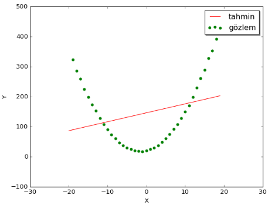
</p>

Gördüğün üzere, doğrusal regresyon yöntemi doğrusal olmayan noktalardan oluşan bir veri kümesine mantıklı bir doğru uyduramadı, ki bu aslında normal. Sonuçta bir parabolü doğruya ait iki parametre ile kestirmek mümkün değildir zaten. Peki bunun yerine parabolik bir fonksiyon deneseydik? Örneğin; $\hat{y} = \theta_0 + \theta_1x + \theta_2x^2$. O zaman olabilirdi. Ancak bu kez de üç parametreyi kestirmemiz gerekiyor.

Peki ya kestirmemiz gereken parametre sayısı yüzlerce olsaydı?

Bu durumda mümkünse parametrik olmayan bir yöntemi tercih etmek isteyebilirdik. Parametrik olmayan derken "parametresiz" demek istemiyorum tam tersi sonsuz sayıda parametreden bahsediyorum! Öyle ki, bu durumda bizim gözlemlere "uyan" (elimizdeki noktalara uydurduğumuz bir eğriyi temsil eden) *olası tüm fonksiyonları* taramamız gerekirdi.

Bu yeni durumda sonsuz olasılık var. Keza problemi pratik olarak çözülebilir hale getirmek için gözlemlerimizle ilgili bazı öncül bilgilerden yararlanabiliriz. Örneğin, $x$ değerlerinin $[-10, 10]$ aralığında değiştiğini varsayabiliriz. Ek olarak bu aralıkta üreteceğimiz fonksiyonlar arasından fonksiyon değerlerinin ortalaması $0$ olanları ve fonksiyonun Y-eksenindeki değişkenliği (dalgalanması) düşük olanları seçeceğiz diyebiliriz. Yani her bir $y$ değeri ortalaması sıfır olan ve varyansı küçük olasılık dağılımına sahip birer rassal değişkendir diye düşünebiliriz. Bunun ne anlama geldiğini anlamadıysan önemli değil, aşağıda çok detaylı inceleyeceğiz.

Aşağıdaki figürlerde çok değişken ve az değişken iki fonksiyon örneğe bakalım.

<p align="center">
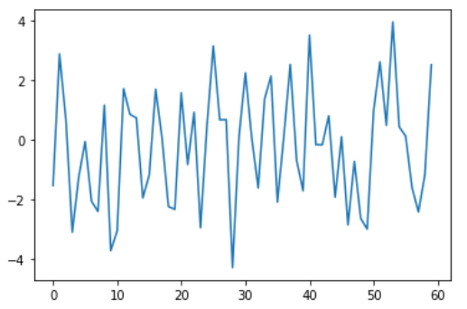
</p>

<p align="center">
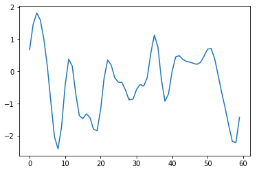
</p>

Gördüğün üzere ikinci figürdeki sinyalin değişkenliği daha az.

Emre: Seçtiğimiz fonksiyonun ne kadar değişken olduğunun formal bir ölçüsü var mı?

Kaan: Elbette. Fonksiyonun değişkenliğini tanımlamanın bir yolu *kovaryans matrisini* kullanmaktır. Anahtar fikir şudur; eğer kovaryans $x_i$ ve $x_j$'in  birbirine yakın olduğunu söylüyorsa fonksiyonun bu $x$ 'lere eşleşen $y_i$ ve $y_j$ değerlerinin de birbirine yakın olduğunu düşünebiliriz. Yani başka bir manada fonksiyonun giriş uzayında değerler birbirine yakın olursa çıkış uzayında da değerler birbirine yakın olur!

Bunun daha matematiksel tanımına bakalım.

## Gauss Süreci (Model)

## Öncül Dağılım (Prior Distribution)

Gauss Süreci Regresyonu'nda öncül olarak $x$ noktalarına eşleşen $f$ fonksiyon değerlerine ait ortak olasılık dağılımın Gauss Süreci olduğunu varsayarız. Dikkat et "eşleşen" dedim çünkü gerçekte fonksiyonun ne olduğunu (doğrusal ya da değil) bilmiyorum ve ne olduğu umrumda da değil. Ama bir şekilde $x$ değerlerinin bilemediğimiz bir ilişki ile $f$  değerlerine dönüştüğünü biliyoruz. Matematiksel dille;

<div>
$$
\begin{bmatrix}
x_1 \\
\vdots \\
x_N
\end{bmatrix} \rightarrow
\begin{bmatrix}
f(x_1) \\
\vdots \\
f(x_N)
\end{bmatrix}
$$
</div>

olarak görmek bize yeterlidir. Burası çok önemli, o yüzden tekrar edeyim. $x_1$'i alıp $f$ fonksiyonuna sokup, çıktı olarak $f(x_1)$'i hesaplayamıyoruz. Çünkü fonksiyonun ne olduğunu bilmiyoruz. Madem fonksiyonun ne olduğunu bilmiyoruz o zaman fonksiyonun alabileceği değerlerin her birini bir rassal değişken olarak modelleyip bu değişkenlerin olasılık dağılımlarını bulabiliriz. Yinede ifade ederken $f(x)$ şeklinde ifade ediyoruz ki fonksiyon değerinin hangi $x$'le eşleştiğini bilelim. Fonksiyonun her bir değerini bir rassal değişken olarak görmeye başladığımıza göre Gauss Sürecinde öncül dağılımın aşağıdaki rassal değişken vektörü

<div>
$$
\begin{bmatrix}
f(x_1) \\
\vdots \\
f(x_N)
\end{bmatrix}
$$
</div>

üzerinde çok-değişkenli Gauss dağılımı olduğunu söyleyebiliriz:

Formal olarak tanımlamak gerekirse;

$x_1, x_2,...,x_N$ setindeki herbir $x_i$ reel değerin ($\mathbf{x} \in \mathbb{R}^d$) rassal değişkeni olan bir $f(x_i)$ fonksiyonu olduğunu varsayalım. Bu durumda, $f_i = f(x_i)$ ve $f = [f_1,...,f_N]^T$ olmak kaydıyla, sınırlı sayıdaki $f_i$ rassal değişkenlerin herhangi bir kombinasyonunun ortak dağılımı olan $p(f_1,...,f_N)$ bir Gauss dağılımıdır ve şöyle ifade edebiliriz:

<div>
$$
p(f_1,...,f_N|X) = \mathcal{N}(f|\mu, K)
$$
</div>

öyle ki bu denklemde

<div>
$$
\begin{gathered}
\mu = [\mu(x_1),...,\mu(x_N)]^T \\
K_{ij} = k(x_i, x_j)
\end{gathered}
$$
</div>

diyebiliriz. Burada $p(f\vert X)$ artık bizim öncül dağılımımız.

Gördüğün üzere Gauss Sürecini aslında rassal değişkenlere ait ortalama vektörü $\mu$ ve kovaryans matrisi $K$ tanımlar.

* $\mu(x)$ burada $f(x_i)$ rassal değişkenlerinin $x_i$ lokasyonundaki ortalama hesaplayan fonksiyonlarını ifade eder. Yani $\mu(x)$ bir rassal değişken değil aslında bir fonksiyondur.

<div>
$$
\mu : \mathbb{R} \rightarrow \mathbb{R}
$$
</div>

Gauss sürecini tanımlamada aslında $\mu$ 'yü seçmek kolaydır. Genellikle $0$ seçilir ve bu bir çok gerçek hayat problemine uyacaktır.

* Diğer taraftan $K$ kovaryans matrisini temsil eder. Örneğin, $x_1$ ve $x_2$ ile eşleşen $f_1$ ve $f_2$ rassal değişkenleri arasındaki kovaryansı tanımlar. $K$'nın önemli bazı özellikleri vardır. Örneğin, $K$ aslında pozitif tanımlı bir $k$ çekirdek fonksiyonundan (<a href="https://en.wikipedia.org/wiki/Positive-definite_kernel">positive definite kernel function</a>) oluşturulur. Bu pozitif tanımlılık meselesine birazdan daha detaylı geleceğim. Aynı şekilde $k$ da rassal değişken değil, bir çift reel değer alıp reel değer döndüren bir fonksiyondur:

<div>
$$
k : \mathbb{R} \times \mathbb{R} \rightarrow \mathbb{R}
$$
</div>

Gauss sürecinde asıl anahtar mesele bu $K$ kovaryansını tanımlamaktan geçer. Bu konu önemli çünkü yukarıda tanımladığımız $f$ değerlerinin birbirine istatistiksel olarak bağımlı olduğunu varsayıyoruz. Öyle değilse zaten gözlemlediğimiz veriye bakarak gözlem yapmadığımız $x$ noktaları ile eşleşen $f$ değerleri için bir şey söylememiz mümkün değil. Bu bağımlılık meselesi çok-değişkenli dağılımlarda kovaryansın içinde ele alınır.

İstersen Gauss Sürecini daha iyi anlayabilmek için konunun biraz daha temeline inelim.

## Çok-değişkenli Gauss Dağılımı

Burada tanımını yaptığımız Gauss Sürecinin matematiksel temeli aslında çok-değişkenli Gauss dağılımına (<a href="https://en.wikipedia.org/wiki/Multivariate_normal_distribution">multivariate normal distribution</a>) dayanır. Tek değişkenli Gauss dağılımını hatırlarsın. Sadece ortalama ve varyanstan söz ediliyordu. İki-değişkenli (bivariate) Gauss dağılımını hayal etmek de zor değil. Bu durumda çan eğrisinin asıl şekli kovaryans matrisince belirlenir. Tepeden baktığımızda eş yükseklik eğrileri eksenlere hizalı elipsler (varyanslar eşitse mükemmel daireler) ise iki değişken ilintisizdir; Gauss değişkenler için bu aynı zamanda bağımsız oldukları anlamına gelir.

Örneğin $x_1$ ve $x_2$ rassal değişkenlerinin $p(x_1,x_2)$ ortak dağılımından $p(x_1)$ ve $p(x_2)$ marjinal dağılımlarını bulabiliriz. Görsel olarak çok-değişkenli Gauss dağılıma ait marjinal dağılımlar şöyle görünür:

<p align="center">
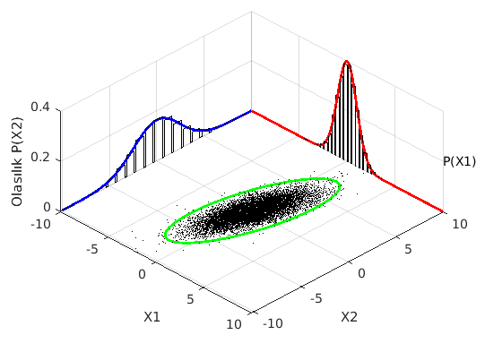
</p>

(Bu figür <a href="https://en.wikipedia.org/wiki/Multivariate_normal_distribution">multivariate normal distribution - Wikipedia</a> yardımıyla oluşturulmuştur.)

Biraz daha formal olmak gerekirse, eğer $x_1$ ve $x_2$ değişkenlerinin ortak olasılık dağılımı şöyleyse;

<div>
$$
\begin{bmatrix}
x_1 \\
x_2
\end{bmatrix} \sim \mathcal{N}{\left(\begin{bmatrix}
\mu_1 \\
\mu_2
\end{bmatrix}, \begin{bmatrix}
\sigma_{11} & \sigma_{12}\\
\sigma_{21} & \sigma_{22}
\end{bmatrix}
\right)}
$$
</div>

Değişkenlerin birinin verilmesi durumunda buradan ikinciye ait koşullu olasılığı bulabiliriz.

Örneğin $x_1$ rassal değişkeninin bilindiği durumda $x_2$ rassal değişkeninin koşullu olasılık dağılımını ortak dağılımdan elde edebiliriz. Bunu şöyle görselleştirebiliriz.

<p align="center">
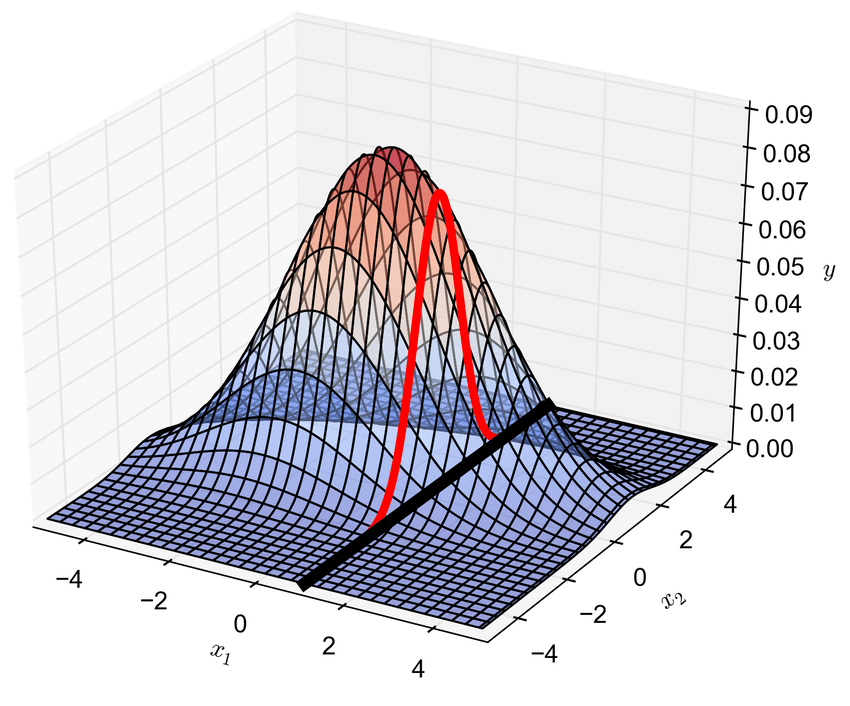
</p>

(Bu figür <a href="https://www.researchgate.net/figure/Linking-two-points-using-a-bivariate-Gaussian-distribution-enables-the-conditional-pdf_fig1_318429539">M. D. Piggott'ın makalesinden</a> alınmıştır.)

Seçtiğimiz örnekte $p(x_2\vert x_1)$ koşullu dağılımı da normal dağılımdır (Gauss dağılımı) ki burada üzerinde çalıştığımız boyutu azaltmış oluyoruz. Yeni koşullu olasılık dağılımı tek boyutlu bir dağılım.

Bu arada ortak dağılıma ait bağıntıyı $N$ değişkenli olarak kolayca genişletebilirsin sanırım. Ancak bu bağıntının nereden geldiğini anlıyorsun değil mi?

Emre: Evet, tek değişkenli dağılımın genişletilmiş formu. Tek değişkenli dağılım şöyleydi:

<div>
$$
x \sim \mathcal{N}(\mu, \sigma^2)
$$
</div>

Yani $x$ rassal değişkeninin aldığı değerler ortalaması $\mu$ ve varyansı $\sigma^2$ olan bir *normal* dağılımdan simüle edilerek ya da örneklerek üretiliyordu.

Yukarıdaki de bu ifadenin çok değişkenli formda yazılışı değil mi?.

Kaan: Aynen. Çok-değişkenli durumda vektörler ve matrisler oluşmaya başlıyor. Şimdi Gauss Süreci Regresyonunun kalbi sayılan kovaryans meselesini biraz daha derinden inceleyelim.

## Kovaryans Matrisi

Yukarıdaki iki değişkenli dağılımda her iki değişkenin varyansının $1$ olduğunu (ki figüre bakarsan öyle olmadığı aşikardır- bunu dağılımların genişliğine bakarak söyleyebiliriz- dağılımların biri diğerinden daha geniş) ve ilintisiz olduklarını varsayarsak, şöyle bir kovaryans matrisimiz olur;

<div>
$$
\Sigma = \begin{bmatrix}
 1& 0\\
 0& 1
\end{bmatrix}
$$
</div>

Hatırlarsan diyagonel değerler her bir değişkenin varyansını ve diyagonel olmayan değerlerse değişkenler arasındaki *kovaryansı* gösteriyordu. Kabaca söylersek kovaryans, bir değişkeni bilmenin bize diğeri hakkında ne kadar bilgi verdiğini söyler. İki değişken birbirinden bağımsız olduğunda kovaryans sıfır olacaktır. Yani o durumda bir rassal değişken hakkında bilgi sahibi olmak bize diğer rassal değişken hakkında hiç bilgi vermiyor demektir. Sonuçta "kovaryans" kelimesi İngilizce'de "co-vary" yani "birlikte değişim"den gelmektedir. Bu durumda yukarıdaki kovaryans matrisinin diyagonel olmayan elemanları sıfır olduğuna göre değişkenlerin ilintisiz (ve Gauss oldukları için bağımsız) olduğunu söyleyebiliriz.

Diğer bir konu da kovaryans matrisinin "simetrik ve pozitif yarı-tanımlı" olma şartı. Bunun üzerinde de biraz düşünmelisin. Neden simetrik ve pozitif yarı-tanımlı olmak zorunda?

Kovaryans matrisinin diyagonal olmayan elemanları iki değişkenin arasındaki kovaryansı gösterdiğinden tanımı gereği simetriktir. Bunu şöyle düşünebiliriz. Diyagonel olmayan elemanlar aslında

<div>
$$
\sigma(x,x_{\ast}) = E [(x-E(x))(x_{\ast}-E(x_{\ast}))]
$$
</div>
 olarak hesaplanır. Beklenti fonksiyonu $E$'nin içindeki $x$'li ve $x_{\ast}$'li parantezlerin yerini değiştirmek sonucu değiştirmez. Bu yüzden simetriktir. Burası anlaşılır. Peki neden pozitif yarı-tanımlı?

Rassal değişkenlerin herhangi bir doğrusal kombinasyonunu, herhangi bir $a$ vektörü için $a^Tx$'i, düşünelim. Bu kombinasyonun varyansı $\text{Var}(a^Tx) = a^T\Sigma a$'dır ve bir varyans asla negatif olamaz, çünkü bir dağılımın genişliğini ölçer. Yani her $a$ için $a^T\Sigma a \geq 0$'dır ve $\Sigma$'nın pozitif yarı-tanımlı olması da tam olarak bu demektir. <a href="https://www.visiondummy.com/2014/04/geometric-interpretation-covariance-matrix/">Geometrik</a> olarak bunun ne anlama geldiğini gösterebiliriz.

<p align="center">
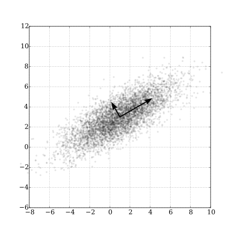
</p>

(Temel bileşen analizini temsil eden bu figürün orjinalini ve nasıl üretildiği hakkında daha geniş bilgiyi <a href="https://en.wikipedia.org/wiki/Principal_component_analysis">Wikipedia - temel bileşen analizi</a>'nde bulabilirsin.)

Figürde örnek bir kovaryans matrisinin öz-vektörleri görülüyor. Öz-vektörler verinin temel yönlerini, bunlara karşılık gelen öz-değerler (eigen-değerler) de verinin bu yönlerdeki varyanslarını gösterir. Varyanslar negatif olamayacağından kovaryans matrisinin öz-değerleri reel ve negatif olmayan değerlerdir. Formal matematiksel açıdan $N \times N$ boyutunda simetrik reel bir $K$ matrisi tüm $x\in\mathbb{R}^N$ için $x^TKx \geq 0$ koşulunu sağlıyorsa $K$ matrisi pozitif yarı-tanımlıdır ve bu, tüm öz-değerlerinin negatif olmamasına denktir.  Diğer yandan kovaryans matrisinin özellikleri hakkında daha çok şey öğrenmek için <a href="https://tr.wikipedia.org/wiki/Kovaryans_matrisi">Kovaryans matrisi- Wikipedia</a>'ya bakabilirsin.

Burada bir karışıklığı engellemek için şunu da ekleyeyim, sürekli Gauss dağılımından bahsederken beklenen değer yerine "ortalama" diyeceğim. Bunu şöyle açıklayabilirim; $\mathcal{N}{(\mu, \sigma^2)}$ dağılımından gelen $x_1, x_2,...,x_N$ gözlemlerinden bu dağılımın parametrelerini, $\hat{\theta} = (\hat{\mu}, \hat{\sigma}^2)$, <a href="https://en.wikipedia.org/wiki/Maximum_likelihood_estimation">Maksimum Olabilirlik Kestirimi</a> ile elde ederiz ve beklenen değer $\mu$'nün kestirimi de gözlemlerin aritmetik ortalaması çıkar. Yani

<div>
$$
 \hat{\mu} = \overline{X} \equiv \frac{1}{N} \sum_{i=1}^{N} x_i
$$
</div>

diyebiliriz. Bunu burada bir hatırlatma olarak geçmiş olayım ancak bu da kendi içinde derin bir mevzudur. Şöyle bir üzerinden geçmeni tavsiye ederim.

## Gauss Süreci Regresyon Yaklaşımı

## Sonsal Dağılımın (Posterior Distribution) Hesaplanması

Asıl konumuza geri dönelim. Sonsal dağılım elimizde bazı gözlemler varken elde etmek istediğimiz tahminler üzerindeki olasılık dağılımıdır. Tahminlerimizi bu dağılım üzerinden örnekler çekerek elde ederiz. Şimdiye dek bahsettiğimiz öncül Gauss Süreci sadece $x$'lerdeki fonksiyon değerlerinin olasılık dağılımını açıklıyordu. Tüm Bayesçi yöntemlerde olduğu gibi sonsal dağılım olabilirliğin (likelihood) ve öncül dağılımın birlikte kullanılmasıyla hesaplanır. Olabilirlik sonuç olarak öncül Gauss Süreci ile gözlemlediğimiz fonksiyon değerlerini birbirine ilişkilendirir. Bu ilişkiyi kullanarak sonsal dağılım hesaplanabilir.

Daha formal olmak gerekirse, elimizde bir kısmını gözlemlediğimiz $y$, bir kısmını henüz gözlemlemediğimiz $f_{\ast}=f(x_{\ast})$ rassal değişkenlerin ortak olasılık dağılımı var:

<div>
$$
\begin{bmatrix}
y \\
f_*
\end{bmatrix} \sim \mathcal{N}{\left(\begin{bmatrix}
\mu \\
\mu_*
\end{bmatrix}, \begin{bmatrix}
K_y & K_*\\
K_*^T & K_{\ast \ast}
\end{bmatrix}
\right)}
$$
</div>

öyle ki $\mu = \mu(x)$, $\mu_{\ast} = \mu(x_{\ast})$ ve  $K_y=k(x,x)+\sigma_y^2I$ yani çekirdek fonksiyonunu gözlemlediğimiz $x$ değerlerinin tüm ikilileri için hesaplayarak elde ettiğimiz matristir (köşegenine de gözlem gürültüsü eklenir). Yani $K_y$ matrisi bize gözlemlenen değerlerin birbirine benzerliği hakkında bilgi verir. Diğer yandan $K_{\ast}=k(x,x_{\ast})$ bize gözlemler ile fonksiyonunu tahmin etmeye çalıştığımız test noktaların ($x$ ekseninde) aralarındaki benzerliği verir. Son olarak $K_{\ast \ast}=k(x_{\ast}, x_{\ast})$ bize tahmin etmeye çalıştığımız test noktalarının ($x$ ekseninde yine) arasındaki benzerliği verir. Dikkat et kovaryans hesabında henüz rassal değişkenlerin değerlerini değil, sadece $x$ konumlarını kullanıyoruz. Kovaryans hesabında öncül dağılımla ilgili bilgileri oluşturuyoruz.

Yukarıdaki $K_y$'nin nereden geldiğini anlamak için $y$ rassal değişkeninden biraz daha bahsedelim. Bu değişkenin özelliği şudur; normalde $x$ değerleriyle eşleşen $f$ fonksiyon değerlerinden bahsediyorduk. Ancak bu fonksiyon değerlerini gözlemlerken bazı gözlem hataları yaptığımızı kabul ederek şimdi gözlemlerimizin $f$ fonksiyon çıktıları üzerine eklenmiş rastgele değerler olduğunu düşünüyoruz. Bu nedenle artık $y$ rassal değişkeni ortalaması gözlemlediğimiz noktadaki $f$ fonksiyon çıktısı olan ve varyansı da $\epsilon$ gürültü dağılımının varyansına denk olan bir rassal değişkendir diyebiliriz.

Yani $y$ rassal değişkenini şöyle ifade edebiliriz:

<div>
$$
y: y(x) = I_n f(x) + \epsilon
$$
</div>

ki $\epsilon \sim \mathcal{N}(0, \sigma_y^2)$ olduğunu varsayabiliriz. Burada yaptığımız şey aslında $f(x)$ rassal değişkeninin doğrusal transformasyonu ve üzerine $\epsilon$ olarak tanımlanan Gauss gürültüsünün eklenmesi. Dikkat bu $\epsilon$ gürültüsü her bir $f$ fonksiyon çıktısına bir diğerinden bağımsız olarak ekleniyor. Yani $\epsilon$ değerlerinin birbiriyle korelasyonunun olmadığını varsayıyoruz. Bu biraz kafa karıştırıcı olabilir. $f$ rassal değişkeninin bir varyansı vardı zaten bir de üzerine biz gürültü varyansını ekledik. Eklemesek olur muydu? Evet, ama bu model kurma meselesi. Gözlem hatalarını hesaba katmak istiyorsak eklememiz şart. Eklemezsek $f$ rassal değişkeninin modellemeye çalıştığı sistemin kendi içindeki istatistiksel dinamik ve belirsizlikle başbaşa kalırız. Ki bu çoğu zaman mümkün değildir.

Burada ince bir noktaya daha değineceğim. Bizim $y$ gözlemlerimiz $y(x)$ rassal değişkeninden geliyor. Öyleyse $f(x)$ rassal değişkenimiz aslında *saklı rassal değişkendir* (latent random variable) diyebiliriz.

Sonuçta $X$ değerlerinin fonksiyon çıktısı olarak gözlemleyebildiğimiz $y$ gözlemlerini kullanarak bazı $X_{\ast}$ değerleri için $f_{\ast}$ çıktılarını tahmin etmek istiyoruz. Bu yüzden

<div>
$$
p(f_{\ast}|X_{\ast},X,y)
$$
</div>

sonsal olasılık dağılımını bulmaya çalışıyoruz.

Diğer yandan burada baştan beri söylediğimiz gibi $y$ ve $f_{\ast}$ rassal değişkenlerinin $p(y, f_{\ast})$ ortak dağılımına sahip olduğunu varsaydık.

Burada basit görünen ama karmaşık bir geçiş yapmamız gerekiyor! Buraya dikkat! Yukarıdaki iki değişkenli örneği hatırla: ortak Gauss dağılımındaki değişkenlerden birini bildiğimizde diğerinin koşullu dağılımı da Gauss'tur ve onu doğrudan ortak dağılımın ortalama vektörü ile kovaryans matrisinden hesaplayabiliriz. Burada da tek değişkenler yerine vektörlerle tamamen aynı şey geçerli. $p(y, f_{\ast})$ ortak dağılımını $y$ gözlemlerine koşullandırırsak, sayfalarca süren cebirsel matris işlemleri sonucunda

<div>
$$
p(f_{\ast}|X_{\ast}, X, y)
$$
</div>

koşullu dağılımını kapalı formda elde ederiz.

Emre: Bu ne demektir?

Kaan: Açıklayayım, bu bize şunu söylüyor: $y$ gözlemleri ile tahmin etmek istediğimiz $f_{\ast}$ rassal değişkenlerinin ortak dağılımını bir kez yazdığımızda, $y$ gözlemleri elimizdeyken $f_{\ast}$'ın koşullu olasılık dağılımı, $p(f_{\ast}\vert y)$, doğrudan buradan çıkar ve o da bir Gauss dağılımıdır.

Bu çıkarımın nereden geldiğini merak ediyorsan konuyla ilgili akademik kaynak kitaplara bakman gerekecek. Bir çok kitapta Gauss dağılımları için bu koşullandırma kuralının ispatı var aslında.

Marjinal sonsal dağılım gördüğün üzere aslında *saklı rassal değişkenimiz* $f_{\ast}$ üzerine ifade edilmiş durumda. Tahminlerimizi gözlem hatalarını da hesaba kattığımız $y_{\ast}$ rassal değişkenleri üzerinden yapmak istersek $p(y_{\ast}\vert X_{\ast},X,y)$ tahminsel dağılımını da buradan kolayca elde edebiliriz: $y_{\ast} = f_{\ast} + \epsilon$ olduğundan kovaryansın köşegenine gürültü varyansı $\sigma_y^2$'yi eklememiz yeterli.

Öyleyse nihayetinde ulaşmak istediğimiz sonsal dağılım şöyledir:

<div>
$$
\color{blue}{p(f_{\ast}|X_{\ast},X,y) = \mathcal{N}{\left(\mu_{\ast}, \Sigma_{\ast}\right)}}
$$
</div>

Bu durumda tahminlerde kullanacağımız ortalama vektörü ve kovaryan matrisi şu şekilde olacaktır:

<div>
$$
\begin{gathered}
\color{blue}{\mu_{\ast} = \mu(X_{\ast}) + K_{\ast}^T K_y^{-1} (y - \mu(X))} \\
\color{blue}{\Sigma_{\ast} = K_{\ast \ast} - K_{\ast}^T K_y^{-1} K_{\ast}}
\end{gathered}
$$
</div>

Öncül ortalamamız sıfır olduğundan ilk ifade $\mu_{\ast} = K_{\ast}^T K_y^{-1} y$'ye sadeleşir. Matris boyutlarını yerine koyarsan göreceksin ki sonsal $\mu_{\ast}$ aslında $N_{\ast}$ uzunluğunda bir vektör ve sonsal kovaryans da aslında $N_{\ast} \times N_{\ast}$ boyutunda bir matris.

Bu durumda Gauss Süreç Regresyonu kullanarak tahmin yapmak için en azından elimizde bu iki istatistiğin olması şarttır. Yani tahminimiz bu ortalama vektörüne ve kovaryans matrisine sahip bir Gauss dağılımıdır.

Peki sonsal dağılımın gerçekten de ulaşmaya çalıştığımız fonksiyona en yüksek olasılığı verdiğini teorik olarak gösterebilir miyiz?

Emre: Evet, gürültüsüz durumda ($\sigma_y = 0$) $X_*$ gördüğümüz her yere $X$ koyabiliriz. O zaman $K_{\ast} = K_{\ast\ast} = K_y$ olur ve yukarıdaki iki ifade

<div>
$$
\begin{gathered}
\mu_{\ast} = y \\
\Sigma_{\ast} = 0
\end{gathered}
$$
</div>

olacaktır. Sonsal dağılım bir normal dağılımdı. Öyleyse en yüksek değerini ortalama değerde alacağına göre ve bizim gözlemlerimiz de ortalamaya denk geldiğine göre o zaman gözlemlerimiz bu dağılımdan en yüksek olasılıkla gelen örnekler olacaktır. Kaldı ki artık burada bir dağılımdan da bahsedemeyiz çünkü kovaryans sıfıra eşit! Yani gözlem noktalarında bu dağılımdan gelecek değerler sadece bizim gözlemlerimiz olacaktır. Bu durumda tahmin etmeye çalıştığımız fonksiyon değerleri gerçeğe en yakın olduğu yerde bu dağılımdan en yüksek olasılık değerleriyle dönecektir.

Kaan: Aynen. Öyleyse tahminlerimizi bu dağılımdan örnekler olarak çekmeye başlayabiliriz!

## Dağılımdan Örnek Çekmek (Sampling from a Distribution)

Emre: Dağılımdan örnek çekmek?

Kaan: Güzel bir noktaya değindin. Bir dağılımdan nasıl örnek çekebiliyorduk?

Hatırlarsan tek değişkenli durumda elimizde $x \sim \mathcal{N}{\left(\mu, \sigma^2\right)}$ varken, bunu "standart normaller" formunda

<div>
$$
x \sim \mu + \sigma\mathcal{N}{\left(0, 1\right)}
$$
</div>

şeklinde yazabiliyorduk. Standart normalleri herhangi bir matematik simülasyon programı ile üretebilirsin. Ancak tabi yine hatırlaman gereken bir nokta var. Standart normalden örnek çekmenin bir yolu ters dönüşüm örneklemesidir: tekdüze (uniform) dağılımdan çekilen örnekleri normal dağılımın birikimli dağılım fonksiyonunun (cumulative distribution function) tersinden geçiririz. Biz şimdi o konuya da girmeyelim! Ama yine de en az bir kez kendi elinle bunu yapan bir kod yazmanı tavsiye ederim.

Günün sonunda bizim de sonsal dağılımdan örnekler çekebilmek için çok değişkenli normal dağılımı benzer bir şekilde ifade etmemiz gerekiyor. Yani şu formda:

<div>
$$
f_{*} \sim \mu_{*} + L\mathcal{N}{(0, I)}
$$
</div>

öyle ki $L$ kovaryans matrisimizin karekökünü temsil ediyor olsun; yani,

<div>
$$
\Sigma_{*}=LL^T
$$
</div>

Emre: Peki bir matrisin karekökünü yani $L$'yi nasıl hesaplayabiliriz?

Kaan: Lineer cebir derslerinden  hatırlarsan, kovaryans matrisi gibi simetrik ve pozitif tanımlı bir matrisin karekökünü hesaplamak için <a href="https://en.wikipedia.org/wiki/Cholesky_decomposition">Cholesky Ayrıştırma yöntemini</a> kullanıyorduk. Sonsal dağılımı bu şekilde standart normaller cinsinden ifade edebilirsek bu dağılımdan kolayca örnekler çekebiliriz.

## Çekirdek Fonksiyonu ve Hiper-parametreler

Yalnız burada bir şey eklemem lazım. Tahminlerimize ait ortalama değere ait bir beklenti tasarlamak basit. Daha önce dediğim gibi beklenen değeri (ortalaması) sıfır olan fonksiyonları arıyoruz. Ancak öncül bilgilerle kovaryansı tanımlamamız biraz daha karmaşık bir iş. Sadece kovaryans çekirdek fonksiyonları üzerine yazılı kitaplar var! Biz maksat hasıl olsun diye basitçe _karesel eksponansiyel_ kovaryans fonksiyonunu seçelim. Bu çekirdek fonksiyonu literatürde "Gaussian kernel" ya da "radial basis function kernel" diye de geçer. Genel olarak çekirdek fonksiyonunu üzerinde çalıştığımız problemin türüne göre seçmemiz gerekiyor.

Emre: Yine de neden özellikle bu fonksiyonu seçtik?

Kaan: $x_1$ ve $x_2$ arasındaki mesafe sonsuza gidince bu fonksiyonun değeri sıfır oluyor, birbirine eşit olunca da üstel sıfır oluyor böylece eksponensiyelin değeri de $1$'e denk oluyor. Yani bu denklem bize $x$'lerin birbirine ne kadar yakın olduğunun bir ölçüsünü yani benzerliğini veriyor. En başta ne demiştik; giriş uzayındaki değerler birbirine ne kadar yakın olursa çıkış uzayında da o kadar yakın olurdu. Çekirdek fonksiyonu karesel exponansiyel olan bir dağılımdan gelen örnekler bizim bu varsayımımıza uyacak demektir.

$x_1$ ve $x_2$'deki rassal değişkenler arasındaki kovaryansı _karesel eksponansiyel_ fonksiyonla şöyle tanımlayabiliriz:

<div>
$$
\Sigma_{12}= k(x_1, x_2) = \sigma_f^2 \exp\left(-\frac{1}{2\lambda^2}|x_1 - x_2|^2\right)
$$
</div>

Bu ifadede $\lambda$'ya dikkat. $\lambda$'yı değiştirerek uzunluk ölçeğini kontrol edebiliriz. Denklemden de görüldüğü üzere, uzunluk ölçeği ne kadar büyükse iki nokta birbirinden o kadar uzak olup yine de güçlü bir korelasyona sahip olabilir. Yani uzaklık arttıkça iki değişken arasında bir korelasyon kalıp kalmayacağını belirleyen parametre. Örneğin aşağıdaki şekle bakalım.

<p align="center">
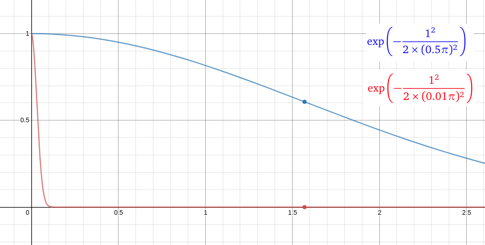
</p>

Bu figürde x ekseni bize $x_1$ ve $x_2$ rassal değişkeninin arasındaki mesafeyi gösterirken, Y ekseni bize bu iki rassal değişken arasındaki korelasyonu gösteriyor. Mavi eğri uzunluk ölçeğinin $0.5\pi$ ve kırmızı eğri de uzunluk ölçeğinin $0.01\pi$ olduğu durumda korelasyonun nasıl değiştiğini gösteriyor. Mesafenin tam olarak

<div>
$$
|x_1-x_2|=0.5\pi \approx 1.57
$$
</div>

olduğu noktada her iki eğrinin aldığı değerlere bakalım. Mavi eğrinin bu noktada yaklaşık $0.6$ korelasyon değerini gösterirken, kırmızı eğrinin 0 korelasyon gösterdiğini görüyoruz.

Yani kısaca diyebiliriz ki, uzunluk ölçeği sıfıra yaklaşırken, çekirdek değeri de sıfıra yaklaşır. Yani her iki değişken (tam olarak aynı noktada değillerse) birbirine ne kadar yakın olursa olsun aralarında korelasyon yok demektir. Diğer yandan uzunluk ölçeği sonsuza giderken, çekirdek değeri $1$'e yaklaşır. Yani her iki rassal değişken birbirinden ne kadar uzak olursa olsun aralarında mutlaka korelasyon vardır.

Bu durumda uzunluk ölçeğini üzerinde çalıştığımız probleme göre seçmemiz gerekir.

Bunun yanında bir hiperparametre ile tahmin edilen fonksiyon değerlerinin ortalamadan ne kadar sapabileceğini (değişkenliğini) de kontrol edebiliriz. Bunun için _sinyal varyansı_ diye isimlendirdiğimiz bir $\sigma_f^2$ değişkeni kullanıyoruz. $\sigma_f^2$ ne kadar küçükse fonksiyon değerleri ortalama değere o kadar yakın olacaktır.

Bu konu önemli. Çünkü eğer öncülümüzü kötü seçersek öncülden elde edeceğimiz fonksiyonlar arasında aslında aradığımız gerçek fonksiyon hiç olmayabilir. Bu nedenle öncül dağılımı tasarlarken beklediğimiz fonksiyona benzer fonksiyonlar üretip üretmediğine bakabiliriz. Diğer yandan gerçek fonksiyon hakkında hiçbir beklentimiz yoksa zaten yapacak bir şey yoktur ve öncülden gelen fonksiyonlara bakmanın bir anlamı da olmaz.

Emre: Biraz görselleştirsek bütün bunları?

Kaan: Makul!

Şimdi kodlayalım bu konuştuklarımızı.

## Kodlama- Öncül Dağılım Hesaplama

```python
import numpy as np
import matplotlib.pyplot as plt

np.random.seed(5) # sonuclar tekrarlanabilir olsun diye rasgele sayi uretecini sabitleyelim

# Gauss Süreci çekirdek fonksiyonu (karesel eksponansiyel)
# Hiperparametreler:
#                   lamda: uzunluk ölçeği
#                   var_f: sinyal varyansı
def kernel(a, b, lamda, var_f):
    sqdist = np.sum(a**2,1).reshape(-1,1) + np.sum(b**2,1) - 2*np.dot(a, b.T)
    return var_f*np.exp(-.5 * (1/lamda)**2 * sqdist)

# test noktası sayısı - çok değişkenli Gauss dağılımının boyut sayısı
N = 50

# örneklenecek fonksiyon sayısı
Nstar = 3

# çekirdek fonksiyonu hesabında varyansı temsil eden hiper-parametre
# (şimdilik basit olsun diye varyansın 1 olduğunu varsayalım)
var_f = (1)**2

# fonksiyonun uzunluk ölçeğini temsil eden hiper-parametre
l = 0.9

# y = f(x) + err ifadesindeki  gözlem hatasının (gürültü) olasılık dağılımının standart sapması
stdv_y = 0

# tahmin edeceğimiz fonksiyonların beklenen değerleri (ortalaması)
mu = 0

# fonksiyon değerlerini tahmin edeceğimiz noktaların x eksenindeki indeksleri (-10 ile 10 arasında)
X_test = np.linspace(-10, 10, N).reshape(-1,1)

# test noktalarının birbirine benzerliğini hesapla (var_f bir hiper-parametre)
Kss = kernel(X_test, X_test, l, var_f)

# numerik kararlılığı sağlayacak kadar küçük bir sayı (K'nın eigen-değerleri hızla küçülebilir) seç
eps = 1e-10

# Cholesky ayrıştırmasını yap ve kovaryansın karekökü L'yi geri döndür
L_ss = np.linalg.cholesky(Kss + eps*np.eye(N))

# standart normal ve L'yi kullanarak öncül dağılımdan örnekle: mu + L*N(0, I)
fprior = mu + L_ss @ np.random.normal(size=(N, Nstar))

# öncül dağılımdan örnek olarak çekilen fonksiyonları çizdir
plt.plot(X_test, fprior)
plt.axis([-10, 10, -3, 3])
plt.title('Gauss Süreci öncül dağılımından örneklenmiş %i fonksiyon' % Nstar)
plt.show()

# kovaryans fonksiyonunu çizdir
plt.title("Öncül kovaryans $K(X_*, X_*)$")
plt.contour(Kss)
plt.show()
```

<p align="center">
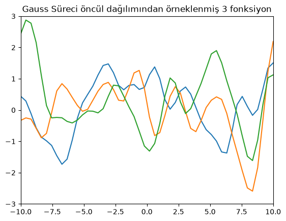
</p>

<p align="center">
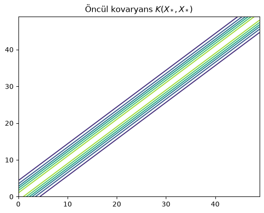
</p>

Birinci figürde Gauss Sürecinde oluşturduğumuz öncül dağılımdan örnekleyerek elde ettiğimiz 3 adet fonksiyonu görüyoruz. Bunlar öncül dağılımdan gelen fonksiyonlar ki olası tüm fonksiyonlar arasından seçtik bunları. Bu 3 örneği şöyle de düşünebiliriz; 50 boyutlu çok-değişkenli Gauss dağılımından alınmış 3 örnek vektör yani her bir vektörde 50 rassal değişken var. Burada yine Gauss Sürecinin fonksiyonlar üzerinde bir dağılım olduğunu hatırlıyoruz. Yani her bir vektörün olasılığını hesaplayabiliriz. Hangisini seçeceğimize sonsal dağılım hesabındaki Bayes kuralı karar verecek.

İkinci figürde bize öncül kovaryans fonksiyonunu (karesel eksponansiyel) gösteriyor ki, bu da bizim için giriş değerlerinin birbirine ne kadar benzediğini gösteriyor.

Buradan itibaren gözlemler üzerinden sonsal dağılımı hesaplayıp, test noktalarında sonsal dağılımdan örnekleme nasıl yapılıyor ona yapalım.

## Kodlama- Sonsal Dağılım Hesaplama ve Tahminleme

Gerçekte bir sinüs fonksiyonundan gözlemler alalım (tabiki bizim modelimiz fonksiyonun sinüs olduğunu bilmiyor) ve yukarıda bahsettiğimiz matematiksel yöntemleri kullanarak sonsal dağılımdan üç örnek fonksiyon çekelim.

```python
# fonksiyon gözlemleri ile eşleşen X indekslerini oluştur (eğitim verisi sayılır)
X_train = np.array([-4, -3, -2, -1, 1, 2, 3, 4, 5, 6]).reshape(10,1)

# stdv_y'yi sıfır seçtiğimizde gürültüsüz (gözlem hatası olmayan) durumu (y= f(x) + 0) simüle ediyoruz
y_train = np.sin(X_train) + stdv_y*np.random.randn(10,1)

# gözlemlerle eşleşen X indeksleriyle çekirdek fonksiyonunu hesaplayalım
K = kernel(X_train, X_train, l, var_f)

# K_y = K + sigma_y^2 I matrisinin karekökünü bulalım (numerik kararlılık için çok küçük bir sayı da ekleyelim)
L = np.linalg.cholesky(K + (stdv_y**2 + eps)*np.eye(len(X_train)))

# test noktalarında beklenen değerleri (ortalama vektörü) hesapla
Ks = kernel(X_train, X_test, l, var_f)
Lk = np.linalg.solve(L, Ks)
mu = np.dot(Lk.T, np.linalg.solve(L, y_train)).reshape((N,))

# standart sapmayı hesapla
s2 = np.diag(Kss) - np.sum(Lk**2, axis=0)
stdv = np.sqrt(np.maximum(s2, 0))

# test noktalarında sonsal dağılımdan örnek fonksiyonlar çek
L = np.linalg.cholesky(Kss + 1e-6*np.eye(N) - np.dot(Lk.T, Lk))
fpost = mu.reshape(-1,1) + np.dot(L, np.random.normal(size=(N,3)))

plt.plot(X_train, y_train, 'bs', ms=8, label='Gözlem')
plt.plot(X_test, fpost)
plt.gca().fill_between(X_test.flat, mu-2*stdv, mu+2*stdv, color="#dddddd", label='95% Güven Aralığı')
plt.plot(X_test, mu, 'r--', lw=2, label='Ortalama')
plt.axis([-10, 10, -3, 3])
plt.title('GS sonsal dağılımdan örneklenmiş 3 fonksiyon')
plt.legend(loc='lower left')
plt.show()
```
Dikkat edersen kod $K_y$'nin tersini hiçbir zaman doğrudan almıyor. Bunun yerine $K_y$'nin Cholesky çarpanı $L$'yi kullanıp üçgen denklem sistemleri çözüyor; bu aynı $\mu_{\ast}$ ve $\Sigma_{\ast}$'yi verir ama numerik olarak çok daha kararlıdır.

Şimdi sonsal dağılımdan örneklenmiş fonksiyonları gösteren figürü inceleyelim.

<p align="center">
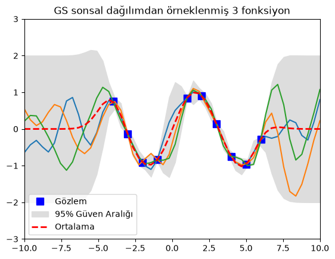
</p>

Mavi kutucuklara (gözlemlerin olduğu noktalar) dikkat et. Sonsal dağılımdan seçtiğimiz tüm fonksiyonlar (tahminlerimiz) o noktalardan geçiyor. Kırmızı kesik çizgi beklenen değeri (alabileceği tüm değerlerin ortalaması), gri alan da ortalamanın iki standart sapma çevresini gösteriyor. Gözlem noktalarında (mavi kutular) bu gri alanların sıfır olması normal çünkü simülasyonu ilk çalıştırdığımızda gözlemlere hiç gürültü eklemedik ($\sigma_y = 0$). Figürün en sağına ya da en soluna gittikçe sapmanın çok büyüdüğünü görüyoruz. Yani gözlemlerden uzaklaştıkça tahminlerimizin belirsizliği gittikçe büyüyor. Ta ki yeni gözlem gelene kadar da öyle olacaktır. Yeni gözlem gelince o noktanın çevresinde belirsizlik azalacaktır.

## Gürültü (Noise)

Şimdi bir de modele gürültü (gözlemlerdeki belirsizlik) eklendiğinde nasıl çalıştığına bakalım. Bu durumda $\sigma_y = 0.2$ yapalım. O zaman sonuç aşağıdaki gibi olacaktır.

<p align="center">
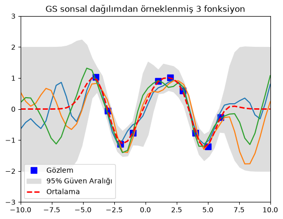
</p>

Dikkat et gri alan artık gözlemlerin olduğu noktalarda bile sıfıra inmiyor ve örneklenen fonksiyonlar gözlemlerden tam olarak geçmek zorunda kalmıyor. Çünkü gözlem verisinde bir belirsizlik olduğunu biliyoruz. Bu yüzden güven aralığı o bölgelerde bile sıfıra gitmiyor.

## İleri Seviye Konular

### Parametre Öğrenme
Gauss Süreç Regresyonunda çekirdek fonksiyonunun seçilmesi, optimal hiper-parametrelerin bulunması (*parametre öğrenme*), model karmaşıklığının ölçülmesi, model performansının ölçülmesi ve gözlem belirsizliğine ait gürültü dağılımının varyans kestirimi başlı başına araştırma konuları olmakla birlikte o kadar detaya burada girmeyeceğim. Yine de fikir versin diye birkaç hususa değineceğim.

Örnek olarak $\sigma_y$'ı ele alalım. $\sigma_y$'ı ya gözlem verisinden Maksimum Olabilirlik Kestirimi yaparak bulmak zorundayız ya da üzerine bir öncül dağılım koyabiliriz. Tek bir gürültü varyansı için yaygın bir seçim, <a href="https://en.wikipedia.org/wiki/Inverse-Wishart_distribution">ters-Wishart</a> dağılımının tek boyutlu özel hali olan ters-Gamma dağılımıdır. Ters-Wishart dağılımı Bayesçi istatistikte çok-değişkenli normal dağılıma ait kovaryans matrisinin konjuge öncülü olarak kullanılır; ters-Gamma da varyansı bilinmeyen normal dağılımın varyansı için konjuge öncüldür. Buna <a href="https://en.wikipedia.org/wiki/Prior_probability#Uninformative_priors">bilgilendirici-olmayan</a> öncülle başlayıp analitik olarak takip edilebilir bir konjuge öncüle (bilgilendirici öncül) ihtiyaç duyduğumuzda başvururuz.

Bir başka konu Hiyerarşik Bayesçi Modelleme (HBM). Çoğu zaman gerçek hayatta öncül dağılımın parametrelerini en baştan bilmiyoruz. Bu durumda öncül dağılımın parametrelerini çapraz doğrulama, Bayesçi kestirim veya Maksimum Olabilirlik Kestirimi ile bulabiliriz. Öncülün parametrelerini verinin kendisinden, tipik olarak marjinal olabilirliği maksimize ederek kestirmeye formal olarak Ampirik Bayes deniliyor çünkü Bayesçi parametreleri öğrenmek için deneysel veriyi kullanıyoruz. Tam Bayesçi bir senaryoda ise öncül dağılımın parametrelerini bir başka dağılımla açıklamaya çalışabiliriz ki buna Hiyerarşik Bayesçi Modelleme (HBM) deniliyor. HBM'de dikkat edilmesi gereken bir şey var, o da sonuçların, öncül dağılımın parametreleri için seçtiğimiz dağılımın hiper-parametrelerindeki küçük değişikliklere hassas olmaması gerekliliği. Yani hiper-parametre biraz değişince öncül dağılımda yüksek miktarda değişime sebep olmaması lazım. Bu açıdan gerçek dünya problemlerinde hiper-parametreler üzerinde hassasiyet analizi yapmak önemlidir.

### Model Karmaşıklığı ve Model Başarımı

Makine öğrenmesinde yaygın olarak bilinen bir başarım problemi kurduğumuz modelin sonunda *aşırı uyum gösterme* (overfitting) ya da *yetersiz uyum* (underfitting) göstermesidir.

Aşırı uyum gösterme ne zaman oluyor buna bir bakalım.

Model karmaşıklığının bir parametresi olan uzunluk ölçeğinin (çekirdek fonksiyon hesabında) $0$'a yaklaştığını varsayalım. O zaman gözlemlerden uzaktaki test noktalarında sonsal ortalama $\mu_{\ast}$ $0$, sonsal varyans da $1$ (sinyal varyansı $\sigma_f^2$) çıkacaktı.

Bunun anlamı şudur: $f_{\ast}$ rassal değişkenleri $f$ değişkenlerinden istatistiksel olarak bağımsız olduğundan modelimiz $f$'in verildiği durumlarda $f_{\ast}$ hakkında hiçbir şey bilmiyor. Bu nedenle sonsal ortalama öncül ortalama olan $0$ çıkıyor.

Aynı zamanda modelimizin test noktalarındaki ortalama tahminindeki belirsizlik en üst düzeyde. Bu yüzden burada da en yüksek varyansı raporluyor. Yani uzunluk ölçeğini çok küçülttüğümüzde rassal değişkenler arasında hiç korelasyon kalmadığından eğitim verisinin (yani gözlemlerimizin) tam olarak gözlenen noktalar dışında yapacağımız tahminlere hiçbir faydası olmuyor. Model gözlemleri ezberliyor ama genelleyemiyor. Buna aşırı uyum gösterme deniliyor.

Peki tersini yapsaydık? Yani uzunluk ölçeği sonsuza gitse ne olurdu?

O zaman tüm fonksiyon değerleri birbiriyle tam korelasyonlu olacağından model sadece sabit bir fonksiyonu temsil edebilecekti: $\mu_{\ast}$ gözlemlerin ağırlıklı bir ortalaması ve $\Sigma_{\ast} = 0$ çıkacaktı. Yani bu kez de modelimiz kendinden aşırı emin olacaktı. Bunun sebebi de basit. Uzunluk ölçeği sonsuz büyüklükte olduğunda bir rassal değişkenin tüm değişkenlerle tam korelasyonu oluyor. Yani elimizde $f$ olduğunda model tüm bilgiye sahip olduğunu düşünüyor, $f_{\ast}$ modele hiç bir bilgi sunmuyor. Yani kovaryans $0$ oluyor! Buna da yetersiz uyum deniliyor.

Pratikte hiper-parametreler gözlemlerin marjinal olabilirliği maksimize edilerek öğrenilir. Bu marjinal olabilirlik hem veriye uyum terimini hem de model karmaşıklığı cezasını içerir ve bu ikisi ters yönlere çeker. Bu aslında iyi haber: birbirlerini otomatik olarak dengelerler. Öyle olmasaydı model karmaşıklığını kontrol altında tutmak için başka bir parametre icat etmemiz gerekecekti.

Herneyse bunlar ileri seviye konular. Gördüğün üzere modelin başarımını baştan belirlemek ya da başarım performansını ölçme konusu da kendi içinde çok derin bir konu.

## Gerçek Hayat

İleri seviye konuları sadece yöntemi küçümsememen ve gerçek hayat problemlerini çözmeye çalıştığında müracaat etmen gereken bazı fikirlerden bahsetmek istedim.

Son figüre dönersek. Gördüğün üzere gözlemlerdeki belirsizlik arttıkça bu gözlemlere dayalı tahminlere olan güven azalıyor ki zaten mantıken de öyle olması lazımdı.

Unutmaman gereken bir başka konu da şu ki; Gauss Süreç Regresyon modelini kurarken bizim karar vermemiz gereken üç parametre vardı;

1. Fonksiyon ortalamasının sıfır olduğunu varsaydık
2. Çekirdek fonksiyonunun karesel eksponansiyel olduğunu varsaydık
3. Gözlem rassal değişkeninin saklı değişkenden doğrusal bir transformasyon ve Gauss gürültüsü eklenerek elde edilebildiğini varsaydık.

Bu kararları verdikten sonrası klasik olasılık teorisinin mekanik işlemleri. Unutmamalısın ki, üzerinde çalıştığımız her problem bu üç varsayımı değiştirebilir.

Evet buraya kadar Gauss Süreç Regresyonu'nun nasıl çalıştığını anlatmaya çalıştım. Umarım faydası olmuştur.

Emre: Elbette, kabaca ne yapmaya çalıştığımızı anladım. Ancak gerçek hayatta nerede kullanıldığına dair örnekler yok mu?

Kaan: Olmaz mı. Örneğin insanların tercihleri üzerinden model kurulması gereken işlerde (kullanıcı tercihlerinin anlaşılması vs) kullanılıyor. Bir başka örnek; insan yürüyüşü, dinozor yürüyüşü, yangın, patlama vesair animasyonların yapımında dinamik modeller kuruluyor. Model parametrelerinin hassas ayarlanması ile de animasyonlar insan algısında gerçek gibi görülecek şekilde geliştiriliyor. Düşük çözünürlüklü animasyonlar insanlara izletilerek puanlandırmaları isteniyor. İnsanların gerçeklik algısı bir şekilde bu animasyonlar üzerinde puanlanarak model parametreleri son halini alıyor. Gauss Süreç Regresyonu insanların tercihlerini birer fonksiyon olarak modelleyerek bunu başarmamıza yardımcı oluyor. Tabiki süreç Bayesçi olarak başlatıldığından ilk başta öncül bilgilerle başlayan model sonuçta gerçekçi oluyor. Daha sonra bu parametreleri kullanarak yüksek çözünürlüklü "rendering" yapılıyor. Böylece işlemsel olarak çok masraflı bir iş düşük işlemci maliyeti ile çözülmüş oluyor.

Gauss Süreçleri sadece regresyon probleminde değil, sınıflandırma problemlerinde de kullanılır. Örneğin bir resim arama motoru düşün. "Kedi" kelimesiyle resim aratırsın. Arama motoru kedi olduğunu düşündüğü bir çok resmi getirir. Kediye en çok benzeyeni tıklarsın. Kullanıcıların çoğunun ilk olarak tıklamayı tercih ettiği resmin kediye en çok benzeyen resim olduğu kabul edilirse, tıklamalar birer oy gibi kullanılabilir ve en çok tıklanan resimler yüksek bir oylama oranıyla "kedi" olarak sınıflandırılabilir. Daha sonra arama motoru bu öncül bilgiyi "kedi" sınıflandırmasının doğruluğunu artırmak için kullanarak kedi arayan sonraki kullanıcılara kediye daha çok benzeyen resimler getirebilir.

## İşlem Karmaşıklığı

Tam Gauss Süreç Regresyonu $N \times N$ boyutundaki $K_y$ matrisini ayrıştırmak (ya da tersini almak) zorundadır; bu da $N$ gözlem için $O(N^3)$ işlem ve $O(N^2)$ bellek demektir. Birkaç bin gözlem için bu sorun değildir, ama daha büyük veri kümelerinde maliyeti azaltmak için yaklaşık yöntemler (örneğin daha küçük bir "indükleyici nokta" kümesi kullanan seyrek Gauss süreçleri) kullanılır. Diğer yandan da dikkat edersen sonsal dağılımdan elde ettiğimiz ortalama vektörü ve kovaryans matrisinde modeli eğitmek için kullanılan gözlemler var. Yani parametrik modellerde olduğu gibi eğitim esnasında gözlemleri kullanıp, parametreleri öğrendikten sonra gözlemleri çöpe atamıyoruz. Bu nedenle Gauss Süreçleri büyük veriler üzerinde çalışırken bellek bakımından çok etkin sayılmaz.

## Tavsiyeler

Herneyse, unutmadan, Gauss Süreç Regresyon yönteminin bu tür karmaşık problemlerde kullanılabilmesi için <a href="https://www.python.org/">Python</a> dilinde çeşitli kütüphaneler yazılmıştır. Bunlardan <a href="https://scikit-learn.org/stable/modules/generated/sklearn.gaussian_process.GaussianProcessRegressor.html">Scikit-learn</a>'e bakmanı tavsiye ederim ya da Kevin P. Murphy'nin <a href="https://www.cs.ubc.ca/~murphyk/MLbook/">Machine Learning: A Probabilistic Perspective</a> kitabını edinebilirsen kitaptaki örneklerin kod kütüphanesinden <a href="https://github.com/probml/pmtk3">PMTK3 Toolkit</a> yararlanabilirsin. Çok güzel bir kitaptır!

Bir de Gauss Süreçleri ile ilgili daha derin matematiksel okuma yapmak istersen Cambridge Üniversitesi'den David MacKay'in <a href="http://www.inference.org.uk/mackay/gpB.pdf">ders notlarını</a> da tavsiye ederim. Özellikle tek gizli katmanlı bir yapay sinir ağının nöron sayısı sonsuza giderken bir Gauss sürecine yakınsadığını anlattığı kısım ilgini çekebilir!


## Referanslar
1. <a href="https://www.cs.ubc.ca/~murphyk/MLbook/">Machine Learning: A Probabilistic Perspective</a>
2. <a href="https://www.cs.ubc.ca/~nando/540-2013/lectures.html">Nando de Freitas Lecture Notes</a>
3. <a href="https://www.cs.ubc.ca/~nando/540-2013/lectures/gp.py">Simple Python demo codes for GPR</a>

<a href="https://www.freecounterstat.com" title="visitor counters"></a>
