Emre: Can you explain how Gaussian processes can define a distribution over infinitely many functions, and what that is good for?!

Kaan: Of course. The classic reference on how Gaussian Processes are used for regression and classification in machine learning is Rasmussen and Williams' book <a href="http://www.gaussianprocess.org/gpml/">Gaussian Processes for Machine Learning</a>, published by MIT Press in 2006. If you are curious about all the details, you can get it and read it, but let me try to explain the fundamentals of Gaussian Process Regression here as I understand them.

You may remember that we looked at the solutions of the linear regression problem with classical statistics and with <a href="https://tayyarg.github.io/bayesian-inference-and-linear-regression/">Bayesian inference</a>. Gaussian Processes are another option for solving regression problems. In this sense, Gaussian Process Regression is used to make _inferences_ about, and/or _predictions_ of, functions that we cannot compute analytically. You can see its applications in many areas, such as predicting end-user product preferences, consumer demand forecasting, modeling human behavior, algorithmic trading, and modeling animations in computer games.

## Problem

Above, I said functions that we cannot compute analytically. I want you to think broadly when I say function. For example, let's say I'm looking for a list of cities you could move to. Suppose I listed some city names and asked you to give each one a score between one and a hundred depending on how much you like it. If you scored these cities based on what you already know about them, what would we be doing? At the end of a lot of computations in your brain, you would be producing an output by making some choices as a function of your ideas and feelings. You would give reliable scores, based on your observations, to the cities you know well, while you would more or less guess the scores of cities you hear about for the first time (we can call this observation error). So, can we find out what this function in your brain is?

Not exactly, but we can define it as a probabilistic process and make some reasonable inferences. This is a complex problem. To understand how Gaussian Process Regression can help us here, let's go back to the simple regression problem we discussed before.

Remember, we had a variable $y$ that was a function of an independent variable $x$, and we defined it as:

<div>
$$
y = f(x) + \epsilon
$$
</div>

where $\epsilon$ represents the error that we cannot reduce to zero (the uncertainty in our observations), and in the previous problem we assumed that the function $f$ describes a linear relationship (which it might not! For example, a model of our preferences would be a nonlinear function).

<div>
$$
f : X \rightarrow Y
$$
</div>

and the function $f$ took real values and returned real values:

<div>
$$
f : \mathbb{R} \rightarrow \mathbb{R}
$$
</div>

Using observations from this model, we tried to estimate the parameters $\theta_0$ and $\theta_1$, which define the intercept and the slope of the function $f$.

Going one step beyond classical regression, we then looked at the Bayesian approach. Bayesian linear regression provided a probabilistic approach to the problem by finding a new distribution over the parameters every time a new observation arrived. Now let's notice something here: Gaussian Process Regression is a non-parametric approach. Instead of a distribution over parameters, it helps us find a distribution over *all possible functions* $f(x)$ that are consistent with the observations.

Emre: All possible functions! What exactly does that mean?

Kaan: To better grasp what this means, let's look at an example. If we apply linear regression to observations from a parabolic curve, we get the following result.

<p align="center">
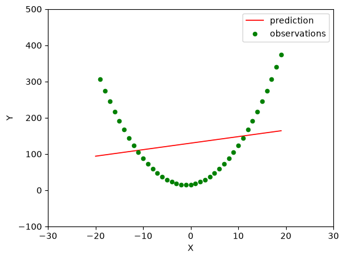
</p>

As you can see, linear regression could not fit a meaningful line to a data set made of nonlinear points, which is actually normal. After all, it is impossible to estimate a parabola with the two parameters of a line. What if we tried a parabolic function instead, for example $\hat{y} = \theta_0 + \theta_1x + \theta_2x^2$? Then it could work. But this time, we need to estimate three parameters.

What if the number of parameters we needed to estimate were in the hundreds?

In that case, we might prefer a non-parametric method if possible. By non-parametric, I don't mean "without parameters"; on the contrary, I'm talking about infinitely many parameters! In this case, we would have to search over *all possible functions* that "fit" our observations (that represent a curve fitted to the points we have).

In this new situation, there are infinitely many possibilities. However, to make the problem practically solvable, we can use some prior knowledge about our observations. For example, we can assume that the $x$ values vary in the interval $[-10, 10]$. In addition, we can say that among the functions we generate in this interval, we will choose those whose function values have a mean of $0$ and whose variability (fluctuation) along the Y-axis is low. In other words, we can think of each $y$ value as a random variable with a probability distribution that has zero mean and a small variance. Don't worry if this doesn't make sense yet; we'll examine it in detail below.

Let's look at two example functions in the figures below, one with high variability and one with low variability.

<p align="center">
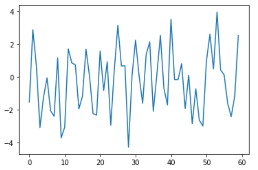
</p>

<p align="center">
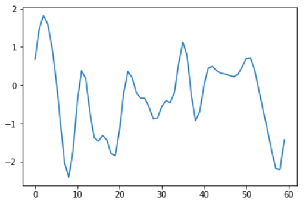
</p>

As you can see, the signal in the second figure varies less.

Emre: Is there a formal measure of how variable the chosen function is?

Kaan: Of course. One way to define the variability of a function is to use a *covariance matrix*. The key idea is this: if the covariance says that $x_i$ and $x_j$ are close to each other, then we can expect the function values $y_i$ and $y_j$ that correspond to these $x$'s to be close to each other as well. In other words, if values are close to each other in the input space of the function, they are also close to each other in the output space!

Let's look at a more mathematical definition of this.

## Gaussian Process (Model)

## Prior Distribution

In Gaussian Process Regression, as the prior, we assume that the joint probability distribution of the function values $f$ that correspond to the points $x$ is a Gaussian Process. Notice that I said "correspond", because I don't actually know what the function is (linear or not), and I don't care. But we know that somehow, through a relationship we cannot know, the $x$ values turn into $f$ values. In mathematical terms, it is enough for us to see this as:

<div>
$$
\begin{bmatrix}
x_1 \\
\vdots \\
x_N
\end{bmatrix} \rightarrow
\begin{bmatrix}
f(x_1) \\
\vdots \\
f(x_N)
\end{bmatrix}
$$
</div>

This point is very important, so let me repeat it. We cannot take $x_1$, put it into the function $f$, and compute the output $f(x_1)$, because we don't know what the function is. Since we don't know what the function is, we can model each value the function can take as a random variable and find the probability distributions of these variables. We still write it as $f(x)$ so that we know which $x$ the function value corresponds to. Now that we see each value of the function as a random variable, we can say that the prior distribution in a Gaussian Process is a multivariate Gaussian distribution over the following vector of random variables:

<div>
$$
\begin{bmatrix}
f(x_1) \\
\vdots \\
f(x_N)
\end{bmatrix}
$$
</div>

To define it formally:

Let's assume that for each real value $x_i$ ($\mathbf{x} \in \mathbb{R}^d$) in the set $x_1, x_2,...,x_N$, there is a random variable $f(x_i)$. Then, with $f_i = f(x_i)$ and $f = [f_1,...,f_N]^T$, the joint distribution $p(f_1,...,f_N)$ of any finite collection of the random variables $f_i$ is a Gaussian distribution, which we can write as:

<div>
$$
p(f_1,...,f_N|X) = \mathcal{N}(f|\mu, K)
$$
</div>

where

<div>
$$
\begin{gathered}
\mu = [\mu(x_1),...,\mu(x_N)]^T \\
K_{ij} = k(x_i, x_j)
\end{gathered}
$$
</div>

Here, $p(f\vert X)$ is now our prior distribution.

As you can see, a Gaussian Process is actually defined by the mean vector $\mu$ and the covariance matrix $K$ of the random variables.

* Here, $\mu(x)$ is the function that gives the mean of the random variable $f(x_i)$ at the location $x_i$. So $\mu(x)$ is not a random variable; it is actually a function.

<div>
$$
\mu : \mathbb{R} \rightarrow \mathbb{R}
$$
</div>

When defining a Gaussian process, choosing $\mu$ is actually easy. It is usually chosen as $0$, and this will fit many real-life problems.

* On the other hand, $K$ represents the covariance matrix. For example, it defines the covariance between the random variables $f_1$ and $f_2$ that correspond to $x_1$ and $x_2$. $K$ has some important properties. For example, $K$ is built from $k$, a <a href="https://en.wikipedia.org/wiki/Positive-definite_kernel">positive definite kernel function</a>. I'll come back to this positive definiteness issue in more detail shortly. Like $\mu$, $k$ is not a random variable either; it is a function that takes a pair of real values and returns a real value:

<div>
$$
k : \mathbb{R} \times \mathbb{R} \rightarrow \mathbb{R}
$$
</div>

The real key in a Gaussian process is defining this covariance $K$. This matters because we assume that the $f$ values we defined above are statistically dependent on each other. If they weren't, we couldn't say anything about the $f$ values at the $x$ points we haven't observed by looking at the data we have observed. In multivariate distributions, this dependence is captured by the covariance.

If you like, let's dig a bit deeper into the foundations of the topic to understand Gaussian Processes better.

## Multivariate Gaussian Distribution

The mathematical foundation of the Gaussian Process we defined here is actually the <a href="https://en.wikipedia.org/wiki/Multivariate_normal_distribution">multivariate normal distribution</a>. You remember the univariate Gaussian distribution; we only talked about a mean and a variance. It's not hard to imagine a bivariate Gaussian distribution either. In this case, the actual shape of the bell curve is determined by the covariance matrix. If, looking from the top, the contours of the bell are ellipses aligned with the axes (or perfect circles when the variances are equal), the two variables are uncorrelated, and for Gaussian variables, this also means they are independent.

For example, from the joint distribution $p(x_1,x_2)$ of the random variables $x_1$ and $x_2$, we can find the marginal distributions $p(x_1)$ and $p(x_2)$. Visually, the marginal distributions of a multivariate Gaussian distribution look like this:

<p align="center">
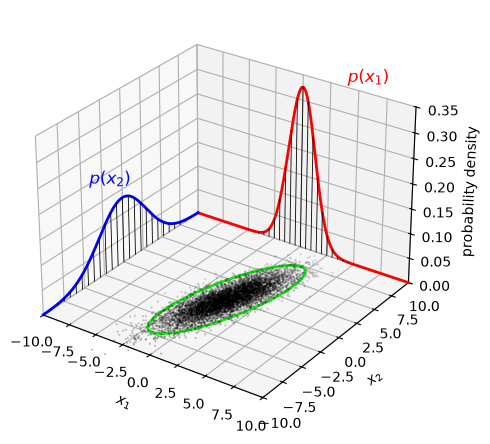
</p>

(This figure was created with the help of <a href="https://en.wikipedia.org/wiki/Multivariate_normal_distribution">multivariate normal distribution - Wikipedia</a>.)

To be a bit more formal, if the joint probability distribution of the variables $x_1$ and $x_2$ is

<div>
$$
\begin{bmatrix}
x_1 \\
x_2
\end{bmatrix} \sim \mathcal{N}{\left(\begin{bmatrix}
\mu_1 \\
\mu_2
\end{bmatrix}, \begin{bmatrix}
\sigma_{11} & \sigma_{12}\\
\sigma_{21} & \sigma_{22}
\end{bmatrix}
\right)}
$$
</div>

then, when one of the variables is given, we can find the conditional probability of the other one from it.

For example, when the random variable $x_1$ is known, we can obtain the conditional probability distribution of the random variable $x_2$ from the joint distribution. We can visualize this as follows.

<p align="center">
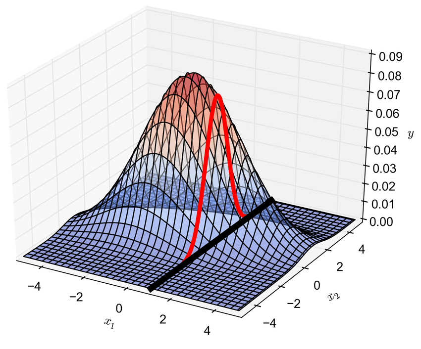
</p>

(This figure is taken from <a href="https://www.researchgate.net/figure/Linking-two-points-using-a-bivariate-Gaussian-distribution-enables-the-conditional-pdf_fig1_318429539">a paper by M. D. Piggott</a>.)

In our example, the conditional distribution $p(x_2\vert x_1)$ is also a normal (Gaussian) distribution, and here we reduce the number of dimensions we are working with. The new conditional probability distribution is a one-dimensional distribution.

By the way, I think you can easily extend the joint distribution to $N$ variables. But you understand where this expression comes from, right?

Emre: Yes, it's the extended form of the univariate distribution. The univariate distribution was:

<div>
$$
x \sim \mathcal{N}(\mu, \sigma^2)
$$
</div>

That is, the values of the random variable $x$ were generated by simulating, or sampling, from a *normal* distribution with mean $\mu$ and variance $\sigma^2$.

And the expression above is just this written in multivariate form, isn't it?

Kaan: Exactly. In the multivariate case, vectors and matrices start to appear. Now let's examine the covariance, which is the heart of Gaussian Process Regression, a bit more deeply.

## Covariance Matrix

In the bivariate distribution above, if we assumed that the variance of both variables is $1$ (which is clearly not the case if you look at the figure; we can tell from the widths of the distributions, since one is wider than the other) and that they are uncorrelated, we would have the following covariance matrix:

<div>
$$
\Sigma = \begin{bmatrix}
 1& 0\\
 0& 1
\end{bmatrix}
$$
</div>

Remember that the diagonal values show the variance of each variable, and the off-diagonal values show the *covariance* between the variables. Roughly speaking, the covariance tells us how much knowing one variable tells us about the other. When the two variables are independent, the covariance is zero; in that case, knowing something about one random variable gives us no information about the other. After all, the word "covariance" comes from "co-vary". Since the off-diagonal elements of the covariance matrix above are zero, we can say that the variables are uncorrelated (and, since they are Gaussian, independent).

Another point is the requirement that the covariance matrix must be "symmetric and positive semi-definite". You should think about this a little. Why does it have to be symmetric and positive semi-definite?

The off-diagonal elements of the covariance matrix show the covariance between two variables, so it is symmetric by definition. We can think of it this way. The off-diagonal elements are computed as

<div>
$$
\sigma(x,x_{\ast}) = E [(x-E(x))(x_{\ast}-E(x_{\ast}))]
$$
</div>

Swapping the parentheses with $x$ and $x_{\ast}$ inside the expectation $E$ doesn't change the result. That's why it is symmetric. That part is clear. So why positive semi-definite?

Take any linear combination of the random variables, $a^Tx$, for any vector $a$. Its variance is $\text{Var}(a^Tx) = a^T\Sigma a$, and a variance can never be negative, because it measures the width of a distribution. So $a^T\Sigma a \geq 0$ for every $a$, which is exactly what it means for $\Sigma$ to be positive semi-definite. We can also show what this means <a href="https://www.visiondummy.com/2014/04/geometric-interpretation-covariance-matrix/">geometrically</a>.

<p align="center">
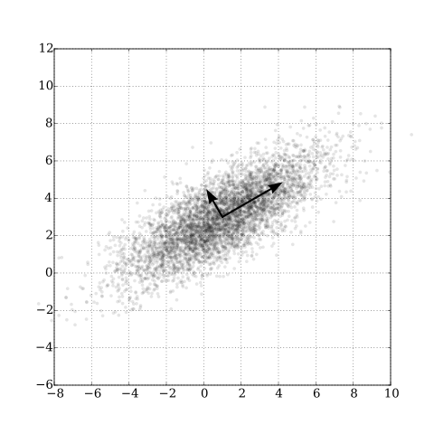
</p>

(You can find the original of this figure, which illustrates principal component analysis, and more information on how it was produced in <a href="https://en.wikipedia.org/wiki/Principal_component_analysis">Wikipedia - principal component analysis</a>.)

The figure shows the eigenvectors of an example covariance matrix. They point in the principal directions of the data, and the corresponding eigenvalues are the variances of the data along those directions. Since variances can't be negative, the eigenvalues of a covariance matrix are real and non-negative. Formally, an $N \times N$ symmetric real matrix $K$ is positive semi-definite if $x^TKx \geq 0$ for all $x\in\mathbb{R}^N$, which is equivalent to all its eigenvalues being non-negative. To learn more about the properties of the covariance matrix, you can check <a href="https://en.wikipedia.org/wiki/Covariance_matrix">Covariance matrix - Wikipedia</a>.

To prevent a confusion here, let me also add that when talking about the Gaussian distribution, I'll keep saying "mean" instead of expected value. I can explain this as follows: from observations $x_1, x_2,...,x_N$ that come from a $\mathcal{N}{(\mu, \sigma^2)}$ distribution, we estimate the parameters of the distribution, $\hat{\theta} = (\hat{\mu}, \hat{\sigma}^2)$, with <a href="https://en.wikipedia.org/wiki/Maximum_likelihood_estimation">Maximum Likelihood Estimation</a>, and the estimate of the expected value $\mu$ turns out to be the arithmetic mean of the observations. That is,

<div>
$$
 \hat{\mu} = \overline{X} \equiv \frac{1}{N} \sum_{i=1}^{N} x_i
$$
</div>

I'm only mentioning this here as a reminder, but this is a deep topic in itself. I recommend you go over it once.

## Gaussian Process Regression Approach

## Computing the Posterior Distribution

Let's get back to our main topic. The posterior distribution is the probability distribution over the predictions we want to make, given some observations. We get our predictions by drawing samples from this distribution. The prior Gaussian Process we have talked about so far only described the probability distribution of the function values at the $x$'s. As in all Bayesian methods, the posterior distribution is computed by using the likelihood and the prior distribution together. The likelihood connects the prior Gaussian Process to the function values we observed. Using this connection, the posterior distribution can be computed.

To be more formal, we have the joint probability distribution of the random variables $y$, which we have observed, and $f_{\ast}=f(x_{\ast})$, which we haven't observed yet:

<div>
$$
\begin{bmatrix}
y \\
f_*
\end{bmatrix} \sim \mathcal{N}{\left(\begin{bmatrix}
\mu \\
\mu_*
\end{bmatrix}, \begin{bmatrix}
K_y & K_*\\
K_*^T & K_{\ast \ast}
\end{bmatrix}
\right)}
$$
</div>

where $\mu = \mu(x)$, $\mu_{\ast} = \mu(x_{\ast})$, and $K_y=k(x,x)+\sigma_y^2I$, i.e., the matrix we get by evaluating the kernel function at all pairs of the observed $x$ values (plus the observation noise on the diagonal). So the matrix $K_y$ tells us how similar the observed points are to each other. On the other hand, $K_{\ast}=k(x,x_{\ast})$ tells us how similar the observations are to the test points (on the $x$ axis) where we are trying to predict the function. Finally, $K_{\ast \ast}=k(x_{\ast}, x_{\ast})$ tells us how similar the test points (again on the $x$ axis) are to each other. Notice that in the covariance calculation, we don't use the values of the random variables yet, only the $x$ locations. In the covariance, we encode our prior knowledge.

To understand where $K_y$ above comes from, let's talk a bit more about the random variable $y$. Its property is this: so far, we were talking about the function values $f$ that correspond to the $x$ values. But now we accept that we make some errors while observing these function values, so we think of our observations as random values added on top of the function outputs $f$. Therefore, we can say that $y$ is a random variable whose mean is the output of the function $f$ at the observed point and whose variance is the variance of the noise distribution $\epsilon$.

So we can express the random variable $y$ as follows:

<div>
$$
y: y(x) = I_n f(x) + \epsilon
$$
</div>

where we can assume that $\epsilon \sim \mathcal{N}(0, \sigma_y^2)$. What we are doing here is actually a linear transformation of the random variable $f(x)$, followed by adding the Gaussian noise defined as $\epsilon$. Note that this noise $\epsilon$ is added to each function output $f$ independently of the others; that is, we assume the $\epsilon$ values are not correlated with each other. This can be a bit confusing. The random variable $f$ already had a variance, and on top of it we added the noise variance. Would it be okay not to add it? Yes, but this is a matter of modeling. If we want to take observation errors into account, we have to add it. If we don't, we are left only with the statistical dynamics and uncertainty within the system that the random variable $f$ is trying to model, which is often not realistic.

Let me touch on one more subtle point here. Our observations $y$ come from the random variable $y(x)$. So we can say that our random variable $f(x)$ is actually a *latent random variable*.

In the end, we want to predict the outputs $f_{\ast}$ for some values $X_{\ast}$, using the observations $y$ that we can see as the function outputs of the values $X$. That's why we are trying to find the posterior probability distribution

<div>
$$
p(f_{\ast}|X_{\ast},X,y)
$$
</div>

On the other hand, as we've said from the beginning, we assumed that the random variables $y$ and $f_{\ast}$ have the joint distribution $p(y, f_{\ast})$ above.

Here, we need to make a transition that looks simple but is actually quite involved! Pay attention! Remember the bivariate example above: when we know one of the variables of a joint Gaussian distribution, the conditional distribution of the other one is also Gaussian, and we can compute it directly from the mean vector and covariance matrix of the joint distribution. Exactly the same thing works here, with vectors instead of single variables. If we condition the joint distribution $p(y, f_{\ast})$ on the observations $y$, after pages of matrix algebra, we get the conditional distribution

<div>
$$
p(f_{\ast}|X_{\ast}, X, y)
$$
</div>

in closed form.

Emre: What does this mean?

Kaan: Let me explain. It means that once we write down the joint distribution of the observations $y$ and the random variables $f_{\ast}$ we want to predict, the conditional distribution of $f_{\ast}$ given the observations $y$, $p(f_{\ast}\vert y)$, follows directly from it, and it is also a Gaussian.

If you are wondering where this derivation comes from, you'll need to look at the academic textbooks on the subject. Many books contain the proof of this conditioning rule for Gaussian distributions.

As you can see, the marginal posterior distribution is actually expressed over our *latent random variables* $f_{\ast}$. If we want to make our predictions over the random variables $y_{\ast}$, which also take the observation errors into account, we can easily get the predictive distribution $p(y_{\ast}\vert X_{\ast},X,y)$ from it: since $y_{\ast} = f_{\ast} + \epsilon$, we just add the noise variance $\sigma_y^2$ to the diagonal of the covariance.

So the posterior distribution we want to reach is:

<div>
$$
\color{blue}{p(f_{\ast}|X_{\ast},X,y) = \mathcal{N}{\left(\mu_{\ast}, \Sigma_{\ast}\right)}}
$$
</div>

In this case, the mean vector and the covariance matrix we will use in our predictions are:

<div>
$$
\begin{gathered}
\color{blue}{\mu_{\ast} = \mu(X_{\ast}) + K_{\ast}^T K_y^{-1} (y - \mu(X))} \\
\color{blue}{\Sigma_{\ast} = K_{\ast \ast} - K_{\ast}^T K_y^{-1} K_{\ast}}
\end{gathered}
$$
</div>

With our zero prior mean, the first expression simplifies to $\mu_{\ast} = K_{\ast}^T K_y^{-1} y$. If you substitute the matrix dimensions, you'll see that the posterior mean $\mu_{\ast}$ is a vector of length $N_{\ast}$ and the posterior covariance is an $N_{\ast} \times N_{\ast}$ matrix.

So, to make predictions with Gaussian Process Regression, we need at least these two statistics. That is, our prediction is a Gaussian distribution with this mean vector and covariance matrix.

So, can we show theoretically that the posterior distribution really gives the highest probability to the function we're trying to reach?

Emre: Yes. In the noise-free case ($\sigma_y = 0$), we can put $X$ wherever we see $X_*$. Then $K_{\ast} = K_{\ast\ast} = K_y$, and the two expressions above become

<div>
$$
\begin{gathered}
\mu_{\ast} = y \\
\Sigma_{\ast} = 0
\end{gathered}
$$
</div>

The posterior distribution is a normal distribution. It takes its highest value at the mean, and since our observations are equal to the mean, our observations will be the samples that come from this distribution with the highest probability. In fact, we can't even talk about a distribution here anymore, because the covariance is zero! That is, the only values that can come from this distribution at the observed points are our observations. So the function values we're trying to predict will come out of this distribution with the highest probability where they are closest to the truth.

Kaan: Exactly. So we can start drawing our predictions as samples from this distribution!

## Sampling from a Distribution

Emre: Drawing samples from a distribution?

Kaan: You touched on a good point. How did we draw samples from a distribution?

Remember, in the univariate case, when we had $x \sim \mathcal{N}{\left(\mu, \sigma^2\right)}$, we could write it in terms of "standard normals" as

<div>
$$
x \sim \mu + \sigma\mathcal{N}{\left(0, 1\right)}
$$
</div>

You can generate standard normals with any mathematical simulation program. But of course, there's still a point you need to remember. One way to draw a sample from a standard normal is inverse transform sampling: you pass samples from a uniform distribution through the inverse of the normal distribution's cumulative distribution function. Let's not get into that now! But I still recommend that you write code that does this with your own hands at least once.

At the end of the day, to be able to draw samples from the posterior distribution, we need to express the multivariate normal distribution in a similar way. That is, in this form:

<div>
$$
f_{*} \sim \mu_{*} + L\mathcal{N}{(0, I)}
$$
</div>

where $L$ represents the square root of our covariance matrix; that is,

<div>
$$
\Sigma_{*}=LL^T
$$
</div>

Emre: So how can we compute the square root of a matrix, i.e., $L$?

Kaan: If you remember from linear algebra courses, to compute the square root of a symmetric positive definite matrix like a covariance matrix, we used the <a href="https://en.wikipedia.org/wiki/Cholesky_decomposition">Cholesky decomposition</a>. If we can express the posterior distribution in terms of standard normals like this, we can easily draw samples from it.

## Kernel Function and Hyper-parameters

But I need to add something here. Designing a prior expectation for the mean of our predictions is simple. As I said before, we are looking for functions whose expected value (mean) is zero. However, defining the covariance from prior knowledge is a bit more complicated. There are entire books written just on covariance kernel functions! For the sake of the example, let's simply choose the _squared exponential_ covariance function. This kernel function is also known as the "Gaussian kernel" or the "radial basis function kernel" in the literature. In general, we need to choose the kernel function according to the type of problem we are working on.

Emre: Still, why did we choose this function in particular?

Kaan: When the distance between $x_1$ and $x_2$ goes to infinity, the value of this function goes to zero, and when they are equal, the exponent becomes zero, so the exponential equals $1$. So this equation gives us a measure of how close the $x$'s are to each other, i.e., their similarity. Remember what we said at the very beginning: the closer the values are in the input space, the closer they will be in the output space. Samples from a distribution with a squared exponential kernel will match this assumption of ours.

We can define the covariance between the random variables at $x_1$ and $x_2$ with the _squared exponential_ function as follows:

<div>
$$
\Sigma_{12}= k(x_1, x_2) = \sigma_f^2 \exp\left(-\frac{1}{2\lambda^2}|x_1 - x_2|^2\right)
$$
</div>

Pay attention to $\lambda$ in this expression. By changing $\lambda$, we can control the length scale. As you can see from the equation, the larger the length scale, the further apart two points can be while still being strongly correlated. That is, it's the parameter that determines whether there will be any correlation left between two variables as the distance between them increases. For example, let's look at the figure below.

<p align="center">
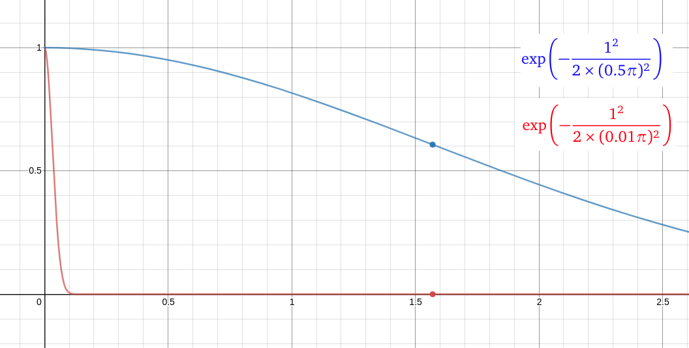
</p>

In this figure, the x-axis shows the distance between $x_1$ and $x_2$, and the y-axis shows the correlation between the two random variables. The blue curve shows how the correlation changes when the length scale is $0.5\pi$, and the red curve when the length scale is $0.01\pi$. Let's look at the values of both curves at the point where the distance is exactly

<div>
$$
|x_1-x_2|=0.5\pi \approx 1.57
$$
</div>

At this point, we see that the blue curve shows a correlation of about $0.6$, while the red curve shows a correlation of $0$.

So, in short, as the length scale approaches zero, the kernel value approaches zero, which means that there is no correlation between the two variables, no matter how close they are to each other (unless they are at exactly the same point). On the other hand, as the length scale goes to infinity, the kernel value approaches $1$, which means that the two random variables are always correlated, no matter how far apart they are.

So we need to choose the length scale according to the problem we're working on.

In addition, with another hyper-parameter, we can also control how much the predicted function values can deviate from the mean (their variability). For this, we use a variable $\sigma_f^2$, which we call the _signal variance_. The smaller $\sigma_f^2$ is, the closer the function values will be to the mean.

This is important. If we choose our prior badly, the true function we're looking for may not be among the functions we get from the prior at all. Therefore, when designing the prior distribution, we can check whether it generates functions similar to the one we expect. On the other hand, if we have no expectations about the true function, there isn't much we can do, and looking at the functions from the prior doesn't make much sense either.

Emre: Can we visualize all this a bit?

Kaan: Sure!

Let's code what we've talked about.

## Coding - Computing the Prior Distribution

```python
import numpy as np
import matplotlib.pyplot as plt

np.random.seed(5) # fix the random seed so the results are reproducible

# Gaussian Process kernel function (squared exponential)
# Hyper-parameters:
#                   lamda: length scale
#                   var_f: signal variance
def kernel(a, b, lamda, var_f):
    sqdist = np.sum(a**2,1).reshape(-1,1) + np.sum(b**2,1) - 2*np.dot(a, b.T)
    return var_f*np.exp(-.5 * (1/lamda)**2 * sqdist)

# number of test points - the dimension of the multivariate Gaussian distribution
N = 50

# number of functions to sample
Nstar = 3

# hyper-parameter representing the signal variance in the kernel function
# (for simplicity, let's assume the variance is 1 for now)
var_f = (1)**2

# hyper-parameter representing the length scale of the function
l = 0.9

# standard deviation of the observation error (noise) in y = f(x) + err
stdv_y = 0

# expected value (mean) of the functions we will predict
mu = 0

# x-axis locations of the points where we will predict the function values (between -10 and 10)
X_test = np.linspace(-10, 10, N).reshape(-1,1)

# compute how similar the test points are to each other
Kss = kernel(X_test, X_test, l, var_f)

# a small number for numerical stability (the eigenvalues of K can get very small)
eps = 1e-10

# Cholesky decomposition: the square root L of the covariance
L_ss = np.linalg.cholesky(Kss + eps*np.eye(N))

# sample from the prior distribution using standard normals and L: mu + L*N(0, I)
fprior = mu + L_ss @ np.random.normal(size=(N, Nstar))

# plot the functions sampled from the prior distribution
plt.plot(X_test, fprior)
plt.axis([-10, 10, -3, 3])
plt.title('%i functions sampled from the Gaussian Process prior' % Nstar)
plt.show()

# plot the covariance function
plt.title("Prior covariance $K(X_*, X_*)$")
plt.contour(Kss)
plt.show()
```

<p align="center">
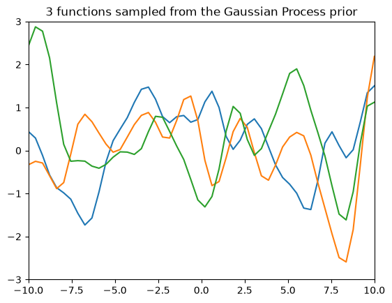
</p>

<p align="center">
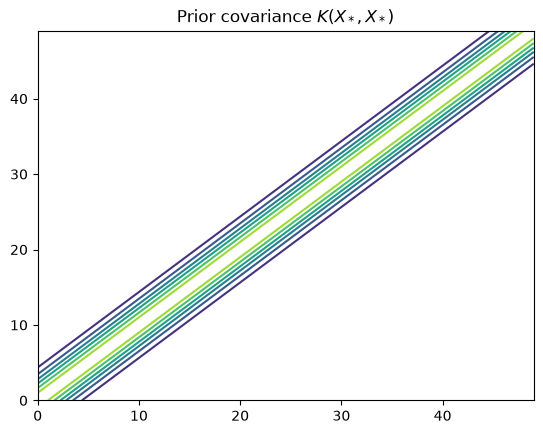
</p>

In the first figure, we see 3 functions obtained by sampling from the prior distribution we built with the Gaussian Process. These are functions from the prior distribution, chosen from among all possible functions. We can also think of these 3 samples as 3 vectors sampled from a 50-dimensional multivariate Gaussian distribution, i.e., each vector contains 50 random variables. Here, we are reminded again that a Gaussian Process is a distribution over functions. That is, we can compute the probability of each vector. Bayes' rule in the posterior distribution calculation will decide which ones to choose.

The second figure shows the prior covariance function (squared exponential), which tells us how similar the input values are to each other.

From here on, let's compute the posterior distribution from the observations and see how sampling from the posterior distribution works at the test points.

## Coding - Computing the Posterior Distribution and Prediction

Let's take observations from what is actually a sine function (of course, our model doesn't know that the function is a sine) and draw three sample functions from the posterior distribution using the mathematical methods we talked about above.

```python
# create the X locations that match the function observations (this is our training data)
X_train = np.array([-4, -3, -2, -1, 1, 2, 3, 4, 5, 6]).reshape(10,1)

# choosing stdv_y as zero simulates the noise-free case (y = f(x) + 0)
y_train = np.sin(X_train) + stdv_y*np.random.randn(10,1)

# compute the kernel function at the X locations of the observations
K = kernel(X_train, X_train, l, var_f)

# find the square root of K_y = K + sigma_y^2 I (plus a tiny number for numerical stability)
L = np.linalg.cholesky(K + (stdv_y**2 + eps)*np.eye(len(X_train)))

# compute the expected values (mean vector) at the test points
Ks = kernel(X_train, X_test, l, var_f)
Lk = np.linalg.solve(L, Ks)
mu = np.dot(Lk.T, np.linalg.solve(L, y_train)).reshape((N,))

# compute the standard deviation
s2 = np.diag(Kss) - np.sum(Lk**2, axis=0)
stdv = np.sqrt(np.maximum(s2, 0))

# draw sample functions from the posterior distribution at the test points
L = np.linalg.cholesky(Kss + 1e-6*np.eye(N) - np.dot(Lk.T, Lk))
fpost = mu.reshape(-1,1) + np.dot(L, np.random.normal(size=(N,3)))

plt.plot(X_train, y_train, 'bs', ms=8, label='Observations')
plt.plot(X_test, fpost)
plt.gca().fill_between(X_test.flat, mu-2*stdv, mu+2*stdv, color="#dddddd", label='95% confidence interval')
plt.plot(X_test, mu, 'r--', lw=2, label='Mean')
plt.axis([-10, 10, -3, 3])
plt.title('3 functions sampled from the GP posterior')
plt.legend(loc='lower left')
plt.show()
```

Notice that the code never inverts $K_y$ directly. Instead, it uses the Cholesky factor $L$ of $K_y$ and solves triangular systems with it, which gives the same $\mu_{\ast}$ and $\Sigma_{\ast}$ but is much more stable numerically.

Now let's examine the figure showing the functions sampled from the posterior distribution.

<p align="center">
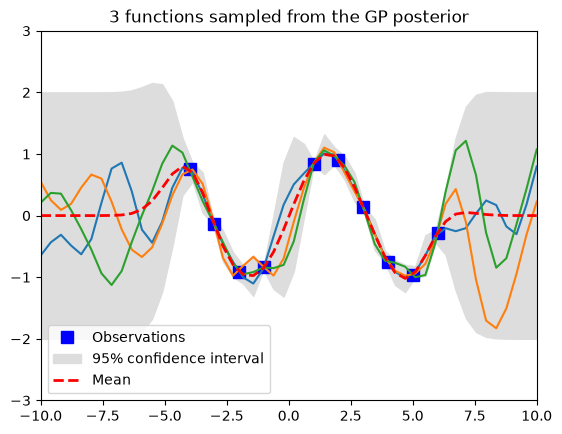
</p>

Pay attention to the blue squares (the points where we have observations). All the functions we drew from the posterior distribution (our predictions) pass through those points. The red dashed line shows the expected value (the mean of all the values the function can take), and the gray area shows two standard deviations around the mean. It's normal that these gray areas are zero at the observation points (blue squares), because in this first run, we didn't add any noise to the observations ($\sigma_y = 0$). We see that the deviation grows a lot as we go to the far right or far left of the figure. That is, the further we get from the observations, the larger the uncertainty of our predictions becomes. And it will stay like that until a new observation arrives. When a new observation comes in, the uncertainty will decrease around that point.

## Noise

Now let's see how it works when noise (uncertainty in the observations) is added to the model. Let's set $\sigma_y = 0.2$. Then the result looks like this:

<p align="center">
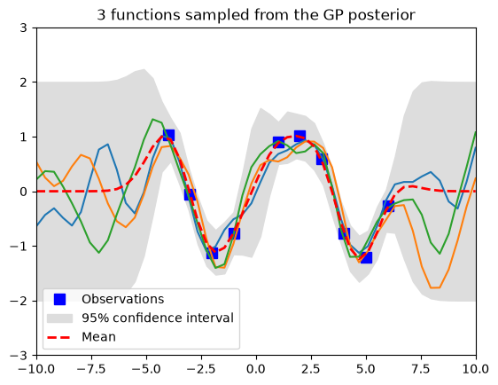
</p>

Notice that the gray area no longer shrinks to zero, even at the observation points, and the sampled functions no longer have to pass exactly through the observations. That's because we know there is some uncertainty in the observation data. Therefore, the confidence interval doesn't go to zero even in those regions.

## Advanced Topics

### Parameter Learning
In Gaussian Process Regression, choosing the kernel function, finding the optimal hyper-parameters (*parameter learning*), measuring model complexity, measuring model performance, and estimating the variance of the noise distribution of the observation uncertainty are research topics in their own right, and I won't go into that much detail here. Still, I'll touch on a few points to give you an idea.

As an example, let's consider $\sigma_y$. We either have to find $\sigma_y$ from the observation data with Maximum Likelihood Estimation, or put a prior distribution on it. For a single noise variance, a common choice is the inverse-Gamma distribution, which is the one-dimensional special case of the <a href="https://en.wikipedia.org/wiki/Inverse-Wishart_distribution">inverse-Wishart</a> distribution. In Bayesian statistics, the inverse-Wishart distribution is used as the conjugate prior for the covariance matrix of a multivariate normal distribution, and the inverse-Gamma is the conjugate prior for the unknown variance of a normal distribution. We turn to these when, instead of starting with an <a href="https://en.wikipedia.org/wiki/Prior_probability#Uninformative_priors">uninformative</a> prior, we need an analytically tractable conjugate (informative) prior.

Another topic is Hierarchical Bayesian Modeling (HBM). In real life, we often don't know the parameters of the prior distribution from the start. In this case, we can find the parameters of the prior distribution with cross-validation, Bayesian estimation, or Maximum Likelihood Estimation. Estimating the prior's parameters from the data itself, typically by maximizing the marginal likelihood, is formally called Empirical Bayes, because we use the experimental data to learn the Bayesian parameters. In a fully Bayesian scenario, we can instead describe the parameters of the prior distribution with yet another distribution, which is called Hierarchical Bayesian Modeling (HBM). There's one thing to be careful about in HBM: the results shouldn't be sensitive to small changes in the hyper-parameters of the distribution we choose for the prior's parameters. That is, a small change in a hyper-parameter shouldn't cause a large change in the prior distribution. In this respect, it's important to do a sensitivity analysis on the hyper-parameters in real-world problems.

### Model Complexity and Model Performance

A well-known performance problem in machine learning is that the model we build ends up *overfitting* or *underfitting*.

Let's look at when overfitting happens.

Let's assume that the length scale (in the kernel function), which is a parameter of model complexity, approaches $0$. Then, at test points away from the observations, the posterior mean $\mu_{\ast}$ would come out as $0$, and the posterior variance would come out as $1$ (the signal variance $\sigma_f^2$).

This means that since the random variables $f_{\ast}$ are statistically independent of the variables $f$, our model knows nothing about $f_{\ast}$ when $f$ is given. That's why the posterior mean comes out as $0$, the prior mean.

At the same time, the uncertainty of our model's mean prediction at the test points is at its highest level. That's why it reports the highest variance here as well. In other words, when we make the length scale very small, no correlation remains between the random variables, so the training data (i.e., our observations) is of no use for our predictions anywhere except exactly at the observed points. The model memorizes the observations but can't generalize. This is called overfitting.

What if we did the opposite? What would happen if the length scale went to infinity?

Then all the function values would be perfectly correlated with each other, so the model could only represent a constant function: $\mu_{\ast}$ would come out as a weighted average of the observations, and $\Sigma_{\ast} = 0$. This time, our model would be overconfident. The reason is simple: when the length scale is infinitely large, every random variable is fully correlated with all the others. So once we have $f$, the model thinks it has all the information, and $f_{\ast}$ adds no new information to it. That's why the covariance becomes $0$! This is called underfitting.

In practice, the hyper-parameters are learned by maximizing the marginal likelihood of the observations. This marginal likelihood contains both a data-fit term and a model complexity penalty, and these two pull in opposite directions. This is actually good news: they balance each other automatically. If they didn't, we would have to invent another parameter to keep the model complexity under control.

Anyway, these are advanced topics. As you can see, determining the performance of a model in advance, or measuring its performance, is a very deep topic in itself.

## Real Life

I wanted to mention the advanced topics only so that you don't underestimate the method, and to point to some ideas you should turn to when you try to solve real-life problems.

Let's go back to the last figure. As you can see, as the uncertainty in the observations increases, the confidence in the predictions based on these observations decreases, which is how it should logically be.

Another thing you shouldn't forget is that, while building the Gaussian Process Regression model, there were three decisions we had to make:

1. We assumed that the mean of the function is zero.
2. We assumed that the kernel function is squared exponential.
3. We assumed that the observation random variable can be obtained from the latent variable with a linear transformation plus Gaussian noise.

After making these decisions, the rest is the mechanical operations of classical probability theory. You shouldn't forget that every problem we work on can change these three assumptions.

So, up to here, I tried to explain how Gaussian Process Regression works. I hope it was helpful.

Emre: Of course, I roughly understand what we're trying to do. But aren't there examples of where it's used in real life?

Kaan: Of course there are. For example, it's used in tasks where a model has to be built from people's preferences (understanding user preferences, etc.). Another example: dynamic models are built for making animations such as human walking, dinosaur walking, fire, explosions, and so on. By fine-tuning the model parameters, the animations are developed so that they look real to human perception. People are shown low-resolution animations and asked to score them. Somehow, people's perception of realism is scored over these animations, and the model parameters take their final form. Gaussian Process Regression helps us achieve this by modeling people's preferences as functions. Of course, since the process is set up in a Bayesian way, the model starts with prior knowledge and ends up being realistic. Then high-resolution "rendering" is done using these parameters. In this way, a computationally very expensive job is solved at a low processing cost.

Gaussian Processes are used not only for regression problems but also for classification problems. For example, imagine an image search engine. You search for images with the word "cat". The search engine brings many images that it thinks are cats, and you click on the one that looks most like a cat. If the image that most users choose to click first is assumed to be the one that looks most like a cat, the clicks can be used as votes, and the most clicked images can be classified as "cat" with a high vote rate. Then, by using this prior knowledge to improve the accuracy of the "cat" classification, the search engine can bring images that look more like cats to the next users who search for cats.

## Computational Complexity

Exact Gaussian Process Regression has to factorize (or invert) the $N \times N$ matrix $K_y$, which costs $O(N^3)$ operations and $O(N^2)$ memory for $N$ observations. This is fine for a few thousand observations, but for larger data sets, approximations (for example, sparse Gaussian processes with a smaller set of inducing points) are used to reduce the cost. On the other hand, notice that the mean vector and covariance matrix we get from the posterior distribution contain the observations used to train the model. That is, unlike parametric models, we can't use the observations during training, learn the parameters, and then throw the observations away. That's why Gaussian Processes are not very memory-efficient when working with large data sets.

## Recommendations

Anyway, before I forget: several libraries have been written in the <a href="https://www.python.org/">Python</a> language so that Gaussian Process Regression can be used for such complex problems. I recommend you take a look at <a href="https://scikit-learn.org/stable/modules/generated/sklearn.gaussian_process.GaussianProcessRegressor.html">Scikit-learn</a>, or if you can get Kevin P. Murphy's book <a href="https://www.cs.ubc.ca/~murphyk/MLbook/">Machine Learning: A Probabilistic Perspective</a>, you can use the code library of the book's examples, the <a href="https://github.com/probml/pmtk3">PMTK3 Toolkit</a>. It's a very nice book!

And if you want to do deeper mathematical reading on Gaussian Processes, I also recommend the <a href="http://www.inference.org.uk/mackay/gpB.pdf">lecture notes</a> of David MacKay from the University of Cambridge. You may find especially interesting the part where he explains that a neural network with a single hidden layer converges to a Gaussian process as the number of neurons goes to infinity!

## References
1. <a href="https://www.cs.ubc.ca/~murphyk/MLbook/">Machine Learning: A Probabilistic Perspective</a>
2. <a href="https://www.cs.ubc.ca/~nando/540-2013/lectures.html">Nando de Freitas Lecture Notes</a>
3. <a href="https://www.cs.ubc.ca/~nando/540-2013/lectures/gp.py">Simple Python demo codes for GPR</a>

<a href="https://www.freecounterstat.com" title="visitor counters"></a>
