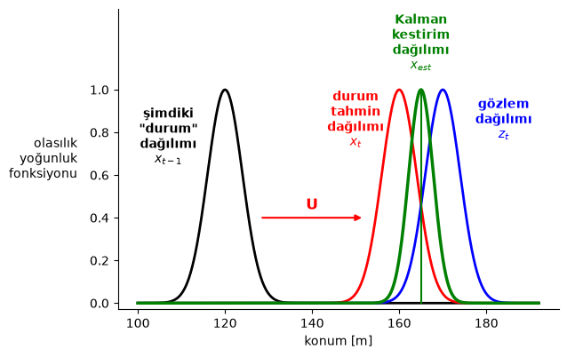
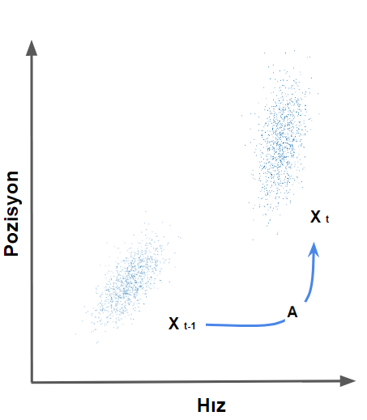
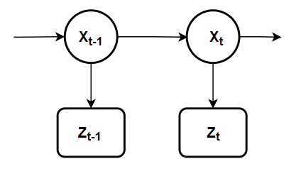
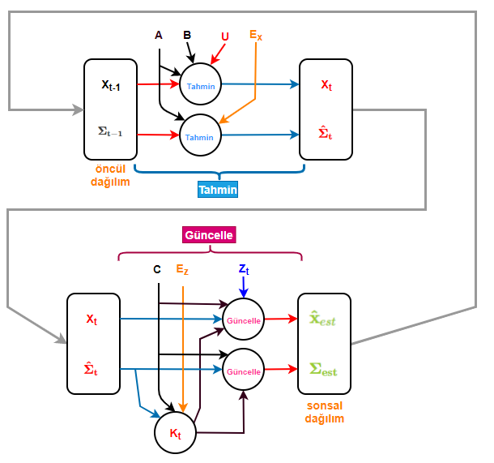
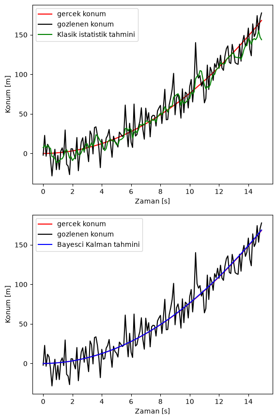
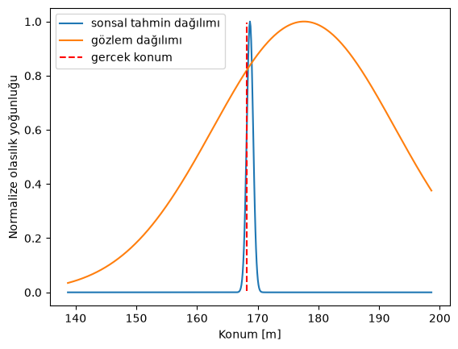
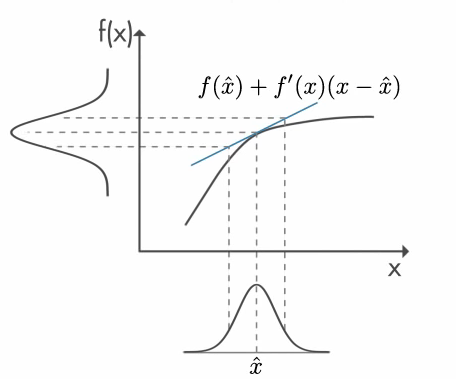

Emre: Nedir bu Kalman filtresi'nin mantığı? Nasıl otonom hareket eden robotlardan Apollo uzay programına kadar birçok alanda işe yarıyor?!

Kaan: Güzel soru. Özünde Kalman filtresi Macar asıllı Amerikan matematiksel sistem teoristi Rudolf Kalman tarafından bulunmuş ve 60'lı yıllardan bu yana halen günümüzde kullanılmaya devam eden büyüleyici bir algoritmadır.

<a href="https://en.wikipedia.org/wiki/Kalman_filter#Underlying_dynamical_system_model">Kalman filtresi</a> yirminci yüzyılda bulunan en önemli algoritmalardan biridir ve bunun neden böyle olduğunu elinde birkaç sensör olan ve bu sensörlerden gelen veriler üzerinden tahminler yapmaya çalışan her sinyal işleme ya da makine öğrenmesi uzmanı mutlaka bilmelidir.

Yine bir örnek üzerinden anlatmaya çalışabilirim.

## Problem - Otonom Sürüş yapabilen araç tasarımı

Kendi kendini süren (otonom sürüş yapabilen) bir otomobil tasarladığımızı varsayalım. Otomobilimizde bir çok sensör olduğunu varsayabiliriz, ki bu sensörlerle diğer otomobilleri, yayaları ve bisikletlileri algılayabilelim. Bu nesnelerin yerini bilmek, aracın karar vermesine yardımcı olabilir ve böylece çarpışmaları önleyebilir. Ancak, nesnelerin yerini bilmenin yanı sıra, otopilotun çarpışma olup olmayacağını kestirmesi için öncelikle kendisinin ve diğer araçların gelecekteki konumlarını da tahmin etmesi gerekir, böylece önceden ne yapacağını planlayabilir.

Yani aslında otopilot nesnelerin pozisyonunu belirleyen sensörlerin yanı sıra gelecekteki pozisyonlarını tahmin eden matematiksel modellere de sahip olmalıdır. Ancak gerçek dünyada, tahmin modelleri ve sensörler mükemmel çalışmaz. Her zaman bir belirsizlik vardır. Örneğin, hava durumu gelen ses sensörü verilerini etkileyebileceğinden (belirsizliği artıracağından), araç bu sensörlerden gelen verilere tam olarak güvenemez. İşte amacımız Kalman filtreleriyle bu belirsizliği azaltmak ve tahminlerimizi güçlendirmektir!

Teorisine detaylı girmeden önce şunu belirteyim ki Kalman'ı iyi anlamak için doğrusal dinamik sistemler, durum-uzayı, matrisler, Markov-zinciri ve kovaryans konularında alt yapının güçlü olması lazım.

Emre: Referans kaynak verebilir misin?

Kaan: Elbette, <a href="https://en.wikipedia.org/wiki/Linear_dynamical_system">doğrusal dinamik sistemler</a> ve <a href="https://en.wikipedia.org/wiki/State-space_representation">durum-uzayı</a> modeli <a href="https://en.wikipedia.org/wiki/Control_theory">Kontrol Teorisi derslerinde</a>, matrisler <a href="https://math.mit.edu/~gs/linearalgebra/">Lineer Cebir derslerinde</a>, ve son olarak <a href="https://en.wikipedia.org/wiki/Markov_chain">Markov Zinciri</a> ve <a href="https://en.wikipedia.org/wiki/Covariance">Kovaryans</a> konusunda <a href="https://www.cs.ubc.ca/~murphyk/MLbook/"> Olasılık ve İstatistik derslerinde</a> öğretilen konulardır.

## Kalman Filtresi

Kalman filtresinin matematiği Google'da bulabileceğin bir çok yerde oldukça korkutucu aslında ama burada basitleştirerek anlatmaya çalışacağım.

Haydi matematiksel modelimizi kurarak başlayalım.

Otopilotumuzun konum ($p$) ve hızı ($v$) temsil eden $\vec{x}$ *durum* vektörüne sahip olduğunu varsayalım:

<div>
$$
\vec{x} = \begin{bmatrix}
p\\
v
\end{bmatrix}
$$
</div>

Burada *durum* vektörünün yalnızca sisteminizin temel yapılandırmasıyla ilgili bir sayı listesi olduğunu unutmayalım; bu liste herhangi bir veri kombinasyonu olabilir. Örneğimizde konumu ve hızı aldık ama tankındaki yakıt miktarı, araba motorunun sıcaklığı, bir kullanıcının parmağının dokunmatik bir yüzeydeki konumu veya izlememiz gereken herhangi başka bir sensör hakkındaki veriler de olabilirdi.

Ayrıca varsayalım ki, arabamız yaklaşık 15 metre doğruluk hassasiyeti olan bir GPS sensörüne de sahip olsun.  Aslında 15 metre hassasiyet oldukça iyidir, ancak kazayı önceden algılayabilmek için araç yerini 15 metreden çok daha kesin olarak bilmeliyiz. Yani senaryomuzda GPS verilerinin tek başına yeterli olmadığını varsayalım. Aynı problemi ev süpüren bir robot olarak düşünseydik hassasiyet çok daha önemli olurdu ama çözüm çok farklı olmayacaktı.

Model kurmanın önemli bir kısmı da fiziksel fenomen hakkında düşünmektir. Mesela otopilot aracın nasıl hareket ettiği hakkında bir şeyler biliyor. Örneğin motora veya direksiyona gönderilen komutları biliyor ve eğer bir yöne gidiyorsa ve yoluna hiçbir şey çıkmazsa, bir sonraki anda muhtemelen aynı yönde ilerleyeceğini biliyor. Ancak elbette gerçekte olan hareketi hakkında her şeyi bilemez. Araç aşırı rüzgar tarafından itilebilir, tekerlekler zeminden ötürü biraz kayabilir veya engebeli arazide beklenmedik yönlere dönebilir. Bu nedenle tekerleklerin döndüğü miktar, aracın gerçekte ne kadar yol kat ettiğini tam olarak göstermeyebilir ve bu durumda otopilotun eski konumlara bakarak yaptığı yeni konum tahmini mükemmel olmaz.

GPS "sensörü" de bize yeni *durum* (konum ve hız) hakkında ancak dolaylı olarak ve bazı belirsizlik veya hatalarla bir konum söyler.

Peki elimizdeki iki bilgiyi de kullanarak her iki tahminin de bize ayrı ayrı verebileceğinden daha iyi bir tahminde bulabilir miyiz?

Bunu biraz görselleştirecek olursak.

<p align="center">

</p>

Dikkat et burada "gerçek" konumun ve hızın ne olduğunu bilmiyoruz. Bu nedenle $x_{t-1}$ *durumuna* ait konumu bile bir olasılık dağılımıyla (öncül dağılım) gösteriyoruz ve en yüksek olasılıkla aracın bu dağılımın beklenen değerinde ($\mu$) olduğunu düşünüyoruz. Figürde gösterdiğim $U$ bilgisi otopilotun bilgisi dahilinde motora giden hızlan/yavaşla komutlarını temsil eden kontrol değişken vektörü, kırmızı dağılım beklenen değeri $x_t$ olan *durum* tahmin dağılımımız, mavi dağılım da GPS'ten gelen $z_t$ okuması etrafındaki *ölçüm* (gözlem) dağılımı olsun. Kalman filtresi, durum tahmin dağılımı ile ölçüm dağılımını çarparak yeni bir dağılım (yeşil) buluyor.  Bu dağılımın beklenen değeri $x_{est}$ aracın durumu ile ilgili yeni kestirimimiz oluyor ki bu kestirim aslında gerçekte yeni *durumunun* (konum + hız) ne olduğunu her iki tahminden de daha iyi bulur (yani varyansı hem durum tahmin dağılımının hem de ölçüm dağılımının varyanslarından küçüktür ve beklenen değeri de optimal kestirimdir).

Şimdi işin matematiğine biraz daha girelim. *Durum*un gerçekte nasıl değiştiğini (ilk denklem) ve bizim bu duruma dair tahminimizi (ikinci denklem) şöyle yazabiliriz:

<div>
$$
\begin{aligned}
\mathbf{x}_t &= \mathbf{A} \mathbf{x}_{t-1} + \mathbf{B} \vec{\mathbf{u}}_t + \color{darkorange}{\varepsilon_{x}} \\
\color{red}{\mathbf{\hat{x}}_t} &= \mathbf{A} \mathbf{\hat{x}}_{t-1} + \mathbf{B} \vec{\mathbf{u}}_t
\end{aligned}
$$
</div>

$\varepsilon_{x}$ süreç gürültüsüdür: modelleyemediğimiz rasgele etkileri (rüzgar, tekerlek kayması vs.) temsil eder ve Kalman filtresinde her zaman ortalaması sıfır olan bir Gaussian varsayılır. Değerini bilemeyeceğimiz için tahminimizde (ikinci denklem) modeli onsuz kullanıyoruz; onun etkisini birazdan kovaryansı üzerinden hesaba katacağız. Dikkat edersen tahminimiz aslında bir doğrusal denklem olarak kuruldu. $A$ ve $B$'de bu doğrusal dinamik denklemde *durum* vektörü $\hat{x}_{t-1}$ ve *kontrol* (dış etken) vektörü $\vec{u}_t$ ile çarpılan doğrusal sistem matrislerini temsil ediyor.

Emre: Doğrusal sistemlerde bir dağılımın bir katsayı matrisiyle çarpılması ne anlama geliyor?


Kaan: Bunu görsel olarak göstersem daha iyi olur.

<p align="center">

</p>

Çarpılan matris orijinal dağılımdaki her noktayı alır ve yeni bir yere taşır, ki bu yeni yerler modelimiz doğruysa sistemin bir sonraki zaman adımında bulunacağı stokastik koşulları temsil eder. *Durum* derken burada sistemin fiziksel konumu ve fiziksel hızını kastediyoruz tabi çünkü *durum* vektörümüz bu iki parametreyi temsil ediyor. $A$ matrisi ile çarpımdan sonra varyans ve kovaryanslara aslında neler olduğundan birazdan bahsedeceğim. Ama şimdilik bu çarpımın yeni *durum* vektörünün kovaryans matrisini değiştirdiğini görmeni istedim.

Burada bir noktaya daha dikkat, dışarıdan herhangi bir şekilde kontrol edilmeyen sistemlerde kontrol vektörü ($\vec{u}$) ve kontrol matrisi $B$ gözardı edilir.

Tahmini *durum* kestirimi aynı zamanda *öncül kestirim* diye de isimlendirilir çünkü ölçüm alınmadan önce hesaplanır.

Bir de ölçüm denklemine ve ölçüm tahminimize bakalım:

<div>
$$
\begin{aligned}
\color{royalblue}{\mathbf{z}_t} &= \mathbf{C} \mathbf{x}_t + \color{darkorange}{\varepsilon_{z}} \\
\color{royalblue}{\mathbf{\hat{z}}_t} &= \mathbf{C} \color{red}{\mathbf{\hat{x}}_{t}}
\end{aligned}
$$
</div>

Burada $C$ yine doğrusal denklemin katsayısı. İlk denklem, sensörün $Cx_t$'yi ve üzerine eklenen ölçüm gürültüsü $\varepsilon_{z}$'yi ölçtüğünü söylüyor; bu gürültü de ortalaması sıfır olan bir Gaussian varsayılır. Ölçüm tahminimizde (ikinci denklem) ise girdi olarak *durum* vektörü tahmini kullanılıyor.

Peki Kalman filtresi bu iki tahmini kullanarak güvenilir $x_{est}$ durum vektörü kestirimini (Kalman tahmini) nasıl yapıyor?

Bunu şöyle gösterebiliriz:

<div>
$$
\begin{equation}
\begin{split}
\color{yellowgreen}{\mathbf{x}_{est}} &= \color{red}{\mathbf{\hat{x}}_{t}} + \mathbf{K} (\color{royalblue}{\mathbf{z}_t} - \color{royalblue}{\mathbf{\hat{z}}_t})
\end{split}
\end{equation}
$$
</div>

Evet, işin sırrı bu ifadede. Bu ifadeye *sonsal kestirim* denilir ve $K$ literatürde Kalman kazancı olarak geçen terimdir. Parantez içinde kalan $z_t - \hat{z}_t$ ise düzeltme terimi diye geçer. Peki tüm bunlar ne demek?

Bu denklem bize şunu söylüyor. Elimizde bir yeni *durum* vektörü tahmini $\hat{x}_t$ ve bir de sensörün göstereceği yeni konum tahmini (ölçüm tahmini) $\hat{z}_t$ var.
Ölçüm tahminimiz ölçümden gelen gözlemle aynıysa o zaman parantez içindeki ifade sıfır olacaktır. Yani *durum* vektörü tahminimize güvenebiliriz. Farkın sıfırdan farklı olduğu zamanlardaysa, *durum* vektörü tahminimizin gözlemden gelen bir düzeltmeye ihtiyacı var demektir. Gözlemle gözleme ait ölçüm tahminimiz arasındaki fark bu düzeltmenin bir ölçüsü olacak. İşte bu farkın ne kadarını hesaba katacağımıza $K$ kalman kazancı karar verir. Kalman kazancı ölçüme tahminimize kıyasla ne kadar güveneceğimize karar verir. Tahminimiz belirsiz, ölçüm ise hassassa kazanç yüksek olur ve düzeltme büyük bir ağırlıkla hesaba katılır; ölçüm tahminimize göre gürültülüyse kazanç küçük olur.

Kalman burada güzel bir şey yapıyor aslında; kim belirsizliği yüksek bir tahmini başka bir kestirimde yüksek ağırlıkla kullanmak ister ki?

## Doğrusal dinamik sistem modeli

Bu noktada yukarıda ortaya attığımız tahmin denklemlerindeki doğrusal dinamik sistem katsayılarını ($A,B,C$) hesaplama vakti geldi. Artık doğrusal dinamik sistemimizi modellemek için otonom sürüş yapan aracımızın hareket denklemlerini açıkça yazabiliriz.

Hatırlarsan *durum* vektörümüzü şöyle tanımlamıştık:

<div>
$$
\vec{x} = \begin{bmatrix}
p\\
v
\end{bmatrix}
$$
</div>

Bu modeli kullanarak ve GPS'in sadece konum bilgisi $p$'yi raporladığını varsayarak $A,B$ ve $C$'yi hesaplayabiliriz ve bunun için de fiziğin konum ve hız için geçerli genel hareket denklemlerinden yararlanabiliriz. Neydi bizim meşhur sabit ivmeli hareketin hareket denklemleri:

<div>
$$
\begin{aligned}
\color{deeppink}{p_t} &= \color{royalblue}{p_{t-1}} + \Delta t \, \color{royalblue}{v_{t-1}} + \frac{1}{2} \color{darkorange}{a_t} \, \Delta t^2 \\
\color{deeppink}{v_t} &= \color{royalblue}{v_{t-1}} + \color{darkorange}{a_t} \, \Delta t
\end{aligned}
$$
</div>

Burada $\Delta t$ iki örnek arasındaki zaman adımı (kodda `dt`). Bunu matris formunda şöyle yazabiliriz:

<div>
$$
\begin{align}
\color{deeppink}{\mathbf{x}_t} &= \begin{bmatrix}
1 & \Delta t \\
0 & 1
\end{bmatrix} \begin{bmatrix}
p_{t-1}\\
v_{t-1}
\end{bmatrix} +  \begin{bmatrix}
\Delta t^2/2\\
\Delta t
\end{bmatrix} a_t + \color{darkorange}{\varepsilon_{x}}
\end{align}
$$
</div>

Ölçümümüzü de şöyle modellemiştik:

<div>
$$
\begin{aligned}
\color{royalblue}{\mathbf{z}_t} &= \mathbf{C} \mathbf{x}_t + \color{darkorange}{\varepsilon_{z}} \\
\color{royalblue}{\mathbf{\hat{z}}_t} &= \mathbf{C} \color{red}{\mathbf{\hat{x}}_{t}}
\end{aligned}
$$
</div>

GPS sensörünün bize sadece konum bilgisi $p$'yi verdiğini varsaydığımıza göre;

<div>
$$
\begin{align}
\color{royalblue}{\mathbf{z}_t} &= \begin{bmatrix}
1 & 0
\end{bmatrix} \begin{bmatrix}
p_{t}\\
v_{t}
\end{bmatrix} + \color{darkorange}{\varepsilon_{z}}
\end{align}
$$
</div>

O zaman $A$, $B$ ve $C$'yi biliyoruz artık:

<div>
$$
\begin{align}
A &= \begin{bmatrix}
1 & \Delta t \\
0 & 1
\end{bmatrix}\\
B &= \begin{bmatrix}
\Delta t^2/2 \\
\Delta t \end{bmatrix} \\
C &= \begin{bmatrix}
1 & 0
\end{bmatrix}
\end{align}
$$
</div>

## Kalman Filtre Algoritması

Kalman filtresi özyinelemeli olarak iki adımı tekrar eder; *tahmin* ve ölçümden gelen bilgiyle *güncelleme*. Elimizdeki bilgilerle bir tahmin yapılır ve ardından ölçümden gelen bilgiyle bir düzeltme güncellemesi. Ardından ortaya çıkan sonsal dağılım bir sonraki adımda öncül dağılım olarak kullanılır. Böylece öncül inançlarımız da güncellenmiş olur.

Buraya Bayesçi felsefeyle ilgili küçük bir not düşeyim; demek ki ön yargılı olmak değil, yeni bilgi geldiğinde bu yargıyı değiştirebilmek büyük kazanç sağlıyormuş!

## Tahmin

İşe varyans ve kovaryansın hesaplanmasıyla başlayabiliriz.

Öncelikle *durum* ve ölçüm denklemlerindeki gürültü terimlerinin kovaryanslarını yazalım:

<div>
$$
\begin{equation}
\begin{aligned}
\color{darkorange}{\varepsilon_{x}} &\sim \mathcal{N}(0, \mathbf{E}_x), \quad \mathbf{E}_x =
\begin{bmatrix}
\Sigma_{pp} & \Sigma_{pv} \\
\Sigma_{vp} & \Sigma_{vv}
\end{bmatrix} \\
\color{darkorange}{\varepsilon_{z}} &\sim \mathcal{N}(0, \mathbf{E}_z), \quad \mathbf{E}_z = \sigma_{z}^2
\end{aligned}
\end{equation}
$$
</div>

*Durum* vektöründe birden fazla rassal değişken olduğu için $E_x$ aslında bir kovaryans matrisi, diğer yandan, ölçüm vektöründe sadece bir rassal değişken olduğu için $E_z$ de aslında bu değişkene ait varyansı temsil edecektir.

Bu bilgiyi kullanarak *durum* vektörü tahmini için elde edeceğimiz kovaryansı şöyle ifade edebiliriz:

<div>
$$
\begin{equation}
\begin{split}
\color{red}{\mathbf{\hat{\Sigma}_{t}}} = \mathbf{A} \mathbf{\Sigma_{t-1}} \mathbf{A}^T + \color{darkorange}{\mathbf{E}_x}
\end{split}
\end{equation}
$$
</div>

### Çıkarım
Bu ifadenin çıkarımı o kadar da zor değil. $x$'in kovaryansını şöyle ifade edersek:

<div>
$$
Cov(x) = \Sigma
$$
</div>

ve tahmin denkleminde $A\hat{x}_{t-1}$ olduğunu bildiğimize göre, kovaryansın rassal değişkenin sabit bir matrisle çarpımından sonraki halini şöyle ifade edebiliriz:

<div>
$$
\begin{equation}
\begin{split}
Cov(\color{firebrick}{\mathbf{A}}x) &= \color{firebrick}{\mathbf{A}} \Sigma \color{firebrick}{\mathbf{A}}^T
\end{split}
\end{equation}
$$
</div>

Emre: Peki $B$ ve $u$'ya ne oldu?

Kaan: $u$ rassal bir değişken değil, ne olduğunu biliyoruz. O yüzden onun varyansından bahsedilemez. Bir sabitin varyansı gibi varyansını sıfır alıp ihmal ediyoruz.

Bu aslında klasik olasılık teorisinden bildiğimiz bir çıkarım.

Herneyse, özetle bu ifadede yaptığımız şudur; bir önceki kovaryansı, $\mathbf{\Sigma_{t-1}}$, $A$ sistem matrisinden geçirip üzerine süreç gürültüsünün kovaryansını, $E_x$'i, ekliyoruz. Bu da bizim tahmini kovaryansımız oluyor.

Şu noktada artık elimizde <span style="color:red">*tahmin denklemleri*</span> var ve bu denklemlerin $A$ ve $B$ katsayılarını varsaydığımız doğrusal dinamik sistemden hesaplayabiliyoruz.

<div>
$$
\begin{equation}
\color{red}{\mathbf{\hat{x}}_t} = \mathbf{A} \mathbf{\hat{x}}_{t-1} + \mathbf{B} \vec{\mathbf{u}}_t
\end{equation}
$$
</div>

<div>
$$
\begin{equation}
\begin{split}
\color{red}{\mathbf{\hat{\Sigma}_{t}}} = \mathbf{A} \mathbf{\Sigma_{t-1}} \mathbf{A}^T + \color{darkorange}{\mathbf{E}_x}
\end{split}
\end{equation}
$$
</div>

## Ölçümün ardından düzeltme (güncelleme)

Kalman filtresi sensörlerimizin mükemmel olmamasını da hesaba katar. Ölçümden gelen hatanın varyansı Kalman kazancı hesabına girerek oradan da son yaptığımız tahminde bir rol oynar.

Şimdi yapmamız gereken durum vektörü ve ölçüm vektörü tahminlerinin varyansını kullanarak Kalman kazancını yani $K$'yı hesaplamak.

Peki Kalman kazancı nasıl hesaplanır?

İşte bu biraz daha karmaşık bir iş. Genel fikir olarak hatırlamamız gereken şey şudur; ölçüm hatasının varyansı (yani belirsizlik) ne kadar yüksekse, Kalman kazancının o kadar küçük olması gerekiyor ki ölçüm tahminimizle gerçek gözlem arasındaki fark *durum* vektörü kestirimimizi çok yüksek ağırlıkla etkilemesin.

Bu durumda ispatına girmeden Kalman kazancını şöyle ifade edebiliriz:

<div>
$$
\begin{equation}
\color{red}{\mathbf{K}_t} = \color{red}{\mathbf{\hat{\Sigma}_t} \color{black}{\mathbf{C}^T} (\color{black}{\mathbf{C}} \color{red}{\mathbf{\hat{\Sigma}_t}} \color{black}{\mathbf{C}^T}} + \color{darkorange}{\mathbf{E}_z})^{-1}
\end{equation}
$$
</div>

Bu ifade gözünü korkutmasın. Bir takım matrisleri çarpıyoruz ama aslında olan şey şudur; ölçüm hatası varyansının da içinde bulunduğu matris çarpımlarının tersini kovaryans tahminiyle çarpıyoruz. Tersini aldığımız için, ölçümdeki varyans büyüdükçe bu çarpımın değeri küçülecektir. Sonuç olarak ölçümdeki varyans ne kadar büyükse ölçümümüz o kadar az bilgi taşır. Kalman kazancı da bu bilginin son kestirim denklemine aktarılmasını sağlar. Bu ifadenin elle çıkarımını kendi kendine yapmanı tavsiye ederim.

Öyleyse Kalman filtresinin bir sonraki adımı olan güncelleme basamağında <span style="color:red">*güncelleme denklemlerini*</span> kullanarak elde edeceğimiz son *durum* kestirimi $x_{est}$ ve bu kestirimin kovaryansı da şöyle olacaktır;

<div>
$$
\begin{equation}
\begin{split}
\color{yellowgreen}{\mathbf{\hat{x}}_{est}} &= \color{red}{\mathbf{\hat{x}}_t} + \color{red}{\mathbf{K}_t} ( \color{royalblue}{\mathbf{z}_t} - \color{black}{\mathbf{C} \mathbf{\hat{x}}_t} )
\end{split}
\end{equation}
$$
</div>

<div>
$$
\begin{equation}
\begin{split}
\color{yellowgreen}{\mathbf{\Sigma_{est}}} = (I - \color{red}{\mathbf{K}_t} \color{black}{\mathbf{C})} \color{red}{\hat{\Sigma_{t}}}
\end{split}
\end{equation}
$$
</div>

Unutma aslında $\color{black}{\mathbf{C} \mathbf{\hat{x}}_t} = \hat{z}_t$'dir. Dikkat et Kalman kazancının büyüklüğü burada devreye giriyor. $K$ burada ölçümden gelen bilginin ağırlıklandırılarak hesaba katılmasını sağlıyor.

İkinci denklemde de tahmin kovaryansını yine bir takım matrislerle çarpıyoruz. Eğer Kalman kazancı sıfırsa, o zaman tahmin kovaryansı efektif olarak $I$ birim matrisiyle çarpılıyor. Böyle bir durumda güncellenmiş kovaryans tahmin kovaryansına eşit olmuş oluyor. Yani yeni bir bilgi kazanmamış oluyoruz. Böylece Bayesçi bakış açısından öncül inancımızı güncellememize de gerek yok demektir. (Aşağıdaki kodda aynı kovaryans güncellemesini Joseph formu denilen, sayısal olarak daha kararlı ve eşdeğer $(I - K_tC)\hat{\Sigma}_t(I - K_tC)^T + K_tE_zK_t^T$ biçiminde hesaplıyoruz.)

Bir kez daha hatırlatayım. Elde ettiğimiz *durum* vektörü tahmini ve kovaryans tahmini bir sonraki adımda öncül bilgi olarak kullanılacak. Yani burada yine Bayesçi yaklaşımı kullanıyoruz. Elde ettiğimiz sonsal dağılım bir sonraki adımda öncül dağılım olarak kullanılıyor. Filtre yinelemeli olarak çalışmaya devam ediyor ve böylece yeni bilgi geldikçe kestirimlerimizin hata varyansı minimuma iniyor.

## Kalman Filtresi Bilgi Akışı ve Bayesçi Yaklaşım

Diğer yandan şunu da söylemeden geçmeyeyim ki Kalman filtresi en basit dinamik Bayes ağlarından biridir. Durumların gerçek değerlerini gelen ölçümler ve matematik modelimizi kullanarak özyinelemeli olarak kestirip durur. Böylece özyinelemeli Bayesçi kestirimimiz de sonsal dağılımı aynı şekilde tahmin edip durur. Özyinelemeli Bayesçi kestirimde gerçek durum gözlemlenemeyen bir Markov süreci olarak kabul edilir. Yani ölçümler saklı Markov modelimizin gözlemlenebilen durumları gibi düşünülür ancak bu kez durumları ayrık olan Saklı Markov Model'inin aksine sürekli değerli durumlarla çalışılır. Daha önce de söylediğim gibi gerçek durum $t$ anında olasılıksal olarak sadece kendinden bir önceki ($t-1$ anındaki) duruma koşulludur ve daha önceki durumlardan bağımsızdır. Bunu matematiksel olarak şöyle ifade ederiz:

<div>
$$
p(x_t|x_{0},...,x_{t-1}) = p(x_t|x_{t-1})
$$
</div>

ve Markov zincirini de şöyle görselleştiririz:

<p align="center">

</p>

Bu özyinelemeli çalışmayı bilgi akışı biçiminde de görselleştirebiliriz:

<p align="center">

</p>

Kalman filtresini Bayesçi stokastik bakış açısından ele alıp olasılık teorisi bakımından neler olduğuna biraz daha detaylı gireceğim. Ama şimdilik kafa karıştırmamak için bu kadar yeterli diyerek yukarıda konuştuklarımız kodlayalım bakalım neler göreceğiz.

## Algoritmayı Kodlama

```python
import numpy as np
import matplotlib.pyplot as plt
from math import *


# gaussian cizdiren yardimci fonksiyon tanimi
def gaussianpdf(ortalama, varyans, x):
    katsayi = 1.0 / sqrt(2.0 * pi *varyans)
    ustel = exp(-0.5 * (x-ortalama) ** 2 / varyans)
    return katsayi * ustel

# meta degiskenleri ilklendirelim
T = 15 # toplam surus suresi
dt = .1 # ornekleme periyodu
np.random.seed(42) # sonuclar tekrarlanabilir olsun diye rasgele sayi uretecini sabitleyelim

# Bayesci olmayan konum kestirimini hareketli-ortalama ile hesapladigimizi varsayalim
# asagidaki fonksiyon 5 uzunlugunda bir `window` kullanarak girdi olarak gelen sinyalin hareketli ortalamasini alir
har_ort_uzunluk = 5
def smooth(x,window_len=har_ort_uzunluk):
    s=np.r_[x[window_len-1:0:-1],x,x[-2:-window_len-1:-1]]
    w=np.ones(window_len,'d')
    y=np.convolve(w/w.sum(),s,mode='valid')
    return y

# katsayi matrislerini tanimlayalim (dogrusal dinamik sistem katsayi matrisleri)
A = np.array([[1, dt], [0, 1]])  # durum gecis matrisi - aracin beklenen konum ve hizlarini temsilen
B = np.array([dt**2/2, dt]).reshape(2,1) # giris kontrol matrisi - giriste kontrollu olarak verilen ivmenin beklenen etkisini temsilen
C = np.array([1, 0]).reshape(1, 2) # gozlem matrisi - tahmin edilen durum elimizdeyken beklenen gozlemleri (olabilirlik) temsilen

# ana degiskenleri tanimlayalim
u=1.5 # ivmenin buyuklugu
OP_x=np.array([0,0]).reshape(2,1) # konum ve hizi temsil eden durum vektoru ilklendirme
OP_x_kest = OP_x # aracin ilklendirme esnasindaki durum kestirimi
OP_ivme_gurultu_buyuklugu = 0.05; # surec gurultusu - ivmenin standart deviasyonu - [m/s^2]
gozlem_gurultu_buyuklugu = 15;  # olcum gurultusu - otopilotun sensor olcum hatalari - [m]
Ez = gozlem_gurultu_buyuklugu**2; # olcum hatasini kovaryans matrisine cevirelim
Ex = np.dot(OP_ivme_gurultu_buyuklugu**2,np.array([[dt**4/4, dt**3/2], [dt**3/2, dt**2]])) # surec gurultusunu kovaryans matrisine cevirelim
P = Ex; # ilk arac konum varyansinin kestirimi (kovaryans matrisi)

# sonuc degiskenlerini ilklendirelim
OP_konum = [] # aracin gercek konum vektoru
OP_hiz = [] # aracin gercek hiz vektoru
OP_konum_gozlem = [] # otopilotun gozlemledigi konum vektoru

# dt adimlariyla 0 dan T ye kadar simulasyonu calistiralim
for  t in np.arange(0, T, dt):

  # her bir adim icin aracin gercek durumunu hesaplayalim
  # rasgele ivme (surec gurultusu) konumu ve hizi B uzerinden etkiler
  OP_ivme_gurultusu = OP_ivme_gurultu_buyuklugu * np.random.randn() * B
  OP_x = np.dot(A, OP_x)  + np.dot(B, u) +  OP_ivme_gurultusu

  # otopilotun gozlemledigi (olctugu) gurultulu konum vektorunu olusturalim
  gozlem_gurultusu = gozlem_gurultu_buyuklugu * np.random.randn()
  OP_z = np.dot(C, OP_x) + gozlem_gurultusu

  # konum, hiz ve gozlemleri cizdirmek icin vektor seklinde saklayalim
  OP_konum.append(OP_x[0, 0])
  OP_hiz.append(OP_x[1, 0])
  OP_konum_gozlem.append(OP_z[0, 0])

# aracin gercek ve otopilot tarafindan gozlemlenen konumlarini cizdirelim
plt.plot(np.arange(0, T, dt), OP_konum, color='red', label='gercek konum')
plt.plot(np.arange(0, T, dt), OP_konum_gozlem, color='black', label='gozlenen konum')

# Kalman filtresi yerine klasik istatistik uygulayip Hareketli-Ortalama alan otopilotun tahmin ettigi konum
plt.plot(np.arange(0, T, dt), smooth(np.array(OP_konum_gozlem)[:-(har_ort_uzunluk-1)]), color='green', label='Klasik istatistik tahmini')
plt.ylabel('Konum [m]')
plt.xlabel('Zaman [s]')

plt.legend()
plt.show()

# Kalman Filtresi

# kestirim degiskenlerini ilklendirelim
OP_konum_kest = [] #otopilot pozisyon kestirimi
OP_hiz_kest = [] # otopilot hiz kestirimi
OP_x_kest = np.array([0,0]).reshape(2,1) # otopilot durum kestirimini yeniden ilklendir
P = Ex # kestirimin kovaryansini yeniden ilklendir
P_buyukluk_kest = []
durum_tahmin = []
varyans_tahmin = []

for z in OP_konum_gozlem:

  # tahmin adimi

  # yeni durum tahminimizi hesaplayalim
  OP_x_kest = np.dot(A, OP_x_kest)  + np.dot(B, u)
  durum_tahmin.append(OP_x_kest[0, 0])

  # yeni kovaryansi tahminini hesaplayalim
  P = np.dot(np.dot(A,P), A.T) + Ex
  varyans_tahmin.append(P)

  # guncelleme adimi

  # Kalman kazancini hesaplayalim
  K = np.dot(np.dot(P, C.T), np.linalg.inv(Ez + np.dot(C, np.dot(P, C.T))))

  # durum kestirimini guncelleyelim
  z_tahmin= z - np.dot(C, OP_x_kest)
  OP_x_kest = OP_x_kest + np.dot(K, z_tahmin)

  # kovaryans kestirimini guncelleyelim
  I = np.eye(A.shape[1])
  P = np.dot(np.dot(I - np.dot(K, C), P), (I - np.dot(K, C)).T) + np.dot(np.dot(K, Ez), K.T)

  #  otopilotun konum, hiz ve kovaryans tahminlerini vektorel olarak saklayalim
  OP_konum_kest.append(np.dot(C, OP_x_kest)[0, 0])
  OP_hiz_kest.append(OP_x_kest[1, 0])
  P_buyukluk_kest.append(P[0])

plt.plot(np.arange(0, T, dt), OP_konum, color='red', label='gercek konum')
plt.plot(np.arange(0, T, dt), OP_konum_gozlem, color='black', label='gozlenen konum')
plt.plot(np.arange(0, T, dt), OP_konum_kest, color='blue', label='Bayesci Kalman tahmini')
plt.ylabel('Konum [m]')
plt.xlabel('Zaman [s]')
plt.legend()
plt.show()

# Kalman durum tahmin dagilimini bul
mu1 = OP_x_kest[0, 0]
sigma1 = P[0, 0] # konum kestiriminin varyansi

print("Konum kestiriminin varyansi [m^2]: ", sigma1)

# konumun mumkun olan araligini tanimlayalim
x_axis = np.arange(mu1-gozlem_gurultu_buyuklugu*2, mu1+gozlem_gurultu_buyuklugu*2, dt)

# durum tahmin dagilimini hesaplayalim
g1 = []
for x in x_axis:
    g1.append(gaussianpdf(mu1, sigma1, x))

# durum tahmin dagilimini cizdir
y=np.dot(g1,1/np.max(g1))
plt.plot(x_axis, y, label='sonsal tahmin dağılımı')
print("Gercek konum: ", OP_konum[-1])

# gozlemi dagilimini bul
mu2 = OP_konum_gozlem[-1]
sigma2 = Ez # gaussianpdf varyans bekliyor

# gozlem dagilimini hesaplayalim
g2 = []
for x in x_axis:
    g2.append(gaussianpdf(mu2, sigma2, x))

# gozlem dagilimini cizdir
y=np.dot(g2,1/np.max(g2))
plt.plot(x_axis, y, label='gözlem dağılımı')

# gercek pozisyonu cizdir
plt.axvline(OP_konum[-1], 0.05, 0.95, color='red', linestyle='--', label='gercek konum')
plt.legend(loc='upper left')
plt.xlabel('Konum [m]')
plt.ylabel('Normalize olasılık yoğunluğu')
plt.show()
```
Kalman filtresinin yukarıdaki simülasyonunu çalıştırırsak şöyle bir çıktı elde ederiz:

<p align="center">

</p>

Örnekte sadece Kalman filtresi değil, bir de Kalman yerine klasik istatistik yöntemlerinden birini ele aldık. Birçok klasik istatistik yöntemi uygulanabilir ama karşılaştırmak için literatürde sıkça kullanılan hareketli ortalama (moving average) filtresini kullandık.

Son olarak Kalman filtresinin yaptığı son tahminin dağılımına bakalım. Gördüğün üzere gözlem dağılımının (GPS'ten gelen veriler) ortalaması gerçek konuma uzak olmasına rağmen, tahmini durumun konum dağılımının ortalaması gerçek konuma çok yakın çıkmış. Yukarıdaki simülasyon parametreleri ile son konum kestirimimizin varyansı yaklaşık 0.27 m², yani standart sapması yaklaşık 0.5 metre; GPS'in $15$ metresiyle karşılaştır!

<p align="center">

</p>

## İleri Seviye Konular ve Gerçek Hayat

Yukarıda Kalman kazancından bahsettim ve direk tanımlayan ifadeyi verdim ama nasıl çıkarıldığını söylemedim. Kalman kazancının nasıl çıkarıldığını merak ettiysen şöyle bir ipucu verebilirim: Durum tahmininin hata kovaryansını matris formunda yazarsan ve bu matrisin izinin (trace), $Tr[\color{red}{\mathbf{\hat{\Sigma}_{t\|t}}}]$, Kalman kazancına göre türevini alarak türevi minimize etmeye çalışırsan, buradan $\color{red}{K_t}$'yi çekerek çıkarımını yapabilirsin. Unutma kovaryans matrisinin izi, yani diyagoneldeki elemanlarının toplamı bize ortalama karesel hatayı (<a href="https://en.wikipedia.org/wiki/Mean_squared_error">mean squared error- MSE</a>) veriyordu ve biz de bu hatayı minimize etmeye çalışıyoruz. İlle çıkarımın nasıl yapıldığına başka bir kaynaktan bakmak istersen MIT'de yayınlanan <a href="http://web.mit.edu/kirtley/kirtley/binlustuff/literature/control/Kalman%20filter.pdf">Kalman filtresini</a> anlatan bu kaynakta bulabilirsin.

Bir başka teorik bakış açısından, Kalman filtresinin ana varsayımı alttaki sistemin doğrusal dinamik bir sistem olduğudur ve Kalman filtresi hata ve ölçüm rassal değişkenleri Gaussian dağılıma (sıklıkla çok değişkenli Gaussian dağılımı) sahip olduğunda teorik olarak optimal filtredir. Sistemin öncülü olan Gaussian dağılımı tahmin yaparken kullandığımız doğrusal dönüşümlerden sonra da yine Gaussian kalmaya devam eder. Bu nedenle sonsal dağılım da Gaussian kalır ve filtre onu sadece bir ortalama vektörü ve bir kovaryans matrisiyle tam olarak takip edebilir. Ancak aklına şöyle bir soru gelebilir: Peki üzerinde çalıştığımız dinamik sistem doğrusal değilse ne olacak?

O zaman doğrusal dönüşüm yerine doğrusal olmayan fonksiyonlar kullanmamız gerekecek. Doğrusal olmayan dönüşümler öncül olarak varsaydığımız Gaussian dağılımını bilmediğimiz bir dağılıma dönüştürebilir. Böyle durumların etrafından dolaşmak için "genişletilmiş Kalman filtreleri" geliştirilmiştir. Genişletilmiş Kalman'da doğrusal olmayan fonksiyonumuz halihazırdaki durum tahmin kestiriminin beklenen değeri civarında doğrusallaştırılır.

<p align="center">

</p>

Bu figür <a href="https://www.mathworks.com/help/fusion/ug/extended-kalman-filters.html">Mathworks</a>'ten alınmıştır.


Doğrusal olmayan dinamik sistem artık aşağıdaki şekilde modellenir:

<div>
$$
\begin{gathered}
x_{t} = f(x_{t-1}, u_t) + \varepsilon_{x} \\
z_t = g(x_{t}) + \varepsilon_{z}
\end{gathered}
$$
</div>

Bu sistemin doğrusallaştırılabilmesi için aşağıdaki Jakobyan matrislerinin hesaplanması gerekir.

<div>
$$
F = \left[ \frac{\partial f}{\partial x} \right ] _{\hat{x}_{t-1}, u_t}, G = \left[ \frac{\partial g}{\partial x} \right ] _{\hat{x}_{t}}
$$
</div>

Burada artık şunu söylemem lazım ki, gerçek hayatta bu Jakobyenlerdeki kısmi türevleri analitik olarak bulup hesaplamak zordur ve her zaman mümkün olmayabilir. Numerik olarak hesaplamak da yine işlemsel olarak karmaşıktır. Bir diğer yandan genişletilmiş Kalman filtresi sadece türevi alınabilen modellerde çalışır ve sistem yüksek derecede doğrusal olmayan bir modele sahipse artık optimal olmaktan da çıkar.

Kalman filtresiyle çözmenin artık makul ya da mümkün olmadığı durumlarda yardımımıza 1940'lı yılların nükleer fizik çalışmalarından mühendislik dünyasına yavaşça sızıp gelen yeni ve meşhur başka bir algoritma koşar; <a href="https://en.wikipedia.org/wiki/Monte_Carlo_method">Monte Carlo yaklaşımı</a>. 90'lı yıllardan günümüze kadar doğrusal-, parametrik- ve Gaussian- olmayan dinamik sistemlerin modellenmesinde başarıyla kullanılmaktadır. Monte Carlo filtreleme de yine yirminci yüzyılın en önemli algoritmalarından biridir! İlerleyen yazılarda ona da geleceğim.

## İşlem Karmaşıklığı

Kalman filtrelemenin Markov özelliği halihazırdaki *durumdan* bir önceki *durumdan* geride kalan geçmişle ilgilenmememizi sağlar. Bu nedenle KF algoritmaları hem bellek bakımından avantajlı hem de hızlıdırlar. Bu da Kalman filtresini gömülü sistemler için güzel bir aday haline getirir. Aynı problemi çözmeye aday Yapay Sinir Ağları gibi yöntemler hem çok uzun geçmiş veriye ihtiyaç duyabilir hem de işlemsel olarak çok daha karmaşık olabilir. Bu da daha çok bellek ve işlem gücü demektir. Bu nedenle gömülü sistemlerde pek tercih edilmezler.

## Referanslar
1. <a href="https://www.cs.ubc.ca/~murphyk/MLbook/">Machine Learning: A Probabilistic Perspective</a>
2. <a href="http://web.mit.edu/kirtley/kirtley/binlustuff/literature/control/Kalman%20filter.pdf">Tutorial: The Kalman Filter</a>
3. <a href="https://arxiv.org/pdf/1910.03558.pdf">A Step by Step Mathematical Derivation and Tutorial on Kalman Filters</a>

<a href="https://www.freecounterstat.com" title="visitor counters"></a>
