Emre: Apple Airpods'lar aktif gürültüyü nasıl yokediyor?

Kaan: Sinyal işlemenin en zevkli konularından biridir. Gel birlikte bakalım nasıl oluyormuş.

## Problem - Aktif Gürültü Yoketme

İstenmeyen bir gürültünün belirli bir bölgede akustik olarak bastırılmasına Aktif Gürültü Kontrolü deniliyor. Bunu başarmak için genellikle bir ya da birden fazla hoparlörden gürültüyle aynı genlikte fakat ters fazda bir sinyal (anti-gürültü) basılır. Gürültü ve anti-gürültü havada adeta bir toplama işleminden geçerek birbirini yok eder. Bunun sebebi aynı genlikte fakat ters fazda iki dalganın aynı yönde hareket etmesi durumunda fiziksel olarak birbirini söndürmesidir. Bunu temsili olarak şöyle gösterebiliriz.

<p align="center">
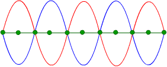
</p>

Figürde gördüğün yeşil noktalar havada gerçekleşen toplama (söndürmenin) sonucu olarak hep "sıfır" çıkacaktır. 

Ancak eğer fazlar tam olarak denk gelmiyorsa aksine gürültü artabilir de! 

<p align="center">
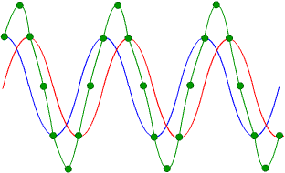
</p>

Gördüğün üzere bu kez yeşil noktalar orjinal sinyalden bile büyük genlikte bir sinyal gösteriyor. 

Peki bu gürültü sinyalinin tersini oluşturma işi o kadar kolay mıdır?

Tahmin edeceğin üzere elbette değil. 

Emre: Neden?

Kaan: Çünkü istenmeyen gürültü sinyali sürekli aynı genlik ve fazda gelmez. Sesin yayıldığı kaynaktan gürültüyü yoketmeye çalıştığımız bölgeye kadar havada adeta bilinmeyen fiziksel bir kanaldan (ortamdaki yansımalar vs.) geçer. Bu nedenle bu bilinmeyen kanalı modellememiz gerekir. Modelin doğruluğunu ve bu havada gerçekleşen toplama işleminin gerçekten sıfırla sonuçlandığını takip eden uyarlanır bir filtreye ihtiyacımız var. Model doğruysa kaynağa yakın bir referans mikrofonundan aldığımız sinyali bu modelden geçirip, tersini alarak hata mikrofonu civarında hoparlöre verirsek, hata mikrofonu etrafında sessiz bir bölge oluşturabiliriz. 

Böylece aktif gürültü yoketme yapan bir sistemin düzeneği şuna benzer olacaktır:

<p align="center">
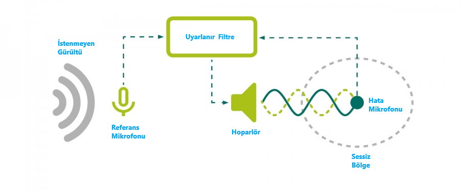
</p>

Peki tam olarak nedir bu uyarlanır filtre? Matematiksel olarak nasıl modeller bu havadaki kanalı?

## Uyarlanır (Adaptif) Filtre Tasarımı 

### Temel FIR Filtre

Önce uyarlanabilir olmayan temel filtreyi bir hatırlayalım. Elimizde girişi $$x(n)$$ ve çıkışı $$y(n)$$ olan bir sayısal filtre olduğunu düşünelim. 
Bu filtrenin birim darbe cevabı sonlu sayıda, $$N$$ adet örnek içersin. Böyle bir filtre şöyle bir fark denklemiyle açıklanabilir:

$$
y[n] = \sum_{i=0}^{N-1} w_i x[n-i]
$$

Bu tür filtrelere <a href="https://en.wikipedia.org/wiki/Finite_impulse_response">Sonlu Dürtü Yanıtlı (SDY) - (finite impulse response - FIR) filtreler</a> denilir. Bu konu kendi içinde derin bir konu. Ancak şu kadarını söylemem lazım ki, bu filtreleri cazip yapan iki şey var. Birincisi, tam olarak doğrusal fazlı tasarlanabilmeleri (katsayıları simetrik ya da anti-simetrik olduğunda). İkincisi de, kutupları olmadığı için her zaman kararlı olmaları. Neden bunların önemli olduğunu anlatabilmek için bu filtre tipinin $$z$$ ve Fourier dönüşümü özelliklerinden bahsetmem gerekir. Bu detaya burada girmeyeceğim, temel bir konu olduğu için başka kaynaklardan araştırmanı tavsiye ederim. Ancak yine de burada SDY filtreden uyarlanabilir filtreye nasıl gittiğimizi anlatmaya çalışacağım.

Şimdi yukarıdaki işlemi bir <a href="https://en.wikipedia.org/wiki/Convolution">konvolüsyon</a> operasyonu olarak düşünerek şu şekilde ifade edebileceğimizi söyleyeceğim ve sen de bu konu hakkında yazılı birçok kitaba güvenerek bana inanacaksın (nihayetinde her alt başlığın detayına girmek istemiyorum- ama bunun ne olduğunu bilmiyorsan diğer kaynaklara bakıp devam etmende fayda var):

$$
y[n] = x[n] * w[n]
$$

Bu denklem aslında doğrusal bir FIR (sonlu dürtü yanıtlı) filtrenin ayrık zamanda ifadesidir. Dikkat et $$x$$ ile $$w$$ arasındaki çarpma değil bir konvolüsyon işlemi. Bu filtrenin $$z$$ domenindeki temsili gösterimi şöyledir:

<p align="center">
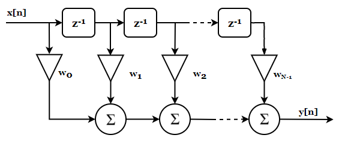
</p>

$$x$$ girişine ait ayrık örnekler birer birer kaydırılarak (figürde gösterilen $$z^{-1}$$ kendisine gelen ayrık örneği zamanda bir kez geciktirir, yani $$x[n]$$ girer, $$x[n-1]$$ çıkar) $$w$$ ağırlıklarıyla çarpılır ve her kaydırmada bu ağırlıklara denk gelen tüm çarpımlar toplanır. Bu toplamdan çıkan değer sistemin çıkışıdır artık.

Yani aslında bu figürün gösterdiği işlemi yaparsak;

$$
y[n] = w_0x[n] + w_1x[n-1] + ... + w_{N-1}x[n-N+1]
$$

ifadesini elde ederiz.

Buraya kadarki kısım ayrık zamanlı filtre tasarımında lisans düzeyinde anlatılan genel geçer bilgilerden ibaret. Bir hatırlatma veya bilmiyorsan da altyapı olsun diye anlattım. 

Peki bu filtreleri nasıl uyarlanır hale getirebiliriz?

### Uyarlanır Filtre

Basit aslında. Filtre katsayılarını yani $$w$$'ları değiştirirsek elimizdeki filtrenin darbe cevabını da değiştirmiş oluruz değil mi?

Ama bunu neden yapalım?

Bunun birkaç ilginç nedeni olabilir. Mesela bilinmeyen bir sistemi modellemeye çalışıyor olabiliriz. 

Bunun için önce elimizdeki filtrenin katsayılarını değişebilir olarak hayal etmemiz lazım. 

<p align="center">
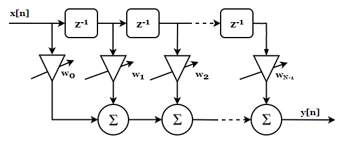
</p>

artık $$w$$ katsayıları değişebiliyor. Ama neye göre değiştireceğiz? Bilinmeyen bir sistemi modellediğimizde bu katsayıların ne olması lazım?

İşte bunun için bir algoritmaya ihtiyacımız var. Birazdan geliştireceğimiz algoritmayı kullanarak bilinmeyen sistemle elimizdeki filtreyi birbirine benzetmeye çalışacağız. Aradaki farkı sıfırlayınca ya da sıfıra çok yakın bir hale getirdiğimizde elimizdeki filtrenin artık bilinmeyen sistem gibi davrandığını düşünebiliriz. Yani sistemin çalışan bir modeli olacak elimizde. Bu fikri de görselleştirelim:

<p align="center">
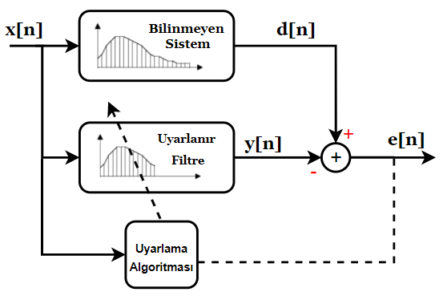
</p>

Matematiksel bakış açısından şunu söyleyebiliriz, uyarlama algoritması hatayı sıfıra indirmeyi başarırsa (sıfıra tam inmeyecektir ama yeterince yaklaşabilir) uyarlanabilir filtrenin transfer fonksiyonu modellemeye çalıştığımız bilinmeyen sistemin transfer fonksiyonuna eşit olacaktır. O noktadan itibaren uyarlanır filtrenin katsayıları artık güncellenmez. Ancak bilinmeyen sistem zamanla değişebilir. Bu durumda da uyarlanır filtre yine kendini güncelleyecektir.

İşte aktif gürültü yoketme işinde yukarıda bahsettiğimiz bilinmeyen sistemleri böyle modelleyeceğiz. Bu fikri görüntü işlemede bulanık belirleme, haberleşmede kanal kestirimi, kontrol sistemlerinde sistem belirleme, ters-sistem belirleme, gürültü giderme ya da tahmin işlerinde sıkça kullanılırken bulabilirsin. 

Peki öyleyse hatayı sıfıra indiren algoritma nasıl olabilir?

### En-Küçük Kareler

Uyarlanır filtrelerin tasarımı temel olarak En-Küçük Kareler tekniğine dayanır. 

Bu teknik $$Ax=b$$ şeklinde ifade edilen artık-belirtilmiş (over determined) doğrusal bir denklem setini çözmek için kullanılır. Bunun sebebi basittir; çünkü tüm doğrusal sistemler $$Ax=b$$ şeklinde ifade edilebilir. Burada $$A$$ bir matris, $$b$$ ve $$x$$ birer sütun vektörüdür. Amacımız elimizde $$A$$ ve $$b$$ varken $$x$$'i elde etmektir. 

$$A$$ matrisimizin boyutu $$m \times n$$'dir. $$m>n$$ olduğu durumlarda elimizde bilinmeyen sayısından çok denklem var demektir ki bu durumda genellikle tam bir çözüm yoktur. Ancak $$A$$'nın sütunları doğrusal bağımsızsa bu doğrusal denklem setini en küçük hata ile sağlayan tek bir $$x$$ çözümü vardır.

Bu doğrusal denklem setini lineer cebirsel olarak şöyle gösteririz:

<div>
$$
\begin{bmatrix}
a_{11} & a_{12} & \cdots & a_{1n}\\
a_{21} & a_{22} & \cdots & a_{2n}\\
\vdots & \vdots & \ddots & \vdots\\
a_{m1} & a_{m2} & \cdots & a_{mn}
\end{bmatrix}
\begin{bmatrix}
x_1\\x_2\\ \vdots\\x_n
\end{bmatrix}
=\begin{bmatrix}
b_1\\b_2\\ \vdots\\b_m
\end{bmatrix}
$$
</div>

Basitçe şunu söyleyebilirim ki, bulmaya çalıştığımız çözüm aslında aşağıdaki 
<div>
$$
e = \|A\hat{x}-b\|^2
$$
</div>

farkı minimize ettiğimizde ortaya çıkıyor. Bu farkı minimize etmek aslında hata vektörünün, $$A\hat{x}-b$$, enerjisini minimize etmeye denk gelir. Çift $$\|\cdot\|$$ işaretiyle gösterilen bu büyüklüğe L-2 (Öklid) normu denilir; karesini almak da bize vektörün enerjisini verir. L-1 ya da farklı normlara da bakabilirdik ama bunlar buranın konusu değil. 
 
Probleme geometrik açıdan da bakabiliriz. $$b$$ vektörünü $$A$$ matrisinin sütun uzayı üzerinde gösterebiliriz. 
Aşağıdaki figürden de görebileceğin üzere $$b$$ vektörü $$A$$ matrisinin sütun uzayında değildir. Yani $$A$$ matrisinin sütunlarının hiçbir kombinasyonu bize $$b$$'yi vermez. Ancak yaklaşık bir çözüm bulabiliriz. $$b$$ vektörüyle $$A$$ matrisinin sütun uzayı arasındaki en kısa mesafe bizim hata vektörümüzdür. Bu hata vektörü sütun uzayına diktir (yani $$A^T$$'nin boş-uzayındadır). 

<p align="center">
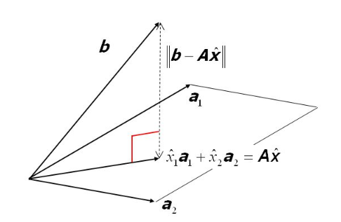
</p>

Not: Bu figür <a href="https://slideplayer.com/slide/2342847/">Ordinary Least-Squares</a> sunumundan.

O zaman geometrik olarak şunu söyleyebiliriz, çözüm ancak ve ancak $$b$$ vektörünün $$A$$'nın <a href="https://towardsdatascience.com/what-is-column-space-with-a-machine-learning-example-8f8a8d4ec6c">sütun uzayı</a> üzerindeki ortogonal projeksiyonuna eşittir. 

En küçük kareler yaklaşık çözümü ararken $$A$$'nın sütun vektörlerinin hata vektörümüzü minimum yapan kombinasyonunu bulmaya çalışıyoruz ki, $$C(A)$$ sütun uzayındaki $$A\hat{x}$$ noktası $$b$$'ye $$C(A)$$'daki diğer tüm noktalardan daha yakın olsun.  
O noktayı bulduğumuzda artık $$\hat{x_1}$$ ve $$\hat{x_2}$$ doğrusal denklem takımının çözümüdür. Umarım bu sana sezgisel bir anlayış sağlamıştır. 

Geometrik diğer bir yorum da hata performans yüzeyinin şekliyle ilgilidir. $$e$$'nin $$n$$ boyutlu $$x$$ vektörüne göre çizimi bize $$n+1$$ boyutlu bir hiper-parabol verir. $$x$$'in tek boyutlu olduğu durumda sadece bir elemanı vardır ve yüzey basit bir paraboldür. İki boyutlu durumda paraboloid olur bu yüzey ve bundan büyük boyutları çizmek mümkün değildir. Aslında bu parabolu <a href="https://tayyarg.github.io/dogrusal_regresyon_probleminin_bayesci_cikarimla_cozulmesi/">doğrusal regresyon</a>'da hata analizi kısmında konuşmuştuk hatırlarsan.

<p align="center">
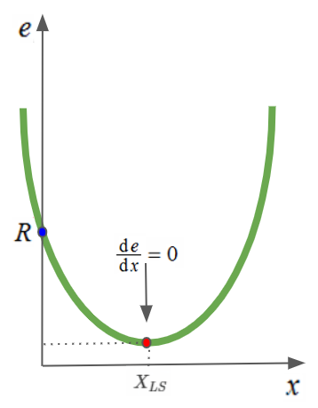
</p>

Emre: $$R$$ nereden geldi?

Kaan: Güzel soru. Bakalım nereden gelmiş.

$$A$$'nın $$2 \times 1$$'lik bir matris olduğu duruma bakalım. O zaman yukarıda sözü geçen $$e$$ vektörünü şöyle hesaplayabiliriz:

<div>
$$
\begin{gathered}
e = \|A\hat{x}-b\|^2 =
\left(
\begin{bmatrix}
a_1\\a_2 
\end{bmatrix} x
-\begin{bmatrix}
b_1\\b_2
\end{bmatrix}
\right)^T \times \left(
\begin{bmatrix}
a_1\\a_2 
\end{bmatrix} x
-\begin{bmatrix}
b_1\\b_2
\end{bmatrix}
\right) \\
= \begin{bmatrix}
a_1 \space a_2 
\end{bmatrix} \begin{bmatrix}
a_1 \\ a_2 
\end{bmatrix}x^2-2\begin{bmatrix}
b_1 \space b_2 
\end{bmatrix} \begin{bmatrix}
a_1 \\ a_2 
\end{bmatrix}x+\begin{bmatrix}
b_1 \space b_2 
\end{bmatrix} \begin{bmatrix}
b_1 \\ b_2 
\end{bmatrix} 
\end{gathered}
$$
</div>

Şimdi bu ifadenin içindeki bazı terimleri yeniden isimlendirelim;

$$
\begin{gathered}
P = (a_1^2 + a_2^2) \\
Q= (a_1b_1+a_2b_2) \\
R=(b_1^2+b_2^2)
\end{gathered}
$$

Bu geometrik yorumu ya da lineer cebirsel çözümü takip edersen, en-küçük kareler çözümünün şöyle çıkacağını göreceksin:

$$
X_{LS} = (A^TA)^{-1}A^Tb = \frac{Q}{P}
$$

Gördüğün üzere $$e$$ hata denkleminde $$x$$'in sıfır olduğu yerde parabol $$e$$ eksenini $$R$$'de kesiyor.

İşin ilginç yanı $$Ax=b$$'nin çözümüne dair başka olasılıklar da var. Eğer sistem eksik-belirtilmiş (denklem sayısından çok bilinmeyen sayısı varsa), o zaman sonsuz sayıda çözümü vardır. Tekil Değer Çözümlemesi (singular value decomposition) yöntemi (sözde-ters) kullanılarak bunların arasından en küçük normlu çözüm bulunabilir. 

Eğer bilinmeyen sayısı denklem sayısına eşitse ve $$A$$ terslenebilirse, o zaman işimiz daha da kolay. Çözüm direk;

$$
X_{LS} = A^{-1}b
$$

olacaktır. 

Bütün bunların bizim filtremizle ne ilgisi mi var?

Yukarıda bahsettiğim Sonlu Dürtü Yanıtlı filtreyi de bu şekilde ifade edebiliriz.

$$
Xw = y
$$

Burada $$X$$ matrisinin her satırı belirli bir $$n$$ anındaki $$x[n], x[n-1], \ldots, x[n-N+1]$$ giriş örneklerini tutar. Umarım aradaki benzerliği kurabilmişsindir. 

Burada dikkatini mühendisliğin ilginç bir yönüne çekmek istiyorum. Bir probleme matematiksel olarak bambaşka açılardan bakabiliyoruz. Bazen çözüme ulaşmak için her bir açıyı denememiz gerekebilir. Örneğin FIR filtresini bir fark denklemi olarak yazdık, sonra bir konvolüsyon işlemi olarak gördük, $$z$$ domeninde modelledik ve şimdi de aynı denklemi lineer cebirsel olarak doğrusal denklem sistemi olarak yazıyoruz.

### Wiener-hopf Çözümü ve Bilinmeyen Sistem Modelleme

Artık En-küçük Kareler tekniğinin doğrusal bir denklem takımını nasıl çözdüğünü biliyoruz. Bundan faydalanarak uyarlanır filtremizi tasarlayabiliriz. 

Yukarıda bilinmeyen sistem ve uyarlanır filtrenin birlikte olduğu bir mimari göstermiştim. Bilinmeyen sistemle uyarlanır filtrenin çıkışı bir fark işlemine tabi tutularak hatayı buluyorduk. Yani 

$$
e[n] = d[n]-y[n]
$$

demiştik. 

Bu kez de yapmak istediğimiz şey bu hatayı minimize eden katsayıları bulmak. 

Bunu yapabilmek için $$x[n]$$ ve $$d[n]$$ sinyallerini istatistiksel olarak biraz inceleyip üzerinde düşünmemiz lazım. Eğer $$x[n]$$ ve $$d[n]$$ <a href="https://en.wikipedia.org/wiki/Stationary_process">geniş-anlamda durağan</a> süreçlerse ve birbirleriyle ilintili (correlated) ise hata sinyalinin karelerinin ortalamasını minimize edebiliriz ki, bu çözüme Wiener-hopf çözümü denir. 

Hatırlatayım, bir rasgele sürecin istatistikleri yani ortalaması ve öz-ilinti fonksiyonu zamanla değişmiyorsa bu süreç geniş-anlamda durağan bir süreçtir. 

Filtrenin çıkışının konvolüsyon sonucunun;

$$
y[n] = \sum_{k=0}^{N-1} w_k x[n-k] = \textbf{w}^T\textbf{x}[n]
$$

olduğunu varsayalım. Wiener-hopf çözümüne ulaşmak için hatanın, $$e[n]$$ karesini alabiliriz; karesini aldığımız ifadede denklemin her iki tarafının da beklenen değerini alırsak ortalama karesel hatayı (mean square error- MSE) bulabiliriz. Bu ortalama karesel hatayı minimize ederek çözümü bulabiliriz. 

$$
E\{e^2[n]\}=E\{(d[n]-y[n])^2\}=E\{d^2[n]\}+w^TE\{x[n]x^T[n]\}w-2w^TE\{d[n]x[n]\}
$$

Bu ifadenin içinde gördüğün $$E\{x[n]x^T[n]\}$$ 'yi $$N \times N$$ 'lik ilinti matrisi $$\textbf{R}$$ ve $$E\{d[n]x[n]\}$$'de $$N \times 1$$'lik çapraz-ilinti vektörü $$\textbf{p}$$ olarak tanımlarsak. 

$$
\begin{gathered}
R = E\{x[n]x^T[n]\}\\
p = E\{d[n]x[n]\}
\end{gathered}
$$

O zaman ortalama karesel hatayı şöyle ifade edebiliriz:

$$
\zeta = E\{d[n]^2\} +\textbf{w}^T\textbf{R}\textbf{w}-2\textbf{w}^T\textbf{p}
$$

İşin güzel yanı şu ki, yukarıdaki denklem $$\textbf{w}$$'ya göre kuadratiktir yani sadece bir tane minimum noktası vardır. 
Öyleyse en küçük ortalama karesel hata (minimum mean squared error- MMSE) çözümü ($$\textbf{w}_{opt}$$), gradyan (kısmi türev) vektörünü sıfıra eşitleyerek bulunabilir:

$$
\begin{gathered}
\nabla = \frac{\partial \zeta}{\partial \textbf{w}} = 2\textbf{R}\textbf{w}-2\textbf{p} = 0 \\
\textbf{w}_{opt}=\textbf{R}^{-1}\textbf{p}
\end{gathered}
$$

Evet, şu anda ortalama karesel hatayı minimize eden katsayıları bulan denkleme bakıyorsun!

<p align="center">
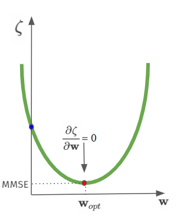
</p>

Gördüğün üzere Wiener-hopf çözümünde bir geribesleme yok! Yani hata vektörünü çözümde göremiyoruz. Ama yukarıda çizdiğimiz mimaride katsayıları güncelleyen algoritmaya bir geribesleme vardı. 

Bunun nedeni şu; Wiener-hopf tek seferde hesaplanan kapalı formda bir çözümdür. Çözüme adım adım yaklaşmaz, doğrudan hesaplar. $$\textbf{R}$$ matrisi terslenebildiği sürece de tek bir çözüm vardır. Bu nedenle aslında $$x[n]$$ ve $$d[n]$$ verilerinden sadece ilinti matrisi $$\textbf{R}$$'yi ve çapraz ilinti vektörü $$\textbf{p}$$'yi hesaplamak optimal filtre katsayılarını bulmak için yeterli aslında. 

Ancak sorun şu ki, $$\textbf{R}$$'nin hesaplanması için $$N$$ uzunluğundaki bir filtre için ve $$M$$ sayıda örnekle $$2 \times M \times N$$ çarpma-ve-toplama (multiply-and-accumulate - MAC) işlemi gerekir. Ardından $$\textbf{R}$$'nin terslenmesi $$N^3$$ çarpma-ve-toplama ve son olarak çapraz ilinti fonksiyonu ile çarpımı $$N^2$$ çarpma-ve-toplama işlemi gerektirir. Yani tek aşamalı Wiener-hopf algoritmasının işlem yükü $$N^3 + N^2 + 2MN$$'dir. Bu işlem yükü malesef gerçek zamanlı uygulamalar yapmak için çok fazladır. Daha da kötüsü, eğer $$x$$ ve $$d$$'nin istatistikleri değişirse filtre katsayıları yeniden hesaplanmalıdır. Yani algoritmanın takip etme özelliği de yoktur. Sonuç olarak Wiener-hopf pratik değildir. Benzeri bir analizi En-küçük Kareler çözümü için de söyleyebiliriz. Veri boyu arttıkça matris boyutları çok büyür. Büyüyen matris boyları $$A^TA$$ matrisinin tersinin alınmasını işlem yükü açısından çok zorlaştırır. 

Buradan bir çıkış yok mu?

Her zamanki gibi, elbette var. 

Hata enerjisini minimize etmek isteyen gerçek zamanlı sistemler gradyan iniş tabanlı en-küçük ortalama kareler (least-mean-squares) veya özyineli en-küçük kareler (recursive least squares) gibi yinelemeli uyarlanır algoritmalar kullanır. 

Gradyan iniş algoritmasından <a href="https://tayyarg.github.io/dogrusal_regresyon_probleminin_bayesci_cikarimla_cozulmesi/">Bayesçi Çıkarım ve Doğrusal Regresyon</a> üzerine konuşurken bahsetmiştik. 

### En-küçük Ortalama Kareler (LMS)

En baştan şunu söyleyeyim; LMS algoritması bazı şartlar sağlandığında Wiener-hopf çözümüne yakınsar. Aslında burada da yine ortalama karesel hata performans yüzeyini oluşturuyoruz. Ancak bu kez kapalı form Wiener-hopf çözümü yerine gradyan inişi tabanlı bir çözüm uyguluyoruz.

Algoritmanın özeti şöyle; hiper-parabol üzerinde herhangi bir noktadan başlarız, filtre katsayılarını en dik gradyanın ters yönünde değiştiririz ve yakınsaklığa ulaşıp ulaşmadığımızı kontrol ederiz. Ulaştıysak algoritma sonlanır, yoksa gradyanı değiştirme adımına geri döneriz.

Hata performans yüzeyinin gradyanını hatırlayalım:

$$
\nabla_n = \frac{\partial E\{e^2[n]\}}{\partial \textbf{w}[n]} = 2\textbf{R}\textbf{w}[n]-2\textbf{p} 
$$

Bu durumda gradyan iniş algoritması şöyledir:

$$
\textbf{w}[n+1] = \textbf{w}[n]+\mu(-\nabla_n)
$$

Burada $$\mu$$'yü ilk kez gördün. Sen sormadan ben söyleyeyim $$\mu$$ bizim gradyan hesapladıkça ilerlemeyi kabul ettiğimiz adım aralığı. Bu adım aralığı uyarlamanın hızını ve yakınsaklık anındaki hatanın teorik olana (MMSE) yakınlığını belirliyor. $$\mu$$'yü küçük seçerek küçük sıçramalarla optimum noktaya ilerlenebilir. Adım büyüklüğü küçük olduğundan yakınsama yavaş olacaktır ama yine de optimum nokta civarında küçük adımlarla dolaşınca teoriye en yakın noktada algoritma sonlandırılarak başarılı bir kestirim yapılabilir. Adım aralığı büyük tutulunca hızlıca yakınsama sağlanabilir ancak bu kez de optimum noktaya yakın yerlerde büyük sıçramalar yapacağımızdan optimum noktaya yaklaşmak zor olacaktır. 

Herneyse, burada bir sorun gözüne çarpmadı mı?

Emre: Çarpmaz mı! Biz $$\textbf{R}$$ ve $$\textbf{p}$$'yi hesaplamak çok işlem yükü alıyor diye yeni bir yöntem arıyorduk. Yine bunlara bağlı bir algoritma bulduk sanki. Performans yüzeyini hesaplamanın maliyeti yine yüksek değil mi?

Kaan: Tam üstüne bastın!

$$\textbf{R}$$ ve $$\textbf{p}$$'yi hesaplama işinden kurtulmanın bir yolunu bulmamız lazım.

Bunun için gerçek gradyan yerine "anlık" gradyan kestirimi yapabiliriz! Bunu yapmanın bir yolu gradyanı hesaplarken hatanın karesinin beklenen değeri (ortalaması) yerine sadece o anki değerinin karesini kullanmaktır.

$$
\begin{gathered}
e[n] = d[n] - y[n] = d[n]-\textbf{w}^T[n]\textbf{x}[n] \\
\frac{\partial e[n]}{\partial \textbf{w}[n]}=-\textbf{x}[n] \\
\hat{\nabla}_n = \frac{\partial e^2[n]}{\partial \textbf{w}[n]} = 2e[n]\frac{\partial e[n]}{\partial \textbf{w}[n]}=-2e[n]\textbf{x}[n]
\end{gathered}
$$

Öyleyse gradyanın anlık kestirimi kullanılarak filtre güncellemesi şu şekilde yapılabilir:

$$
\textbf{w}[n+1] = \textbf{w}[n]+\mu(-\hat{\nabla}_n) = \textbf{w}[n] + 2\mu e[n]\textbf{x}[n]
$$

Hepsi bu. LMS algoritmasını uygulamak işlem yükü açısından basittir. Adım başına FIR filtreyi uygulamak için $$N$$ adet çarpma-ve-toplama (MAC) ve filtreyi güncellemek için de $$N$$ adet MAC işlemi gerekir. 

O zaman uyarlanır filtremizin son haline bir bakalım:

<p align="center">
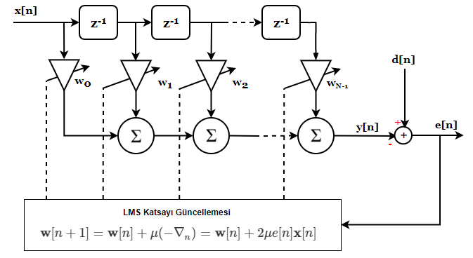
</p>

Algoritma tasarımının önemli bir aşaması uyarlanır filtre boyuna karar vermektir. Uzun filtreler sistemi daha iyi modeller ancak bu da işlem yükünü artırır. 

İkinci parametre de adım aralığıdır. Hem hızlıca yakınsamayı hem de algoritmayı kararsız hale getirmeyecek şekilde seçilmesi gerekir. Genellikle uygulanan bir seçim şöyledir:

<div>
$$
0 < \mu < \frac{1}{N \times E\{x^2[n]\}}
$$
</div>

Bu denklemde $$N$$ filtre boyudur, $$E\{x^2[n]\}$$'i de giriş sinyalinin gücü olarak yorumlayabilirsin.

Öyleyse LMS algoritmasının özetini bir daha gösterelim:



## Aktif Gürültü Yoketme

Şimdi yukarıda tanımladığımız algoritmayı kodlayarak aktif gürültü yoketmenin bir jet uçağı gürültüsü üzerinde nasıl çalıştığına bakalım. Jet gürültüsünü <a href="http://web.archive.org/web/20190911232731/http://thebeautybrains.com/wp-content/uploads/podcast/soundfx/insidejet.wav">thebeautybrains.com</a>'dan (arşivlenmiş kopya) indirebilirsiniz. 

```python
import numpy as np
from scipy.signal import lfilter
from scipy.io import wavfile
import matplotlib.pyplot as plt

# iterasyon sayisi
N_iter = 10000

# Jet içi gürültü kaydını yükleyelim (stereo ise tek kanalını kullanalım)
fs, signal = wavfile.read('insidejet.wav')
if signal.ndim > 1:
  signal = signal[:, 0]

# giriş sinyal kaydı 8 bit işaretsiz olduğu için (örnekler 128 etrafında) normalize edelim
x = (signal.astype(float) - 128) / 128

# birincil yol filtre katsayılarını oluşturalım (bir gecikme ve ardından sönümlenen bir yanıt)
ind = np.arange(0,2.0,0.2)
p1 = np.zeros(50)
p2 = np.exp(-ind**2)
p = np.append(p1,p2)
p = p / np.sum(p)
p_len = len(p)

# x giriş sinyali üzerinde FIR filtreleme yapalım
d = lfilter(p, [1.0], x)

# uyarlanır filtre katsayılarını ilklendirelim
w_len = p_len
w = np.zeros(w_len)

# adım aralığını kararlılık sınırı 1/(N*E[x^2])'nin bir kesri olarak seçelim (N filtre boyu)
mu = 0.1/(w_len*np.mean(x**2))

error_array = []
# uyarlanır filtre algoritmasını çalıştıralım
# anti-gürültü havada gürültüye eklendiği için hata mikrofonu e = d + y duyar.
# Bu yüzden güncelleme ters işaretlidir ve w, -p'ye (anti-gürültü filtresine) yakınsar.
for i in range(w_len, N_iter):
  x_ = x[i:i-w_len:-1]
  e = d[i] + w.dot(x_)
  w = w - mu * 2 * x_ * e
  error_array.append(e)

f1 = plt.figure()
f2 = plt.figure()

ax1 = f1.add_subplot(111)
ax1.plot(p)
ax1.set_title('Birincil yol (primary path) filtre katsayıları')
ax2 = f2.add_subplot(111)
ax2.plot(error_array)
ax2.set_title('Jet içi gürültüsü - Uyarlanır Filtre hata eğrisi')
ax2.set(xlabel='iterasyon', ylabel='e')
plt.show()
```
Bu algoritmayı çalıştırınca ortaya çıkacak hata eğrisi aşağıdaki gibi olacak:

<p align="center">
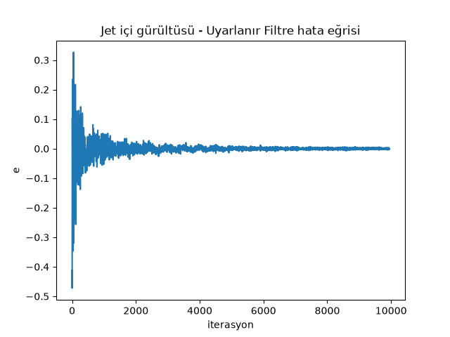
</p>

Tasarladığımız birincil yol (primary path) filtre katsayıları da şöyle olacaktır:

<p align="center">
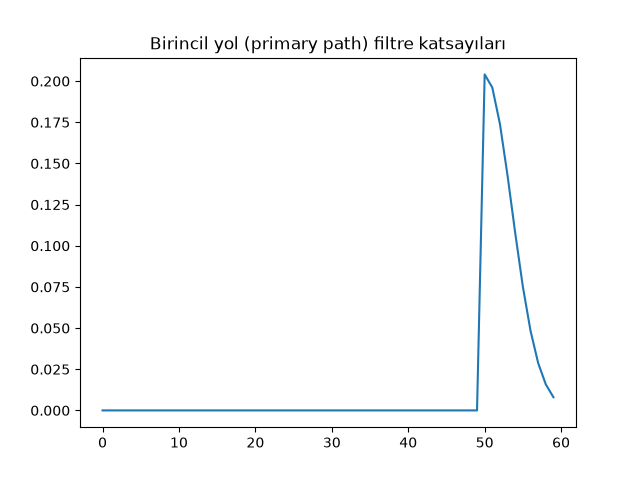
</p>

## Gerçek Hayat 

Simülasyonları olduğu şekilde bir Sayısal Sinyal İşleyici (digital signal processor- DSP) üzerinde gerçeklersen göreceksin ki teorik haliyle çalışmayacak. Bunun iki sebebi var. Birincisi, hoparlörden çıkan anti-gürültü akustik olarak referans mikrofonuna ulaşıp referans olarak ölçtüğümüz sinyali bozabilir.  

İkinci olarak da, uyarlanır filtrenin çıkışındaki elektriksel sinyal hoparlörden çıkana kadar ve hata sinyali de mikrofondan elektriksel olarak okunup işlemciye ulaşana kadar iki farklı sistemden geçer. Bu problemlerin de hesaba katılması lazım.  

Gerçek hayatta Filtered-x Least Mean Square (Fx-LMS) ya da RLS (Recursive Least Squares) algoritmaları kullanılmaktadır. Fx-LMS, referans sinyalini ikincil yolun (yukarıda bahsettiğimiz hoparlörden hata mikrofonuna kadar olan kanalın) bir modelinden geçirerek bu yolun etkisini telafi eder. RLS ise LMS'ten çok daha hızlı yakınsar, ancak bunun bedeli örnek başına daha fazla işlem yüküdür ($$N$$ yerine $$N^2$$). İleri seviyede bu işle uğraşmak istiyorsan bu kadar sezgisel ve teorik bilgiden sonra bu algoritmalara da bakabilirsin.

Bir de gerçek dünya problemlerinde genellikle birden fazla referans mikrofonu ve birden fazla hoparlörlü (çok kanallı) aktif gürültü yoketme sistemleri geliştiriliyor. Çok kanallı AGY'nin matematiği de şimdiye kadar baktıklarımızdan çok farklı değil. Temel olarak bu bahsi anladıysan, çok kanallı çözümü anlatan literatürü de kolayca anlayabilirsin.

## Referanslar
1. <a href="https://www.amazon.com/Adaptive-Filter-Theory-4th-fourth/dp/B0085AY57Q">Adaptive Filter Theory</a>, Simon Haykin
2. İşaret İşlemede İleri Konular, Ders Notları, Fatih Kara
3. <a href="https://www.findsounds.com/ISAPI/search.dll?start=11&keywords=jet&seed=22">Jet ses kayıtları</a>
4. <a href="https://towardsdatascience.com/what-is-column-space-with-a-machine-learning-example-8f8a8d4ec6c">What is Column Space? — Example, Intuition & Visualization</a>

<a href="https://www.freecounterstat.com" title="visitor counters"></a>

