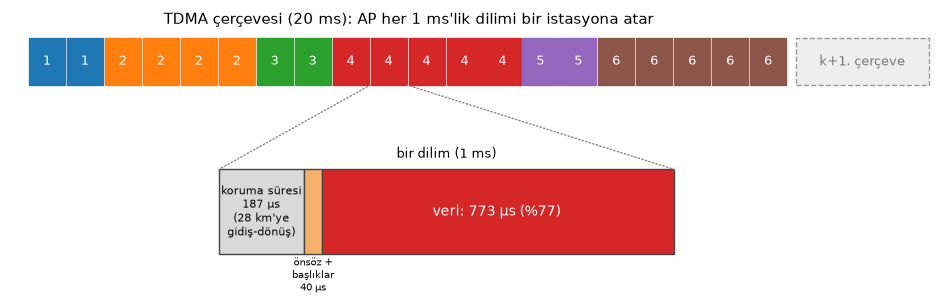
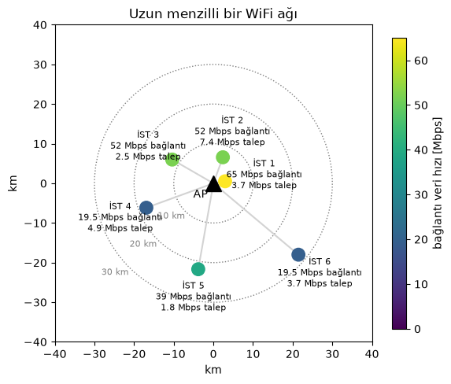
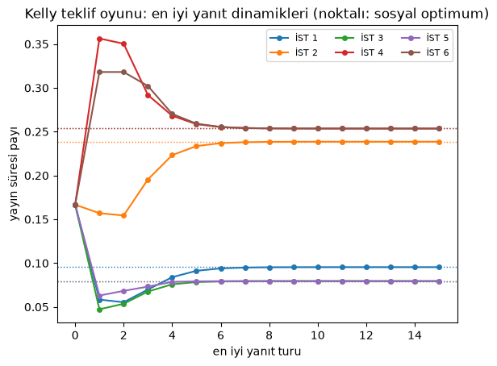
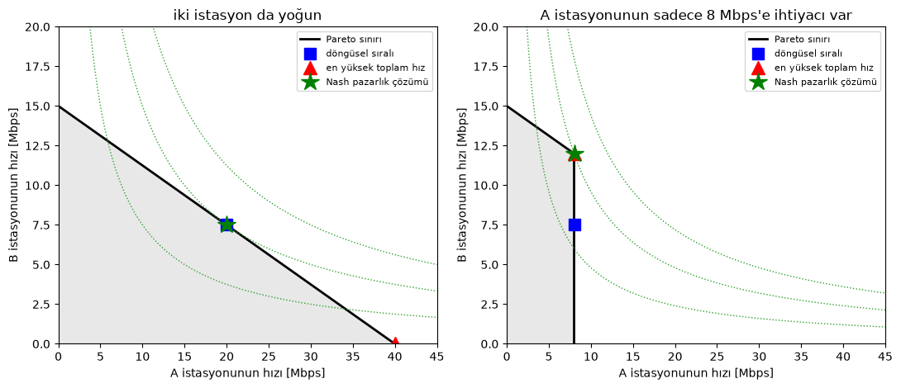
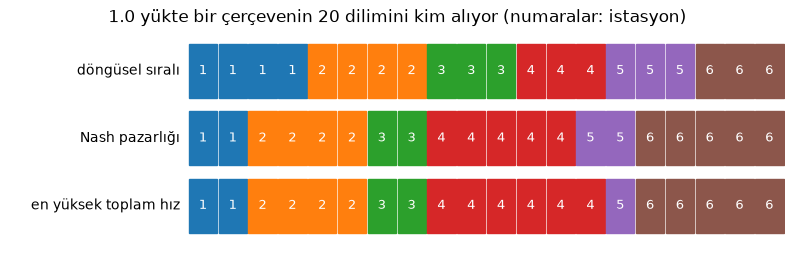
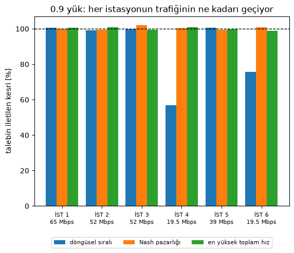
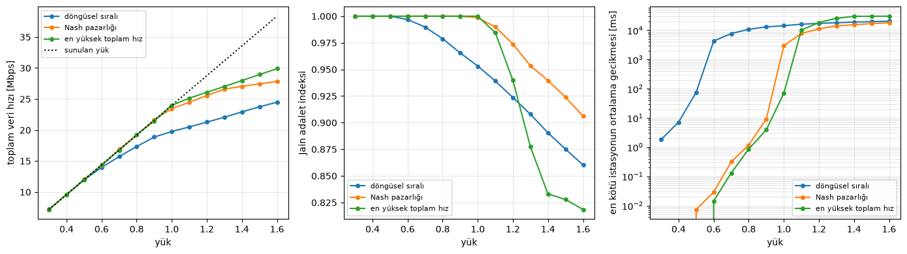

Emre: Kablosuz ağlarda oyun teorisinin kullanıldığını duyup duruyorum. Oyunların radyolarla ne ilgisi var?

Kaan: Birkaç kullanıcı bir kaynağı paylaşıyorsa ve her biri ondan olabildiğince fazla almak istiyorsa, elinde bir oyun var demektir. Kablosuz ağlarda bu kaynak genellikle spektrum ya da yayın süresidir (airtime). Çok somut bir örnek alalım, uzun menzilli bir WiFi ağı, ve onu oyun teorisinin ana fikirlerini tek tek öğrenmek için kullanalım: oyuncular, stratejiler, Nash dengesi, anarşinin bedeli, mekanizma tasarımı ve pazarlık. Sonunda oyun teorik bir çizelgeleyici kurup onu en basitiyle, döngüsel sıralı (round robin) çizelgeleyiciyle karşılaştıracağız.

## Problem - Uzun Menzilli bir WiFi Ağında Havayı Paylaşmak

Birçok kırsal bölgede internet erişimi uzun menzilli WiFi bağlantıları üzerinden gelir. Bir tepeye ya da kuleye kurulmuş bir erişim noktası (AP), birkaç kilometreden onlarca kilometreye kadar uzaktaki, her biri yönlü bir anteniyle AP'ye bakan müşterilere (istasyonlara) hizmet verir. Donanım sıradan, ucuz WiFi donanımıdır ama mesafeler hiç de sıradan değildir.

Standart WiFi CSMA/CA kullanır: bir istasyon kanalı dinler, kanal boşsa iletir ve bir onay (ACK) bekler. Bu, onlarca metrelik mesafeler için tasarlanmıştır ve uzun bağlantılarda bozulur:

- **ACK zaman aşımı:** bir WiFi vericisi onayı birkaç on mikrosaniye içinde bekler. 20 km'de sadece gidiş-dönüş süresi 133 µs'dir. Zaman aşımını uzatabilirsin ama o zaman her alışverişte bekleyerek zaman kaybedersin.
- **Gizli istasyonlar:** aralarında kilometreler olan ve hepsi AP'ye bakan istasyonlar birbirini duyamaz. Taşıyıcı algılama işe yaramaz ve paketleri AP'de çarpışır.
- **Dilim süreleri:** çekişme mekanizması herkesin bir iletimi birkaç mikrosaniyelik bir dilim süresi içinde duyduğunu varsayar. Uzun mesafelerde duymazlar.

Bu yüzden uzun menzilli WiFi ağları neredeyse her zaman CSMA/CA yerine **TDMA (Zaman Bölmeli Çoklu Erişim)** kullanır: AP zamanı çerçevelere, her çerçeveyi de dilimlere böler ve her istasyona hangi dilimlerde iletebileceğini söyler. Çekişme yok, çarpışma yok, ACK zaman aşımı sorunu yok. Ama artık AP'nin **kime kaç dilim vereceğine** karar vermesi gerekiyor ve işler burada ilginçleşiyor.

<p align="center">

</p>

En basit cevap **döngüsel sıralı (round robin)** çizelgelemedir: her istasyon sırayla aynı sayıda dilim alır. Basittir ve adil görünür. Ama istasyonlar birbirinden çok farklı. Bazıları AP'ye yakındır ve yüksek veri hızları elde eder, bazıları uzaktadır ve düşük hızlarla çalışır. Bazıları internette gezinen tek bir hanedir, bazıları ise her akşam sunucularını yedekleyen küçük bir işletmedir. Hepsine aynı yayın süresini vermek en akıllıca seçim olmayabilir.

Ağımızı kuralım: 5.8 GHz'de bir AP ve 3 ile 28 km arasındaki mesafelerde altı istasyon. Her istasyonun veri hızı bağlantı bütçesinden geliyor: verici gücü artı anten kazançları eksi boş uzay yol kaybı ve ağaçlar ya da kısmi engeller için biraz ek kayıp alınan sinyali verir; gürültü tabanıyla karşılaştırıldığında bu SNR'dır ve SNR çalışan en yüksek 802.11 modülasyon ve kodlama şemasına (MCS) karar verir.

```python
import numpy as np
import matplotlib.pyplot as plt

rng = np.random.default_rng(11) # sonuclar tekrarlanabilir olsun diye rasgele sayi uretecini sabitleyelim

# 5.8 GHz'de, 20 MHz'lik kanal icin baglanti butcesi
F_MHZ, PT, G_AP, G_STA, CABLE, NOISE = 5800, 23, 17, 23, 2, -95   # MHz, dBm, dBi, dBi, dB, dBm
dist_km = np.array([3, 7, 12, 18, 22, 28.0])          # her istasyonun AP'ye uzakligi
excess_db = np.array([0, 9, 4, 12, 3, 6.0])           # ek kayip: agaclar, kismi engeller
azimuth = np.radians([10, 70, 150, 200, 260, 320])     # sadece harita icin

fspl = 20 * np.log10(dist_km) + 20 * np.log10(F_MHZ) + 32.44     # bos uzay yol kaybi [dB]
snr = PT + G_AP + G_STA - CABLE - fspl - excess_db - NOISE

# 802.11n, 20 MHz, tek uzamsal akis: veri hizi [Mbps] ve gerektirdigi SNR [dB]
MCS_RATE = np.array([6.5, 13, 19.5, 26, 39, 52, 58.5, 65])
MCS_SNR = np.array([5, 8, 11, 14, 18, 22, 24, 26.0])
rates = np.array([MCS_RATE[MCS_SNR <= s].max() for s in snr])

# TDMA cercevesi: 1 ms'lik 20 dilimden olusan 20 ms
FRAME, S = 20e-3, 20
SLOT = FRAME / S
guard = 2 * dist_km.max() * 1e3 / 3e8                  # en uzak istasyona gidis-donus
overhead = 40e-6                                        # onsoz (preamble) ve basliklar
eff = (SLOT - guard - overhead) / SLOT                  # her dilimin kullanilabilir orani
cap_bits = rates * 1e6 * SLOT * eff                     # bir istasyonun bir dilimde gonderebilecegi bit
R = rates * eff                                         # tum cerceve onun olsaydi elde edecegi hiz [Mbps]

# trafik talebi [Mbps]; 1.0 yukte istasyonlarin cercevenin %95'ine ihtiyac duyacagi sekilde olceklendi
base = np.array([3, 6, 2, 4, 1.5, 3.0])
demand = base * 0.95 / np.sum(base / R)

print("koruma suresi %.0f us, bir dilimin kullanilabilir orani %%%.1f" % (guard * 1e6, 100 * eff))
print("istasyon  mesafe   SNR    hiz       talep     gereken sure")
for i in range(6):
    print("  %i       %4.0f km  %4.1f dB %4.1f Mbps %4.2f Mbps  %%%4.1f"
          % (i + 1, dist_km[i], snr[i], rates[i], demand[i], 100 * demand[i] / R[i]))

fig, ax = plt.subplots(figsize=(6.5, 6))
x, y = dist_km * np.cos(azimuth), dist_km * np.sin(azimuth)
for r in (10, 20, 30):
    ax.add_patch(plt.Circle((0, 0), r, fill=False, ls=':', color='gray'))
    ax.text(-r * 0.71, -r * 0.71, '%i km' % r, color='gray', fontsize=8, ha='right', va='top')
sc = ax.scatter(x, y, c=rates, cmap='viridis', s=140, vmin=0, vmax=65, zorder=3)
ax.plot(0, 0, 'k^', ms=14)
ax.text(-1.5, -1.5, 'AP', fontsize=10, ha='right', va='top')
for i in range(6):
    ax.plot([0, x[i]], [0, y[i]], color='lightgray', zorder=1)
    r_label = max(dist_km[i] + 7, 13)                      # etiketi biraz daha disari koyalim
    lx, ly = r_label * np.cos(azimuth[i]), r_label * np.sin(azimuth[i])
    ax.text(lx, ly, 'İST %i\n%g Mbps bağlantı\n%.1f Mbps talep' % (i + 1, rates[i], demand[i]),
            fontsize=8, ha='center', va='center')
plt.colorbar(sc, label='bağlantı veri hızı [Mbps]', shrink=0.8)
ax.set_xlim(-40, 40); ax.set_ylim(-40, 40); ax.set_aspect('equal')
ax.set_xlabel('km'); ax.set_ylabel('km')
ax.set_title('Uzun menzilli bir WiFi ağı')
plt.show()
```

```
koruma suresi 187 us, bir dilimin kullanilabilir orani %77.3
istasyon  mesafe   SNR    hiz       talep     gereken sure
  1          3 km  38.7 dB 65.0 Mbps 3.69 Mbps  % 7.3
  2          7 km  22.4 dB 52.0 Mbps 7.38 Mbps  %18.3
  3         12 km  22.7 dB 52.0 Mbps 2.46 Mbps  % 6.1
  4         18 km  11.2 dB 19.5 Mbps 4.92 Mbps  %32.6
  5         22 km  18.4 dB 39.0 Mbps 1.84 Mbps  % 6.1
  6         28 km  13.3 dB 19.5 Mbps 3.69 Mbps  %24.5
```

<p align="center">

</p>

Son sütuna bak. Her istasyonun talebini taşımak için ihtiyaç duyduğu yayın süresi oranı bu ve %6 ile %33 arasında değişiyor. Sorunlu çocuk 4. istasyon: talebi mütevazı ama uzakta ve birkaç ağacın arkasında, bu yüzden bağlantısı sadece 19.5 Mbps'de çalışıyor ve tüm yayın süresinin üçte birine ihtiyaç duyuyor. Döngüsel sıralı çizelgeleme her istasyona altıda bir (%16.7) veriyor. 1., 3. ve 5. istasyonların o kadarına ihtiyacı yok ve paylarının bir kısmını boşa harcayacaklar; 4. ve 6. istasyonların ise çok daha fazlasına ihtiyacı var ve kuyrukları birikecek. Koruma süresine de dikkat et: 28 km'de gidiş-dönüş 187 µs sürüyor, bu da her 1 ms'lik dilimin neredeyse beşte birini yiyor. Uzun menzilin, paylaşmaya başlamadan önce bile bir bedeli var.

## Hızlandırılmış Oyun Teorisi

Bir **oyunun** üç bileşeni vardır:

- **Oyuncular:** burada altı istasyon.
- **Stratejiler:** her oyuncunun yapabilecekleri. Burada bir istasyonun AP'den ne istediği.
- **Getiriler (faydalar):** her oyuncunun sonuçtan ne kadar memnun olduğu. Burada istasyonun elde ettiği veri hızının bir fonksiyonu.

Her oyuncu kendi getirisini maksimize edecek stratejiyi seçer ve sonucun diğerlerinin yaptıklarına da bağlı olduğunu bilir. **Nash dengesi**, her oyuncu için bir strateji olmak üzere, hiçbir oyuncunun tek başına kendi stratejisini değiştirerek getirisini artıramadığı bir strateji kümesidir. Her oyuncu diğerlerine karşı **en iyi yanıtını** oynuyordur. Nash dengesi kararlıdır ama kararlı olmak iyi olmak demek değildir.

Getiri olarak bir istasyonun aldığı veri hızının, talebiyle sınırlanmış logaritmasını kullanacağız:

<div>
$$
u_i = \log \left( \min(\theta_i R_i, \lambda_i) \right)
$$
</div>

Burada $$\theta_i$$, $$i$$. istasyonun aldığı yayın süresi oranı, $$R_i$$ tüm çerçeve onun olsaydı alacağı veri hızı, $$\lambda_i$$ ise talebidir. Neden logaritma? **Azalan getiriler** yüzünden: 1 Mbps'den 2 Mbps'ye çıkmak hayatını değiştirir, 20'den 21 Mbps'ye çıkmak değiştirmez. Sınır da bir istasyonun trafiği olmayan kapasiteyi umursamadığını söylüyor.

Bir sonuç ağın bütünü için ne kadar iyi? Yaygın bir ölçü getirilerin toplamı, $$\sum_i u_i$$, yani **sosyal refah**. Logaritmik getirilerle onu maksimize etmek meşhur **orantısal adalet** (proportional fairness) kriteridir. Peki en kötü Nash dengesi sosyal optimumdan ne kadar kötü? Bu orana **anarşinin bedeli** (price of anarchy) denir.

### Müştereklerin Trajedisi

En saf oyunla başlayalım. Her istasyon AP'ye ne kadar yayın süresi istediğini, $$r_i$$'yi, söylüyor ve AP çerçeveyi isteklerle orantılı paylaştırıyor: $$\theta_i = r_i / \sum_j r_j$$. İstekler bedava.

Emre: O zaman herkes çerçevenin tamamını isteyecek!

Kaan: Aynen öyle. Diğerleri ne isterse istesin, daha fazla istemek sana asla daha az kazandırmaz. Daha fazla dilim aynı zamanda trafik patlamaları için pay demektir, bu yüzden her şeyi istemek **baskın bir stratejidir**. Nash dengesinde her istasyon %100 ister ve AP çerçeveyi eşit paylaştırır. İstasyonlar ne kadar farklı olursa olsun, döngüsel sıralı çizelgelemeye geri döndük. Paylarına ihtiyacı olmayan istasyonlar onu boşa harcar, daha fazlasına ihtiyacı olanlar alamaz ve kimsenin farklı davranmak için bir teşviki yoktur. Bu, **müştereklerin trajedisinin** (tragedy of the commons) kablosuz versiyonu: ot bedava olduğu için ortak meraya fazla hayvan salan köylüler.

Sorun şu ki bedava istekler hiçbir bilgi taşımaz. Verimli bir sonuç elde etmek için ya istasyonların yayın süresine gerçekte ne kadar değer verdiklerini ortaya koymaları için isteklerin bir bedeli olmalı ya da güvenilir bir hakemin karar vermesine izin vermeliyiz. İkisine de bakalım.

## Kelly Mekanizması: Yayın Süresine Fiyat Koymak

Frank Kelly 1997'de bir kaynağı paylaştırmak için basit bir mekanizma önerdi. Her istasyon ödemeye razı olduğu bir miktar olan bir **teklif** $$w_i$$ verir (para ya da bir ağ jetonu olarak) ve teklifiyle orantılı bir yayın süresi payı alır:

<div>
$$
\theta_i = \frac{w_i}{\sum_j w_j}, \qquad
\text{getiri}_i = \log\left(\min(\theta_i R_i, \lambda_i)\right) - w_i
$$
</div>

Artık daha fazla istemenin bir bedeli var, bu yüzden her istasyon daha fazla yayın süresinin faydasını fiyatıyla dengelemek zorunda. Bir oyunun kurallarını bencil oyuncular iyi bir yere varacak şekilde tasarlamaya **mekanizma tasarımı** denir.

Bu oyunu talebin kapasitenin %30 üzerinde olduğu yoğun saatte (1.3 yük) oynayalım. Tam olarak döngüsel sıralı çizelgelemeyi veren eşit tekliflerle başlıyoruz ve ardından istasyonların sırayla en iyi yanıtlarını oynamasına izin veriyoruz: her istasyon diğerlerinin mevcut tekliflerine göre kendi getirisini maksimize eden teklifi buluyor. Buna **en iyi yanıt dinamikleri** denir. Değişim durursa bir Nash dengesi bulmuşuz demektir.

```python
from scipy.optimize import minimize_scalar

load = 1.3
lam = demand * load                                   # yogun saat talebi [Mbps]

def welfare(theta):
    return np.sum(np.log(np.minimum(theta * R, lam)))

def best_response(i, w):
    """Diger tekliflere gore i. istasyonun getirisini maksimize eden teklif."""
    others = w.sum() - w[i]
    payoff = lambda b: np.log(min(b / (b + others) * R[i], lam[i])) - b
    return minimize_scalar(lambda b: -payoff(b), bounds=(1e-6, 10), method='bounded').x

w = np.full(6, 0.1)                                   # esit teklifler: dongusel sirali
shares = [w / w.sum()]
for _ in range(15):
    for i in range(6):                                # istasyonlar sirayla oynuyor
        w[i] = best_response(i, w)
    shares.append(w / w.sum())
theta_ne = w / w.sum()

def proportional_fair():
    """Sosyal optimum: max sum(log), yani esit paylar ama kimse ihtiyacindan fazlasini almiyor."""
    cap = lam / R
    theta, free, left = np.zeros(6), np.ones(6, bool), 1.0
    while True:
        share = left / free.sum()
        capped = free & (cap <= share)
        if not capped.any():
            theta[free] = share
            return theta
        theta[capped] = cap[capped]; left -= cap[capped].sum(); free &= ~capped

theta_pf = proportional_fair()
theta_rr = np.full(6, 1 / 6)
for name, th in (("dongusel sirali", theta_rr), ("Kelly dengesi", theta_ne), ("orantisal adil", theta_pf)):
    print("%-16s paylar %s  toplam hiz %.1f Mbps  refah %.3f"
          % (name, np.round(th, 3), np.minimum(th * R, lam).sum(), welfare(th)))

shares = np.array(shares)
for i in range(6):
    plt.plot(shares[:, i], 'o-', ms=4, label='İST %i' % (i + 1))
    plt.axhline(theta_pf[i], color=plt.gca().lines[-1].get_color(), ls=':', lw=1)
plt.xlabel('en iyi yanıt turu'); plt.ylabel('yayın süresi payı')
plt.title('Kelly teklif oyunu: en iyi yanıt dinamikleri (noktalı: sosyal optimum)')
plt.legend(ncol=3, fontsize=8)
plt.show()
```

```
dongusel sirali  paylar [0.167 0.167 0.167 0.167 0.167 0.167]  toplam hiz 22.1 Mbps  refah 7.350
Kelly dengesi    paylar [0.095 0.239 0.08  0.254 0.08  0.254]  toplam hiz 27.6 Mbps  refah 8.548
orantisal adil   paylar [0.095 0.239 0.08  0.254 0.08  0.254]  toplam hiz 27.6 Mbps  refah 8.548
```

<p align="center">

</p>

Döngüsel sıralı paylaşımdan başlayan teklifler birkaç turda oturuyor ve denge tam olarak sosyal optimum: 1., 3. ve 5. istasyonlar ihtiyaçları kadarını alıyor, geri kalan da üç yoğun istasyon arasında eşit paylaşılıyor. Toplam veri hızı 22.1 Mbps'den 27.6 Mbps'ye çıkıyor ve bunu kimse merkezi olarak planlamadı. Her istasyon sadece en iyi yanıtını oynadı.

Emre: Kelly dengesi her zaman optimal mi?

Kaan: Her zaman değil. Burada optimal, çünkü tüm istasyonlar veri hızına aynı şekilde (aynı logaritmayla) değer veriyor. Oyuncular kaynağa farklı değer verdiğinde, fiyatı oynatabilecek kadar büyük olduğunu bilen bir istasyon teklifini stratejik olarak kısabilir ve denge biraz verimsizleşir. Johari ve Tsitsiklis kaybın optimal refahın %25'ini asla geçmediğini kanıtladılar: Kelly mekanizmasının anarşi bedeli en fazla 4/3'tür. Bunu dengenin keyfi derecede kötü olabildiği bedava istek oyunuyla karşılaştır.

## Nash Pazarlık Çözümü: Adil bir Hakem

Bir TDMA ağında zaten AP karar veriyor. İstasyonlara bir piyasa oyunu oynatmak yerine AP'nin **adil bir hakem** gibi davranmasına izin verebiliriz. O zaman soru şuna dönüşüyor: iş birliğinin kazançlarını paylaştırmanın adil bir yolu nedir?

John Nash 1950'de bu soruyu birkaç sağduyulu aksiyomla cevapladı. Adil bir çözüm şöyle olmalı:

1. **Pareto verimli:** birisi için daha iyi olup hiç kimse için daha kötü olmayan başka bir sonuç yoktur.
2. **Simetrik:** aynı durumdaki oyuncular aynı sonucu alır.
3. **Birimlerden bağımsız:** birinin getirisini Mbps yerine kbps ile ölçmek sonucu değiştirmez.
4. **İlgisiz alternatiflerden bağımsız:** seçilmemiş seçenekleri ortadan kaldırmak seçimi değiştirmez.

Her pazarlığın bir de **anlaşmazlık noktası** $$d_i$$ vardır: pazarlık başarısız olursa her oyuncunun alacağı. Nash, dört aksiyomun hepsini sağlayan tek çözümün anlaşmazlık noktası üzerindeki kazançların çarpımını maksimize eden çözüm olduğunu kanıtladı:

<div>
$$
\max_{\theta} \prod_i \left( u_i(\theta) - d_i \right) \quad \text{öyle ki} \quad u_i(\theta) \geq d_i, \quad \sum_i \theta_i = 1
$$
</div>

Buna **Nash Pazarlık Çözümü (NPÇ)** denir. Logaritmasını alırsak $$\sum_i \log(u_i - d_i)$$'yi maksimize ediyor: $$d_i = 0$$ ve $$u_i$$ veri hızı olduğunda bu yine tam olarak orantısal adalettir.

Anlaşmazlık noktasının seçimi işin mühendislik kısmı. Bizim ağımızda doğal seçim **döngüsel sıralı çizelgeleme**: hiçbir pazarlık olmadan her istasyonun zaten aldığı şey bu. Anlaşmazlık noktası döngüsel sıralı olduğunda NPÇ **bireysel olarak rasyoneldir**: hiçbir istasyon döngüsel sıralı payından daha azını almaz. Pazarlık sadece *artanın*, yani bazı istasyonların ihtiyaç duymadığı yayın süresinin nasıl paylaşılacağına karar verir.

Bunu her şeyi çizebileceğimiz sadece iki istasyonla görelim. Elde edilebilecek tüm veri hızı çiftlerinin kümesi **fayda bölgesidir** ve sağ üst sınırı **Pareto sınırıdır**. Nash çarpımı $$u_A u_B$$'nin seviye eğrileri hiperbollerdir ve Nash pazarlık çözümü en yüksek hiperbolün bölgeye değdiği yerdir. Resmi basit tutmak için burada $$d = 0$$ kullanacağız; anlaşmazlık noktası döngüsel sıralı olduğunda da her iki durumda cevap aynı çıkıyor. İki duruma bakacağız: iki istasyon da yoğun ve bir istasyon yoğunken diğerinin sadece biraz ihtiyacı var.

```python
def utility_region(Ra, Rb, la, lb, n=400):
    th = np.linspace(0, 1, n)
    return th, np.minimum(th * Ra, la), np.minimum((1 - th) * Rb, lb)

fig, axes = plt.subplots(1, 2, figsize=(11, 4.8))
for ax, (la, lb, title) in zip(axes, ((40, 20, 'iki istasyon da yoğun'), (8, 20, 'A istasyonunun sadece 8 Mbps\'e ihtiyacı var'))):
    Ra, Rb = 40.0, 15.0                                   # A istasyonu: hizli baglanti, B istasyonu: yavas baglanti
    th, xa, xb = utility_region(Ra, Rb, la, lb, n=401)
    ax.plot(xa, xb, 'k-', lw=2, label='Pareto sınırı')
    ax.fill_between(xa, 0, xb, color='lightgray', alpha=0.5)
    rr = (min(Ra / 2, la), min(Rb / 2, lb))               # dongusel sirali: yayin suresinin yarisi
    mt = np.argmax(xa + xb)                               # en yuksek toplam hiz
    nb = np.argmax(xa * xb)                               # d = (0, 0) ile Nash pazarligi
    for k in (0.5, 1, 1.5):                               # Nash carpimi x*y'nin seviye egrileri
        x = np.linspace(0.5, 45, 300)
        ax.plot(x, k * xa[nb] * xb[nb] / x, ':', color='tab:green', lw=1)
    ax.plot(*rr, 'bs', ms=10, label='döngüsel sıralı')
    ax.plot(xa[mt], xb[mt], 'r^', ms=11, label='en yüksek toplam hız')
    ax.plot(xa[nb], xb[nb], 'g*', ms=16, label='Nash pazarlık çözümü')
    ax.set_xlim(0, 45); ax.set_ylim(0, 20)
    ax.set_xlabel('A istasyonunun hızı [Mbps]'); ax.set_ylabel('B istasyonunun hızı [Mbps]')
    ax.set_title(title); ax.legend(fontsize=8, loc='upper right')
plt.tight_layout()
plt.show()
```

<p align="center">

</p>

Soldaki panelde önemli bir ders var. İki istasyon da yoğun olduğunda döngüsel sıralı çizelgeleme zaten Pareto sınırı üzerinde ve tam da en yüksek hiperbolün ona değdiği yerde: Nash pazarlık çözümü bu. Logaritmik faydalarla eşit yayın süresi tam olarak orantısal adildir. En yüksek toplam hız noktası neredeyse her şeyi hızlı A istasyonuna veriyor ve yavaş B istasyonuna çok az şey bırakıyor. Verimli ama pek adil değil.

Sağdaki panel döngüsel sıralı çizelgelemenin nerede başarısız olduğunu gösteriyor. A istasyonunun sadece 8 Mbps'e ihtiyacı var ama döngüsel sıralı çizelgeleme yine de ona kullanamayacağı yayın süresinin yarısını veriyor. Döngüsel sıralı nokta bölgenin içinde, sınırın altında kalıyor. Nash pazarlık çözümü dümdüz yukarı, hiperbolün değdiği köşeye çıkıyor: A istasyonu ihtiyacı olan her şeyi almaya devam ediyor, B istasyonu da A'nın ihtiyaç duymadığı tüm yayın süresini alıyor. Burada pazarlık çözümü ile en yüksek toplam hız çözümü aynı.

Yani bir TDMA ağında oyun teorik çizelgeleyicinin kazancı, paylarının tamamına ihtiyacı olmayan istasyonlardan geliyor ve gerçek trafik patlamalı olduğundan neredeyse her zaman böyle birisi vardır.

## Çizelgeleyici

Şimdi bunu gerçek bir çizelgeleyiciye dönüştürelim. Her çerçevede her istasyon kuyruğunun boyutunu bildiriyor (çoğu TDMA sistemi böyle çalışır: istasyonlar kuyruk boyutlarını kendi iletimlerine ekler). Ardından AP o çerçeve için küçük bir Nash pazarlık problemi çözüyor:

1. Döngüsel sıralı çizelgelemenin bu çerçevede her istasyona ileteceği miktarı hesapla: anlaşmazlık noktası $$d_i$$.
2. Her istasyona $$d_i$$'ye ulaşmaya yetecek kadar dilim ver.
3. Kalan dilimleri tek tek, her birini $$\log(\text{iletilen}_i - d_i)$$'yi en çok artırdığı istasyona dağıt.

Logaritma içbükey (concave) olduğundan ve iletilen veri kuyruk boşalana kadar dilimlerle doğrusal olarak arttığından bu açgözlü dağıtım pazarlık problemini tam olarak çözer. Kendiliğinden ne yaptığına dikkat et: kuyruğu boş bir istasyon fazladan bir dilimden hiçbir şey kazanmaz, bu yüzden hiç dilim almaz ve dilimleri onları kullanabilecek birine gider.

Onu iki başka çizelgeleyiciyle karşılaştıracağız: her çerçevenin dilimlerini istasyonlara sırayla veren **döngüsel sıralı** ve her dilimi o dilimde en çok biti gönderebilecek istasyona veren **en yüksek toplam hız** (maximum throughput). Önce üçünün bir çerçeveyi nasıl paylaştırdığına bakalım.

```python
def round_robin(Q, frame):
    """Sirayla esit dilimler (baslayan istasyon cerceveden cerceveye doner)."""
    n = np.zeros(len(Q), int)
    for k in range(S):
        n[(frame * S + k) % len(Q)] += 1
    return n

def served(n, Q):
    return np.minimum(Q, n * cap_bits)

def nash_bargaining(Q, frame, delta=1.0):
    """Bu cercevenin dilimleri uzerinde, anlasmazlik noktasi dongusel sirali olan Nash pazarligi."""
    d = served(round_robin(Q, frame), Q)
    n = np.ceil(d / cap_bits - 1e-9).astype(int)          # d'ye ulasmaya yetecek kadar dilim
    for _ in range(S - n.sum()):
        gain = np.log(served(n + 1, Q) - d + delta) - np.log(served(n, Q) - d + delta)
        k = int(np.argmax(gain))
        if gain[k] <= 0:
            break
        n[k] += 1
    return n

def max_throughput(Q, frame):
    """Her dilim, o dilimde en cok biti gonderebilecek istasyona."""
    n = np.zeros(len(Q), int)
    for _ in range(S):
        gain = served(n + 1, Q) - served(n, Q)
        k = int(np.argmax(gain))
        if gain[k] <= 0:
            break
        n[k] += 1
    return n

schedulers = {'döngüsel sıralı': round_robin, 'Nash pazarlığı': nash_bargaining, 'en yüksek toplam hız': max_throughput}

Q = demand * 1.0 * 1e6 * FRAME                           # 1.0 yukte bir cercevelik ortalama trafik tutan kuyruklar
colors = plt.cm.tab10(np.arange(6))
fig, ax = plt.subplots(figsize=(10, 2.8))
for row, (name, sched) in enumerate(schedulers.items()):
    n = sched(Q, 0)
    owner = np.repeat(np.arange(6), n)
    for k, o in enumerate(owner):
        ax.add_patch(plt.Rectangle((k, -row - 0.4), 0.95, 0.8, color=colors[o]))
        ax.text(k + 0.47, -row, str(o + 1), ha='center', va='center', color='white', fontsize=9)
    ax.text(-0.3, -row, name, ha='right', va='center')
ax.set_xlim(-6, S); ax.set_ylim(-2.6, 0.6); ax.axis('off')
ax.set_title('1.0 yükte bir çerçevenin 20 dilimini kim alıyor (numaralar: istasyon)')
plt.show()
```

<p align="center">

</p>

Döngüsel sıralı çizelgeleme, her biri iki dilimden az trafiğe ihtiyaç duyan 1., 3. ve 5. istasyonlara üç ya da dört dilim veriyor; 4. ve 6. istasyonlar ise sadece üçer dilim alıyor ve trafiklerinin sadece %46'sını ve %61'ini gönderebiliyor. Nash pazarlığı çizelgeleyicisi hafif istasyonlara tam ihtiyaçları kadarını (ikişer dilim) veriyor ve gerisini onu kullanabilecek istasyonlara aktarıyor: 6. istasyon artık tüm trafiğini geçiriyor, 4. istasyon da %77'sini. En yüksek toplam hız çizelgeleyicisi bir adım daha ileri gidiyor: 5. istasyondan bir dilim alıyor, ki 5. istasyonun trafiği artık tek bir dilime sığmıyor, çünkü 4. istasyon o dilimi birikmiş trafiğiyle daha fazla doldurabiliyor. Burada zararsız, ama gelecek olanın bir işareti.

## Döngüsel Sıralıya Karşı Oyun Teorisi

Şimdi tam simülasyon. 1500 baytlık paketler her istasyona, ortalama hızı istasyonun talebi olan bir Poisson süreci olarak geliyor. Her çerçevede çizelgeleyici dilimleri atıyor, her istasyon dilimlerinin izin verdiği kadar kuyruğunu gönderiyor ve biz de veri hızını ve kuyrukları takip ediyoruz. Her durum için 3000 çerçeve (bir dakika) çalıştıracağız; önce akıllı bir çizelgeleyicinin herkese hizmet verebildiği 0.9 yükte.

Üç şey ölçüyoruz: toplam **veri hızı**; her istasyonun talebinin aldığı kesrin Jain adalet indeksiyle sonucun ne kadar **adil** olduğu, $$J = (\sum_i x_i)^2 / (n \sum_i x_i^2)$$, ki herkes aynı kesri aldığında 1, tek bir istasyon her şeyi aldığında $$1/n$$'dir; ve Little yasasıyla (ortalama kuyruk boyu bölü geliş hızı) her istasyonun paketlerinin kuyrukta geçirdiği ortalama **gecikme**.

```python
def simulate(sched, load, frames=3000, pkt_bits=1500 * 8):
    lam_pkts = demand * load * 1e6 * FRAME / pkt_bits     # cerceve basina ortalama paket gelisi
    Q = np.zeros(6); delivered = np.zeros(6); queued = np.zeros(6)
    for t in range(frames):
        Q += rng.poisson(lam_pkts) * pkt_bits             # yeni paketler geliyor
        s = served(sched(Q, t), Q)                        # cizelgeleyici karar veriyor, istasyonlar gonderiyor
        Q -= s; delivered += s; queued += Q
    throughput = delivered / (frames * FRAME) / 1e6       # [Mbps]
    delay = (queued / frames) / (demand * load * 1e6) * 1e3   # Little yasasi [ms]
    return throughput, delay

def jain(x):
    return x.sum() ** 2 / (len(x) * (x ** 2).sum())

load = 0.9
results = {name: simulate(sched, load) for name, sched in schedulers.items()}
for name, (tp, dl) in results.items():
    sat = np.minimum(tp / (demand * load), 1)
    print("%-20s toplam %.1f Mbps, adalet %.3f, iletilen oran %s, gecikme [ms] %s"
          % (name, tp.sum(), jain(sat), np.round(sat, 2), np.round(dl, 0)))

x = np.arange(6)
for k, (name, (tp, _)) in enumerate(results.items()):
    plt.bar(x + (k - 1) * 0.27, 100 * tp / (demand * load), 0.27, label=name)
plt.axhline(100, color='k', ls='--', lw=1)
plt.xticks(x, ['İST %i\n%g Mbps' % (i + 1, rates[i]) for i in range(6)], fontsize=8)
plt.ylabel('talebin iletilen kesri [%]')
plt.title('0.9 yük: her istasyonun trafiğinin ne kadarı geçiyor')
plt.legend(loc='upper center', bbox_to_anchor=(0.5, -0.15), ncol=3, fontsize=8)
plt.show()
```

```
döngüsel sıralı      toplam 18.8 Mbps, adalet 0.966, iletilen oran [1.   0.99 1.   0.57 1.   0.76], gecikme [ms] [    0.    67.     0. 12997.     0.  7201.]
Nash pazarlığı       toplam 21.6 Mbps, adalet 1.000, iletilen oran [1.   0.99 1.   1.   0.99 1.  ], gecikme [ms] [ 0.  0.  0. 10.  0.  4.]
en yüksek toplam hız toplam 21.6 Mbps, adalet 1.000, iletilen oran [1.   1.   0.99 1.   1.   0.99], gecikme [ms] [0. 0. 0. 1. 1. 5.]
```

<p align="center">

</p>

0.9 yükte ağın herkese yetecek kapasitesi var, ama sadece akıllıca paylaşılırsa. Döngüsel sıralı çizelgeleme 4. istasyonun trafiğinin sadece %57'sini ve 6. istasyonunkinin %76'sını geçirebiliyor: kuyrukları büyümeye devam ediyor ve birkaç saniyelik "gecikme" sadece paketlerinin simülasyonun bir dakikası boyunca biriktiği anlamına geliyor. Bu arada 1., 3. ve 5. istasyonlar dilimlerinin bir kısmını kullanmadan bırakıyor. Hem Nash pazarlığı hem de en yüksek toplam hız çizelgeleyicileri herkesin trafiğini birkaç milisaniyelik gecikmeyle iletiyor ve toplamda %15 daha fazla trafik taşıyor (18.8 yerine 21.6 Mbps). Ağ herkese hizmet verebildiği sürece önemli olan tek şey boş dilimler konusunda akıllı olmak ve iki akıllı çizelgeleyici de aynı şeyi yapıyor.

Şimdi yükü hafiften ağır aşırı yüke kadar tarayalım.

```python
loads = np.arange(0.3, 1.65, 0.1)
sweep = {name: [simulate(sched, ld) for ld in loads] for name, sched in schedulers.items()}

fig, (ax1, ax2, ax3) = plt.subplots(1, 3, figsize=(14, 4))
for name, res in sweep.items():
    tp = np.array([r[0] for r in res]); dl = np.array([r[1] for r in res])
    ax1.plot(loads, tp.sum(axis=1), 'o-', ms=4, label=name)
    ax2.plot(loads, [jain(np.minimum(t / (demand * ld), 1)) for t, ld in zip(tp, loads)], 'o-', ms=4, label=name)
    ax3.semilogy(loads, dl.max(axis=1), 'o-', ms=4, label=name)
ax1.plot(loads, demand.sum() * loads, 'k:', label='sunulan yük')
ax1.set_ylabel('toplam veri hızı [Mbps]'); ax2.set_ylabel('Jain adalet indeksi')
ax3.set_ylabel('en kötü istasyonun ortalama gecikmesi [ms]')
for ax in (ax1, ax2, ax3):
    ax.set_xlabel('yük'); ax.grid(alpha=0.3, which='both'); ax.legend(fontsize=8)
plt.tight_layout()
plt.show()
```

<p align="center">

</p>

Üç çizelgeleyici üç farklı hikaye anlatıyor:

- **Hafif yük (0.5'e kadar):** üçü de aynı. Herkesin ihtiyacından fazla yayın süresi var.
- **Döngüsel sıralı** çizelgeleme daha 0.6 yükte, 4. istasyonun talebi altıda bir payını aştığında ve kuyruğu sınırsızca büyümeye başladığında çöküyor. O andan itibaren gecikmesi sadece simülasyonun uzunluğu ve toplam veri hızı sunulan yükün gittikçe daha gerisinde kalıyor.
- **Nash pazarlığı ve en yüksek toplam hız** 0.9 yüke kadar herkesin gecikmesini birkaç milisaniyede tutuyor ve 1.0 yükte döngüsel sıralıdan yaklaşık %20 daha fazla trafik taşıyor (19.8 Mbps'ye karşı 23.5 ve 24.0 Mbps).
- **Aşırı yük:** verimlilik ile adalet arasındaki fark burada ortaya çıkıyor. En yüksek toplam hız çizelgeleyicisi en yüksek toplam veri hızını koruyor (1.3 yükte 27.0 Mbps), ama bunu en kötü bağlantıya sahip 6. istasyondan vazgeçerek yapıyor: 1.3 yükte trafiğinin %14'ünü geçirebiliyor, 1.4 yükten itibaren de hiç. Adalet indeksi 0.82'ye düşüyor. Nash pazarlığı çizelgeleyicisi neredeyse aynı miktarı (1.3'te 26.6 Mbps) 0.95'lik bir adalet indeksiyle taşıyor ve döngüsel sıralı anlaşmazlık noktası sayesinde hiçbir istasyon asla döngüsel sıralıda alacağından daha azını almıyor: 1.3 yükte 4. istasyon %39 yerine %54, 6. istasyon da %52 yerine %66 alıyor.

Oyun teorisi işini yapıyor: Nash pazarlık çözümü verimli (birinin kullanabileceği bir dilimi asla boşa harcamıyor), adil ve her istasyona döngüsel sıralı payını garanti ediyor; böylece hiçbir müşterinin "akıllı" çizelgeleyicinin işleri onun için kötüleştirdiğinden şikayet etmek için bir sebebi kalmıyor.

## Gerçek Hayat

Modelimiz bilerek basit. Gerçek bir ağda birkaç şey daha önemli:

- **Doğru bildirim.** Nash pazarlığı çizelgeleyicisi istasyonların bildirdiği kuyruk boyutlarına güveniyor. Kuyruğunu abartan bir istasyon daha fazla dilim alır. Kelly mekanizmasında yalan söylemenin bir bedeli var, ama bedava bir hakemle AP'nin biraz korunmaya ihtiyacı var: bildirilen kuyrukları gerçekte iletilen trafikle doğrulamak ya da tek bir bildirimin dağıtımı ne kadar oynatabileceğini sınırlamak gibi. Yalana dayanıklı çizelgeleyiciler tasarlamak yine mekanizma tasarımı ve anahtar kavram **teşvik uyumluluğu** (incentive compatibility): doğruyu söylemek her oyuncunun en iyi stratejisiyse bir mekanizma teşvik uyumludur.
- **Değişen kanallar.** Uzun menzilli bağlantılar hava durumu ve bitki örtüsüyle sönümlenir, bu yüzden veri hızları zamanla değişir. Çizelgeleyici her istasyonun o anki MCS'ini kullanmalı, bu da onu kendiliğinden fırsatçı yapar: bir istasyon bağlantısı iyiyken dilim alır.
- **Yukarı ve aşağı bağlantı.** Her istasyonun trafiğini tek bir talep olarak ele aldık. Pratikte çerçeve aşağı bağlantı (downlink) ve yukarı bağlantı (uplink) kısımlarına bölünür ve aynı pazarlık her kısma uygulanabilir.
- **Öncelikler ve hizmet paketleri.** Premium bir paket için ödeme yapan bir müşteriye daha yüksek bir ağırlık verilebilir. Ağırlıklı NPÇ $$\sum_i \alpha_i \log(u_i - d_i)$$'yi maksimize eder ve $$\alpha_i$$ ağırlıkları her oyuncunun pazarlık gücünü ifade eder.
- **Daha büyük ağlar.** Aynı kanalda birkaç AP olduğunda AP'lerin kendileri oyuncu olur: iletimleri birbirini girişime uğratır, bu yüzden ne zaman ileteceklerini koordine etmeleri gerekir. Panigrahi ve Raman tam da bu problemi uzun mesafeli WiFi örgü ağları için inceledi.

## İşlem Karmaşıklığı

Döngüsel sıralı çizelgeleyicinin hiçbir maliyeti yok. Nash pazarlığı çizelgeleyicisi çerçeve başına en fazla $$S$$ dilim dağıtıyor ve her dilim için $$N$$ istasyonu karşılaştırıyor, yani bir çerçeve $$O(S N)$$, bir öncelik kuyruğuyla $$O(S \log N)$$ işlem tutuyor. 20 dilim ve birkaç düzine istasyon için bu her 20 ms'de birkaç yüz işlem demek ki bir WiFi erişim noktasının küçük işlemcisi için bile hiçbir şey. Kelly mekanizması AP için ucuz ama yakınsamak için AP ile istasyonlar arasında birkaç tur mesajlaşma gerektiriyor; bu yüzden her çerçevede karar vermekten çok bir omurga ağının bant genişliği sözleşmeleri gibi yavaş değişen dağıtımlara daha uygun.

## Referanslar

1. J. F. Nash, <a href="https://doi.org/10.2307/1907266">The bargaining problem</a>, Econometrica, 1950
2. F. Kelly, <a href="https://doi.org/10.1002/ett.4460080106">Charging and rate control for elastic traffic</a>, European Transactions on Telecommunications, 1997
3. R. Johari, J. N. Tsitsiklis, <a href="https://doi.org/10.1287/moor.1040.0091">Efficiency loss in a network resource allocation game</a>, Mathematics of Operations Research, 2004
4. H. Yaïche, R. R. Mazumdar, C. Rosenberg, <a href="https://doi.org/10.1109/90.879352">A game theoretic framework for bandwidth allocation and pricing in broadband networks</a>, IEEE/ACM Transactions on Networking, 2000
5. Z. Han, D. Niyato, W. Saad, T. Başar, A. Hjørungnes, <a href="https://doi.org/10.1017/CBO9780511895043">Game Theory in Wireless and Communication Networks</a>, Cambridge University Press, 2011
6. A. B. MacKenzie, L. A. DaSilva, <a href="https://doi.org/10.1007/978-3-031-01672-1">Game Theory for Wireless Engineers</a>, Morgan & Claypool, 2006
7. K. Chebrolu, B. Raman, S. Sen, <a href="https://doi.org/10.1145/1161089.1161099">Long-distance 802.11b links: performance measurements and experience</a>, ACM MobiCom, 2006
8. R. Patra, S. Nedevschi, S. Surana, A. Sheth, L. Subramanian, E. Brewer, <a href="https://www.usenix.org/legacy/event/nsdi07/tech/patra.html">WiLDNet: Design and implementation of high performance WiFi based long distance networks</a>, USENIX NSDI, 2007
9. D. Panigrahi, B. Raman, <a href="https://doi.org/10.1109/INFCOM.2009.5062261">TDMA scheduling in long-distance WiFi networks</a>, IEEE INFOCOM, 2009
10. R. Jain, D. Chiu, W. Hawe, <a href="https://arxiv.org/abs/cs/9809099">A quantitative measure of fairness and discrimination for resource allocation in shared computer systems</a>, DEC Research Report TR-301, 1984

<a href="https://www.freecounterstat.com" title="visitor counters"></a>
