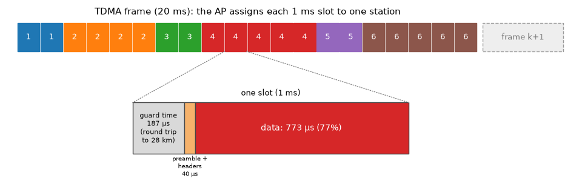
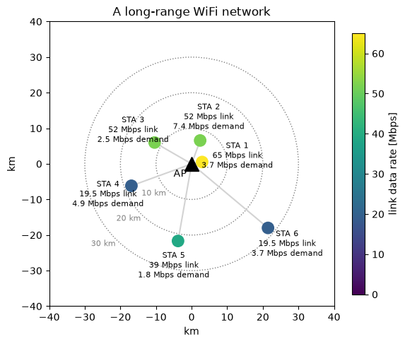
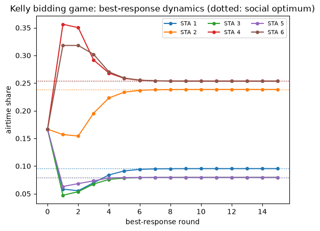
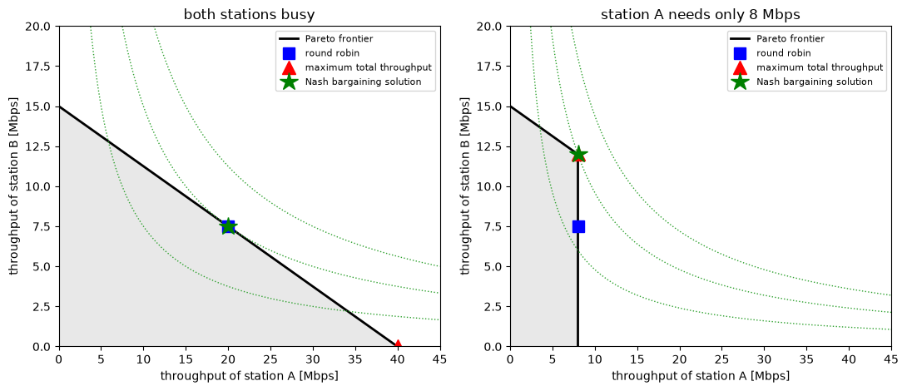
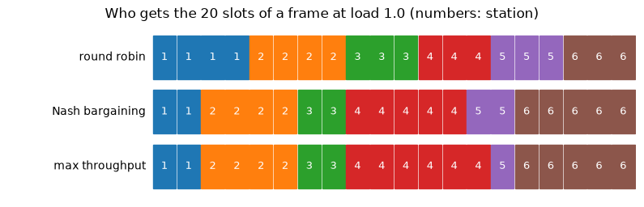
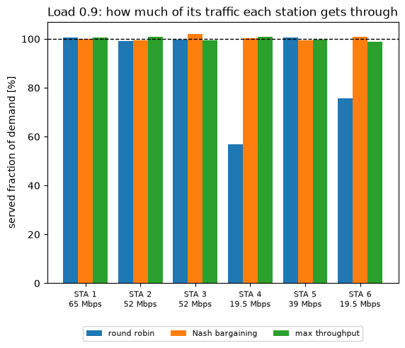
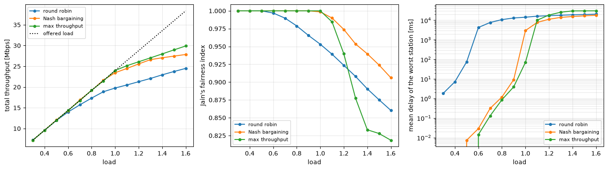

Emre: I keep hearing that game theory is used in wireless networks. What do games have to do with radios?

Kaan: Whenever several users share a resource and each one wants as much of it as possible, you have a game. In wireless networks, the resource is usually the spectrum or the airtime. Let's take a very concrete example, a long-range WiFi network, and use it to learn the main ideas of game theory one by one: players, strategies, Nash equilibrium, the price of anarchy, mechanism design and bargaining. At the end, we'll build a game-theoretic scheduler and compare it with the simplest one there is, round robin.

## Problem - Sharing the Air in a Long-Range WiFi Network

In many rural areas, internet access comes over long-range WiFi links. An access point (AP) on a hill or a tower serves customers (stations) that are several kilometers to tens of kilometers away, each with a directional antenna pointing at the AP. The hardware is ordinary, cheap WiFi hardware, but the distances are anything but ordinary.

Standard WiFi uses CSMA/CA: a station listens, and if the channel is free, it transmits and waits for an acknowledgement. This was designed for distances of tens of meters, and it breaks down over long links:

- **The ACK timeout:** a WiFi transmitter expects the acknowledgement within a few tens of microseconds. Over 20 km, the round trip alone takes 133 µs. You can stretch the timeout, but then every exchange wastes time waiting.
- **Hidden stations:** stations kilometers apart, all pointing at the AP, can't hear each other. Carrier sensing is useless and their packets collide at the AP.
- **Slot times:** the contention mechanism assumes that everybody hears a transmission within one slot time of a few microseconds. Over long distances, they don't.

That's why long-range WiFi networks almost always replace CSMA/CA with **TDMA (Time Division Multiple Access)**: the AP divides time into frames, divides each frame into slots, and tells each station in which slots it may transmit. No contention, no collisions, no ACK timeout problems. But now the AP has to decide **who gets how many slots**, and that's where it gets interesting.

<p align="center">

</p>

The simplest answer is **round robin**: every station gets the same number of slots, in turn. It's simple and it looks fair. But the stations are very different. Some are close to the AP and get high data rates, some are far away and get low rates. Some are a single household browsing the web, and some are a small business backing up its servers every evening. Giving them all the same airtime may not be the smartest choice.

Let's build our network: an AP and six stations at distances from 3 to 28 km, at 5.8 GHz. Each station's data rate comes from its link budget: transmit power plus antenna gains, minus the free-space path loss and some extra loss for trees or partial obstructions, gives the received signal; compared with the noise floor, that's the SNR, and the SNR decides the highest 802.11 modulation and coding scheme (MCS) that works.

```python
import numpy as np
import matplotlib.pyplot as plt

rng = np.random.default_rng(11) # fix the random seed so the results are reproducible

# link budget at 5.8 GHz, 20 MHz channel
F_MHZ, PT, G_AP, G_STA, CABLE, NOISE = 5800, 23, 17, 23, 2, -95   # MHz, dBm, dBi, dBi, dB, dBm
dist_km = np.array([3, 7, 12, 18, 22, 28.0])          # distance of each station to the AP
excess_db = np.array([0, 9, 4, 12, 3, 6.0])           # extra loss: trees, partial obstruction
azimuth = np.radians([10, 70, 150, 200, 260, 320])     # only used for the map

fspl = 20 * np.log10(dist_km) + 20 * np.log10(F_MHZ) + 32.44     # free-space path loss [dB]
snr = PT + G_AP + G_STA - CABLE - fspl - excess_db - NOISE

# 802.11n, 20 MHz, one spatial stream: data rate [Mbps] and the SNR it needs [dB]
MCS_RATE = np.array([6.5, 13, 19.5, 26, 39, 52, 58.5, 65])
MCS_SNR = np.array([5, 8, 11, 14, 18, 22, 24, 26.0])
rates = np.array([MCS_RATE[MCS_SNR <= s].max() for s in snr])

# TDMA frame: 20 ms with 20 slots of 1 ms
FRAME, S = 20e-3, 20
SLOT = FRAME / S
guard = 2 * dist_km.max() * 1e3 / 3e8                  # round trip to the farthest station
overhead = 40e-6                                        # preamble and headers
eff = (SLOT - guard - overhead) / SLOT                  # useful fraction of each slot
cap_bits = rates * 1e6 * SLOT * eff                     # bits a station can send in one slot
R = rates * eff                                         # throughput with the whole frame [Mbps]

# traffic demand [Mbps]; scaled so that at load 1.0 the stations need 95% of the frame
base = np.array([3, 6, 2, 4, 1.5, 3.0])
demand = base * 0.95 / np.sum(base / R)

print("guard time %.0f us, useful fraction of a slot %.1f%%" % (guard * 1e6, 100 * eff))
print("station  distance  SNR    rate     demand   airtime needed")
for i in range(6):
    print("  %i      %4.0f km  %4.1f dB %4.1f Mbps %4.2f Mbps %5.1f%%"
          % (i + 1, dist_km[i], snr[i], rates[i], demand[i], 100 * demand[i] / R[i]))

fig, ax = plt.subplots(figsize=(6.5, 6))
x, y = dist_km * np.cos(azimuth), dist_km * np.sin(azimuth)
for r in (10, 20, 30):
    ax.add_patch(plt.Circle((0, 0), r, fill=False, ls=':', color='gray'))
    ax.text(-r * 0.71, -r * 0.71, '%i km' % r, color='gray', fontsize=8, ha='right', va='top')
sc = ax.scatter(x, y, c=rates, cmap='viridis', s=140, vmin=0, vmax=65, zorder=3)
ax.plot(0, 0, 'k^', ms=14)
ax.text(-1.5, -1.5, 'AP', fontsize=10, ha='right', va='top')
for i in range(6):
    ax.plot([0, x[i]], [0, y[i]], color='lightgray', zorder=1)
    r_label = max(dist_km[i] + 7, 13)                      # put the label further out
    lx, ly = r_label * np.cos(azimuth[i]), r_label * np.sin(azimuth[i])
    ax.text(lx, ly, 'STA %i\n%g Mbps link\n%.1f Mbps demand' % (i + 1, rates[i], demand[i]),
            fontsize=8, ha='center', va='center')
plt.colorbar(sc, label='link data rate [Mbps]', shrink=0.8)
ax.set_xlim(-40, 40); ax.set_ylim(-40, 40); ax.set_aspect('equal')
ax.set_xlabel('km'); ax.set_ylabel('km')
ax.set_title('A long-range WiFi network')
plt.show()
```

```
guard time 187 us, useful fraction of a slot 77.3%
station  distance  SNR    rate     demand   airtime needed
  1         3 km  38.7 dB 65.0 Mbps 3.69 Mbps   7.3%
  2         7 km  22.4 dB 52.0 Mbps 7.38 Mbps  18.3%
  3        12 km  22.7 dB 52.0 Mbps 2.46 Mbps   6.1%
  4        18 km  11.2 dB 19.5 Mbps 4.92 Mbps  32.6%
  5        22 km  18.4 dB 39.0 Mbps 1.84 Mbps   6.1%
  6        28 km  13.3 dB 19.5 Mbps 3.69 Mbps  24.5%
```

<p align="center">

</p>

Look at the last column. It's the fraction of the airtime each station needs to carry its demand, and it varies from 6% to 33%. Station 4 is the problem child: it has a modest demand, but it's far away behind some trees, so its link runs at only 19.5 Mbps, and it needs a third of all the airtime. Round robin gives every station one sixth (16.7%). Stations 1, 3 and 5 don't need that much and will waste part of their share, while stations 4 and 6 need much more and will build up queues. Also note the guard time: at 28 km, the round trip takes 187 µs, which eats almost a fifth of every 1 ms slot. Long range has a price even before we start sharing.

## A Crash Course in Game Theory

A **game** has three ingredients:

- **Players:** here, the six stations.
- **Strategies:** what each player can do. Here, what a station asks the AP for.
- **Payoffs (utilities):** how happy each player is with the outcome. Here, a function of the throughput the station gets.

Each player chooses its strategy to maximize its own payoff, knowing that the outcome also depends on what the others do. A **Nash equilibrium** is a set of strategies, one for each player, such that no player can increase its payoff by changing its own strategy alone. Each player is playing a **best response** to the others. A Nash equilibrium is stable, but stable doesn't mean good.

For the payoff, we'll use the logarithm of the throughput a station gets, capped at its demand:

<div>
$$
u_i = \log \left( \min(\theta_i R_i, \lambda_i) \right)
$$
</div>

where $$\theta_i$$ is the fraction of the airtime station $$i$$ gets, $$R_i$$ is its throughput if it had the whole frame and $$\lambda_i$$ is its demand. Why the logarithm? Because of **diminishing returns**: going from 1 to 2 Mbps changes your life, going from 20 to 21 Mbps doesn't. And the cap says that a station doesn't care about capacity it has no traffic for.

How good is an outcome for the network as a whole? A common measure is the sum of the payoffs, $$\sum_i u_i$$, called the **social welfare**. With logarithmic payoffs, maximizing it is the famous **proportional fairness** criterion. And how much worse is the worst Nash equilibrium than the social optimum? That ratio is called the **price of anarchy**.

### The Tragedy of the Commons

Let's start with the most naive game. Each station tells the AP how much airtime it would like, $$r_i$$, and the AP shares the frame in proportion to the requests: $$\theta_i = r_i / \sum_j r_j$$. Requests are free.

Emre: Then everybody will ask for the whole frame!

Kaan: Exactly. Whatever the others ask for, asking for more never gives you less. More slots also mean headroom for traffic bursts, so asking for everything is a **dominant strategy**. In the Nash equilibrium, every station asks for 100%, and the AP shares the frame equally. We're back to round robin, no matter how different the stations are. The stations that don't need their share waste it, the stations that need more can't get it, and nobody has an incentive to behave differently. This is the wireless version of the **tragedy of the commons**: the villagers who overgraze the common pasture because grass is free.

The problem is that free requests carry no information. To get an efficient outcome, we need either to make the requests cost something, so that stations reveal how much they really value the airtime, or to let a trusted arbiter decide. Let's look at both.

## Kelly's Mechanism: Putting a Price on Airtime

In 1997, Frank Kelly proposed a simple mechanism for sharing a resource. Each station submits a **bid** $$w_i$$, an amount it is willing to pay (in money, or in some network token), and gets a share of the airtime proportional to its bid:

<div>
$$
\theta_i = \frac{w_i}{\sum_j w_j}, \qquad
\text{payoff}_i = \log\left(\min(\theta_i R_i, \lambda_i)\right) - w_i
$$
</div>

Now asking for more costs something, so each station has to balance the benefit of more airtime against the price. Designing the rules of a game so that selfish players end up somewhere good is called **mechanism design**.

Let's play this game in the busy hour, when the demand is 30% above the capacity (load 1.3). We start with equal bids, which gives exactly round robin, and then let the stations take turns playing their best response: each station finds the bid that maximizes its own payoff, given the current bids of the others. This is called **best-response dynamics**. If it stops changing, we've found a Nash equilibrium.

```python
from scipy.optimize import minimize_scalar

load = 1.3
lam = demand * load                                   # busy hour demand [Mbps]

def welfare(theta):
    return np.sum(np.log(np.minimum(theta * R, lam)))

def best_response(i, w):
    """The bid that maximizes station i's payoff, given the other bids."""
    others = w.sum() - w[i]
    payoff = lambda b: np.log(min(b / (b + others) * R[i], lam[i])) - b
    return minimize_scalar(lambda b: -payoff(b), bounds=(1e-6, 10), method='bounded').x

w = np.full(6, 0.1)                                   # equal bids: round robin
shares = [w / w.sum()]
for _ in range(15):
    for i in range(6):                                # stations take turns
        w[i] = best_response(i, w)
    shares.append(w / w.sum())
theta_ne = w / w.sum()

def proportional_fair():
    """Social optimum: max sum(log), i.e. equal shares, but nobody gets more than it needs."""
    cap = lam / R
    theta, free, left = np.zeros(6), np.ones(6, bool), 1.0
    while True:
        share = left / free.sum()
        capped = free & (cap <= share)
        if not capped.any():
            theta[free] = share
            return theta
        theta[capped] = cap[capped]; left -= cap[capped].sum(); free &= ~capped

theta_pf = proportional_fair()
theta_rr = np.full(6, 1 / 6)
for name, th in (("round robin", theta_rr), ("Kelly equilibrium", theta_ne), ("proportional fair", theta_pf)):
    print("%-18s shares %s  throughput %.1f Mbps  welfare %.3f"
          % (name, np.round(th, 3), np.minimum(th * R, lam).sum(), welfare(th)))

shares = np.array(shares)
for i in range(6):
    plt.plot(shares[:, i], 'o-', ms=4, label='STA %i' % (i + 1))
    plt.axhline(theta_pf[i], color=plt.gca().lines[-1].get_color(), ls=':', lw=1)
plt.xlabel('best-response round'); plt.ylabel('airtime share')
plt.title('Kelly bidding game: best-response dynamics (dotted: social optimum)')
plt.legend(ncol=3, fontsize=8)
plt.show()
```

```
round robin        shares [0.167 0.167 0.167 0.167 0.167 0.167]  throughput 22.1 Mbps  welfare 7.350
Kelly equilibrium  shares [0.095 0.239 0.08  0.254 0.08  0.254]  throughput 27.6 Mbps  welfare 8.548
proportional fair  shares [0.095 0.239 0.08  0.254 0.08  0.254]  throughput 27.6 Mbps  welfare 8.548
```

<p align="center">

</p>

Starting from round robin, the bids settle within a few rounds, and the equilibrium is exactly the social optimum: stations 1, 3 and 5 get just what they need, and the rest is shared equally among the three busy stations. The total throughput goes from 22.1 to 27.6 Mbps, and nobody planned it centrally. Each station just played its best response.

Emre: Is a Kelly equilibrium always optimal?

Kaan: Not always. Here, it's optimal because all the stations value throughput in the same way (the same logarithm). When players value the resource differently, a station that knows it's big enough to move the price can shade its bid strategically, and the equilibrium becomes slightly inefficient. Johari and Tsitsiklis proved that the loss is never more than 25% of the optimal welfare: the price of anarchy of Kelly's mechanism is at most 4/3. Compare that with the free-request game, where the equilibrium can be arbitrarily bad.

## The Nash Bargaining Solution: A Fair Arbiter

In a TDMA network, the AP decides anyway. Instead of making the stations play a market game, we can let the AP act as a **fair arbiter**. The question then becomes: what is a fair way to split the gains of cooperation?

In 1950, John Nash answered this question with a few common-sense axioms. A fair solution should be:

1. **Pareto efficient:** there is no other outcome that's better for someone and worse for no one.
2. **Symmetric:** players in identical situations get identical outcomes.
3. **Invariant to the units:** measuring someone's payoff in kbps instead of Mbps doesn't change the outcome.
4. **Independent of irrelevant alternatives:** removing options that weren't chosen doesn't change the choice.

Every bargaining also has a **disagreement point** $$d_i$$: what each player gets if the negotiation fails. Nash proved that the only solution satisfying all four axioms maximizes the product of the gains over the disagreement point:

<div>
$$
\max_{\theta} \prod_i \left( u_i(\theta) - d_i \right) \quad \text{subject to} \quad u_i(\theta) \geq d_i, \quad \sum_i \theta_i = 1
$$
</div>

This is the **Nash Bargaining Solution (NBS)**. Taking the logarithm, it maximizes $$\sum_i \log(u_i - d_i)$$: with $$d_i = 0$$ and $$u_i$$ the throughput, it's exactly proportional fairness again.

The choice of the disagreement point is where the engineering comes in. In our network, the natural one is **round robin**: it's what every station gets anyway without any negotiation. With round robin as the disagreement point, the NBS is **individually rational**: no station ever gets less than its round-robin share. The bargaining only decides how to share the *surplus*, i.e., the airtime that some stations don't need.

Let's see this with just two stations, where we can draw everything. The set of all achievable throughput pairs is the **utility region**, and its upper-right boundary is the **Pareto frontier**. The level curves of the Nash product $$u_A u_B$$ are hyperbolas, and the Nash bargaining solution is where the highest one touches the region. To keep the picture simple, we'll use $$d = 0$$ here; with round robin as the disagreement point, the answer turns out to be the same in both cases. We'll look at two situations: both stations busy, and one station busy while the other needs only a little.

```python
def utility_region(Ra, Rb, la, lb, n=400):
    th = np.linspace(0, 1, n)
    return th, np.minimum(th * Ra, la), np.minimum((1 - th) * Rb, lb)

fig, axes = plt.subplots(1, 2, figsize=(11, 4.8))
for ax, (la, lb, title) in zip(axes, ((40, 20, 'both stations busy'), (8, 20, 'station A needs only 8 Mbps'))):
    Ra, Rb = 40.0, 15.0                                   # station A: fast link, station B: slow link
    th, xa, xb = utility_region(Ra, Rb, la, lb, n=401)
    ax.plot(xa, xb, 'k-', lw=2, label='Pareto frontier')
    ax.fill_between(xa, 0, xb, color='lightgray', alpha=0.5)
    rr = (min(Ra / 2, la), min(Rb / 2, lb))               # round robin: half the airtime each
    mt = np.argmax(xa + xb)                               # maximum total throughput
    nb = np.argmax(xa * xb)                               # Nash bargaining with d = (0, 0)
    for k in (0.5, 1, 1.5):                               # level curves of the Nash product x*y
        x = np.linspace(0.5, 45, 300)
        ax.plot(x, k * xa[nb] * xb[nb] / x, ':', color='tab:green', lw=1)
    ax.plot(*rr, 'bs', ms=10, label='round robin')
    ax.plot(xa[mt], xb[mt], 'r^', ms=11, label='maximum total throughput')
    ax.plot(xa[nb], xb[nb], 'g*', ms=16, label='Nash bargaining solution')
    ax.set_xlim(0, 45); ax.set_ylim(0, 20)
    ax.set_xlabel('throughput of station A [Mbps]'); ax.set_ylabel('throughput of station B [Mbps]')
    ax.set_title(title); ax.legend(fontsize=8, loc='upper right')
plt.tight_layout()
plt.show()
```

<p align="center">

</p>

The left panel holds an important lesson. When both stations are busy, round robin is already on the Pareto frontier, and it's exactly where the highest hyperbola touches it: it's the Nash bargaining solution. With logarithmic utilities, equal airtime is exactly proportionally fair. The maximum-throughput point gives almost everything to the fast station A and leaves the slow station B with very little. That's efficient, but hardly fair.

The right panel shows where round robin fails. Station A only needs 8 Mbps, but round robin still gives it half of the airtime, which it can't use. The round-robin point is inside the region, below the frontier. The Nash bargaining solution moves straight up to the frontier, to the corner where the hyperbola touches: station A still gets everything it needs, and station B gets all the airtime A doesn't need. Here, the bargaining solution and the maximum-throughput solution agree.

So, in a TDMA network, the gains of the game-theoretic scheduler come from the stations that don't need their full share, and since real traffic is bursty, that's almost always someone.

## The Scheduler

Now let's turn this into a real scheduler. In every frame, each station reports the size of its queue (that's how most TDMA systems work: stations piggyback their queue sizes on their transmissions). The AP then solves a small Nash bargaining problem for that frame:

1. Compute what round robin would deliver to each station in this frame: the disagreement point $$d_i$$.
2. Give each station enough slots to reach $$d_i$$.
3. Hand out the remaining slots one by one, each to the station where it increases $$\log(\text{served}_i - d_i)$$ the most.

Because the logarithm is concave and the throughput grows linearly with the slots until the queue is empty, this greedy allocation solves the bargaining problem exactly. Note what it does automatically: a station with an empty queue gains nothing from an extra slot, so it gets none, and its slots go to someone who can use them.

We'll compare it with two other schedulers: **round robin**, which gives the slots of each frame to the stations in turn, and **maximum throughput**, which gives every slot to the station that can send the most bits in it. Let's first see how the three of them split one frame.

```python
def round_robin(Q, frame):
    """Equal slots in turn (the starting station rotates from frame to frame)."""
    n = np.zeros(len(Q), int)
    for k in range(S):
        n[(frame * S + k) % len(Q)] += 1
    return n

def served(n, Q):
    return np.minimum(Q, n * cap_bits)

def nash_bargaining(Q, frame, delta=1.0):
    """Nash bargaining over the slots of this frame, with round robin as the disagreement point."""
    d = served(round_robin(Q, frame), Q)
    n = np.ceil(d / cap_bits - 1e-9).astype(int)          # enough slots to reach d
    for _ in range(S - n.sum()):
        gain = np.log(served(n + 1, Q) - d + delta) - np.log(served(n, Q) - d + delta)
        k = int(np.argmax(gain))
        if gain[k] <= 0:
            break
        n[k] += 1
    return n

def max_throughput(Q, frame):
    """Every slot to the station that can send the most bits in it."""
    n = np.zeros(len(Q), int)
    for _ in range(S):
        gain = served(n + 1, Q) - served(n, Q)
        k = int(np.argmax(gain))
        if gain[k] <= 0:
            break
        n[k] += 1
    return n

schedulers = {'round robin': round_robin, 'Nash bargaining': nash_bargaining, 'max throughput': max_throughput}

Q = demand * 1.0 * 1e6 * FRAME                           # queues holding one frame of average traffic at load 1.0
colors = plt.cm.tab10(np.arange(6))
fig, ax = plt.subplots(figsize=(10, 2.8))
for row, (name, sched) in enumerate(schedulers.items()):
    n = sched(Q, 0)
    owner = np.repeat(np.arange(6), n)
    for k, o in enumerate(owner):
        ax.add_patch(plt.Rectangle((k, -row - 0.4), 0.95, 0.8, color=colors[o]))
        ax.text(k + 0.47, -row, str(o + 1), ha='center', va='center', color='white', fontsize=9)
    ax.text(-0.3, -row, name, ha='right', va='center')
ax.set_xlim(-6, S); ax.set_ylim(-2.6, 0.6); ax.axis('off')
ax.set_title('Who gets the 20 slots of a frame at load 1.0 (numbers: station)')
plt.show()
```

<p align="center">

</p>

Round robin gives stations 1, 3 and 5 three or four slots each, although each of them needs less than two slots' worth of traffic, while stations 4 and 6 get only three slots each and can send only 46% and 61% of their traffic. The Nash bargaining scheduler gives the light stations exactly what they need (two slots each) and moves the rest to the stations that can use it: station 6 now gets all its traffic through and station 4 gets 77%. The maximum-throughput scheduler goes one step further: it takes a slot away from station 5, whose traffic doesn't fit in one slot anymore, because station 4 can fill that slot with more of its backlog. Here, that's harmless, but it's a sign of what's coming.

## Round Robin vs. Game Theory

Now the full simulation. Packets of 1500 bytes arrive at each station as a Poisson process with the station's demand as the average rate. In every frame, the scheduler assigns the slots, each station sends as much of its queue as its slots allow, and we keep track of the throughput and the queues. We'll run 3000 frames (one minute) per case, first at a load of 0.9, where a smart scheduler can serve everybody.

We measure three things: the total **throughput**; how **fair** the result is, using Jain's fairness index of the fraction of its demand each station gets, $$J = (\sum_i x_i)^2 / (n \sum_i x_i^2)$$, which is 1 when everybody gets the same fraction and $$1/n$$ when one station gets everything; and the average **delay** each station's packets spend in the queue, using Little's law (average queue size divided by arrival rate).

```python
def simulate(sched, load, frames=3000, pkt_bits=1500 * 8):
    lam_pkts = demand * load * 1e6 * FRAME / pkt_bits     # average packet arrivals per frame
    Q = np.zeros(6); delivered = np.zeros(6); queued = np.zeros(6)
    for t in range(frames):
        Q += rng.poisson(lam_pkts) * pkt_bits             # new packets arrive
        s = served(sched(Q, t), Q)                        # the scheduler decides, the stations send
        Q -= s; delivered += s; queued += Q
    throughput = delivered / (frames * FRAME) / 1e6       # [Mbps]
    delay = (queued / frames) / (demand * load * 1e6) * 1e3   # Little's law [ms]
    return throughput, delay

def jain(x):
    return x.sum() ** 2 / (len(x) * (x ** 2).sum())

load = 0.9
results = {name: simulate(sched, load) for name, sched in schedulers.items()}
for name, (tp, dl) in results.items():
    sat = np.minimum(tp / (demand * load), 1)
    print("%-16s total %.1f Mbps, fairness %.3f, served fraction %s, delay [ms] %s"
          % (name, tp.sum(), jain(sat), np.round(sat, 2), np.round(dl, 0)))

x = np.arange(6)
for k, (name, (tp, _)) in enumerate(results.items()):
    plt.bar(x + (k - 1) * 0.27, 100 * tp / (demand * load), 0.27, label=name)
plt.axhline(100, color='k', ls='--', lw=1)
plt.xticks(x, ['STA %i\n%g Mbps' % (i + 1, rates[i]) for i in range(6)], fontsize=8)
plt.ylabel('served fraction of demand [%]')
plt.title('Load 0.9: how much of its traffic each station gets through')
plt.legend(loc='upper center', bbox_to_anchor=(0.5, -0.15), ncol=3, fontsize=8)
plt.show()
```

```
round robin      total 18.8 Mbps, fairness 0.966, served fraction [1.   0.99 1.   0.57 1.   0.76], delay [ms] [    0.    67.     0. 12997.     0.  7201.]
Nash bargaining  total 21.6 Mbps, fairness 1.000, served fraction [1.   0.99 1.   1.   0.99 1.  ], delay [ms] [ 0.  0.  0. 10.  0.  4.]
max throughput   total 21.6 Mbps, fairness 1.000, served fraction [1.   1.   0.99 1.   1.   0.99], delay [ms] [0. 0. 0. 1. 1. 5.]
```

<p align="center">

</p>

At a load of 0.9, the network has enough capacity for everybody, but only if it's shared wisely. Round robin gets only 57% of station 4's traffic and 76% of station 6's through: their queues keep growing, and the "delay" of several seconds just means that their packets pile up for the whole minute of the simulation. Meanwhile, stations 1, 3 and 5 leave part of their slots unused. Both the Nash bargaining and the maximum-throughput schedulers deliver everybody's traffic with delays of a few milliseconds, and carry 15% more traffic in total (21.6 instead of 18.8 Mbps). As long as the network can serve everyone, being smart about idle slots is all that matters, and both smart schedulers do the same thing.

Now let's sweep the load from light to heavily overloaded.

```python
loads = np.arange(0.3, 1.65, 0.1)
sweep = {name: [simulate(sched, ld) for ld in loads] for name, sched in schedulers.items()}

fig, (ax1, ax2, ax3) = plt.subplots(1, 3, figsize=(14, 4))
for name, res in sweep.items():
    tp = np.array([r[0] for r in res]); dl = np.array([r[1] for r in res])
    ax1.plot(loads, tp.sum(axis=1), 'o-', ms=4, label=name)
    ax2.plot(loads, [jain(np.minimum(t / (demand * ld), 1)) for t, ld in zip(tp, loads)], 'o-', ms=4, label=name)
    ax3.semilogy(loads, dl.max(axis=1), 'o-', ms=4, label=name)
ax1.plot(loads, demand.sum() * loads, 'k:', label='offered load')
ax1.set_ylabel('total throughput [Mbps]'); ax2.set_ylabel("Jain's fairness index")
ax3.set_ylabel('mean delay of the worst station [ms]')
for ax in (ax1, ax2, ax3):
    ax.set_xlabel('load'); ax.grid(alpha=0.3, which='both'); ax.legend(fontsize=8)
plt.tight_layout()
plt.show()
```

<p align="center">

</p>

The three schedulers tell three different stories:

- **Light load (up to 0.5):** all three are the same. There's more airtime than anyone needs.
- **Round robin** starts to fail at a load of only 0.6, when station 4's demand exceeds its one-sixth share and its queue starts to grow without limit. From then on, its delay is just the length of the simulation, and the total throughput falls further and further behind the offered load.
- **Nash bargaining and maximum throughput** keep everybody's delay at a few milliseconds up to a load of 0.9, and both carry about 20% more traffic than round robin at a load of 1.0 (23.5 and 24.0 Mbps vs. 19.8 Mbps).
- **Overload:** this is where the difference between efficiency and fairness shows. The maximum-throughput scheduler keeps the highest total throughput (27.0 Mbps at a load of 1.3), but it does that by giving up on station 6, the one with the worst link: it gets 14% of its traffic through at a load of 1.3 and nothing at all from a load of 1.4 on. Its fairness index drops to 0.82. The Nash bargaining scheduler carries almost as much (26.6 Mbps at 1.3) with a fairness index of 0.95, and thanks to the round-robin disagreement point, no station ever gets less than it would get with round robin: at a load of 1.3, station 4 gets 54% instead of 39%, and station 6 gets 66% instead of 52%.

That's game theory doing its job: the Nash bargaining solution is efficient (it never wastes a slot that someone could use), it's fair, and it guarantees every station its round-robin share, so no customer has a reason to complain that the "smart" scheduler made things worse for them.

## Real Life

Our model is deliberately simple. In a real network, a few more things matter:

- **Truthful reporting.** The Nash bargaining scheduler trusts the queue sizes the stations report. A station that exaggerates its queue gets more slots. With Kelly's mechanism, lying costs money, but with a free arbiter, the AP needs some protection: verifying reported queues against actually delivered traffic, or limiting how much a single report can move the allocation. Designing schedulers that are robust to lying is mechanism design again, and the key concept is **incentive compatibility**: a mechanism is incentive compatible if telling the truth is each player's best strategy.
- **Changing channels.** Long-range links fade with weather and vegetation, so the data rates change over time. The scheduler should use the current MCS of each station, which naturally makes it opportunistic: a station gets slots when its link is good.
- **Uplink and downlink.** We treated each station's traffic as a single demand. In practice, the frame is split into downlink and uplink parts, and the same bargaining can be applied to each part.
- **Priorities and service plans.** A customer who pays for a premium plan can be given a higher weight. The weighted NBS maximizes $$\sum_i \alpha_i \log(u_i - d_i)$$, and the weights $$\alpha_i$$ express the bargaining power of each player.
- **Larger networks.** With several APs on the same channel, the APs themselves become players: their transmissions interfere, so they must coordinate when to transmit. Panigrahi and Raman studied exactly this problem for long-distance WiFi mesh networks.

## Computational Complexity

The round-robin scheduler costs nothing. The Nash bargaining scheduler hands out at most $$S$$ slots per frame, and for each slot, it compares $$N$$ stations, so a frame costs $$O(S N)$$ operations, or $$O(S \log N)$$ with a priority queue. For 20 slots and a few dozen stations, that's a few hundred operations every 20 ms, which is nothing even for the small processor of a WiFi access point. Kelly's mechanism is cheap for the AP, but it needs several rounds of messages between the AP and the stations to converge, so it's better suited to slowly changing allocations, such as the bandwidth contracts of a backhaul network, than to deciding every frame.

## References

1. J. F. Nash, <a href="https://doi.org/10.2307/1907266">The bargaining problem</a>, Econometrica, 1950
2. F. Kelly, <a href="https://doi.org/10.1002/ett.4460080106">Charging and rate control for elastic traffic</a>, European Transactions on Telecommunications, 1997
3. R. Johari, J. N. Tsitsiklis, <a href="https://doi.org/10.1287/moor.1040.0091">Efficiency loss in a network resource allocation game</a>, Mathematics of Operations Research, 2004
4. H. Yaïche, R. R. Mazumdar, C. Rosenberg, <a href="https://doi.org/10.1109/90.879352">A game theoretic framework for bandwidth allocation and pricing in broadband networks</a>, IEEE/ACM Transactions on Networking, 2000
5. Z. Han, D. Niyato, W. Saad, T. Başar, A. Hjørungnes, <a href="https://doi.org/10.1017/CBO9780511895043">Game Theory in Wireless and Communication Networks</a>, Cambridge University Press, 2011
6. A. B. MacKenzie, L. A. DaSilva, <a href="https://doi.org/10.1007/978-3-031-01672-1">Game Theory for Wireless Engineers</a>, Morgan & Claypool, 2006
7. K. Chebrolu, B. Raman, S. Sen, <a href="https://doi.org/10.1145/1161089.1161099">Long-distance 802.11b links: performance measurements and experience</a>, ACM MobiCom, 2006
8. R. Patra, S. Nedevschi, S. Surana, A. Sheth, L. Subramanian, E. Brewer, <a href="https://www.usenix.org/legacy/event/nsdi07/tech/patra.html">WiLDNet: Design and implementation of high performance WiFi based long distance networks</a>, USENIX NSDI, 2007
9. D. Panigrahi, B. Raman, <a href="https://doi.org/10.1109/INFCOM.2009.5062261">TDMA scheduling in long-distance WiFi networks</a>, IEEE INFOCOM, 2009
10. R. Jain, D. Chiu, W. Hawe, <a href="https://arxiv.org/abs/cs/9809099">A quantitative measure of fairness and discrimination for resource allocation in shared computer systems</a>, DEC Research Report TR-301, 1984

<a href="https://www.freecounterstat.com" title="visitor counters"></a>
