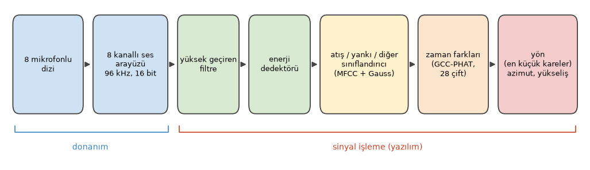
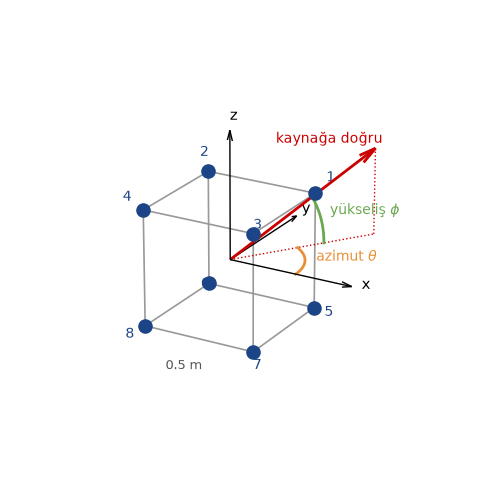
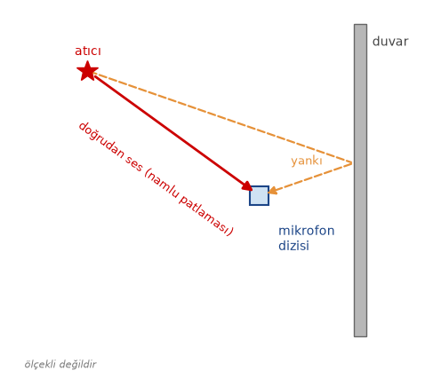
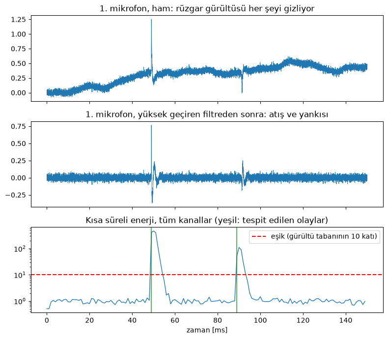
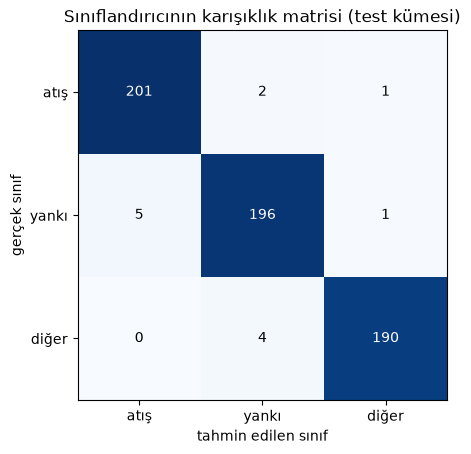
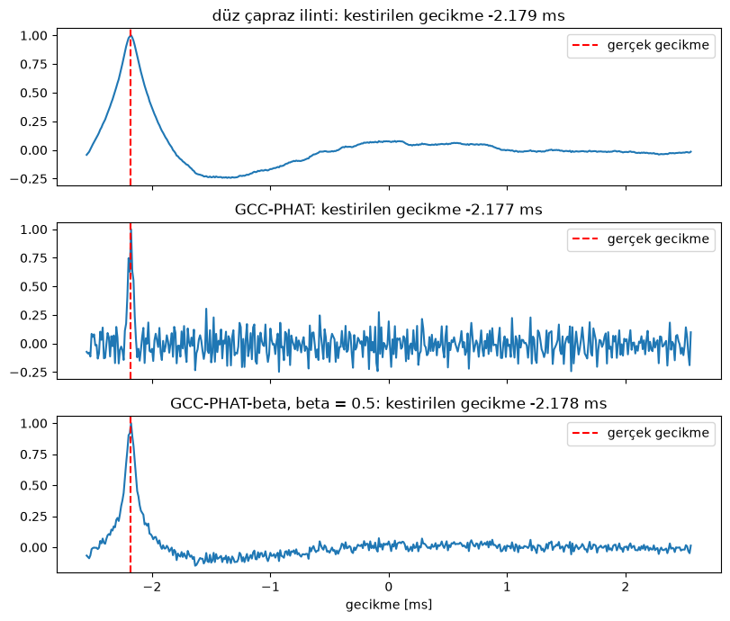
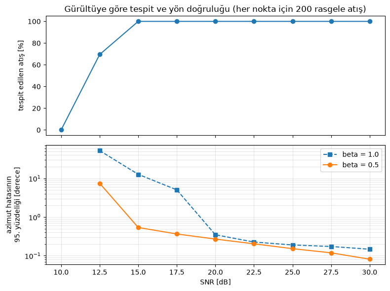

Emre: Bir sistem tek bir silah sesini duyup sana hangi yönden geldiğini nasıl söyleyebilir?

Kaan: Bir süre önce böyle bir sistem üzerinde çalışmıştım. O projenin orijinal verilerini ya da detaylarını paylaşamam ama arkasındaki fikirler klasik sinyal işleme ve her şeyi bir simülasyonla yeniden kurabiliriz.

## Problem

Silah sesi duyabileceğin en yüksek seslerden biridir, bu yüzden *bir şey* olduğunu tespit etmek zor kısım değil. Zor olan, şu üç soruyu otomatik olarak ve saniyenin çok küçük bir kesrinde cevaplamak:

1. Bu bir atış mıydı, yoksa çarpan bir kapı ya da bir havai fişek mi?
2. Bu atışın kendisi miydi, yoksa yakındaki bir binadan gelen yankısı mı?
3. Hangi yönden geldi?

Sistemin var olma sebebi üçüncü soru. Onu cevaplamak için tek bir mikrofon değil, bir mikrofon dizisi kullanıyoruz. Ses saniyede yaklaşık $$343$$ metre yol alır, yani soldan gelen bir ses soldaki mikrofonlara sağdakilerden milisaniyenin bir kesri kadar önce ulaşır. Bu çok küçük zaman farklarını ölçebilirsek sesin yönünü hesaplayabiliriz.

Emre: Milisaniyenin bir kesri mi? Bunu gerçekten ölçebilir miyiz?

Kaan: Yeterince hızlı örneklersek rahatlıkla. $$96$$ kHz'de bir örnek yaklaşık $$10.4\,\mu s$$'dir ve bu sürede ses yaklaşık $$3.6$$ mm yol alır. Aralarında yarım metre olan iki mikrofon için mümkün olan en büyük zaman farkı yaklaşık $$1.5$$ ms, yani 140 örnekten fazla. Bu bize bolca çözünürlük veriyor. Biraz aradeğerleme (interpolation) ile bir örneğin altına da inebiliriz.

## Atışın Akustiği

Bir ateşli silah aslında iki farklı ses üretir:

- **Namlu patlaması (muzzle blast):** Namlu ağzında genleşen gazlar, silahtan her yöne ses hızında yayılan kısa, çok yüksek ve dürtüsel bir basınç dalgası oluşturur. Şekli Friedlander dalga biçimi denilen şeye çok yakındır: keskin bir yükseliş ve ardından sıfırın biraz altına inen bir sönümlenme. Namlu patlaması atıcının konumundan gelir, yani yönü tam da bizim aradığımız yöndür.
- **Şok dalgası:** Mermi ses hızından hızlıysa, tıpkı bir teknenin arkasındaki dümen suyu gibi arkasında bir Mach konisi sürükler. Bu da N harfi şeklinde bir basınç profiline sahip keskin bir "çatlama" sesi üretir. Sadece merminin yoluna yakın yerlerde duyulur, çoğu zaman namlu patlamasından *önce* gelir ve atıcının değil merminin yolunun yönünden gelir.

Bu projede namlu patlamasının yerini bulacağız; şok dalgasına Gerçek Hayat bölümünde döneceğim. Bunların üzerine her gerçek kayıtta binalardan ve araziden gelen yankılar, rüzgar gürültüsü ve her türlü başka dürtüsel ses de bulunur.

## Donanım Düzeni

Sistemin üç parçası var: bir mikrofon dizisi, çok kanallı bir kaydedici ve sinyal işleme zincirini çalıştıran bir bilgisayar.

<p align="center">

</p>

Dizide, kenarları $$0.5$$ m olan bir küpün köşelerine yerleştirilmiş sekiz tane her yöne duyarlı (omnidirectional) mikrofon var. Sekiz kanalın hepsi tek bir çok kanallı ses arayüzü tarafından $$96$$ kHz'de, örnek başına 16 bit ile örnekleniyor. Tüm kanalların aynı saatle, tek bir cihaz tarafından örneklenmesi önemli: yöntemin tamamı birkaç mikrosaniyelik zaman farklarına dayanıyor ve kanallar arasındaki herhangi bir zamanlama kayması doğrudan bir yön hatasına dönüşür.

<p align="center">

</p>

Bir yönü iki açıyla tanımlıyoruz: yatay düzlemde x ekseninden itibaren ölçülen **azimut** $$\theta$$ ve yatay düzlemden yukarı doğru ölçülen **yükseliş** $$\phi$$. Kaynağa doğru bakan birim vektör şöyle:

<div>
$$
\mathbf{u} = \begin{bmatrix} \cos\phi \cos\theta \\ \cos\phi \sin\theta \\ \sin\phi \end{bmatrix}
$$
</div>

Neden bir doğru üzerinde dört mikrofon değil de üç boyutlu bir şekil üzerinde sekiz mikrofon? Doğrusal bir dizi önü arkadan, düz bir dizi ise yukarıyı aşağıdan ayıramaz. Mikrofonlar üç boyuta yayıldığında her yön benzersiz bir gecikme deseni üretir.

Son olarak simüle edeceğimiz sahne şu: Bir atıcı bir yönden ateş ediyor, dizi namlu patlamasını doğrudan ve biraz sonra da yakındaki bir duvardan gelen yankısını duyuyor.

<p align="center">

</p>

## Sinyal Modeli

Atıcı genellikle onlarca ya da yüzlerce metre uzakta, dizi ise yarım metre genişliğinde. Bu yüzden **uzak alan** (far-field) varsayımını kullanabiliriz: ses düzlemsel bir dalga olarak gelir ve tüm mikrofonlar aynı $$\mathbf{u}$$ yönünü görür. $$i$$. mikrofon $$\mathbf{p}_i$$ konumundaysa, düzlemsel dalga ona

<div>
$$
t_i = t_0 - \frac{\mathbf{p}_i^T \mathbf{u}}{c}
$$
</div>

anında ulaşır. Burada $$t_0$$ dalganın dizinin merkezine ulaştığı an, $$c$$ ise ses hızıdır. Kaynağa daha yakın olan mikrofonlar (daha büyük $$\mathbf{p}_i^T \mathbf{u}$$) sesi daha önce duyar. O zaman $$i$$. mikrofondaki sinyal şöyle olur:

<div>
$$
x_i(t) = s(t - t_i) + e_i(t) + n_i(t)
$$
</div>

Burada $$s(t)$$ namlu patlaması, $$e_i(t)$$ onun yankısı (başka bir yönden gelen, gecikmiş başka bir kopya), $$n_i(t)$$ ise gürültü. Ölçeceğimiz şey iki mikrofon arasındaki zaman farkı:

<div>
$$
\tau_{ij} = t_i - t_j = \frac{(\mathbf{p}_j - \mathbf{p}_i)^T \mathbf{u}}{c}
$$
</div>

Bunun $$\mathbf{u}$$'ya göre doğrusal olduğuna dikkat et. Bunu aklında tut; son adımı çok basitleştirecek.

Simülasyonu kuralım. Namlu patlamasını Friedlander dalga biçimiyle modelleyeceğiz, havanın soğurmasını hesaba katmak için biraz yumuşatacağız ve frekans uzayında kesirli bir gecikmeyle her mikrofona geciktireceğiz. 40 ms sonra başka bir yönden gelen bir yankı, beyaz sensör gürültüsü ve düşük frekanslı rüzgar gürültüsü ekleyeceğiz.

```python
import numpy as np
import matplotlib.pyplot as plt
from itertools import combinations
from scipy.signal import butter, sosfilt, lfilter

rng = np.random.default_rng(7) # sonuclar tekrarlanabilir olsun diye rasgele sayi uretecini sabitleyelim

fs = 96000   # ornekleme frekansi [Hz]
c = 343.0    # ses hizi [m/s]
L = 0.5      # kup dizinin kenar uzunlugu [m]

# merkezi orijinde olan bir kupun koselerinde sekiz mikrofon
mics = np.array([[x, y, z] for z in (L/2, -L/2) for y in (L/2, -L/2) for x in (L/2, -L/2)])
pairs = list(combinations(range(len(mics)), 2))  # 28 mikrofon ciftinin hepsi

def direction(az_deg, el_deg):
    """Verilen azimut ve yukseliste bulunan bir kaynaga dogru birim vektor."""
    az, el = np.radians(az_deg), np.radians(el_deg)
    return np.array([np.cos(el) * np.cos(az), np.cos(el) * np.sin(az), np.sin(el)])

def muzzle_blast(T=0.5e-3, dur=8e-3):
    """Friedlander dalga bicimi, havanin sogurmasini hesaba katmak icin biraz yumusatilmis."""
    t = np.arange(int(dur * fs)) / fs
    p = (1 - t / T) * np.exp(-t / T)
    b, a = butter(2, 8000, fs=fs)
    return lfilter(b, a, p)

def place(sig, n_total, t_arrival):
    """Bir sinyali n_total orneklik bir tampona t_arrival aninda baslayacak sekilde yerlestir
    (frekans uzayinda faz kaymasi olarak uygulanan kesirli bir gecikme)."""
    x = np.zeros(n_total)
    x[:len(sig)] = sig
    f = np.fft.rfftfreq(n_total, 1 / fs)
    return np.fft.irfft(np.fft.rfft(x) * np.exp(-2j * np.pi * f * t_arrival), n_total)

def echo_of(blast):
    """Yanki: puruzlu bir duvarda zamanda yayilmis, yuksek frekanslarini kaybetmis daha zayif bir kopya."""
    tail = np.exp(-np.arange(300) / 60) * rng.normal(0, 1, 300)
    b, a = butter(2, 3000, fs=fs)
    e = lfilter(b, a, np.convolve(blast, tail))
    return 0.35 * e * np.abs(blast).max() / np.abs(e).max()

def simulate(az, el, n_total, t0=0.05, snr_db=30, echo_az=None, echo_delay=0.04):
    """(az, el) yonunden gelen bir atisin, yankisinin, sensor gurultusunun ve ruzgarin 8 kanalli kaydi."""
    blast = muzzle_blast()
    x = np.array([place(blast, n_total, t0 - p @ direction(az, el) / c) for p in mics])
    echo_az = az + 150 if echo_az is None else echo_az
    e = echo_of(blast)
    x += np.array([place(e, n_total, t0 + echo_delay - p @ direction(echo_az, 0) / c) for p in mics])
    peak = np.abs(x).max()
    x += rng.normal(0, peak * 10 ** (-snr_db / 20), x.shape)        # sensor gurultusu
    wind = sosfilt(butter(2, 100, fs=fs, output='sos'), np.cumsum(rng.normal(0, 1, n_total)))
    x += 0.6 * peak * wind / np.abs(wind).max()                       # dusuk frekansli ruzgar gurultusu
    return x

n_total = int(0.15 * fs)                    # 150 ms'lik kayit
x = simulate(az=70, el=15, n_total=n_total)  # azimut 70 derece, yukselis 15 dereceden gelen bir atis
```

## 1. Adım: Filtreleme ve Tespit

İlk iş, dürtüsel bir şeyin olduğu anları bulmak. Her şeyden önce rüzgar gürültüsünü yüksek geçiren bir filtreyle temizliyoruz. Rüzgar düşük frekanslı bir olgudur, çoğunlukla birkaç yüz Hz'in altındadır; namlu patlamasının enerjisinin çoğu ise birkaç yüz Hz ile birkaç kHz arasındadır.

Ardından 1 ms'lik çerçevelerde kısa süreli enerjiyi hesaplayıp gürültü tabanıyla karşılaştırıyoruz. İki detay dedektörü çok daha gürbüz yapıyor. Birincisi, enerjiyi patlamanın yaşadığı bantta (300 Hz ile 4 kHz arası) hesaplıyoruz, böylece bu bandın dışındaki gürültü hesaba girmiyor. İkincisi, sekiz kanalın enerjisini topluyoruz. Patlama hepsinde aynı, gürültü ise bağımsız; bu yüzden patlama gürültüden daha hızlı birikiyor. Enerji gürültü tabanının on katının (10 dB) üzerine çıktığında bir olay işaretliyoruz ve tek bir olayın dedektörü tekrar tekrar tetiklememesi için kısa bir ölü süre (dead time) boyunca bekliyoruz.

```python
hp = butter(4, 300, 'hp', fs=fs, output='sos')          # ruzgar gurultusunu temizler
bp = butter(4, [300, 4000], 'bp', fs=fs, output='sos')  # patlamanin yasadigi bant

def detect(x, frame=96, ratio=10, dead=0.03):
    """Tum kanallarin toplami uzerinde kisa sureli enerji dedektoru. Olaylarin baslangic orneklerini dondurur."""
    energy = np.add.reduceat((sosfilt(bp, x, axis=1) ** 2).sum(axis=0), np.arange(0, x.shape[1], frame))
    floor = np.median(energy)                               # gurultu tabani
    events, i = [], 0
    while i < len(energy):
        if energy[i] > ratio * floor:
            events.append(i * frame)
            i += int(dead * fs / frame)                     # her olaydan sonra olu sure
        else:
            i += 1
    return events, energy, floor

xf = sosfilt(hp, x, axis=1)
events, energy, floor = detect(x)
print("Tespit edilen olaylar [ms]:", [round(1000 * k / fs, 1) for k in events])

t = np.arange(n_total) / fs * 1000
fig, (ax1, ax2, ax3) = plt.subplots(3, 1, figsize=(8, 7), sharex=True)
ax1.plot(t, x[0], lw=0.6)
ax1.set_title('1. mikrofon, ham: rüzgar gürültüsü her şeyi gizliyor')
ax2.plot(t, xf[0], lw=0.6)
ax2.set_title('1. mikrofon, yüksek geçiren filtreden sonra: atış ve yankısı')
te = np.arange(len(energy)) * 96 / fs * 1000
ax3.semilogy(te, energy / floor, lw=1)
ax3.axhline(10, color='r', ls='--', label='eşik (gürültü tabanının 10 katı)')
for k in events:
    ax3.axvline(1000 * k / fs, color='g', alpha=0.6)
ax3.set_title('Kısa süreli enerji, tüm kanallar (yeşil: tespit edilen olaylar)')
ax3.set_xlabel('zaman [ms]')
ax3.legend(loc='upper right')
plt.tight_layout()
plt.show()
```

```
Tespit edilen olaylar [ms]: [49.0, 89.0]
```

<p align="center">

</p>

Ham kayıtta yavaş değişen rüzgar gürültüsü baskın. Yüksek geçiren filtreden sonra 50 ms civarındaki atış ve 40 ms sonraki yankısı açıkça ortaya çıkıyor ve enerji dedektörü ikisini de buluyor. Artık iki olayımız var ve hangisinin atış olduğunu bilmemiz gerekiyor.

## 2. Adım: Atış mı? Sınıflandırma

Enerji dedektörü neyi tespit ettiğini bilmiyor. Bir yankı, çarpan bir kapı ya da bir havai fişek de onu tetiklerdi. Sesin *karakterine* bakan bir sınıflandırıcıya ihtiyacımız var. Bunun için konuşma tanıma sistemlerinin onlarca yıldır kullandığı öznitelikleri kullanacağız: **Mel-Frekans Kepstrum Katsayıları (MFCC)**.

Emre: Bir silah sesi için neden konuşma öznitelikleri?

Kaan: Çünkü MFCC'ler kısa bir ses parçasının spektral zarfının, yani "renginin", kompakt ve gürbüz bir tanımıdır ve sınıflarımız arasında farklı olan şey tam da bu. Doğrudan gelen bir namlu patlaması keskin ve geniş bantlıdır. Bir yankı pürüzlü bir yüzeyden sekmiştir: zamanda yayılmıştır ve yüksek frekanslı içeriğinin çoğunu kaybetmiştir. Çarpan bir kapı ya da bir el çırpma ise yine farklı bir spektral şekle sahiptir.

Bir çerçevenin MFCC'lerini hesaplamak dört adım alır: pencerelenmiş çerçevenin spektrumunu al, onu mel ölçeğine göre yerleştirilmiş (düşük frekanslarda dar, yüksek frekanslarda geniş, kabaca bizim işitmemiz gibi) üst üste binen bantlarda topla, bu bant enerjilerinin logaritmasını al ve son olarak bir Ayrık Kosinüs Dönüşümü ile ilintisizleştir. İlk birkaç DCT katsayısı MFCC'lerdir.

Sesin zaman içindeki değişimini de yakalamak için başlangıç anı etrafında üç çerçeve alıyoruz: biri hemen önce, biri başlangıçta, biri hemen sonra. Öznitelik vektörümüz başlangıç çerçevesinin MFCC'leri ile önceki ve sonraki çerçevelerin MFCC'leri arasındaki farktan oluşuyor. Sınıflandırıcı için her sınıfı köşegen kovaryanslı bir Gauss dağılımıyla modelliyoruz ve <a href="https://tayyarg.github.io/dogrusal_regresyon_probleminin_bayesci_cikarimla_cozulmesi/">Bayesçi çıkarım</a> yazısında yaptığımız gibi olabilirliği en yüksek olan sınıfı seçiyoruz:

<div>
$$
\hat{c} = \arg\max_{c} \left[ \log p(c) + \sum_{d} \log \mathcal{N}(f_d \,|\, \mu_{c,d}, \sigma_{c,d}^2) \right]
$$
</div>

Her sınıftan birkaç yüz sentetik örnek üretelim, sınıflandırıcıyı yarısıyla eğitip diğer yarısıyla test edelim.

```python
from scipy.fft import dct

def mel_filterbank(n_fft, n_bands=20, f_lo=100, f_hi=20000):
    mel = lambda f: 2595 * np.log10(1 + f / 700)
    imel = lambda m: 700 * (10 ** (m / 2595) - 1)
    edges = imel(np.linspace(mel(f_lo), mel(f_hi), n_bands + 2))
    f = np.fft.rfftfreq(n_fft, 1 / fs)
    fb = np.zeros((n_bands, len(f)))
    for b in range(n_bands):
        lo, mid, hi = edges[b], edges[b + 1], edges[b + 2]
        fb[b] = np.clip(np.minimum((f - lo) / (mid - lo), (hi - f) / (hi - mid)), 0, None)
    return fb

N_FFT, N_MFCC = 512, 13
FB = mel_filterbank(N_FFT)
WINDOW = np.hamming(N_FFT)

def mfcc(frame):
    spectrum = np.abs(np.fft.rfft(frame * WINDOW)) ** 2
    return dct(np.log(FB @ spectrum + 1e-12), norm='ortho')[:N_MFCC]

def features(sig, onset):
    """Baslangictaki MFCC'ler ve baslangictan hemen once ile hemen sonrasi arasindaki degisim."""
    half = N_FFT // 2
    before, at, after = (sig[onset + k: onset + k + N_FFT] for k in (-half, 0, half))
    return np.concatenate([mfcc(at), mfcc(before) - mfcc(after)])

def make_event(kind, n=4096, onset=1024):
    """Verilen siniftan, yuksek geciren filtreden gecirilmis bir sentetik olay."""
    sig = np.zeros(n)
    if kind == 'shot':
        s = muzzle_blast(T=rng.uniform(0.3e-3, 0.8e-3))
    elif kind == 'echo':
        s = echo_of(muzzle_blast(T=rng.uniform(0.3e-3, 0.8e-3)))
        s = lfilter(*butter(2, rng.uniform(1500, 4000), fs=fs), s)
    else:  # 'other': carpan bir kapi ya da el cirpma, yani sonumlenen bant sinirli bir gurultu patlamasi
        m = int(rng.uniform(2e-3, 8e-3) * fs)
        s = rng.normal(0, 1, m) * np.exp(-np.arange(m) / (m / 4))
        s = sosfilt(butter(2, sorted(rng.uniform(200, 6000, 2)), 'bp', fs=fs, output='sos'), s)
    s = rng.uniform(0.3, 1.0) * s / np.abs(s).max()
    sig[onset:onset + len(s)] = s[:n - onset]
    sig += rng.normal(0, 10 ** (-rng.uniform(20, 35) / 20), n)
    return sosfilt(hp, sig), onset

classes = ['shot', 'echo', 'other']
class_names = ['atış', 'yankı', 'diğer']
X, y = [], []
for label, kind in enumerate(classes):
    for _ in range(400):
        sig, onset = make_event(kind)
        X.append(features(sig, onset)); y.append(label)
X, y = np.array(X), np.array(y)
train = rng.permutation(len(y)) < len(y) // 2   # egitim icin rasgele yarisi, test icin geri kalani

# her sinif icin bir kosegen Gauss
means = np.array([X[train & (y == k)].mean(axis=0) for k in range(3)])
variances = np.array([X[train & (y == k)].var(axis=0) for k in range(3)])

def classify(f):
    loglik = -0.5 * np.sum(np.log(2 * np.pi * variances) + (f - means) ** 2 / variances, axis=1)
    return int(np.argmax(loglik))  # esit onculler

pred = np.array([classify(f) for f in X[~train]])
confusion = np.array([[np.sum((y[~train] == a) & (pred == b)) for b in range(3)] for a in range(3)])
print("Test dogrulugu: %.1f%%" % (100 * np.mean(pred == y[~train])))
print(confusion)

plt.imshow(confusion, cmap='Blues')
for a in range(3):
    for b in range(3):
        plt.text(b, a, confusion[a, b], ha='center', va='center',
                 color='white' if confusion[a, b] > confusion.max() / 2 else 'black')
plt.xticks(range(3), class_names); plt.yticks(range(3), class_names)
plt.xlabel('tahmin edilen sınıf'); plt.ylabel('gerçek sınıf')
plt.title('Sınıflandırıcının karışıklık matrisi (test kümesi)')
plt.show()
```

```
Test dogrulugu: 97.8%
[[201   2   1]
 [  5 196   1]
 [  0   4 190]]
```

<p align="center">

</p>

Sınıflandırıcı test kümesinde üç sınıfı neredeyse kusursuz ayırıyor. Ama çok etkilenme: bir simülasyonda sınıfların birbirinden ne kadar farklı olduğunu biz belirliyoruz. Sahada en çok emek isteyen kısım burasıdır; eğitim için bolca gerçek kayıt ve karar eşiklerinin dikkatli ayarlanması gerekir. Pratik bir hile, kararı yanlı yapmaktır: gerçek bir atışı kaçırmak genellikle yanlış alarm vermekten çok daha kötüdür, bu yüzden atış sınıfının log-olabilirliğine bir sabit ekleyebiliriz.

## 3. Adım: GCC-PHAT ile Zaman Farkları

Artık atışın ne zaman geldiğini biliyoruz. Sırada mikrofon çiftleri arasındaki $$\tau_{ij}$$ zaman farkları var. Klasik araç çapraz ilinti (cross-correlation): sinyallerden birini diğerinin üzerinde kaydır ve en iyi eşleştikleri kaymayı bul:

<div>
$$
r_{ij}(\tau) = \sum_t x_i(t) \, x_j(t + \tau)
$$
</div>

Frekans uzayında bu, $$X_i(f) X_j^*(f)$$ çapraz spektrumunun ters Fourier dönüşümüdür. Sorun şu ki namlu patlamasının enerjisinin çoğu düşük frekanslardadır ve düşük frekanslı bir sinyal geniş, yuvarlak bir ilinti tepesi üretir. Yankılar ve gürültü bunu daha da kötüleştirir. Knapp ve Carter'ın **Genelleştirilmiş Çapraz İlintisi (GCC)** bu sorunu çapraz spektrumu ters dönüşümden önce ağırlıklandırarak çözer. En popüler ağırlıklandırma, çapraz spektrumu kendi genliğine bölen **Faz Dönüşümüdür (PHAT)**:

<div>
$$
r_{ij}^{\text{PHAT}}(\tau) = \mathcal{F}^{-1} \left\{ \frac{X_i(f) X_j^*(f)}{|X_i(f) X_j^*(f)|^{\beta}} \right\}
$$
</div>

$$\beta = 1$$ olduğunda çapraz spektrumun sadece fazı kalır ve tüm frekanslar eşit katkıda bulunur. Saf bir gecikme doğrusal bir faz olarak göründüğünden, sonuç doğru gecikmede çok keskin bir tepedir. Bunun bir bedeli var: sadece gürültünün olduğu frekanslar da sinyalin güçlü olduğu frekanslarla aynı ağırlığı alır. Pratikte $$\beta$$'yı 1'den biraz küçük seçmek (PHAT-$$\beta$$) iyi bir uzlaşmadır. Biz $$\beta = 0.5$$ kullanacağız; nedenini aşağıda göreceğiz.

Bir örneğin altına inmek için tepeden ve iki komşusundan bir parabol geçirip parabolün maksimumunu alıyoruz.

```python
def gcc_phat(a, b, max_lag, beta=0.5):
    """PHAT-beta agirliklandirmali zaman farki t_a - t_b [s] ve ilinti fonksiyonu."""
    n = 2 * len(a)
    R = np.fft.rfft(a, n) * np.conj(np.fft.rfft(b, n))
    R /= np.abs(R) ** beta + 1e-12
    cc = np.fft.irfft(R, n)
    cc = np.concatenate((cc[-max_lag:], cc[:max_lag + 1]))   # -max_lag ile +max_lag arasindaki gecikmeler
    k = int(np.argmax(cc))
    if 0 < k < len(cc) - 1:                                   # parabolik aradegerleme
        y0, y1, y2 = cc[k - 1], cc[k], cc[k + 1]
        k = k + 0.5 * (y0 - y2) / (y0 - 2 * y1 + y2)
    return (k - max_lag) / fs, cc

# mumkun olan en buyuk gecikme: sesin kupun kosegenini gecmesi
max_lag = int(np.ceil(np.sqrt(3) * L / c * fs)) + 2

shot = events[0]
window = xf[:, shot - 96: shot - 96 + 1024]   # baslangictan 1 ms once baslayan yaklasik 10 ms
i, j = 0, 7                                     # kupun karsilikli iki kosesi
true_tau = (mics[j] - mics[i]) @ direction(70, 15) / c
lags = np.arange(-max_lag, max_lag + 1) / fs * 1e3

fig, axes = plt.subplots(3, 1, figsize=(8, 7), sharex=True)
for ax, beta, name in zip(axes, (0.0, 1.0, 0.5), ('düz çapraz ilinti', 'GCC-PHAT', 'GCC-PHAT-beta, beta = 0.5')):
    tau, cc = gcc_phat(window[i], window[j], max_lag, beta)
    ax.plot(lags, cc / np.abs(cc).max())
    ax.axvline(true_tau * 1e3, color='r', ls='--', label='gerçek gecikme')
    ax.set_title('%s: kestirilen gecikme %.3f ms' % (name, tau * 1e3))
    ax.legend(loc='upper right')
axes[-1].set_xlabel('gecikme [ms]')
plt.tight_layout()
plt.show()
```

<p align="center">

</p>

Burada üçü de doğru gecikmeyi buluyor ama şekillerine bak. Düz çapraz ilintinin, gürültünün ve yankıların kolayca kaydırabileceği geniş, yuvarlak bir tepesi var. Saf PHAT ($$\beta = 1$$) en keskin tepeyi veriyor ama ilintinin geri kalanının ne kadar gürültülü olduğuna dikkat et: her frekansa aynı ağırlığı vererek, patlamanın neredeyse hiç enerjisinin olmadığı bantlardaki gürültüyü büyütmüş. $$\beta = 0.5$$ ile PHAT-$$\beta$$ ise tepeyi keskin, ilintinin geri kalanını da sakin tutuyor. Bunun neden önemli olduğunu birazdan göreceğiz.

## 4. Adım: Zaman Farklarından Yöne

Zaman farklarının yön vektörüne göre doğrusal olduğunu hatırla:

<div>
$$
c \, \tau_{ij} = (\mathbf{p}_j - \mathbf{p}_i)^T \mathbf{u}
$$
</div>

28 mikrofon çiftimiz var, bu da sadece 3 bilinmeyeni olan bir vektör için bize 28 denklem veriyor. Bunları alt alta dizersek, $$\mathbf{D}$$'nin her satırı iki mikrofon arasındaki vektör olmak üzere artık-belirtilmiş bir $$\mathbf{D}\mathbf{u} = c\boldsymbol{\tau}$$ doğrusal sistemi elde ederiz. Bu tam olarak <a href="https://tayyarg.github.io/uyarlanir-filtre-gurultu-yoketme/">uyarlanır filtreler</a> yazısından bildiğimiz en küçük kareler problemi:

<div>
$$
\hat{\mathbf{u}} = (\mathbf{D}^T\mathbf{D})^{-1}\mathbf{D}^T c\boldsymbol{\tau}
$$
</div>

Ardından $$\hat{\mathbf{u}}$$'yu birim uzunluğa normalize edip açıları okuyoruz: $$\hat{\theta} = \text{atan2}(\hat{u}_y, \hat{u}_x)$$ ve $$\hat{\phi} = \arcsin(\hat{u}_z)$$.

Emre: Neden 28 çiftin hepsi? İyi seçilmiş üç çift üç bilinmeyen için üç denklem verirdi.

Kaan: Verirdi ve böyle bir sistemin ilk versiyonu çoğu zaman tam da bunu yapar: birkaç çift seç, her birinden bir $$\arccos$$ ile bir açı hesapla ve sonra kaynağın hangi çeyrekte olduğuna karar vermek için biraz if-else mantığı kullan. Ama her çiftin gecikmesinde biraz hata var ve sadece üç denklemle bu hatalar doğrudan cevaba geçer. 28 denklemle en küçük kareler hataların ortalamasını alır ve üç boyutlu geometri çeyreği kendiliğinden çözer. Özel durumlara gerek kalmaz.

```python
def locate(window, beta=0.5):
    """8 kanalli bir pencereden, tum mikrofon ciftlerini kullanarak azimut ve yukselis [derece]."""
    D, tau = [], []
    for i, j in pairs:
        t_ij, _ = gcc_phat(window[i], window[j], max_lag, beta)
        D.append(mics[j] - mics[i])
        tau.append(t_ij)
    u, *_ = np.linalg.lstsq(np.array(D), c * np.array(tau), rcond=None)
    u /= np.linalg.norm(u)
    return np.degrees(np.arctan2(u[1], u[0])) % 360, np.degrees(np.arcsin(np.clip(u[2], -1, 1)))

for k in events:
    w = xf[:, k - 96: k - 96 + 1024]
    print("%.1f ms'deki olay: azimut %.1f, yukselis %.1f derece" % ((1000 * k / fs,) + locate(w)))
```

```
49.0 ms'deki olay: azimut 70.0, yukselis 15.0 derece
89.0 ms'deki olay: azimut 220.1, yukselis 0.2 derece
```

İlk olay atış: gerçek yön 70° azimut ve 15° yükselişti. İkinci olay yankı ve yönü (220°, ufukta) tam da duvarı koyduğumuz yer. Sınıflandırıcının önemli olmasının bir sebebi daha: sadece en yüksek ya da en son olayı raporlayan bir sistem tamamen yanlış bir yönü gösterebilirdi.

## Ne Kadar Doğru?

Tek bir atış bize pek bir şey söylemez. Farklı gürültü seviyelerinde rasgele yönlerden gelen çok sayıda atışı simüle edelim ve atışı ne sıklıkla tespit ettiğimize ve yön hatasının ne kadar büyük olduğuna bakalım. Burada SNR, patlamanın tepe değeri ile sensör gürültüsünün standart sapması arasındaki oran. Bir de $$\beta = 1$$'i (saf PHAT) $$\beta = 0.5$$ ile karşılaştıralım.

```python
snrs = np.arange(10, 32.5, 2.5)
results = {1.0: [], 0.5: []}
detection_rate = []
for snr in snrs:
    errors = {1.0: [], 0.5: []}
    detected = 0
    for _ in range(200):
        az, el = rng.uniform(0, 360), rng.uniform(-10, 40)
        x = simulate(az, el, n_total, snr_db=snr)
        events, *_ = detect(x)
        events = [k for k in events if abs(k / fs - 0.05) < 0.003]   # yanki degil, atis
        if not events:
            continue
        detected += 1
        w = sosfilt(hp, x, axis=1)[:, events[0] - 96: events[0] - 96 + 1024]
        for beta in errors:
            az_hat, _ = locate(w, beta)
            errors[beta].append(abs((az_hat - az + 180) % 360 - 180))
    detection_rate.append(detected / 200)
    for beta in errors:
        results[beta].append(np.percentile(errors[beta], 95) if errors[beta] else np.nan)

fig, (ax1, ax2) = plt.subplots(2, 1, figsize=(8, 6), sharex=True)
ax1.plot(snrs, 100 * np.array(detection_rate), 'o-')
ax1.set_ylabel('tespit edilen atış [%]')
ax1.set_title('Gürültüye göre tespit ve yön doğruluğu (her nokta için 200 rasgele atış)')
for beta, style in ((1.0, 's--'), (0.5, 'o-')):
    ax2.semilogy(snrs, results[beta], style, label='beta = %.1f' % beta)
ax2.set_ylabel('azimut hatasının\n95. yüzdeliği [derece]')
ax2.set_xlabel('SNR [dB]')
ax2.legend()
ax2.grid(alpha=0.3, which='both')
plt.tight_layout()
plt.show()
```

<p align="center">

</p>

Yaklaşık 12 dB'nin altında patlama gürültüde boğuluyor ve dedektör onu kaçırıyor. 15 dB'den itibaren her atış tespit ediliyor.

Yön doğruluğunda ise $$\beta$$ büyük fark yaratıyor. $$\beta = 0.5$$ ile azimut hatalarının %95'i 15 dB SNR'da $$0.54°$$'nin, 20 dB'den itibaren de $$0.3°$$'nin altında. Saf PHAT aynı sonuç için yaklaşık 5 dB daha fazla SNR'a ihtiyaç duyuyor: 15 dB'de 95. yüzdeliği $$12.7°$$, çünkü büyütülen gürültü arada bir yanlış gecikmede bir ilinti tepesi üretiyor. 20 dB'nin üzerinde ikisi neredeyse aynı.

Bu sayılar iyimser. Simülasyonda geometriyi ve ses hızını tam olarak biliyoruz ve tek bir temiz yankı var. Sahada hata bütçesine sensör gürültüsü değil, bir sonraki bölümdeki etkiler hakim olur.

## Gerçek Hayat

Simülasyon dost canlısı bir yer. Sahada değişenler şunlar:

- **Ses hızı sabit değildir.** Sıcaklığa bağlıdır, $$T$$ °C cinsinden olmak üzere kabaca $$c \approx 331.3 + 0.606\,T$$ m/s, yani soğuk bir kış gecesi ile sıcak bir yaz günü arasında yaklaşık %6 değişir. $$c$$'ye böldüğümüz için yanlış bir değer tüm zaman farklarını ölçekler ve yükselişi yanlı hale getirir. Bir sıcaklık sensörü ucuz bir sigortadır. Rüzgar da sesi biraz büker ve kaydırır.
- **Şok dalgası.** Ses üstü mühimmatta dizinin ilk duyduğu şey çoğu zaman namlu patlaması değil merminin şok dalgasıdır ve atıcıdan değil merminin yolundan gelir. Sistemin onu tanıması (karakteristik bir N şekli vardır ve patlamadan çok daha kısadır) ve yönünü atıcının yönüyle karıştırmaması gerekir. Öte yandan şok dalgası işe de yarar: şok dalgası ile namlu patlaması arasındaki süre atıcıya olan mesafeye bağlıdır, yani ikisi birlikte yönün yanında menzili de verebilir.
- **Menzil.** Tek bir küçük dizi mesafe değil yön verir. Şok dalgası hilesi olmadan menzil, birbirinden bir miktar uzağa yerleştirilmiş iki ya da daha fazla dizinin raporladığı yönlerin üçgenlenmesiyle bulunur.
- **Çok yollu yayılım ve yankılar.** Bir şehirde doğrudan ses engellenmiş, bir yansıma ise güçlü olabilir. Doğrudan sesle üst üste binen yankılar ilintiyi bozar; PHAT ağırlıklandırması ve sınıflandırıcı tam da burada işe yarar.
- **Donanım.** Mikrofonlar ve önyükselteçleri hiçbir zaman tam olarak eşleşmez ve dizinin geometrisi hiçbir zaman tam çizimdeki gibi değildir. Her milimetrelik konum hatası yaklaşık 3 µs'lik bir zaman hatasıdır. Bilinen bir ses kaynağıyla yapılan bir kalibrasyon kendini fazlasıyla öder.
- **Yanlış alarmlar.** Gerçek dünya dürtüsel seslerle dolu: inşaatlar, araçlar, havai fişekler. Sınıflandırıcının, sistemin kullanılacağı ortamdan gelen gerçek eğitim verisine ihtiyacı vardır.

## İşlem Karmaşıklığı

Zincirin tamamı mütevazı bir donanımda gerçek zamanlı çalışacak kadar ucuz. Filtreler kanal başına örnek başına birkaç işlem tutar. Enerji dedektörü daha da az. Sınıflandırıcı sadece bir olay tespit edildiğinde çalışır: üç FFT ve birkaç iç çarpım. İşin çoğu GCC'de: 28 çiftin her biri için her kanalın ileri FFT'si (bunlar paylaşılabilir: toplam 8 FFT), frekans başına bir çarpma ve çift başına bir ters FFT gerekir. Yaklaşık bin örneklik pencerelerle bu, olay başına birkaç yüz bin işlem demek ki herhangi bir modern işlemci için önemsiz. Bu, TDOA yöntemlerinin her olası yönü bir hüzme oluşturucuyla (beamformer) tarayan yöntemlere göre büyük bir avantajı.

## Referanslar

1. C. Knapp, G. Carter, <a href="https://doi.org/10.1109/TASSP.1976.1162830">The generalized correlation method for estimation of time delay</a>, IEEE Transactions on Acoustics, Speech, and Signal Processing, 1976
2. J. Benesty, J. Chen, Y. Huang, <a href="https://doi.org/10.1007/978-3-540-78612-2">Microphone Array Signal Processing</a>, Springer, 2008
3. R. C. Maher, <a href="https://doi.org/10.1109/DSPWS.2006.265386">Modeling and signal processing of acoustic gunshot recordings</a>, IEEE 12th Digital Signal Processing Workshop, 2006
4. S. Davis, P. Mermelstein, <a href="https://doi.org/10.1109/TASSP.1980.1163420">Comparison of parametric representations for monosyllabic word recognition in continuously spoken sentences</a>, IEEE Transactions on Acoustics, Speech, and Signal Processing, 1980
5. G. F. Kinney, K. J. Graham, <a href="https://doi.org/10.1007/978-3-642-86682-1">Explosive Shocks in Air</a>, Springer, 1985

<a href="https://www.freecounterstat.com" title="visitor counters"></a>
