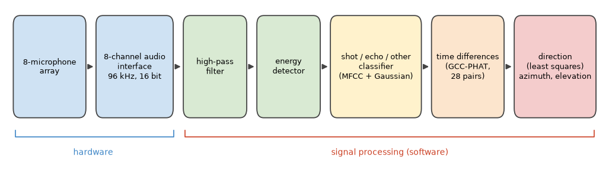
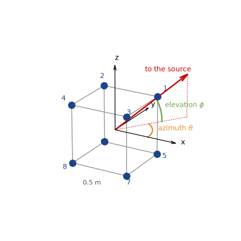
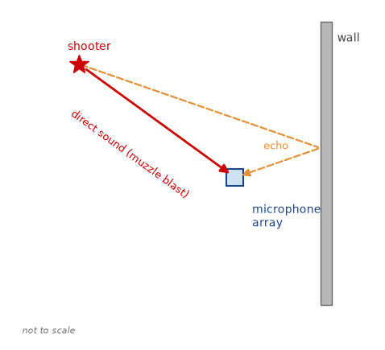
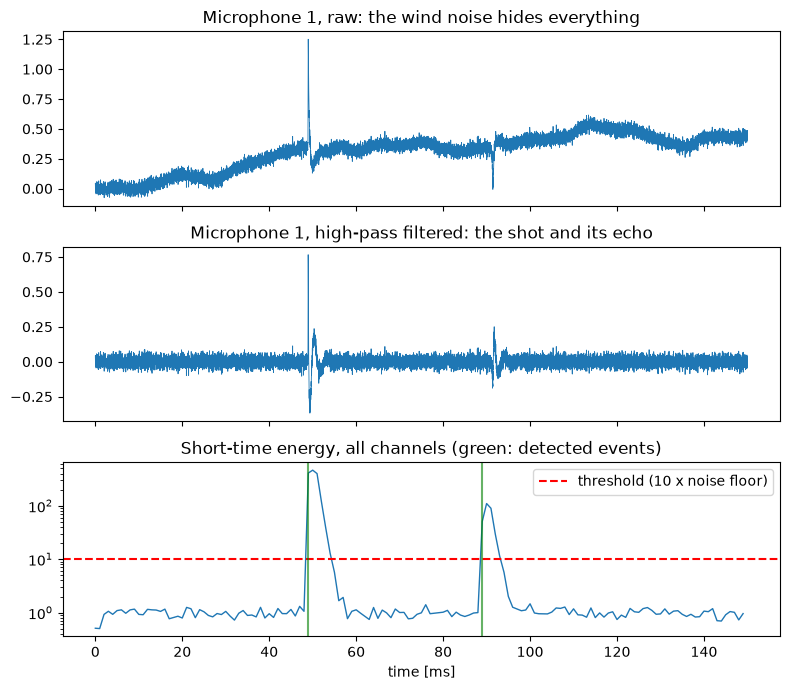
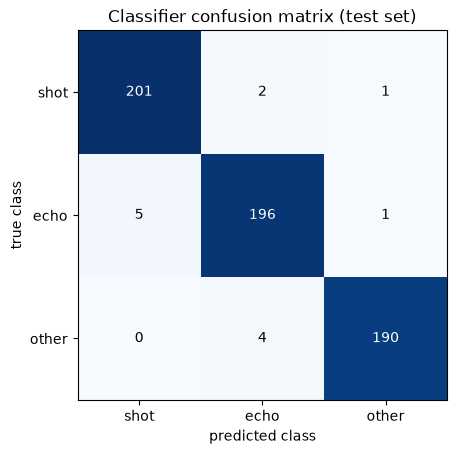
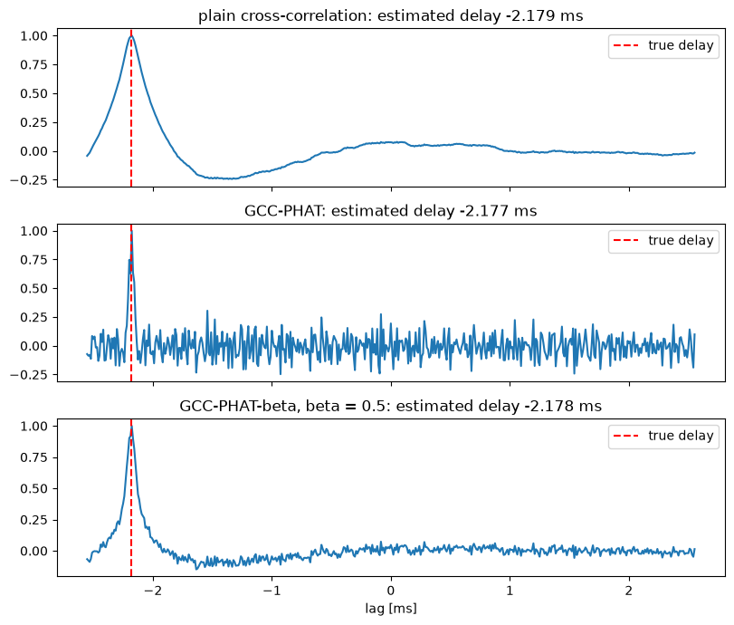
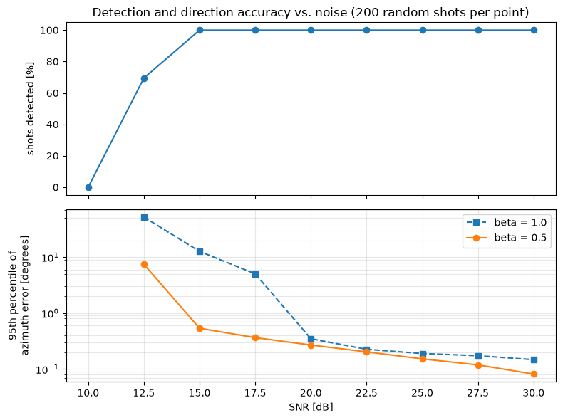

Emre: How can a system hear a single gunshot and tell you which direction it came from?

Kaan: I worked on a system like that some time ago. I can't share the original data or the details of that project, but the ideas behind it are classic signal processing, and we can rebuild the whole thing in a simulation.

## Problem

A gunshot is one of the loudest sounds you can hear, so detecting that *something* happened is not the hard part. The hard part is answering three questions automatically, in a fraction of a second:

1. Was that a gunshot, or a door slamming, or a firecracker?
2. Was that the shot itself, or its echo from a nearby building?
3. Which direction did it come from?

The third question is the reason the system exists. To answer it, we don't use one microphone but an array of them. Sound travels at roughly $$343$$ m/s, so a sound coming from the left reaches the left microphones a fraction of a millisecond before the right ones. If we can measure these tiny time differences, we can work out the direction of the sound.

Emre: A fraction of a millisecond? Can we really measure that?

Kaan: Easily, if we sample fast enough. At $$96$$ kHz, one sample is about $$10.4\,\mu s$$, during which sound travels about $$3.6$$ mm. With microphones half a meter apart, the largest possible time difference is about $$1.5$$ ms, which is more than 140 samples. That gives us plenty of resolution. And with a bit of interpolation, we can go below one sample.

## The Acoustics of a Gunshot

A firearm actually produces two different sounds:

- **The muzzle blast:** the expanding gases at the muzzle create a short, very loud, impulsive pressure wave that spreads out from the weapon in all directions at the speed of sound. Its shape is close to what is known as the Friedlander waveform: a sharp rise followed by a decay that dips slightly below zero. The muzzle blast comes from the shooter's position, so its direction is the direction we want.
- **The shockwave:** if the bullet is supersonic, it drags a Mach cone behind it, like a boat's wake. This produces a sharp "crack" with an N-shaped pressure profile. It is heard only near the bullet's path, it often arrives *before* the muzzle blast, and it comes from the direction of the bullet's path, not the shooter.

In this project, we'll localize the muzzle blast, and I'll come back to the shockwave in the Real Life section. On top of these two, any real recording also contains echoes from buildings and terrain, wind noise and all kinds of other impulsive sounds.

## The Hardware Setup

The system has three parts: a microphone array, a multichannel recorder, and a computer running the signal processing chain.

<p align="center">

</p>

The array has eight omnidirectional microphones on the corners of a cube with $$0.5$$ m sides. All eight channels are sampled by a single multichannel audio interface at $$96$$ kHz with 16 bits per sample. It's important that a single device samples all channels with the same clock: the whole method relies on time differences of a few microseconds, and any timing offset between channels would turn directly into a direction error.

<p align="center">

</p>

We describe a direction with two angles: the **azimuth** $$\theta$$, measured in the horizontal plane from the x-axis, and the **elevation** $$\phi$$, measured up from the horizontal plane. The unit vector pointing towards the source is:

<div>
$$
\mathbf{u} = \begin{bmatrix} \cos\phi \cos\theta \\ \cos\phi \sin\theta \\ \sin\phi \end{bmatrix}
$$
</div>

Why eight microphones on a 3D shape instead of, say, four on a line? A line array can't tell front from back, and a flat array can't tell up from down. With microphones spread in all three dimensions, every direction produces a unique pattern of delays.

Finally, here is the scene we'll simulate. A shooter fires from some direction, and the array hears the muzzle blast directly and, a little later, its echo from a nearby wall.

<p align="center">

</p>

## The Signal Model

The shooter is typically tens or hundreds of meters away, while the array is half a meter wide. So we can use the **far-field** assumption: the sound arrives as a plane wave, and all microphones see the same direction $$\mathbf{u}$$. If microphone $$i$$ is at position $$\mathbf{p}_i$$, the plane wave reaches it at time

<div>
$$
t_i = t_0 - \frac{\mathbf{p}_i^T \mathbf{u}}{c}
$$
</div>

where $$t_0$$ is the time it reaches the center of the array and $$c$$ is the speed of sound. Microphones that are further towards the source (larger $$\mathbf{p}_i^T \mathbf{u}$$) hear it earlier. The signal at microphone $$i$$ is then:

<div>
$$
x_i(t) = s(t - t_i) + e_i(t) + n_i(t)
$$
</div>

where $$s(t)$$ is the muzzle blast, $$e_i(t)$$ is its echo (another delayed copy coming from another direction), and $$n_i(t)$$ is noise. The time difference between two microphones is what we'll measure:

<div>
$$
\tau_{ij} = t_i - t_j = \frac{(\mathbf{p}_j - \mathbf{p}_i)^T \mathbf{u}}{c}
$$
</div>

Notice that this is linear in $$\mathbf{u}$$. Keep that in mind; it'll make the last step very simple.

Let's build the simulation. We'll model the muzzle blast with the Friedlander waveform, smooth it a little to account for air absorption, and delay it to each microphone with a fractional delay in the frequency domain. We'll add an echo from a different direction 40 ms later, white sensor noise, and low-frequency wind noise.

```python
import numpy as np
import matplotlib.pyplot as plt
from itertools import combinations
from scipy.signal import butter, sosfilt, lfilter

rng = np.random.default_rng(7) # fix the random seed so the results are reproducible

fs = 96000   # sampling rate [Hz]
c = 343.0    # speed of sound [m/s]
L = 0.5      # side of the cube array [m]

# eight microphones on the corners of a cube, centered at the origin
mics = np.array([[x, y, z] for z in (L/2, -L/2) for y in (L/2, -L/2) for x in (L/2, -L/2)])
pairs = list(combinations(range(len(mics)), 2))  # all 28 microphone pairs

def direction(az_deg, el_deg):
    """Unit vector pointing towards a source at the given azimuth and elevation."""
    az, el = np.radians(az_deg), np.radians(el_deg)
    return np.array([np.cos(el) * np.cos(az), np.cos(el) * np.sin(az), np.sin(el)])

def muzzle_blast(T=0.5e-3, dur=8e-3):
    """Friedlander waveform, smoothed a little to account for air absorption."""
    t = np.arange(int(dur * fs)) / fs
    p = (1 - t / T) * np.exp(-t / T)
    b, a = butter(2, 8000, fs=fs)
    return lfilter(b, a, p)

def place(sig, n_total, t_arrival):
    """Place a signal in a buffer of n_total samples so that it starts at t_arrival
    (a fractional delay, applied as a phase shift in the frequency domain)."""
    x = np.zeros(n_total)
    x[:len(sig)] = sig
    f = np.fft.rfftfreq(n_total, 1 / fs)
    return np.fft.irfft(np.fft.rfft(x) * np.exp(-2j * np.pi * f * t_arrival), n_total)

def echo_of(blast):
    """An echo: a weaker copy of the blast, smeared by a rough wall and with fewer high frequencies."""
    tail = np.exp(-np.arange(300) / 60) * rng.normal(0, 1, 300)
    b, a = butter(2, 3000, fs=fs)
    e = lfilter(b, a, np.convolve(blast, tail))
    return 0.35 * e * np.abs(blast).max() / np.abs(e).max()

def simulate(az, el, n_total, t0=0.05, snr_db=30, echo_az=None, echo_delay=0.04):
    """Eight-channel recording of a shot from (az, el), its echo, sensor noise and wind."""
    blast = muzzle_blast()
    x = np.array([place(blast, n_total, t0 - p @ direction(az, el) / c) for p in mics])
    echo_az = az + 150 if echo_az is None else echo_az
    e = echo_of(blast)
    x += np.array([place(e, n_total, t0 + echo_delay - p @ direction(echo_az, 0) / c) for p in mics])
    peak = np.abs(x).max()
    x += rng.normal(0, peak * 10 ** (-snr_db / 20), x.shape)        # sensor noise
    wind = sosfilt(butter(2, 100, fs=fs, output='sos'), np.cumsum(rng.normal(0, 1, n_total)))
    x += 0.6 * peak * wind / np.abs(wind).max()                       # low-frequency wind noise
    return x

n_total = int(0.15 * fs)                    # 150 ms of recording
x = simulate(az=70, el=15, n_total=n_total)  # a shot from azimuth 70 degrees, elevation 15 degrees
```

## Step 1: Filtering and Detection

The first job is to find the moments when something impulsive happened. Before anything else, we remove the wind noise with a high-pass filter. Wind is a low-frequency phenomenon, mostly below a couple of hundred Hz, while the muzzle blast has most of its energy between a few hundred Hz and a few kHz.

Then we compute the short-time energy in 1 ms frames and compare it with the noise floor. Two details make the detector much more robust. First, we compute the energy in the band where the blast lives (300 Hz to 4 kHz), so the noise outside that band doesn't count. Second, we add up the energy of all eight channels. The blast is the same in all of them, while the noise is independent, so the blast adds up faster than the noise. When the energy jumps above ten times the noise floor (10 dB), we mark an event and stay quiet for a short dead time, so that a single event doesn't trigger the detector again and again.

```python
hp = butter(4, 300, 'hp', fs=fs, output='sos')          # removes the wind noise
bp = butter(4, [300, 4000], 'bp', fs=fs, output='sos')  # the band where the blast lives

def detect(x, frame=96, ratio=10, dead=0.03):
    """Short-time energy detector on the sum of all channels. Returns event start samples."""
    energy = np.add.reduceat((sosfilt(bp, x, axis=1) ** 2).sum(axis=0), np.arange(0, x.shape[1], frame))
    floor = np.median(energy)                               # the noise floor
    events, i = [], 0
    while i < len(energy):
        if energy[i] > ratio * floor:
            events.append(i * frame)
            i += int(dead * fs / frame)                     # dead time after each event
        else:
            i += 1
    return events, energy, floor

xf = sosfilt(hp, x, axis=1)
events, energy, floor = detect(x)
print("Events detected at [ms]:", [round(1000 * k / fs, 1) for k in events])

t = np.arange(n_total) / fs * 1000
fig, (ax1, ax2, ax3) = plt.subplots(3, 1, figsize=(8, 7), sharex=True)
ax1.plot(t, x[0], lw=0.6)
ax1.set_title('Microphone 1, raw: the wind noise hides everything')
ax2.plot(t, xf[0], lw=0.6)
ax2.set_title('Microphone 1, high-pass filtered: the shot and its echo')
te = np.arange(len(energy)) * 96 / fs * 1000
ax3.semilogy(te, energy / floor, lw=1)
ax3.axhline(10, color='r', ls='--', label='threshold (10 x noise floor)')
for k in events:
    ax3.axvline(1000 * k / fs, color='g', alpha=0.6)
ax3.set_title('Short-time energy, all channels (green: detected events)')
ax3.set_xlabel('time [ms]')
ax3.legend(loc='upper right')
plt.tight_layout()
plt.show()
```

```
Events detected at [ms]: [49.0, 89.0]
```

<p align="center">

</p>

In the raw recording, the slow wind noise dominates. After the high-pass filter, the shot at around 50 ms and its echo 40 ms later stand out clearly, and the energy detector finds both. Now we have two events, and we need to know which one is the shot.

## Step 2: Is It a Shot? Classification

The energy detector doesn't know what it detected. An echo, a door slam or a firecracker would all trigger it. We need a classifier that looks at the *character* of the sound. For that, we'll use the same features that speech recognition systems have used for decades: **Mel-Frequency Cepstral Coefficients (MFCCs)**.

Emre: Why speech features for a gunshot?

Kaan: Because MFCCs are a compact and robust description of the spectral envelope of a short piece of sound, i.e., of its "color", and that's exactly what differs between our classes. A direct muzzle blast is sharp and broadband. An echo has bounced off a rough surface: it's smeared in time and has lost much of its high-frequency content. A door slam or a clap has a different spectral shape again.

Computing the MFCCs of a frame takes four steps: take the spectrum of a windowed frame, sum it in a set of overlapping bands that are spaced on the mel scale (narrow at low frequencies, wide at high frequencies, roughly like our hearing), take the logarithm of these band energies, and finally decorrelate them with a Discrete Cosine Transform. The first few DCT coefficients are the MFCCs.

To also capture how the sound changes in time, we take three frames around the onset: one just before, one at the onset and one just after. Our feature vector is the MFCCs of the onset frame plus the difference between the MFCCs of the frames before and after. For the classifier, we model each class with a Gaussian distribution with a diagonal covariance and pick the class with the highest likelihood, as we did in the <a href="https://tayyarg.github.io/bayesian-inference-and-linear-regression/">Bayesian inference</a> post:

<div>
$$
\hat{c} = \arg\max_{c} \left[ \log p(c) + \sum_{d} \log \mathcal{N}(f_d \,|\, \mu_{c,d}, \sigma_{c,d}^2) \right]
$$
</div>

Let's generate a few hundred synthetic examples of each class, train the classifier on half of them and test it on the other half.

```python
from scipy.fft import dct

def mel_filterbank(n_fft, n_bands=20, f_lo=100, f_hi=20000):
    mel = lambda f: 2595 * np.log10(1 + f / 700)
    imel = lambda m: 700 * (10 ** (m / 2595) - 1)
    edges = imel(np.linspace(mel(f_lo), mel(f_hi), n_bands + 2))
    f = np.fft.rfftfreq(n_fft, 1 / fs)
    fb = np.zeros((n_bands, len(f)))
    for b in range(n_bands):
        lo, mid, hi = edges[b], edges[b + 1], edges[b + 2]
        fb[b] = np.clip(np.minimum((f - lo) / (mid - lo), (hi - f) / (hi - mid)), 0, None)
    return fb

N_FFT, N_MFCC = 512, 13
FB = mel_filterbank(N_FFT)
WINDOW = np.hamming(N_FFT)

def mfcc(frame):
    spectrum = np.abs(np.fft.rfft(frame * WINDOW)) ** 2
    return dct(np.log(FB @ spectrum + 1e-12), norm='ortho')[:N_MFCC]

def features(sig, onset):
    """MFCCs at the onset, plus the change from just before to just after the onset."""
    half = N_FFT // 2
    before, at, after = (sig[onset + k: onset + k + N_FFT] for k in (-half, 0, half))
    return np.concatenate([mfcc(at), mfcc(before) - mfcc(after)])

def make_event(kind, n=4096, onset=1024):
    """One synthetic, high-pass filtered event of the given class."""
    sig = np.zeros(n)
    if kind == 'shot':
        s = muzzle_blast(T=rng.uniform(0.3e-3, 0.8e-3))
    elif kind == 'echo':
        s = echo_of(muzzle_blast(T=rng.uniform(0.3e-3, 0.8e-3)))
        s = lfilter(*butter(2, rng.uniform(1500, 4000), fs=fs), s)
    else:  # 'other': a door slam or a clap, i.e. a decaying burst of band-limited noise
        m = int(rng.uniform(2e-3, 8e-3) * fs)
        s = rng.normal(0, 1, m) * np.exp(-np.arange(m) / (m / 4))
        s = sosfilt(butter(2, sorted(rng.uniform(200, 6000, 2)), 'bp', fs=fs, output='sos'), s)
    s = rng.uniform(0.3, 1.0) * s / np.abs(s).max()
    sig[onset:onset + len(s)] = s[:n - onset]
    sig += rng.normal(0, 10 ** (-rng.uniform(20, 35) / 20), n)
    return sosfilt(hp, sig), onset

classes = ['shot', 'echo', 'other']
X, y = [], []
for label, kind in enumerate(classes):
    for _ in range(400):
        sig, onset = make_event(kind)
        X.append(features(sig, onset)); y.append(label)
X, y = np.array(X), np.array(y)
train = rng.permutation(len(y)) < len(y) // 2   # a random half for training, the rest for testing

# one diagonal Gaussian per class
means = np.array([X[train & (y == k)].mean(axis=0) for k in range(3)])
variances = np.array([X[train & (y == k)].var(axis=0) for k in range(3)])

def classify(f):
    loglik = -0.5 * np.sum(np.log(2 * np.pi * variances) + (f - means) ** 2 / variances, axis=1)
    return int(np.argmax(loglik))  # equal priors

pred = np.array([classify(f) for f in X[~train]])
confusion = np.array([[np.sum((y[~train] == a) & (pred == b)) for b in range(3)] for a in range(3)])
print("Test accuracy: %.1f%%" % (100 * np.mean(pred == y[~train])))
print(confusion)

plt.imshow(confusion, cmap='Blues')
for a in range(3):
    for b in range(3):
        plt.text(b, a, confusion[a, b], ha='center', va='center',
                 color='white' if confusion[a, b] > confusion.max() / 2 else 'black')
plt.xticks(range(3), classes); plt.yticks(range(3), classes)
plt.xlabel('predicted class'); plt.ylabel('true class')
plt.title('Classifier confusion matrix (test set)')
plt.show()
```

```
Test accuracy: 97.8%
[[201   2   1]
 [  5 196   1]
 [  0   4 190]]
```

<p align="center">

</p>

The classifier separates the three classes almost perfectly on the test set. Don't be too impressed, though: in a simulation, we control how different the classes are. In the field, this is the part that needs the most work, with lots of real recordings for training and careful tuning of the decision thresholds. A practical trick is to bias the decision: missing a real shot is usually much worse than raising a false alarm, so we can add a constant to the log-likelihood of the shot class.

## Step 3: Time Differences with GCC-PHAT

Now we know when the shot arrived. Next, we need the time differences $$\tau_{ij}$$ between microphone pairs. The classic tool is the cross-correlation: slide one signal over the other and find the shift where they match best:

<div>
$$
r_{ij}(\tau) = \sum_t x_i(t) \, x_j(t + \tau)
$$
</div>

In the frequency domain, this is the inverse Fourier transform of the cross-spectrum $$X_i(f) X_j^*(f)$$. The problem is that the muzzle blast has most of its energy at low frequencies, and a low-frequency signal produces a wide, rounded correlation peak. Echoes and noise make it worse. The **Generalized Cross-Correlation (GCC)** of Knapp and Carter solves this by weighting the cross-spectrum before the inverse transform. The most popular weighting is the **Phase Transform (PHAT)**, which divides the cross-spectrum by its magnitude:

<div>
$$
r_{ij}^{\text{PHAT}}(\tau) = \mathcal{F}^{-1} \left\{ \frac{X_i(f) X_j^*(f)}{|X_i(f) X_j^*(f)|^{\beta}} \right\}
$$
</div>

With $$\beta = 1$$, only the phase of the cross-spectrum remains, and all frequencies contribute equally. Since a pure delay shows up as a linear phase, the result is a very sharp peak at the right delay. The catch is that the frequencies where there is only noise get the same weight as the frequencies where the signal is strong. In practice, $$\beta$$ slightly smaller than 1 (PHAT-$$\beta$$) is a good compromise. We'll use $$\beta = 0.5$$ and see why below.

To get below one sample, we fit a parabola through the peak and its two neighbors and take the parabola's maximum.

```python
def gcc_phat(a, b, max_lag, beta=0.5):
    """Time difference t_a - t_b [s] with PHAT-beta weighting, plus the correlation function."""
    n = 2 * len(a)
    R = np.fft.rfft(a, n) * np.conj(np.fft.rfft(b, n))
    R /= np.abs(R) ** beta + 1e-12
    cc = np.fft.irfft(R, n)
    cc = np.concatenate((cc[-max_lag:], cc[:max_lag + 1]))   # lags from -max_lag to +max_lag
    k = int(np.argmax(cc))
    if 0 < k < len(cc) - 1:                                   # parabolic interpolation
        y0, y1, y2 = cc[k - 1], cc[k], cc[k + 1]
        k = k + 0.5 * (y0 - y2) / (y0 - 2 * y1 + y2)
    return (k - max_lag) / fs, cc

# the largest possible delay: sound crossing the diagonal of the cube
max_lag = int(np.ceil(np.sqrt(3) * L / c * fs)) + 2

shot = events[0]
window = xf[:, shot - 96: shot - 96 + 1024]   # about 10 ms, starting 1 ms before the onset
i, j = 0, 7                                     # two opposite corners of the cube
true_tau = (mics[j] - mics[i]) @ direction(70, 15) / c
lags = np.arange(-max_lag, max_lag + 1) / fs * 1e3

fig, axes = plt.subplots(3, 1, figsize=(8, 7), sharex=True)
for ax, beta, name in zip(axes, (0.0, 1.0, 0.5), ('plain cross-correlation', 'GCC-PHAT', 'GCC-PHAT-beta, beta = 0.5')):
    tau, cc = gcc_phat(window[i], window[j], max_lag, beta)
    ax.plot(lags, cc / np.abs(cc).max())
    ax.axvline(true_tau * 1e3, color='r', ls='--', label='true delay')
    ax.set_title('%s: estimated delay %.3f ms' % (name, tau * 1e3))
    ax.legend(loc='upper right')
axes[-1].set_xlabel('lag [ms]')
plt.tight_layout()
plt.show()
```

<p align="center">

</p>

All three find the right delay here, but look at the shapes. The plain cross-correlation has a wide, rounded peak that noise and echoes can easily shift. Pure PHAT ($$\beta = 1$$) gives the sharpest peak, but notice how noisy the rest of the correlation is: by giving every frequency the same weight, it has boosted the noise in the bands where the blast has almost no energy. PHAT-$$\beta$$ with $$\beta = 0.5$$ keeps the peak sharp and the rest of the correlation quiet. We'll see in a moment why that matters.

## Step 4: From Time Differences to Direction

Remember that the time differences are linear in the direction vector:

<div>
$$
c \, \tau_{ij} = (\mathbf{p}_j - \mathbf{p}_i)^T \mathbf{u}
$$
</div>

We have 28 microphone pairs, which gives us 28 such equations, for a vector with only 3 unknowns. Stacking them, we get an over-determined linear system $$\mathbf{D}\mathbf{u} = c\boldsymbol{\tau}$$, where each row of $$\mathbf{D}$$ is the vector between two microphones. That's exactly the least squares problem we know from the <a href="https://tayyarg.github.io/digital-signal-processing-2-adaptive-filters-and-active-noise-cancellation/">adaptive filters</a> post:

<div>
$$
\hat{\mathbf{u}} = (\mathbf{D}^T\mathbf{D})^{-1}\mathbf{D}^T c\boldsymbol{\tau}
$$
</div>

Then we normalize $$\hat{\mathbf{u}}$$ to unit length and read off the angles: $$\hat{\theta} = \text{atan2}(\hat{u}_y, \hat{u}_x)$$ and $$\hat{\phi} = \arcsin(\hat{u}_z)$$.

Emre: Why use all 28 pairs? Three well-chosen pairs would give three equations for three unknowns.

Kaan: They would, and a first version of a system like this often does exactly that: pick a few pairs, compute an angle from each one with an $$\arccos$$, and then use some if-else logic to decide which quadrant the source is in. But every pair's delay has some error, and with only three equations, these errors go straight into the answer. With 28 equations, least squares averages the errors out, and the 3D geometry resolves the quadrant automatically. No special cases needed.

```python
def locate(window, beta=0.5):
    """Azimuth and elevation [degrees] from an 8-channel window, using all microphone pairs."""
    D, tau = [], []
    for i, j in pairs:
        t_ij, _ = gcc_phat(window[i], window[j], max_lag, beta)
        D.append(mics[j] - mics[i])
        tau.append(t_ij)
    u, *_ = np.linalg.lstsq(np.array(D), c * np.array(tau), rcond=None)
    u /= np.linalg.norm(u)
    return np.degrees(np.arctan2(u[1], u[0])) % 360, np.degrees(np.arcsin(np.clip(u[2], -1, 1)))

for k in events:
    w = xf[:, k - 96: k - 96 + 1024]
    print("Event at %.1f ms: azimuth %.1f, elevation %.1f degrees" % ((1000 * k / fs,) + locate(w)))
```

```
Event at 49.0 ms: azimuth 70.0, elevation 15.0 degrees
Event at 89.0 ms: azimuth 220.1, elevation 0.2 degrees
```

The first event is the shot: the true direction was an azimuth of 70° and an elevation of 15°. The second event is the echo, and its direction (220°, on the horizon) is exactly where we put the wall. This is another reason the classifier matters: a system that just reported the loudest or the latest event could point in a completely wrong direction.

## How Accurate Is It?

One shot doesn't tell us much. Let's simulate many shots from random directions at different noise levels, and look at how often we detect the shot and how large the direction error is. Here, SNR is the ratio between the peak of the blast and the standard deviation of the sensor noise. Let's also compare $$\beta = 1$$ (pure PHAT) with $$\beta = 0.5$$.

```python
snrs = np.arange(10, 32.5, 2.5)
results = {1.0: [], 0.5: []}
detection_rate = []
for snr in snrs:
    errors = {1.0: [], 0.5: []}
    detected = 0
    for _ in range(200):
        az, el = rng.uniform(0, 360), rng.uniform(-10, 40)
        x = simulate(az, el, n_total, snr_db=snr)
        events, *_ = detect(x)
        events = [k for k in events if abs(k / fs - 0.05) < 0.003]   # the shot, not the echo
        if not events:
            continue
        detected += 1
        w = sosfilt(hp, x, axis=1)[:, events[0] - 96: events[0] - 96 + 1024]
        for beta in errors:
            az_hat, _ = locate(w, beta)
            errors[beta].append(abs((az_hat - az + 180) % 360 - 180))
    detection_rate.append(detected / 200)
    for beta in errors:
        results[beta].append(np.percentile(errors[beta], 95) if errors[beta] else np.nan)

fig, (ax1, ax2) = plt.subplots(2, 1, figsize=(8, 6), sharex=True)
ax1.plot(snrs, 100 * np.array(detection_rate), 'o-')
ax1.set_ylabel('shots detected [%]')
ax1.set_title('Detection and direction accuracy vs. noise (200 random shots per point)')
for beta, style in ((1.0, 's--'), (0.5, 'o-')):
    ax2.semilogy(snrs, results[beta], style, label='beta = %.1f' % beta)
ax2.set_ylabel('95th percentile of\nazimuth error [degrees]')
ax2.set_xlabel('SNR [dB]')
ax2.legend()
ax2.grid(alpha=0.3, which='both')
plt.tight_layout()
plt.show()
```

<p align="center">

</p>

Below about 12 dB, the blast drowns in the noise and the detector misses it. From 15 dB up, every shot is detected.

The direction accuracy is where $$\beta$$ makes a big difference. With $$\beta = 0.5$$, 95% of the azimuth errors are below $$0.54°$$ at 15 dB SNR and below $$0.3°$$ from 20 dB up. Pure PHAT needs about 5 dB more SNR for the same result: at 15 dB, its 95th percentile is $$12.7°$$, because now and then the boosted noise produces a correlation peak at the wrong lag. Above 20 dB, the two are almost the same.

These numbers are optimistic. In the simulation, we know the exact geometry, the exact speed of sound and there's only one clean echo. In the field, the error budget is dominated by the effects in the next section, not by sensor noise.

## Real Life

A simulation is a friendly place. Here is what changes in the field:

- **The speed of sound isn't constant.** It depends on temperature, roughly $$c \approx 331.3 + 0.606\,T$$ m/s with $$T$$ in °C, so it varies by about 6% between a cold winter night and a hot summer day. Since we divide by $$c$$, a wrong value scales all the time differences and biases the elevation. A temperature sensor is cheap insurance. Wind also bends and shifts the sound slightly.
- **The shockwave.** With supersonic ammunition, the first thing the array hears is often the bullet's shockwave, not the muzzle blast, and it comes from the bullet's path, not from the shooter. A system has to recognize it (it has a characteristic N-shape and is much shorter than the blast) and must not mistake its direction for the shooter's. On the other hand, the shockwave is useful: the time between the shockwave and the muzzle blast depends on the distance to the shooter, so together they can give the range as well as the direction.
- **Range.** A single small array gives a direction, not a distance. Without the shockwave trick, the range comes from triangulating the directions reported by two or more arrays placed some distance apart.
- **Multipath and echoes.** In a city, the direct sound may even be blocked while a reflection is strong. Echoes overlapping with the direct sound distort the correlation, and that's where PHAT weighting and the classifier earn their keep.
- **Hardware.** The microphones and their preamplifiers are never perfectly matched, and the array's geometry is never exactly what's on the drawing. Every millimeter of position error is about 3 µs of time error. A calibration with a known sound source pays off.
- **False alarms.** The real world is full of impulsive sounds: construction, vehicles, fireworks. The classifier needs real training data from the environment where the system will be used.

## Computational Complexity

The whole chain is cheap enough to run in real time on modest hardware. The filters cost a few operations per sample per channel. The energy detector costs even less. The classifier runs only when an event is detected: three FFTs and a few dot products. Most of the work is in the GCC: for each of the 28 pairs, we need a forward FFT of each channel (which can be shared: 8 FFTs in total), one multiplication per frequency, and an inverse FFT per pair. With windows of about a thousand samples, that's a few hundred thousand operations per event, which is negligible for any modern processor. This is a big advantage of TDOA methods over methods that scan every possible direction with a beamformer.

## References

1. C. Knapp, G. Carter, <a href="https://doi.org/10.1109/TASSP.1976.1162830">The generalized correlation method for estimation of time delay</a>, IEEE Transactions on Acoustics, Speech, and Signal Processing, 1976
2. J. Benesty, J. Chen, Y. Huang, <a href="https://doi.org/10.1007/978-3-540-78612-2">Microphone Array Signal Processing</a>, Springer, 2008
3. R. C. Maher, <a href="https://doi.org/10.1109/DSPWS.2006.265386">Modeling and signal processing of acoustic gunshot recordings</a>, IEEE 12th Digital Signal Processing Workshop, 2006
4. S. Davis, P. Mermelstein, <a href="https://doi.org/10.1109/TASSP.1980.1163420">Comparison of parametric representations for monosyllabic word recognition in continuously spoken sentences</a>, IEEE Transactions on Acoustics, Speech, and Signal Processing, 1980
5. G. F. Kinney, K. J. Graham, <a href="https://doi.org/10.1007/978-3-642-86682-1">Explosive Shocks in Air</a>, Springer, 1985

<a href="https://www.freecounterstat.com" title="visitor counters"></a>
