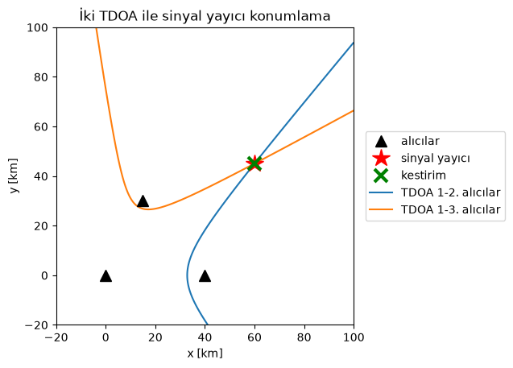
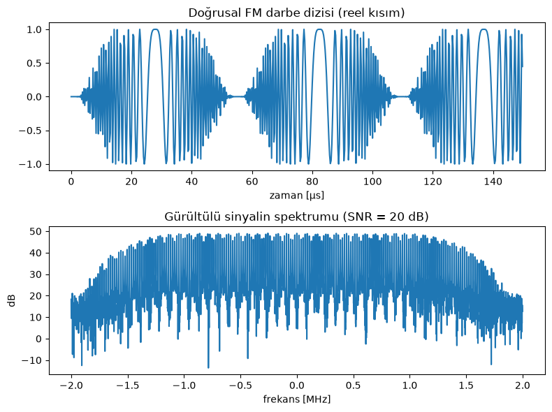
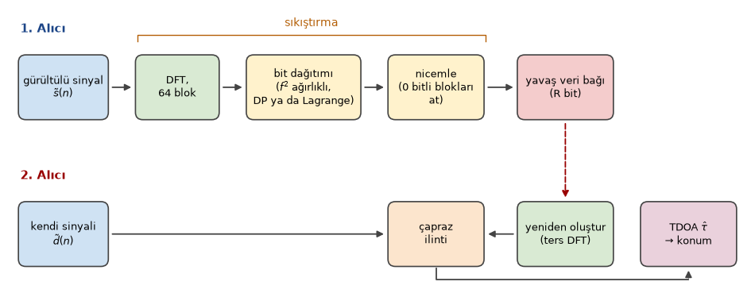
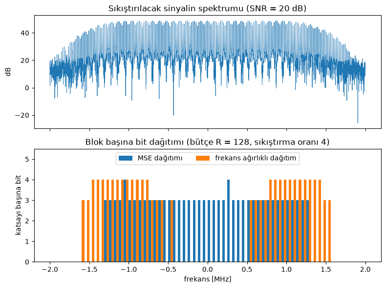
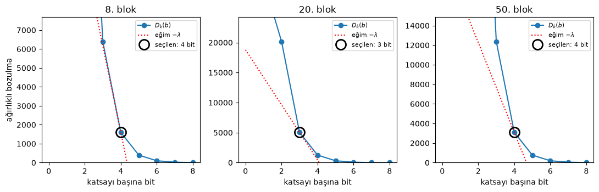
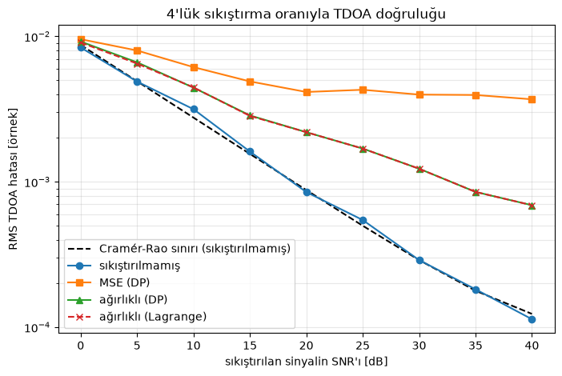
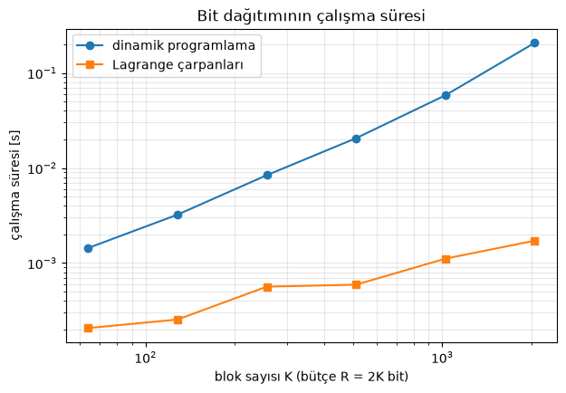

Emre: Göremediğin bir radarın yerini sadece yaydığı sinyali kullanarak nasıl bulabilirsin?

Kaan: Onu aynı anda birkaç farklı yerden dinleyerek. Bu proje, Prof. Mark L. Fowler'ın danışmanlığında yazdığım *Adaptive Compression Method for Emitter Location in Wireless Sensor Networks* (Binghamton University, State University of New York, 2004) başlıklı yüksek lisans tezime dayanıyor. Tez, doğrudan onun sinyal yayıcı konumlama için veri sıkıştırma üzerine çalışmalarının üzerine kurulu. Her şeyi sentetik radar sinyalleriyle Python'da yeniden yazdım, böylece her adımı kendin çalıştırabilirsin.

## Problem - Bir Sinyal Yayıcının Yerini Bulmak

Bir radarın bilinmeyen bir konumdan yayın yaptığını ve konumları bilinen birkaç uçakta (ya da yer algılayıcısında) alıcılarımız olduğunu varsayalım. Tüm alıcılar aynı darbeyi yakalar ama her biri biraz farklı bir anda, çünkü darbe her birine farklı bir mesafe kat ederek ulaşır.

Sinyal 1. alıcıya $$t_1$$ anında, 2. alıcıya $$t_2$$ anında ulaşıyorsa, **varış zamanı farkı (time difference of arrival - TDOA)**

<div>
$$
\tau_{21} = t_2 - t_1 = \frac{\lVert \mathbf{p} - \mathbf{r}_2 \rVert - \lVert \mathbf{p} - \mathbf{r}_1 \rVert}{c}
$$
</div>

olur. Burada $$\mathbf{p}$$ sinyal yayıcının konumu, $$\mathbf{r}_i$$ $$i$$. alıcının konumu, $$c$$ ise ışık hızıdır. Darbenin ne zaman yayıldığını bilmemize gerek olmadığına dikkat et: farkta sadeleşip gidiyor.

Emre: Ama tek bir denklem bize bir konum veremez ki.

Kaan: Doğru. Tek bir TDOA bize iki alıcıya olan uzaklıkların farkının sabit olduğunu söyler ve iki sabit noktaya olan uzaklıklarının farkı sabit olan noktaların kümesi bir **hiperboldür** (3 boyutta hiperboloid). Yani her TDOA sinyal yayıcıyı bir hiperbolün üzerine yerleştirir. Bir düzlemde üç alıcıyla iki bağımsız TDOA, yani iki hiperbol elde ederiz. Sinyal yayıcı onların kesiştiği yerdedir. 3 boyutta dördüncü bir alıcıya ya da **varış frekansı farkına (frequency difference of arrival - FDOA)** ihtiyacımız var: alıcılar hareket ediyorsa Doppler kayması her alıcıda farklıdır ve frekans farkı bize bir denklem daha verir.

Bunu birbirinden 40 km uzaktaki üç alıcı ve yaklaşık 75 km uzakta bir sinyal yayıcıyla görelim. TDOA'lar 20 ns hatayla ölçülüyor ve konumu iki hiperbol denklemini doğrusal olmayan en küçük karelerle çözerek buluyoruz.

```python
import numpy as np
import matplotlib.pyplot as plt
from scipy.optimize import least_squares

rng = np.random.default_rng(3) # sonuclar tekrarlanabilir olsun diye rasgele sayi uretecini sabitleyelim
c = 3e8  # isik hizi [m/s]

receivers = np.array([[0, 0], [40e3, 0], [15e3, 30e3]])  # uc alici [m]
emitter = np.array([60e3, 45e3])                          # bilinmeyen sinyal yayici [m]

def tdoas(p):
    """p konumundaki bir sinyal yayici icin 2. ve 3. alicilarin 1. aliciya gore TDOA'lari."""
    d = np.linalg.norm(receivers - p, axis=1)
    return (d[1:] - d[0]) / c

measured = tdoas(emitter) + rng.normal(0, 20e-9, 2)       # 20 ns'lik olcum hatasi

# baslangic noktasi icin kaba bir izgara aramasi, ardindan dogrusal olmayan en kucuk kareler
grid = np.stack(np.meshgrid(np.linspace(-20e3, 100e3, 241), np.linspace(-20e3, 100e3, 241)), -1).reshape(-1, 2)
start = grid[np.argmin([np.sum((tdoas(g) - measured) ** 2) for g in grid])]
estimate = least_squares(lambda p: (tdoas(p) - measured) * 1e9, start).x
print("Konum hatasi: %.1f m" % np.linalg.norm(estimate - emitter))

# iki hiperbolu cizdirelim
x, y = np.meshgrid(np.linspace(-20e3, 100e3, 600), np.linspace(-20e3, 100e3, 600))
d = [np.hypot(x - rx, y - ry) for rx, ry in receivers]
plt.contour(x / 1e3, y / 1e3, (d[1] - d[0]) / c - measured[0], [0], colors='tab:blue')
plt.contour(x / 1e3, y / 1e3, (d[2] - d[0]) / c - measured[1], [0], colors='tab:orange')
plt.plot(*receivers.T / 1e3, 'k^', ms=10, label='alıcılar')
plt.plot(*emitter / 1e3, 'r*', ms=16, label='sinyal yayıcı')
plt.plot(*estimate / 1e3, 'gx', ms=12, mew=3, label='kestirim')
plt.plot([], [], color='tab:blue', label='TDOA 1-2. alıcılar')
plt.plot([], [], color='tab:orange', label='TDOA 1-3. alıcılar')
plt.xlabel('x [km]'); plt.ylabel('y [km]')
plt.title('İki TDOA ile sinyal yayıcı konumlama')
plt.legend(loc='center left', bbox_to_anchor=(1.02, 0.5)); plt.gca().set_aspect('equal')
plt.show()
```

```
Konum hatasi: 68.1 m
```

<p align="center">

</p>

İki hiperbol sinyal yayıcıda kesişiyor ve kestirim yaklaşık 70 metre uzakta. Bunun ne kadar hassas olduğuna dikkat et: ışık 20 ns'de sadece 6 m yol alır, ama alıcılardan uzakta hiperboller birbirini dar bir açıyla keser, bu yüzden birindeki küçük bir hata kesişim noktasını çok kaydırır (buna geometrik hassasiyet seyrelmesi, geometric dilution of precision, denir). TDOA hatasının her nanosaniyesi önemli: konum doğruluğu ancak TDOA doğruluğu kadar iyidir.

## TDOA'yı Ölçmek

TDOA'yı nasıl ölçeriz? Her alıcı yakaladığı sinyalin karmaşık temel bant halini kaydeder. 2. alıcının sinyali 1. alıcınınkinin gecikmiş (ve hareketli platformlarda Doppler kaymasına uğramış) bir kopyası artı bağımsız gürültüdür:

<div>
$$
\begin{gathered}
\tilde{s}(n) = s(n) + w_1(n) \\
\tilde{d}(n) = s(n - \tau) + w_2(n)
\end{gathered}
$$
</div>

$$\tau$$'yu iki sinyalin çapraz ilintisini alıp tepesini bularak buluruz. Doppler olsaydı çapraz belirsizlik fonksiyonunu (cross-ambiguity function), yani çapraz ilintiyi zaman kaymalarının yanında bir frekans kaymaları ızgarası üzerinde de hesaplayıp tepeyi her ikisinde de arardık. Biz burada sadece TDOA ile kalacağız.

Bu ne kadar doğru olabilir? TDOA kestirimi için Cramér–Rao sınırı şöyledir:

<div>
$$
\sigma_{\tau} \geq \frac{1}{2\pi B_{rms} \sqrt{WT \cdot SNR_{eff}}}, \qquad
SNR_{eff} = \frac{SNR \cdot DNR}{1 + SNR + DNR}
$$
</div>

Burada $$SNR$$ ve $$DNR$$ iki sinyalin sinyal-gürültü oranları, $$WT$$ zaman-bant genişliği çarpımı (eş evreli işleme kazancı), $$B_{rms}$$ ise sinyalin **RMS bant genişliğidir**:

<div>
$$
B_{rms}^2 = \frac{\int f^2 |S(f)|^2 df}{\int |S(f)|^2 df}
$$
</div>

$$B_{rms}$$'yi aklında tut. Aynı enerji için, enerjisi yüksek frekanslarda olan bir sinyalin daha keskin bir ilinti tepesi, dolayısıyla daha doğru bir TDOA verdiğini söylüyor. Bundan sonraki her şeyin anahtarı bu.

Test sinyalimiz olarak tezdeki aynı radar sinyalini kullanacağız: her biri 40 µs uzunluğunda, 2 MHz tarayan ve 4 MHz'de örneklenmiş doğrusal FM (chirp) darbelerinden oluşan bir darbe dizisi. 4096 örneklik bloklarla çalışacağız. Ona bir bakalım, bir TDOA kestirelim ve doğruluğu Cramér–Rao sınırıyla karşılaştıralım.

```python
from scipy.signal.windows import tukey

Fs, PW, F_DEV, N = 4e6, 40e-6, 2e6, 4096   # ornekleme frekansi, darbe genisligi, FM taramasi, blok uzunlugu

def lfm_pulse_train(n=N):
    """Dogrusal FM radar darbelerinden olusan bir dizi (karmasik temel bant)."""
    n_win = round(4 * PW * Fs / 3)
    t = np.arange(n_win) / Fs - (4 * PW / 3) / 2
    pulse = tukey(n_win, 0.5) * np.exp(2j * np.pi * F_DEV / (4 * PW / 3) * t ** 2)
    one = np.concatenate([np.zeros(5), pulse])
    return np.tile(one, n // len(one) + 1)[:n]

def add_noise(x, snr_db):
    p = np.mean(np.abs(x) ** 2) / 10 ** (snr_db / 10)
    return x + np.sqrt(p / 2) * (rng.normal(size=len(x)) + 1j * rng.normal(size=len(x)))

def delay(x, d):
    """x'i d ornek geciktir (d kesirli olabilir)."""
    return np.fft.ifft(np.fft.fft(x) * np.exp(-2j * np.pi * np.fft.fftfreq(len(x)) * d))

def estimate_tdoa(a, b, up=32):
    """b'nin a'ya gore gecikmesi [ornek]: capraz spektrumu sifirla doldurarak ust orneklenmis
    capraz ilinti ve tepe etrafinda parabolik aradegerleme."""
    n = len(a)
    X = np.conj(np.fft.fft(a)) * np.fft.fft(b)
    Xp = np.zeros(n * up, complex)
    Xp[:n // 2], Xp[-n // 2:] = X[:n // 2], X[-n // 2:]
    cc = np.abs(np.fft.ifft(Xp))
    k = int(np.argmax(cc))
    y0, y1, y2 = cc[k - 1], cc[k], cc[(k + 1) % len(cc)]
    d = (k + 0.5 * (y0 - y2) / (y0 - 2 * y1 + y2)) / up
    return d if d < n / 2 else d - n

def crb(x, snr_db, dnr_db):
    """TDOA standart sapmasi icin Cramer-Rao siniri [ornek]."""
    X = np.fft.fft(x); f = np.fft.fftfreq(len(x))
    b_rms2 = np.sum(f ** 2 * np.abs(X) ** 2) / np.sum(np.abs(X) ** 2)
    a, b = 10 ** (snr_db / 10), 10 ** (dnr_db / 10)
    return 1 / np.sqrt(8 * np.pi ** 2 * b_rms2 * len(x) * a * b / (1 + a + b))

s = lfm_pulse_train()
DNR = 40   # 2. alicinin sinyali guclu; gurultulu olan 1. alici

errors = []
for _ in range(200):
    d = rng.uniform(-20, 20)
    errors.append(estimate_tdoa(add_noise(s, 10), add_noise(delay(s, d), DNR)) - d)
print("SNR = 10 dB: RMS TDOA hatasi %.4f ornek, Cramer-Rao siniri %.4f ornek"
      % (np.sqrt(np.mean(np.square(errors))), crb(s, 10, DNR)))

fig, (ax1, ax2) = plt.subplots(2, 1, figsize=(8, 6))
ax1.plot(np.arange(600) / Fs * 1e6, s[:600].real)
ax1.set_xlabel('zaman [µs]'); ax1.set_title('Doğrusal FM darbe dizisi (reel kısım)')
f = (np.arange(N) - N / 2) / N * Fs / 1e6
ax2.plot(f, 20 * np.log10(np.abs(np.fft.fftshift(np.fft.fft(add_noise(s, 20)))) + 1e-9))
ax2.set_xlabel('frekans [MHz]'); ax2.set_ylabel('dB')
ax2.set_title('Gürültülü sinyalin spektrumu (SNR = 20 dB)')
plt.tight_layout()
plt.show()
```

```
SNR = 10 dB: RMS TDOA hatasi 0.0026 ornek, Cramer-Rao siniri 0.0028 ornek
```

<p align="center">

</p>

Kestiricimiz Cramér–Rao sınırına ulaşıyor (aradaki küçük fark istatistiksel), yani diğer her şeyi karşılaştırabileceğimiz iyi bir referansımız var. Birimlere dikkat et: 4 MHz'de 0.003 örnek bir nanosaniyeden az; bunu ilintilediğimiz 4096 örneğe borçluyuz.

## Veri Bağı Problemi

İşin püf noktası şu: iki sinyalin çapraz ilintisini alabilmek için ikisinin de aynı yerde olması gerekiyor. Alıcılardan biri örneklerini bir veri bağı üzerinden diğerine göndermek zorunda ve bir algılayıcı ağında ya da uçaklar arasında bu bağ yavaştır ve enerji harcar. Pratikte veri sıkıştırılmadan zamanında aktarılamaz ve darboğaz bağın kendisi olduğu için **kayıplı** sıkıştırmaya ihtiyacımız var.

<p align="center">

</p>

Emre: Kayıplı sıkıştırma her yerde. Standart bir yöntem kullanamaz mıyız?

Kaan: Standart yöntemler orijinal sinyalle yeniden oluşturulan sinyal arasındaki **ortalama karesel hatayı (MSE)** minimize eder: sinyalin aynı *görünmesini* sağlamaya çalışırlar. Ama bu sinyale kimse bakmayacak. Onu bir makine bir TDOA kestirmek için kullanacak, bu yüzden doğru kalite ölçüsü sıkıştırmanın TDOA doğruluğuna ne kadar zarar verdiğidir. Prof. Fowler'ın çalışmalarının çıkış noktası da buydu: MSE, sinyal yayıcı konumlama için yanlış bozulma ölçüsüdür.

Cramér–Rao sınırına tekrar bak. Sıkıştırma doğruluğa iki şekilde zarar verebilir:

1. **Nicemleme gürültü ekler.** Sinyal-nicemleme gürültüsü oranı $$SQR$$ ise sıkıştırılmış sinyalin etkin SNR'ı kabaca $$\left(1/SNR + 1/SQR\right)^{-1}$$ olur. Nicemleme gürültüsü alıcı gürültüsünün yeterince altında kaldığı sürece pek önemi yoktur.
2. **Katsayıları atmak $$B_{rms}$$'yi değiştirir.** Bir dönüşüm uzayında (örneğin DFT) sıkıştırıp bazı katsayıları atarsak sinyalin spektrumunu, dolayısıyla RMS bant genişliğini değiştiririz.

MSE'nin yanıldığı yer ikinci nokta. $$B_{rms}$$'nin tanımındaki $$f^2$$ yüzünden **yüksek frekanslı içerik TDOA doğruluğu için düşük frekanslı içerikten karesel olarak daha önemlidir**. MSE tabanlı bir kodlayıcı 1.9 MHz'deki bir hatayı 0.1 MHz'deki bir hatayla tamamen aynı görür. TDOA için ilki yaklaşık 360 kat daha önemlidir.

Bu yüzden MSE yerine frekansla ağırlıklandırılmış bir karesel hatayı minimize edeceğiz:

<div>
$$
D = \sum_k f_k^2 \, |S(k) - \hat{S}(k)|^2
$$
</div>

Burada $$S(k)$$ gürültülü sinyalin DFT katsayıları, $$\hat{S}(k)$$ bunların nicemlenmiş halleri, $$f_k$$ ise $$k$$. katsayının frekansıdır.

## Bit Dağıtımı

Kodlayıcımız şöyle çalışıyor. Sinyalin 4096 noktalı DFT'sini alıp 64 katsayılık 64 bloğa bölüyoruz. Her bloğun kendi düzgün nicemleyicisi var: $$k$$. blok $$b_k$$ bit alırsa tüm katsayılarının reel ve sanal kısımları $$b_k$$ bitle nicemlenir, sıfır bit alırsa bloğun tamamı atılır. Soru şu: toplam $$R$$ bitlik bir bütçeyi bloklar arasında nasıl paylaştıracağız?

<div>
$$
\min_{b_1, \ldots, b_K} \sum_{k=1}^{K} D_k(b_k) \quad \text{öyle ki} \quad \sum_{k=1}^{K} b_k \leq R
$$
</div>

Burada $$D_k(b)$$, $$k$$. blok $$b$$ bit aldığında oluşan (ağırlıklı) bozulmadır. Bunları önceden hesaplayabiliriz: $$b = 0$$ için bloğun (ağırlıklı) enerjisi, $$b \geq 1$$ için ise $$b$$ bitlik düzgün bir nicemleyicinin (ağırlıklı) nicemleme gürültüsüdür.

Burada güzel bir şeye dikkat et. Hangi blokları tutacağımıza hiçbir zaman açıkça karar vermiyoruz. $$f^2$$ ağırlıklandırmasıyla düşük frekanslı blokların ağırlıklı bozulması küçüktür, bu yüzden bütçe dar olduğunda onlara kendiliğinden sıfır bit düşer. Katsayıların seçimi dağıtım tarafından zorlanır; bu yüzden bu yaklaşıma **Dağıtımla Zorlanan Seçim** (Allocation-Forced Selection) denir. Sıkıştırılmamış referansımız katsayı başına 8 bitse, 64 blok için $$R = 128$$'lik bir bütçe $$64 \times 8 / 128 = 4$$'lük bir sıkıştırma oranı demektir.

### Dinamik Programlama

Bu klasik bir kaynak dağıtım problemi ve **dinamik programlama** onu tam olarak çözer. Blokların üzerinden tek tek geçeriz ve o ana kadar kullanılan her olası bit sayısı için en iyi toplam bozulmayı saklarız. $$K$$ blok, $$R$$ bitlik bir bütçe ve blok başına en fazla $$b_{max}$$ bit ile bu $$O(K R \, b_{max})$$ işlem alır. Kesin çözümdür ama maliyeti bütçeyle birlikte büyür.

### Lagrange Çarpanları

Tezimin incelediği fikir Shoham ve Gersho'nun ayrık Lagrange çarpanı yöntemi. Kısıtlı problem yerine kısıtsız bir problem çözüyoruz:

<div>
$$
\min_{b_1, \ldots, b_K} \sum_{k=1}^{K} \left[ D_k(b_k) + \lambda b_k \right]
$$
</div>

Burada $$\lambda \geq 0$$. İşin sihri şu ki bu toplam ayrışıyor: her blok, birkaç olası $$b$$ değeri üzerinden $$D_k(b) + \lambda b$$'yi minimize ederek kendi bit sayısını bağımsız olarak seçebilir. Everett'e dayanan bir teorem, bu kısıtsız problemin çözümü tam olarak $$R$$ bit kullanıyorsa kısıtlı problemin de çözümü olduğunu söyler. Yani sadece doğru $$\lambda$$'yı bulmamız gerekiyor ve $$\lambda$$ büyüdükçe toplam hız azaldığından basit bir ikiye bölme (bisection) onu bulur. Tezde $$\lambda$$'yı sabit bir adımla güncellemiştim; ikiye bölme aynı aramayı yapmanın daha temiz bir yolu.

Emre: $$\lambda$$ ne anlama geliyor?

Kaan: Bir bitin fiyatı. Her blok, bir bit daha bozulmasını $$\lambda$$'dan fazla azalttığı sürece bit satın alır. Optimumda bit alan tüm bloklar hız-bozulma eğrilerinde aynı eğime, $$-\lambda$$'ya sahip bir noktada çalışır. Bu yüzden buna **sabit eğim optimizasyonu** da denir.

Bir pürüz var. $$\lambda$$ değiştikçe toplam hız ayrık adımlarla sıçrar, bu yüzden bazen hiçbir $$\lambda$$ tam olarak $$R$$ bit vermez. O zaman bütçenin hemen altındaki çözümü alıp kalan birkaç biti açgözlü bir şekilde, her birini bozulmayı en çok azaltacağı bloğa veririz. Her değerlendirme $$O(K \, b_{max})$$ tutar ve ikiye bölme adımlarının sayısı $$R$$'ye bağlı değildir.

Her ikisini de gerçekleyip MSE için ve ağırlıklı bozulma için ürettikleri dağıtımları karşılaştıralım.

```python
NB, BMAX = 64, 8           # blok sayisi, katsayi basina en fazla bit
M = N // NB                # blok basina katsayi
R = NB * BMAX // 4         # 4'luk sikistirma orani icin bit butcesi
f_norm = (np.arange(N) - N // 2) / (N // 2)   # her (merkezlenmis) DFT katsayisinin normalize frekansi

def to_blocks(x):
    return np.fft.fftshift(np.fft.fft(x)).reshape(NB, M)

def block_scale(blk):
    return max(np.abs(blk.real).max(), np.abs(blk.imag).max())

def distortion_table(blocks, weighted):
    """D[k, b]: b bitle nicemlenen k. blogun bozulmasi (b = 0 blogun atilmasi demek)."""
    w = (f_norm ** 2).reshape(NB, M) if weighted else np.ones((NB, M))
    D = np.zeros((NB, BMAX + 1))
    for k in range(NB):
        A = block_scale(blocks[k])
        D[k, 0] = np.sum(w[k] * np.abs(blocks[k]) ** 2)
        D[k, 1:] = np.sum(w[k]) * 2 * (2 * A / 2.0 ** np.arange(1, BMAX + 1)) ** 2 / 12
        D[k] = np.minimum.accumulate(D[k])   # bir bit fazlasi hicbir zaman isleri kotulestirmez
    return D

def allocate_dp(D, R):
    """Dinamik programlama ile kesin bit dagitimi."""
    K = len(D)
    best = np.full(R + 1, np.inf); best[0] = 0     # best[r]: tam olarak r bit kullanan en kucuk bozulma
    choices = []
    for k in range(K):
        new = np.full(R + 1, np.inf); arg = np.zeros(R + 1, int)
        for b in range(BMAX + 1):
            cand = np.full(R + 1, np.inf)
            cand[b:] = best[:R + 1 - b] + D[k, b]
            better = cand < new
            new[better], arg[better] = cand[better], b
        choices.append(arg); best = new
    r, B = int(np.argmin(best)), np.zeros(K, int)
    for k in range(K - 1, -1, -1):                 # kararlari geriye dogru takip et
        B[k] = choices[k][r]; r -= B[k]
    return B

def allocate_lagrange(D, R, iters=60):
    """Ayrik Lagrange carpani yontemiyle bit dagitimi (Shoham-Gersho)."""
    rate = np.arange(BMAX + 1)
    solve = lambda lam: np.argmin(D + lam * rate, axis=1)   # her blok kendi karar veriyor
    lo, hi = 0.0, D[:, 0].max() + 1.0                       # lam = hi hic bit satin almaz
    for _ in range(iters):                                  # bir bitin fiyati uzerinde ikiye bolme
        lam = (lo + hi) / 2
        if solve(lam).sum() > R: lo = lam
        else: hi = lam
    B = solve(hi)
    while B.sum() < R:                                      # artan bitleri acgozlu sekilde dagit
        gain = [D[k, B[k]] - D[k, B[k] + 1] if B[k] < BMAX else -1 for k in range(len(D))]
        k = int(np.argmax(gain))
        if gain[k] <= 0: break
        B[k] += 1
    return B, hi

def compress(x, R, weighted=True, method='lagrange'):
    """x'i R bitle sikistir; yeniden olusturulan sinyali ve dagitimi dondur."""
    blocks = to_blocks(x)
    D = distortion_table(blocks, weighted)
    B = allocate_dp(D, R) if method == 'dp' else allocate_lagrange(D, R)[0]
    Q = np.zeros_like(blocks)
    for k in range(NB):
        if B[k] == 0: continue
        A = block_scale(blocks[k]); step = 2 * A / 2 ** B[k]
        q = lambda v: np.clip((np.floor(v / step) + 0.5) * step, -A + step / 2, A - step / 2)
        Q[k] = q(blocks[k].real) + 1j * q(blocks[k].imag)
    return np.fft.ifft(np.fft.ifftshift(Q.ravel())), B

x = add_noise(s, 20)
blocks = to_blocks(x)
allocations = {}
for weighted, name in ((False, 'MSE'), (True, 'agirlikli')):
    D = distortion_table(blocks, weighted)
    B_dp, B_lag = allocate_dp(D, R), allocate_lagrange(D, R)[0]
    allocations[name] = B_dp
    print("%-9s: %2d blok tutuldu, %d bit kullanildi, DP ve Lagrange ayni: %s"
          % (name, np.sum(B_dp > 0), B_dp.sum(), np.array_equal(B_dp, B_lag)))

fig, (ax1, ax2) = plt.subplots(2, 1, figsize=(8, 6), sharex=True)
fb = (np.arange(NB) + 0.5) / NB * Fs / 1e6 - Fs / 2e6   # her blogun merkez frekansi [MHz]
ax1.plot(f, 20 * np.log10(np.abs(np.fft.fftshift(np.fft.fft(x)))), lw=0.6)
ax1.set_ylabel('dB'); ax1.set_title('Sıkıştırılacak sinyalin spektrumu (SNR = 20 dB)')
width = Fs / 1e6 / NB
ax2.bar(fb - width / 4, allocations['MSE'], width / 2, label='MSE dağıtımı')
ax2.bar(fb + width / 4, allocations['agirlikli'], width / 2, label='frekans ağırlıklı dağıtım')
ax2.set_xlabel('frekans [MHz]'); ax2.set_ylabel('katsayı başına bit')
ax2.set_title('Blok başına bit dağıtımı (bütçe R = %i, sıkıştırma oranı 4)' % R)
ax2.set_ylim(0, 5.5); ax2.legend(loc='upper center', ncol=2)
plt.tight_layout()
plt.show()
```

```
MSE      : 42 blok tutuldu, 128 bit kullanildi, DP ve Lagrange ayni: True
agirlikli: 35 blok tutuldu, 128 bit kullanildi, DP ve Lagrange ayni: True
```

<p align="center">

</p>

İki bozulma ölçüsü çok farklı kararlar veriyor. MSE dağıtımı bitlerini spektrumun merkezdeki en güçlü kısmına harcıyor ve bant kenarlarına doğru daha zayıf olan blokları atıyor. Ağırlıklı dağıtım ise herhangi bir ses ya da görüntü kodlayıcısını dehşete düşürecek bir şey yapıyor: sinyalin güçlü olduğu **sıfır frekans civarındaki blokları atıyor** ve bitleri yüksek frekanslara harcıyor, çünkü TDOA doğruluğu oradan geliyor. Her iki durumda da Lagrange yöntemi dinamik programlamayla tamamen aynı dağıtımı buldu.

Sabit eğim fikrini de görselleştirelim. Aşağıda üç bloğun hız-bozulma eğrileri ve her bloğun seçtiği nokta var. Seçilen her nokta, aynı eğime ($$-\lambda$$) sahip bir doğrunun bloğun eğrisine alttan değdiği yer: bir bit fazlası $$\lambda$$'dan az kazandırır, bir bit eksiği $$\lambda$$'dan fazla kaybettirir.

```python
D = distortion_table(blocks, weighted=True)
B, lam = allocate_lagrange(D, R)
b = np.arange(BMAX + 1)
fig, axes = plt.subplots(1, 3, figsize=(11, 3.6))
for ax, k in zip(axes, (8, 20, 50)):
    bk = B[k]
    ax.plot(b, D[k], 'o-', label='$D_k(b)$')
    ax.plot(b, D[k, bk] - lam * (b - bk), 'r:', label='eğim $-\\lambda$')
    ax.plot(bk, D[k, bk], 'o', ms=13, mfc='none', mec='k', mew=2, label='seçilen: %i bit' % bk)
    ax.set_ylim(0, 1.2 * D[k, max(bk - 1, 0)])
    ax.set_title('%i. blok' % k); ax.set_xlabel('katsayı başına bit')
    ax.legend(fontsize=8)
axes[0].set_ylabel('ağırlıklı bozulma')
plt.tight_layout()
plt.show()
```

<p align="center">

</p>

## Buna Değiyor mu?

Şimdi asıl test: sıkıştırmadan sonraki TDOA doğruluğu. 1. alıcının gürültülü sinyalini 4'lük sıkıştırma oranıyla MSE dağıtımı ve ağırlıklı dağıtımla (hem dinamik programlama hem de Lagrange çarpanlarıyla) sıkıştıralım, 2. alıcının sinyaliyle çapraz ilintisini alalım ve RMS TDOA hatasını bir SNR aralığında sıkıştırılmamış durumla ve Cramér–Rao sınırıyla karşılaştıralım.

```python
snrs = [0, 5, 10, 15, 20, 25, 30, 35, 40]
cases = {'sıkıştırılmamış': None, 'MSE (DP)': (False, 'dp'),
         'ağırlıklı (DP)': (True, 'dp'), 'ağırlıklı (Lagrange)': (True, 'lagrange')}
rmse = {name: [] for name in cases}
for snr in snrs:
    err = {name: [] for name in cases}
    for _ in range(200):
        d = rng.uniform(-20, 20)
        a, b = add_noise(s, snr), add_noise(delay(s, d), DNR)
        for name, how in cases.items():
            a_c = a if how is None else compress(a, R, *how)[0]
            err[name].append(estimate_tdoa(a_c, b) - d)
    for name in cases:
        rmse[name].append(np.sqrt(np.mean(np.square(err[name]))))
    print("SNR %2d dB: " % snr + ", ".join("%s %.4f" % (n, v[-1]) for n, v in rmse.items()))

plt.figure(figsize=(8, 5))
plt.semilogy(snrs, [crb(s, v, DNR) for v in snrs], 'k--', label='Cramér-Rao sınırı (sıkıştırılmamış)')
for (name, v), style in zip(rmse.items(), ('o-', 's-', '^-', 'x--')):
    plt.semilogy(snrs, v, style, label=name)
plt.xlabel('sıkıştırılan sinyalin SNR\'ı [dB]'); plt.ylabel('RMS TDOA hatası [örnek]')
plt.title('4\'lük sıkıştırma oranıyla TDOA doğruluğu')
plt.legend(); plt.grid(alpha=0.3, which='both')
plt.show()
```

<p align="center">

</p>

Düşük SNR'da alıcı gürültüsü baskın ve tüm versiyonlar birbirine yakın kalıyor. SNR arttıkça MSE ile sıkıştırılan versiyon iyileşmeyi bırakıyor: yaklaşık 20 dB'den itibaren hatası 0.004 örnek civarında takılı kalıyor, çünkü atılan yüksek frekanslar ve nicemleme gürültüsü onu sınırlıyor. Ağırlıklı sıkıştırma ise SNR'la birlikte iyileşmeye devam ediyor: 30 dB'de hatası 0.0012 örnek, yani MSE dağıtımına göre üç kattan fazla küçük, 40 dB'de ise beş kattan fazla küçük (0.0007'ye karşı 0.0037 örnek); üstelik tamamen aynı sayıda bitle.

Lagrange eğrisi de her yerde dinamik programlama eğrisinin tam üzerinde. Tezin ana sonucu buydu: çok daha ucuz olan Lagrange yöntemi aynı TDOA doğruluğunu veriyor.

Tabii ki 4'lük bir sıkıştırma oranı bedava değil: yüksek SNR'da ağırlıklı versiyon bile sıkıştırılmamış sinyalden birkaç kat daha kötü. Daha büyük bir bit bütçesi aradaki farkı kapatır; mesele şu ki, verilen bir bütçe için ağırlıklı dağıtım ona çok daha fazla yaklaşıyor.

### Lagrange Her Zaman Dinamik Programlama Kadar İyi mi?

Her zaman değil ve sebebini bilmeye değer. Lagrange yöntemi sadece hız-bozulma eğrilerinin alt dışbükey zarfı üzerindeki dağıtımlara ulaşabilir. Bir bloğun bozulma eğrisi dışbükey değilse bazı dağıtımlara hiçbir $$\lambda$$ ile ulaşılamaz ve yöntem gerçek optimumu biraz kaçırabilir. Bunun bizim sinyallerimizle ne sıklıkla olduğuna ve problem büyüdükçe çalışma sürelerinin nasıl karşılaştırıldığına bakalım.

```python
import time

same, ratio = 0, []
for _ in range(500):
    x = add_noise(s, rng.uniform(0, 40))
    D = distortion_table(to_blocks(x), weighted=True)
    budget = int(rng.integers(32, 257))
    B_dp, B_lag = allocate_dp(D, budget), allocate_lagrange(D, budget)[0]
    same += np.array_equal(B_dp, B_lag)
    ratio.append(D[np.arange(NB), B_lag].sum() / D[np.arange(NB), B_dp].sum())
print("Ayni dagitimlar: 500'de %i, en kotu bozulma orani Lagrange/DP: %.4f" % (same, max(ratio)))

sizes = [64, 128, 256, 512, 1024, 2048]
t_dp, t_lag = [], []
for K in sizes:
    D = np.tile(distortion_table(to_blocks(add_noise(s, 20)), True), (K // NB, 1))
    t0 = time.perf_counter(); allocate_dp(D, 2 * K); t_dp.append(time.perf_counter() - t0)
    t0 = time.perf_counter(); allocate_lagrange(D, 2 * K); t_lag.append(time.perf_counter() - t0)

plt.figure(figsize=(7, 4.5))
plt.loglog(sizes, t_dp, 'o-', label='dinamik programlama')
plt.loglog(sizes, t_lag, 's-', label='Lagrange çarpanları')
plt.xlabel('blok sayısı K (bütçe R = 2K bit)'); plt.ylabel('çalışma süresi [s]')
plt.title('Bit dağıtımının çalışma süresi')
plt.legend(); plt.grid(alpha=0.3, which='both')
plt.show()
```

```
Ayni dagitimlar: 500'de 424, en kotu bozulma orani Lagrange/DP: 1.0077
```

<p align="center">

</p>

500 rasgele durumun 424'ünde (%85) Lagrange yöntemi dinamik programlamayla tamamen aynı dağıtımı buldu; en kötü durumda bile bozulması sadece %0.8 daha yüksekti ki bu TDOA doğruluğunda görünür bir fark yaratmıyor. Tezde de aynı gözlemi yapmıştım: çoğu zaman Lagrange yöntemi gerçek optimumu buluyor.

Çalışma süreleri hikayenin diğer yarısını anlatıyor. 64 blokla ikisi de yaklaşık bir milisaniye sürüyor. 32 kat daha fazla blokla dinamik programlama yaklaşık 130 kat daha uzun sürüyor, Lagrange yöntemi ise 10 kattan az; en büyük boyutta 100 kattan fazla daha hızlı.

## Gerçek Hayat

Tez de bu simülasyon da işleri basit tutuyor. Gerçek bir sistemde birkaç şey değişir:

- **Doppler.** Hareketli platformlarda hem TDOA'ya hem de FDOA'ya ihtiyacımız var, bu yüzden ilinti gecikme ve Doppler üzerinde çapraz belirsizlik fonksiyonuna dönüşür. Aynı RMS fikri FDOA için de geçerli, ama zaman uzayında: FDOA doğruluğu sinyalin RMS süresine bağlıdır, yani FDOA için kaydın merkezinden uzaktaki örnekler daha önemlidir.
- **Yan bilgi.** Alıcının dağıtımı ve her bloğun nicemleyici ölçeğini bilmesi gerekir. Bu blok başına birkaç bayt eder; burada göz ardı ettik.
- **Entropi kodlama.** Nicemlemeden sonra bir entropi kodlayıcı veriyi ek bir kayıp olmadan daha da sıkıştırabilir.
- **Diğer dönüşümler.** DFT en basit seçim. Prof. Fowler'ın grubu dalgacık dönüşümleri de kullandı ve darbe dizileri için bir zaman-frekans ayrıştırması darbeler arasındaki boşluklardan da yararlanabilir.
- **Büyük fikir.** Göz için değil, görev için sıkıştır. Bugün bu fikir her yerde: videoda makine algısı için kodlamadan, gelecek nesil kablosuz ağlardaki "anlamsal" ya da "amaç odaklı" iletişim fikirlerine kadar.

## İşlem Karmaşıklığı

DFT $$O(N \log N)$$, bozulma tablolarını hesaplamak ise $$O(N + K b_{max})$$ tutar. Ardından dinamik programlama $$O(K R \, b_{max})$$ tutarken Lagrange yöntemi ikiye bölme için $$O(K b_{max} \log(1/\epsilon))$$ artı birkaç açgözlü adım tutar. Bütçe $$R$$ genellikle blok sayısı $$K$$ ile birlikte büyüdüğünden dinamik programlama problem boyutuyla karesel, Lagrange yöntemi ise sadece doğrusal olarak büyür. Enerji bütçesi dar olan bir algılayıcı düğümünde önemli olan fark da budur.

## Referanslar

1. T. Guzel, *Adaptive Compression Method for Emitter Location in Wireless Sensor Networks*, Yüksek Lisans Tezi, Binghamton University, State University of New York, 2004
2. M. L. Fowler, <a href="https://doi.org/10.1109/ACSSC.2001.987006">New distortion measures for data compression for emitter location</a>, Asilomar Conference on Signals, Systems and Computers, 2001
3. M. L. Fowler, <a href="https://doi.org/10.1109/NAECON.2000.894915">Exploiting RMS time-frequency structure for data compression in emitter location systems</a>, National Aerospace and Electronics Conference, 2000
4. M. L. Fowler, <a href="https://doi.org/10.1117/12.449581">Non-MSE wavelet-based data compression for emitter location</a>, Proceedings of SPIE, vol. 4475, 2001
5. M. L. Fowler, M. Chen, <a href="https://doi.org/10.1117/12.453520">Integer optimization methods for non-MSE data compression for emitter location</a>, Proceedings of SPIE, vol. 4793, 2002
6. Y. Shoham, A. Gersho, <a href="https://doi.org/10.1109/29.90373">Efficient bit allocation for an arbitrary set of quantizers</a>, IEEE Transactions on Acoustics, Speech, and Signal Processing, 1988
7. H. Everett, <a href="https://doi.org/10.1287/opre.11.3.399">Generalized Lagrange multiplier method for solving problems of optimum allocation of resources</a>, Operations Research, 1963
8. A. Ortega, K. Ramchandran, <a href="https://doi.org/10.1109/79.733495">Rate-distortion methods for image and video compression</a>, IEEE Signal Processing Magazine, 1998
9. S. Stein, <a href="https://doi.org/10.1109/TASSP.1981.1163621">Algorithms for ambiguity function processing</a>, IEEE Transactions on Acoustics, Speech, and Signal Processing, 1981

Tezin orijinal MATLAB kodundaki dinamik programlama rutini, yine Prof. Fowler'ın grubundan Mo Chen tarafından yazılmıştı.

<a href="https://www.freecounterstat.com" title="visitor counters"></a>
