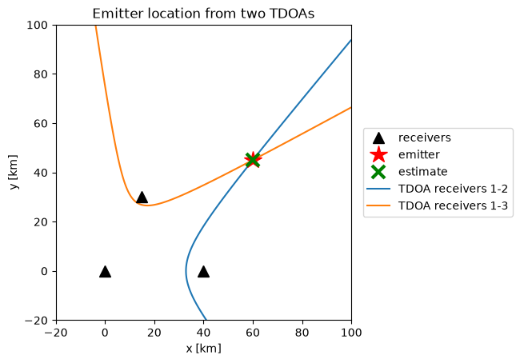
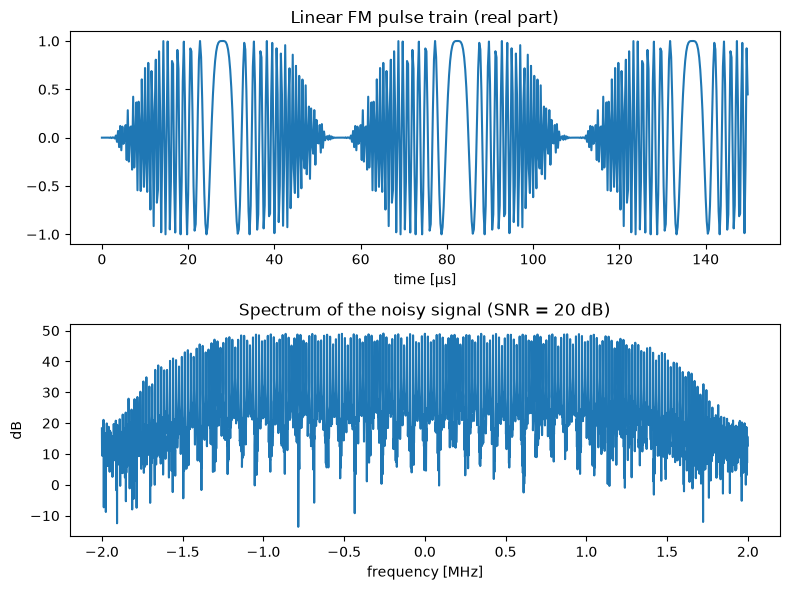
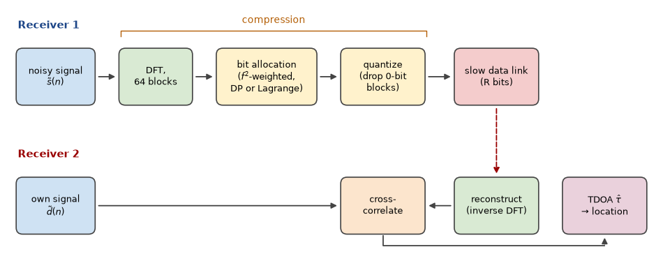
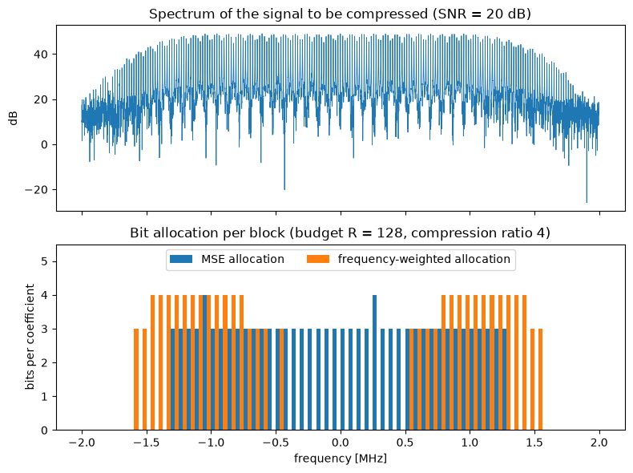
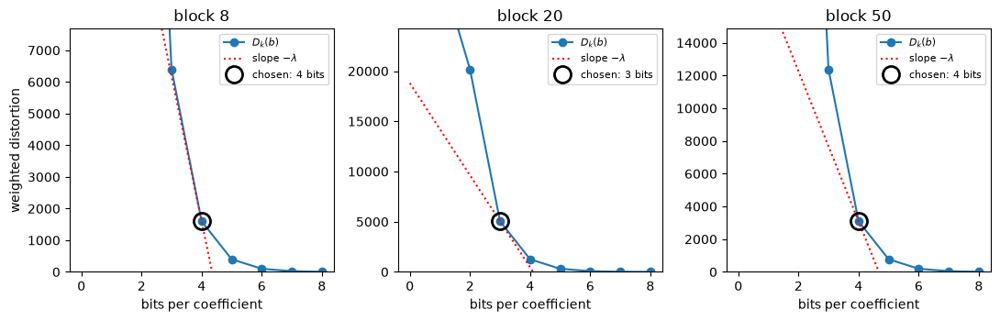
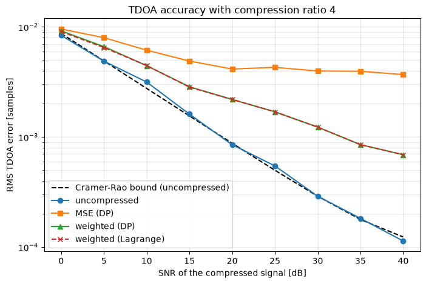
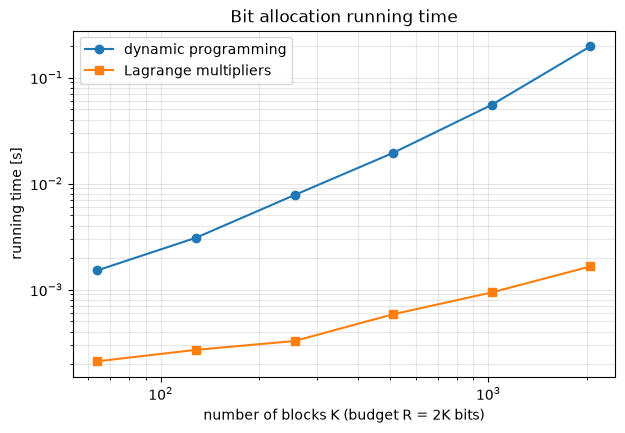

Emre: How can you locate a radar that you can't see, using only the signal it transmits?

Kaan: By listening to it from several places at once. This project is based on my MSc thesis, *Adaptive Compression Method for Emitter Location in Wireless Sensor Networks* (Binghamton University, State University of New York, 2004), which I wrote under the supervision of Prof. Mark L. Fowler. It builds directly on his work on data compression for emitter location. I've rewritten the whole thing in Python with synthetic radar signals, so you can run every step yourself.

## Problem - Locating an Emitter

Suppose a radar is transmitting from an unknown location, and we have receivers on several aircraft (or ground sensors) at known positions. All the receivers intercept the same pulse, but each one at a slightly different time, because the pulse travels a different distance to each of them.

If the signal reaches receiver 1 at $$t_1$$ and receiver 2 at $$t_2$$, the **time difference of arrival (TDOA)** is

<div>
$$
\tau_{21} = t_2 - t_1 = \frac{\lVert \mathbf{p} - \mathbf{r}_2 \rVert - \lVert \mathbf{p} - \mathbf{r}_1 \rVert}{c}
$$
</div>

where $$\mathbf{p}$$ is the emitter's position, $$\mathbf{r}_i$$ is the position of receiver $$i$$ and $$c$$ is the speed of light. Notice that we don't need to know when the pulse was transmitted: it cancels out in the difference.

Emre: But one equation can't give us a position.

Kaan: Right. One TDOA tells us that the difference of the distances to the two receivers is constant, and the set of points with a constant difference of distances to two fixed points is a **hyperbola** (a hyperboloid in 3D). So each TDOA puts the emitter somewhere on a hyperbola, and with three receivers in a plane, we get two independent TDOAs, i.e., two hyperbolas. The emitter is where they intersect. In 3D, we need a fourth receiver, or the **frequency difference of arrival (FDOA)**: if the receivers are moving, the Doppler shift is different at each receiver, and the frequency difference gives one more equation.

Let's see this with three receivers 40 km apart and an emitter about 75 km away. The TDOAs are measured with an error of 20 ns, and we find the position by solving the two hyperbola equations with nonlinear least squares.

```python
import numpy as np
import matplotlib.pyplot as plt
from scipy.optimize import least_squares

rng = np.random.default_rng(3) # fix the random seed so the results are reproducible
c = 3e8  # speed of light [m/s]

receivers = np.array([[0, 0], [40e3, 0], [15e3, 30e3]])  # three receivers [m]
emitter = np.array([60e3, 45e3])                          # the unknown emitter [m]

def tdoas(p):
    """TDOAs of receivers 2 and 3 relative to receiver 1 for an emitter at p."""
    d = np.linalg.norm(receivers - p, axis=1)
    return (d[1:] - d[0]) / c

measured = tdoas(emitter) + rng.normal(0, 20e-9, 2)       # 20 ns of measurement error

# coarse grid search for a starting point, then nonlinear least squares
grid = np.stack(np.meshgrid(np.linspace(-20e3, 100e3, 241), np.linspace(-20e3, 100e3, 241)), -1).reshape(-1, 2)
start = grid[np.argmin([np.sum((tdoas(g) - measured) ** 2) for g in grid])]
estimate = least_squares(lambda p: (tdoas(p) - measured) * 1e9, start).x
print("Location error: %.1f m" % np.linalg.norm(estimate - emitter))

# plot the two hyperbolas
x, y = np.meshgrid(np.linspace(-20e3, 100e3, 600), np.linspace(-20e3, 100e3, 600))
d = [np.hypot(x - rx, y - ry) for rx, ry in receivers]
plt.contour(x / 1e3, y / 1e3, (d[1] - d[0]) / c - measured[0], [0], colors='tab:blue')
plt.contour(x / 1e3, y / 1e3, (d[2] - d[0]) / c - measured[1], [0], colors='tab:orange')
plt.plot(*receivers.T / 1e3, 'k^', ms=10, label='receivers')
plt.plot(*emitter / 1e3, 'r*', ms=16, label='emitter')
plt.plot(*estimate / 1e3, 'gx', ms=12, mew=3, label='estimate')
plt.plot([], [], color='tab:blue', label='TDOA receivers 1-2')
plt.plot([], [], color='tab:orange', label='TDOA receivers 1-3')
plt.xlabel('x [km]'); plt.ylabel('y [km]')
plt.title('Emitter location from two TDOAs')
plt.legend(loc='center left', bbox_to_anchor=(1.02, 0.5)); plt.gca().set_aspect('equal')
plt.show()
```

```
Location error: 68.1 m
```

<p align="center">

</p>

The two hyperbolas intersect at the emitter, and the estimate is about 70 meters off. Note how sensitive this is: in 20 ns, light travels only 6 m, but far from the receivers the hyperbolas cross at a shallow angle, so a small error along one of them moves the intersection a lot (this is called geometric dilution of precision). Every nanosecond of TDOA error matters: the location accuracy is only as good as the TDOA accuracy.

## Measuring the TDOA

How do we measure a TDOA? Each receiver records the complex baseband version of the signal it intercepts. Receiver 2's signal is a delayed (and, for moving platforms, Doppler-shifted) copy of receiver 1's, plus independent noise:

<div>
$$
\begin{gathered}
\tilde{s}(n) = s(n) + w_1(n) \\
\tilde{d}(n) = s(n - \tau) + w_2(n)
\end{gathered}
$$
</div>

We find $$\tau$$ by cross-correlating the two signals and finding the peak. With Doppler, we'd compute the cross-ambiguity function, i.e., the cross-correlation over a grid of frequency shifts as well as time shifts, and find the peak in both. Here, we'll stay with TDOA only.

How accurate can this be? The Cramér–Rao bound for the TDOA estimate is:

<div>
$$
\sigma_{\tau} \geq \frac{1}{2\pi B_{rms} \sqrt{WT \cdot SNR_{eff}}}, \qquad
SNR_{eff} = \frac{SNR \cdot DNR}{1 + SNR + DNR}
$$
</div>

where $$SNR$$ and $$DNR$$ are the signal-to-noise ratios of the two signals, $$WT$$ is the time-bandwidth product (the coherent processing gain) and $$B_{rms}$$ is the signal's **RMS bandwidth**:

<div>
$$
B_{rms}^2 = \frac{\int f^2 |S(f)|^2 df}{\int |S(f)|^2 df}
$$
</div>

Keep your eye on $$B_{rms}$$. It says that, for the same energy, a signal whose energy sits at high frequencies gives a sharper correlation peak, and therefore a more accurate TDOA. This is the key to everything that follows.

As our test signal, we'll use the same radar signal as in the thesis: a train of linear FM (chirp) pulses, each 40 µs long, sweeping 2 MHz, sampled at 4 MHz. We'll work with blocks of 4096 samples. Let's look at it, estimate a TDOA, and compare the accuracy with the Cramér–Rao bound.

```python
from scipy.signal.windows import tukey

Fs, PW, F_DEV, N = 4e6, 40e-6, 2e6, 4096   # sampling rate, pulse width, FM sweep, block length

def lfm_pulse_train(n=N):
    """A train of linear FM radar pulses (complex baseband)."""
    n_win = round(4 * PW * Fs / 3)
    t = np.arange(n_win) / Fs - (4 * PW / 3) / 2
    pulse = tukey(n_win, 0.5) * np.exp(2j * np.pi * F_DEV / (4 * PW / 3) * t ** 2)
    one = np.concatenate([np.zeros(5), pulse])
    return np.tile(one, n // len(one) + 1)[:n]

def add_noise(x, snr_db):
    p = np.mean(np.abs(x) ** 2) / 10 ** (snr_db / 10)
    return x + np.sqrt(p / 2) * (rng.normal(size=len(x)) + 1j * rng.normal(size=len(x)))

def delay(x, d):
    """Delay x by d samples (d can be fractional)."""
    return np.fft.ifft(np.fft.fft(x) * np.exp(-2j * np.pi * np.fft.fftfreq(len(x)) * d))

def estimate_tdoa(a, b, up=32):
    """Delay of b relative to a [samples]: cross-correlation, upsampled by zero-padding the
    cross-spectrum, with parabolic interpolation around the peak."""
    n = len(a)
    X = np.conj(np.fft.fft(a)) * np.fft.fft(b)
    Xp = np.zeros(n * up, complex)
    Xp[:n // 2], Xp[-n // 2:] = X[:n // 2], X[-n // 2:]
    cc = np.abs(np.fft.ifft(Xp))
    k = int(np.argmax(cc))
    y0, y1, y2 = cc[k - 1], cc[k], cc[(k + 1) % len(cc)]
    d = (k + 0.5 * (y0 - y2) / (y0 - 2 * y1 + y2)) / up
    return d if d < n / 2 else d - n

def crb(x, snr_db, dnr_db):
    """Cramer-Rao bound on the TDOA standard deviation [samples]."""
    X = np.fft.fft(x); f = np.fft.fftfreq(len(x))
    b_rms2 = np.sum(f ** 2 * np.abs(X) ** 2) / np.sum(np.abs(X) ** 2)
    a, b = 10 ** (snr_db / 10), 10 ** (dnr_db / 10)
    return 1 / np.sqrt(8 * np.pi ** 2 * b_rms2 * len(x) * a * b / (1 + a + b))

s = lfm_pulse_train()
DNR = 40   # receiver 2 has a strong signal; receiver 1 is the noisy one

errors = []
for _ in range(200):
    d = rng.uniform(-20, 20)
    errors.append(estimate_tdoa(add_noise(s, 10), add_noise(delay(s, d), DNR)) - d)
print("SNR = 10 dB: RMS TDOA error %.4f samples, Cramer-Rao bound %.4f samples"
      % (np.sqrt(np.mean(np.square(errors))), crb(s, 10, DNR)))

fig, (ax1, ax2) = plt.subplots(2, 1, figsize=(8, 6))
ax1.plot(np.arange(600) / Fs * 1e6, s[:600].real)
ax1.set_xlabel('time [µs]'); ax1.set_title('Linear FM pulse train (real part)')
f = (np.arange(N) - N / 2) / N * Fs / 1e6
ax2.plot(f, 20 * np.log10(np.abs(np.fft.fftshift(np.fft.fft(add_noise(s, 20)))) + 1e-9))
ax2.set_xlabel('frequency [MHz]'); ax2.set_ylabel('dB')
ax2.set_title('Spectrum of the noisy signal (SNR = 20 dB)')
plt.tight_layout()
plt.show()
```

```
SNR = 10 dB: RMS TDOA error 0.0026 samples, Cramer-Rao bound 0.0028 samples
```

<p align="center">

</p>

Our estimator reaches the Cramér–Rao bound (the small difference is statistical), so we have a good reference to compare everything else with. Notice the units: 0.003 samples at 4 MHz is less than a nanosecond, thanks to the 4096 samples we correlate.

## The Data Link Problem

Here's the catch. To cross-correlate the two signals, both of them must be in the same place. One receiver has to send its samples to the other over a data link, and in a sensor network or between aircraft, that link is slow and costs energy. In practice, the data can't be transferred in time unless it's compressed, and since the link is the bottleneck, we need **lossy** compression.

<p align="center">

</p>

Emre: Lossy compression is everywhere. Can't we just use a standard method?

Kaan: Standard methods minimize the **mean squared error (MSE)** between the original and the reconstructed signal: they try to make the signal *look* the same. But nobody is going to look at this signal. A machine is going to use it to estimate a TDOA, so the right measure of quality is how much the compression hurts the TDOA accuracy. That was the starting point of Prof. Fowler's work: the MSE is the wrong distortion measure for emitter location.

Look at the Cramér–Rao bound again. Compression can hurt the accuracy in two ways:

1. **Quantization adds noise.** If the signal-to-quantization noise ratio is $$SQR$$, the effective SNR of the compressed signal becomes roughly $$\left(1/SNR + 1/SQR\right)^{-1}$$. As long as the quantization noise is well below the receiver noise, it hardly matters.
2. **Throwing away coefficients changes $$B_{rms}$$.** If we compress in a transform domain (say, the DFT) and discard some coefficients, we change the signal's spectrum, and therefore its RMS bandwidth.

The second point is where the MSE goes wrong. Because of the $$f^2$$ in the definition of $$B_{rms}$$, the **high-frequency content is quadratically more important** for the TDOA accuracy than the low-frequency content. An MSE-based coder treats an error at 1.9 MHz exactly like an error at 0.1 MHz. For TDOA, the first one matters about 360 times more.

So instead of the MSE, we'll minimize a frequency-weighted squared error:

<div>
$$
D = \sum_k f_k^2 \, |S(k) - \hat{S}(k)|^2
$$
</div>

where $$S(k)$$ are the DFT coefficients of the noisy signal, $$\hat{S}(k)$$ are their quantized versions and $$f_k$$ is the frequency of coefficient $$k$$.

## Bit Allocation

Our coder works like this. We take the 4096-point DFT of the signal and split it into 64 blocks of 64 coefficients each. Each block gets its own uniform quantizer: if block $$k$$ gets $$b_k$$ bits, the real and imaginary parts of all its coefficients are quantized with $$b_k$$ bits, and if it gets zero bits, the whole block is discarded. The question is how to split a total budget of $$R$$ bits among the blocks:

<div>
$$
\min_{b_1, \ldots, b_K} \sum_{k=1}^{K} D_k(b_k) \quad \text{subject to} \quad \sum_{k=1}^{K} b_k \leq R
$$
</div>

where $$D_k(b)$$ is the (weighted) distortion of block $$k$$ when it gets $$b$$ bits. We can compute these in advance: for $$b = 0$$, it's the (weighted) energy of the block, and for $$b \geq 1$$, it's the (weighted) quantization noise of a $$b$$-bit uniform quantizer.

Notice something nice here. We never explicitly decide which blocks to keep. With the $$f^2$$ weighting, the low-frequency blocks have a small weighted distortion, so when the budget is tight, they simply get zero bits. The selection of the coefficients is forced by the allocation, which is why this approach is called **Allocation-Forced Selection**. If 8 bits per coefficient is our uncompressed reference, a budget of $$R = 128$$ for 64 blocks means a compression ratio of $$64 \times 8 / 128 = 4$$.

### Dynamic Programming

This is a classic resource allocation problem, and **dynamic programming** solves it exactly. We go through the blocks one by one, and for each possible number of bits used so far, we keep the best total distortion. With $$K$$ blocks, a budget of $$R$$ bits and at most $$b_{max}$$ bits per block, this takes $$O(K R \, b_{max})$$ operations. It's exact, but the cost grows with the budget.

### Lagrange Multipliers

The idea that my thesis explored is the discrete Lagrange multiplier method of Shoham and Gersho. Instead of the constrained problem, we solve an unconstrained one:

<div>
$$
\min_{b_1, \ldots, b_K} \sum_{k=1}^{K} \left[ D_k(b_k) + \lambda b_k \right]
$$
</div>

for some $$\lambda \geq 0$$. The magic is that this sum separates: each block can choose its own number of bits independently, by minimizing $$D_k(b) + \lambda b$$ over its few possible values of $$b$$. A theorem going back to Everett says that if the solution of this unconstrained problem happens to use exactly $$R$$ bits, it's also the solution of the constrained one. So we only have to find the right $$\lambda$$, and since the total rate decreases as $$\lambda$$ grows, a simple bisection finds it. In the thesis, I updated $$\lambda$$ with a fixed step; bisection is a cleaner way to do the same search.

Emre: What does $$\lambda$$ mean?

Kaan: It's the price of a bit. Each block buys bits as long as one more bit reduces its distortion by more than $$\lambda$$. At the optimum, all the blocks that got some bits are operating at a point on their rate-distortion curves with the same slope, $$-\lambda$$. That's why this is also called **constant-slope optimization**.

There's one catch. The total rate jumps in discrete steps as $$\lambda$$ changes, so sometimes no $$\lambda$$ gives exactly $$R$$ bits. Then we take the solution just below the budget and hand out the remaining few bits greedily, each one to the block where it reduces the distortion the most. Each evaluation costs $$O(K \, b_{max})$$, and the number of bisection steps doesn't depend on $$R$$.

Let's implement both and compare the allocations they produce, for the MSE and for the weighted distortion.

```python
NB, BMAX = 64, 8           # number of blocks, maximum bits per coefficient
M = N // NB                # coefficients per block
R = NB * BMAX // 4         # bit budget for a compression ratio of 4
f_norm = (np.arange(N) - N // 2) / (N // 2)   # normalized frequency of each (centered) DFT coefficient

def to_blocks(x):
    return np.fft.fftshift(np.fft.fft(x)).reshape(NB, M)

def block_scale(blk):
    return max(np.abs(blk.real).max(), np.abs(blk.imag).max())

def distortion_table(blocks, weighted):
    """D[k, b]: distortion of block k quantized with b bits (b = 0 means discarded)."""
    w = (f_norm ** 2).reshape(NB, M) if weighted else np.ones((NB, M))
    D = np.zeros((NB, BMAX + 1))
    for k in range(NB):
        A = block_scale(blocks[k])
        D[k, 0] = np.sum(w[k] * np.abs(blocks[k]) ** 2)
        D[k, 1:] = np.sum(w[k]) * 2 * (2 * A / 2.0 ** np.arange(1, BMAX + 1)) ** 2 / 12
        D[k] = np.minimum.accumulate(D[k])   # one more bit never makes things worse
    return D

def allocate_dp(D, R):
    """Exact bit allocation with dynamic programming."""
    K = len(D)
    best = np.full(R + 1, np.inf); best[0] = 0     # best[r]: least distortion using exactly r bits
    choices = []
    for k in range(K):
        new = np.full(R + 1, np.inf); arg = np.zeros(R + 1, int)
        for b in range(BMAX + 1):
            cand = np.full(R + 1, np.inf)
            cand[b:] = best[:R + 1 - b] + D[k, b]
            better = cand < new
            new[better], arg[better] = cand[better], b
        choices.append(arg); best = new
    r, B = int(np.argmin(best)), np.zeros(K, int)
    for k in range(K - 1, -1, -1):                 # trace the decisions back
        B[k] = choices[k][r]; r -= B[k]
    return B

def allocate_lagrange(D, R, iters=60):
    """Bit allocation with the discrete Lagrange multiplier method (Shoham-Gersho)."""
    rate = np.arange(BMAX + 1)
    solve = lambda lam: np.argmin(D + lam * rate, axis=1)   # each block decides on its own
    lo, hi = 0.0, D[:, 0].max() + 1.0                       # lam = hi buys no bits at all
    for _ in range(iters):                                  # bisection on the price of a bit
        lam = (lo + hi) / 2
        if solve(lam).sum() > R: lo = lam
        else: hi = lam
    B = solve(hi)
    while B.sum() < R:                                      # hand out the leftover bits greedily
        gain = [D[k, B[k]] - D[k, B[k] + 1] if B[k] < BMAX else -1 for k in range(len(D))]
        k = int(np.argmax(gain))
        if gain[k] <= 0: break
        B[k] += 1
    return B, hi

def compress(x, R, weighted=True, method='lagrange'):
    """Compress x with R bits; return the reconstructed signal and the allocation."""
    blocks = to_blocks(x)
    D = distortion_table(blocks, weighted)
    B = allocate_dp(D, R) if method == 'dp' else allocate_lagrange(D, R)[0]
    Q = np.zeros_like(blocks)
    for k in range(NB):
        if B[k] == 0: continue
        A = block_scale(blocks[k]); step = 2 * A / 2 ** B[k]
        q = lambda v: np.clip((np.floor(v / step) + 0.5) * step, -A + step / 2, A - step / 2)
        Q[k] = q(blocks[k].real) + 1j * q(blocks[k].imag)
    return np.fft.ifft(np.fft.ifftshift(Q.ravel())), B

x = add_noise(s, 20)
blocks = to_blocks(x)
allocations = {}
for weighted, name in ((False, 'MSE'), (True, 'weighted')):
    D = distortion_table(blocks, weighted)
    B_dp, B_lag = allocate_dp(D, R), allocate_lagrange(D, R)[0]
    allocations[name] = B_dp
    print("%-8s: %2d blocks kept, %d bits used, DP and Lagrange identical: %s"
          % (name, np.sum(B_dp > 0), B_dp.sum(), np.array_equal(B_dp, B_lag)))

fig, (ax1, ax2) = plt.subplots(2, 1, figsize=(8, 6), sharex=True)
fb = (np.arange(NB) + 0.5) / NB * Fs / 1e6 - Fs / 2e6   # center frequency of each block [MHz]
ax1.plot(f, 20 * np.log10(np.abs(np.fft.fftshift(np.fft.fft(x)))), lw=0.6)
ax1.set_ylabel('dB'); ax1.set_title('Spectrum of the signal to be compressed (SNR = 20 dB)')
width = Fs / 1e6 / NB
ax2.bar(fb - width / 4, allocations['MSE'], width / 2, label='MSE allocation')
ax2.bar(fb + width / 4, allocations['weighted'], width / 2, label='frequency-weighted allocation')
ax2.set_xlabel('frequency [MHz]'); ax2.set_ylabel('bits per coefficient')
ax2.set_title('Bit allocation per block (budget R = %i, compression ratio 4)' % R)
ax2.set_ylim(0, 5.5); ax2.legend(loc='upper center', ncol=2)
plt.tight_layout()
plt.show()
```

```
MSE     : 42 blocks kept, 128 bits used, DP and Lagrange identical: True
weighted: 35 blocks kept, 128 bits used, DP and Lagrange identical: True
```

<p align="center">

</p>

The two distortion measures make very different decisions. The MSE allocation spends its bits on the strongest part of the spectrum around the center and discards the weaker blocks towards the band edges. The weighted allocation does something that would horrify any audio or image codec: it **discards the blocks around zero frequency**, where the signal is strong, and spends the bits on the high frequencies, because that's where the TDOA accuracy comes from. And in both cases, the Lagrange method found exactly the same allocation as dynamic programming.

Let's also visualize the constant-slope idea. Here are the rate-distortion curves of three blocks, with the point each block chose. Each chosen point is where a line with the same slope, $$-\lambda$$, touches the block's curve from below: one bit more would gain less than $$\lambda$$, one bit less would lose more than $$\lambda$$.

```python
D = distortion_table(blocks, weighted=True)
B, lam = allocate_lagrange(D, R)
b = np.arange(BMAX + 1)
fig, axes = plt.subplots(1, 3, figsize=(11, 3.6))
for ax, k in zip(axes, (8, 20, 50)):
    bk = B[k]
    ax.plot(b, D[k], 'o-', label='$D_k(b)$')
    ax.plot(b, D[k, bk] - lam * (b - bk), 'r:', label='slope $-\\lambda$')
    ax.plot(bk, D[k, bk], 'o', ms=13, mfc='none', mec='k', mew=2, label='chosen: %i bits' % bk)
    ax.set_ylim(0, 1.2 * D[k, max(bk - 1, 0)])
    ax.set_title('block %i' % k); ax.set_xlabel('bits per coefficient')
    ax.legend(fontsize=8)
axes[0].set_ylabel('weighted distortion')
plt.tight_layout()
plt.show()
```

<p align="center">

</p>

## Does It Pay Off?

Now the real test: the TDOA accuracy after compression. Let's compress the noisy signal of receiver 1 with a compression ratio of 4 using the MSE allocation and the weighted allocation (with both dynamic programming and Lagrange multipliers), cross-correlate it with receiver 2's signal, and compare the RMS TDOA error with the uncompressed case and the Cramér–Rao bound, over a range of SNRs.

```python
snrs = [0, 5, 10, 15, 20, 25, 30, 35, 40]
cases = {'uncompressed': None, 'MSE (DP)': (False, 'dp'),
         'weighted (DP)': (True, 'dp'), 'weighted (Lagrange)': (True, 'lagrange')}
rmse = {name: [] for name in cases}
for snr in snrs:
    err = {name: [] for name in cases}
    for _ in range(200):
        d = rng.uniform(-20, 20)
        a, b = add_noise(s, snr), add_noise(delay(s, d), DNR)
        for name, how in cases.items():
            a_c = a if how is None else compress(a, R, *how)[0]
            err[name].append(estimate_tdoa(a_c, b) - d)
    for name in cases:
        rmse[name].append(np.sqrt(np.mean(np.square(err[name]))))
    print("SNR %2d dB: " % snr + ", ".join("%s %.4f" % (n, v[-1]) for n, v in rmse.items()))

plt.figure(figsize=(8, 5))
plt.semilogy(snrs, [crb(s, v, DNR) for v in snrs], 'k--', label='Cramer-Rao bound (uncompressed)')
for (name, v), style in zip(rmse.items(), ('o-', 's-', '^-', 'x--')):
    plt.semilogy(snrs, v, style, label=name)
plt.xlabel('SNR of the compressed signal [dB]'); plt.ylabel('RMS TDOA error [samples]')
plt.title('TDOA accuracy with compression ratio 4')
plt.legend(); plt.grid(alpha=0.3, which='both')
plt.show()
```

<p align="center">

</p>

At low SNR, the receiver noise dominates and all the versions stay close to each other. As the SNR increases, the MSE-compressed version stops improving: from about 20 dB on, its error is stuck around 0.004 samples, because the discarded high frequencies and the quantization noise limit it. The weighted compression keeps improving with the SNR: at 30 dB, its error is 0.0012 samples, more than three times smaller than with the MSE allocation, and at 40 dB, it's more than five times smaller (0.0007 vs. 0.0037 samples), with exactly the same number of bits.

And the Lagrange curve lies right on top of the dynamic programming curve everywhere. That was the main result of the thesis: the much cheaper Lagrange method gives the same TDOA accuracy.

Of course, a compression ratio of 4 isn't free: at high SNR, even the weighted version is a few times worse than the uncompressed signal. A larger bit budget closes the gap; the point is that, for a given budget, the weighted allocation gets much closer to it.

### Is Lagrange Always as Good as Dynamic Programming?

Not always, and the reason is worth knowing. The Lagrange method can only reach allocations that lie on the lower convex hull of the rate-distortion curves. If a block's distortion curve isn't convex, some allocations can't be reached by any $$\lambda$$, and the method can miss the true optimum by a little. Let's check how often that happens with our signals, and how the running times compare as the problem grows.

```python
import time

same, ratio = 0, []
for _ in range(500):
    x = add_noise(s, rng.uniform(0, 40))
    D = distortion_table(to_blocks(x), weighted=True)
    budget = int(rng.integers(32, 257))
    B_dp, B_lag = allocate_dp(D, budget), allocate_lagrange(D, budget)[0]
    same += np.array_equal(B_dp, B_lag)
    ratio.append(D[np.arange(NB), B_lag].sum() / D[np.arange(NB), B_dp].sum())
print("Identical allocations: %i of 500, worst distortion ratio Lagrange/DP: %.4f" % (same, max(ratio)))

sizes = [64, 128, 256, 512, 1024, 2048]
t_dp, t_lag = [], []
for K in sizes:
    D = np.tile(distortion_table(to_blocks(add_noise(s, 20)), True), (K // NB, 1))
    t0 = time.perf_counter(); allocate_dp(D, 2 * K); t_dp.append(time.perf_counter() - t0)
    t0 = time.perf_counter(); allocate_lagrange(D, 2 * K); t_lag.append(time.perf_counter() - t0)

plt.figure(figsize=(7, 4.5))
plt.loglog(sizes, t_dp, 'o-', label='dynamic programming')
plt.loglog(sizes, t_lag, 's-', label='Lagrange multipliers')
plt.xlabel('number of blocks K (budget R = 2K bits)'); plt.ylabel('running time [s]')
plt.title('Bit allocation running time')
plt.legend(); plt.grid(alpha=0.3, which='both')
plt.show()
```

```
Identical allocations: 424 of 500, worst distortion ratio Lagrange/DP: 1.0077
```

<p align="center">

</p>

In 424 of the 500 random cases (85%), the Lagrange method found exactly the same allocation as dynamic programming, and in the worst case, its distortion was only 0.8% higher, which makes no visible difference to the TDOA accuracy. In the thesis, I made the same observation: most of the time, the Lagrange method finds the true optimum.

The running times tell the other half of the story. With 64 blocks, both take about a millisecond. With 32 times more blocks, dynamic programming takes about 130 times longer, while the Lagrange method takes less than 10 times longer, and it's more than 100 times faster at the largest size.

## Real Life

The thesis and this simulation keep things simple. A few things change in a real system:

- **Doppler.** With moving platforms, we need both TDOA and FDOA, so the correlation becomes the cross-ambiguity function over delay and Doppler. The same RMS idea applies to FDOA, but in the time domain: the FDOA accuracy depends on the signal's RMS duration, so for FDOA, the samples far from the center of the record matter more.
- **Side information.** The receiver needs to know the allocation and each block's quantizer scale. That's a few bytes per block, which we ignored here.
- **Entropy coding.** After quantization, an entropy coder can squeeze the data further without any extra loss.
- **Other transforms.** The DFT is the simplest choice. Prof. Fowler's group also used wavelet transforms, and for pulse trains, a time-frequency decomposition can exploit the gaps between the pulses.
- **The bigger idea.** Compress for the task, not for the eye. Today, this idea is everywhere: from coding for machine perception in video to the "semantic" or "goal-oriented" communication ideas in future wireless networks.

## Computational Complexity

The DFT costs $$O(N \log N)$$, and computing the distortion tables costs $$O(N + K b_{max})$$. Dynamic programming then costs $$O(K R \, b_{max})$$, while the Lagrange method costs $$O(K b_{max} \log(1/\epsilon))$$ for the bisection, plus a few greedy steps. Since the budget $$R$$ usually grows with the number of blocks $$K$$, dynamic programming grows quadratically with the problem size and the Lagrange method only linearly. On a sensor node with a tight energy budget, that's the difference that matters.

## References

1. T. Guzel, *Adaptive Compression Method for Emitter Location in Wireless Sensor Networks*, MSc Thesis, Binghamton University, State University of New York, 2004
2. M. L. Fowler, <a href="https://doi.org/10.1109/ACSSC.2001.987006">New distortion measures for data compression for emitter location</a>, Asilomar Conference on Signals, Systems and Computers, 2001
3. M. L. Fowler, <a href="https://doi.org/10.1109/NAECON.2000.894915">Exploiting RMS time-frequency structure for data compression in emitter location systems</a>, National Aerospace and Electronics Conference, 2000
4. M. L. Fowler, <a href="https://doi.org/10.1117/12.449581">Non-MSE wavelet-based data compression for emitter location</a>, Proceedings of SPIE, vol. 4475, 2001
5. M. L. Fowler, M. Chen, <a href="https://doi.org/10.1117/12.453520">Integer optimization methods for non-MSE data compression for emitter location</a>, Proceedings of SPIE, vol. 4793, 2002
6. Y. Shoham, A. Gersho, <a href="https://doi.org/10.1109/29.90373">Efficient bit allocation for an arbitrary set of quantizers</a>, IEEE Transactions on Acoustics, Speech, and Signal Processing, 1988
7. H. Everett, <a href="https://doi.org/10.1287/opre.11.3.399">Generalized Lagrange multiplier method for solving problems of optimum allocation of resources</a>, Operations Research, 1963
8. A. Ortega, K. Ramchandran, <a href="https://doi.org/10.1109/79.733495">Rate-distortion methods for image and video compression</a>, IEEE Signal Processing Magazine, 1998
9. S. Stein, <a href="https://doi.org/10.1109/TASSP.1981.1163621">Algorithms for ambiguity function processing</a>, IEEE Transactions on Acoustics, Speech, and Signal Processing, 1981

<a href="https://www.freecounterstat.com" title="visitor counters"></a>
