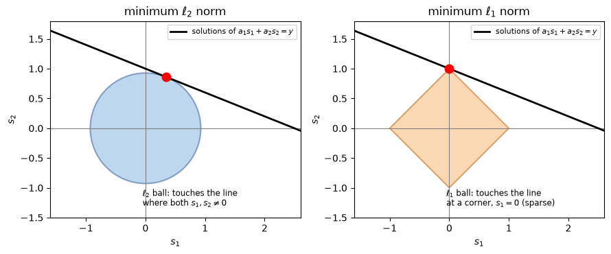
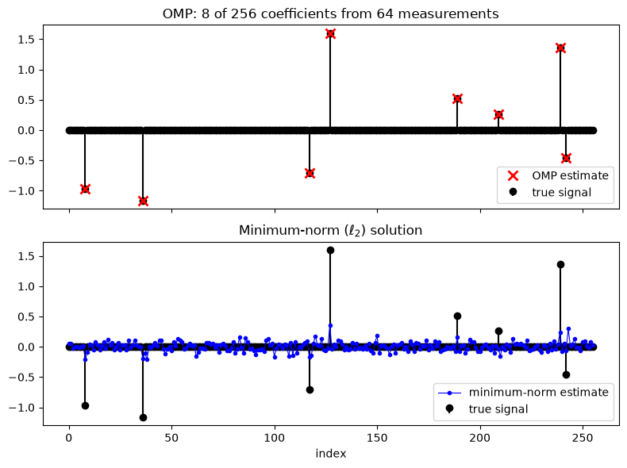
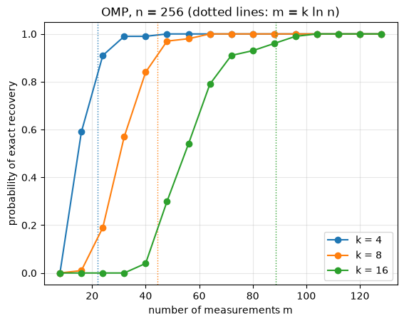
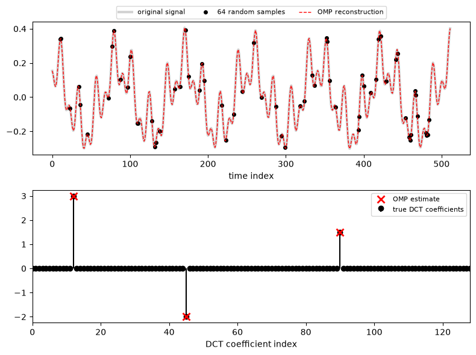

Emre: I read that MRI scans can be made several times faster by taking far fewer measurements than the sampling theorem requires. Doesn't that contradict Nyquist?

Kaan: Great question. It doesn't contradict it; it uses something Nyquist doesn't assume. Let's see what that is.

## Problem - Measuring Less

You know the Nyquist–Shannon sampling theorem: if a signal contains no frequencies above $$B$$ Hz, we can reconstruct it perfectly from samples taken at more than $$2B$$ samples per second. This theorem is the foundation of almost every analog-to-digital converter in the world.

But notice what the theorem assumes about the signal: only that its bandwidth is limited. Nothing else. It treats every band-limited signal as equally likely, so it has to be ready for the worst case.

Now think about the signals we actually measure. A photo is millions of pixels, yet the JPEG algorithm can throw away more than 90% of its transform coefficients and you can barely tell the difference. An audio clip of a few notes is mostly a handful of strong frequencies. A wireless channel in a room is mostly a few strong reflections. These signals live in huge spaces, but they carry very little information. In other words, they are **sparse**: in the right basis, most of their coefficients are zero (or nearly zero).

This raises an obvious question. If we are going to compress the signal right after measuring it and throw most of the coefficients away, why measure all of it in the first place? Can't we measure only the "compressed" information directly?

Emre: That sounds great, but we don't know in advance which coefficients will be the important ones.

Kaan: Exactly. That's the whole challenge, and that's what Compressive Sensing solves. It was introduced in 2006 by Emmanuel Candès, Justin Romberg and Terence Tao, and independently by David Donoho, and it changed how we think about measurement. In MRI, for example, measurements are taken one by one in the frequency domain, and each one takes time. Measuring fewer of them means a shorter scan, which is exactly what you read about.

## The Measurement Model

Let's write the problem down. We have a signal $$\mathbf{x} \in \mathbb{R}^n$$ that we want to know. Instead of measuring its $$n$$ samples, we take $$m$$ linear measurements:

<div>
$$
\mathbf{y} = \mathbf{\Phi} \mathbf{x}
$$
</div>

Here, $$\mathbf{y} \in \mathbb{R}^m$$ is our measurement vector and $$\mathbf{\Phi}$$ is the $$m \times n$$ **measurement matrix**. Each row of $$\mathbf{\Phi}$$ describes one measurement: a weighted sum of the samples of $$\mathbf{x}$$. The interesting case is $$m \ll n$$: far fewer measurements than unknowns.

Emre: But that's an under-determined system! We talked about it in the least squares section of the <a href="https://tayyarg.github.io/digital-signal-processing-2-adaptive-filters-and-active-noise-cancellation/">adaptive filters</a> post. It has infinitely many solutions.

Kaan: Right. If $$\mathbf{x}$$ is a solution, then so is $$\mathbf{x} + \mathbf{z}$$ for any vector $$\mathbf{z}$$ in the null space of $$\mathbf{\Phi}$$ (i.e., any $$\mathbf{z}$$ with $$\mathbf{\Phi}\mathbf{z} = 0$$), and that null space has at least $$n - m$$ dimensions. Without any additional knowledge, there is no way to pick the right one.

The classic answer is to pick the solution with the smallest energy, i.e., the minimum $$\ell_2$$-norm solution, which we get from the pseudo-inverse:

<div>
$$
\hat{\mathbf{x}}_{\ell_2} = \mathbf{\Phi}^T (\mathbf{\Phi}\mathbf{\Phi}^T)^{-1} \mathbf{y}
$$
</div>

We'll see shortly that this answer is almost always wrong for sparse signals. It spreads the energy over all $$n$$ coefficients instead of concentrating it on a few.

## Sparsity

Here comes the additional knowledge. Let's assume that our signal is sparse in some basis $$\mathbf{\Psi}$$ (for example, the Fourier, DCT or wavelet basis):

<div>
$$
\mathbf{x} = \mathbf{\Psi} \mathbf{s}, \qquad \lVert \mathbf{s} \rVert_0 \leq k
$$
</div>

Here, $$\lVert \mathbf{s} \rVert_0$$ is the number of nonzero entries of $$\mathbf{s}$$ (it's not really a norm, but everybody calls it the $$\ell_0$$-norm). We say that $$\mathbf{s}$$ is **$$k$$-sparse**. Then our measurements become:

<div>
$$
\mathbf{y} = \mathbf{\Phi}\mathbf{\Psi}\mathbf{s} = \mathbf{A}\mathbf{s}, \qquad \mathbf{A} = \mathbf{\Phi}\mathbf{\Psi}
$$
</div>

If the signal is already sparse in its own domain, then $$\mathbf{\Psi} = \mathbf{I}$$ and $$\mathbf{A} = \mathbf{\Phi}$$.

Now the question becomes: among all the solutions of $$\mathbf{y} = \mathbf{A}\mathbf{s}$$, find the sparsest one:

<div>
$$
\hat{\mathbf{s}} = \arg\min_{\mathbf{s}} \lVert \mathbf{s} \rVert_0 \quad \text{subject to} \quad \mathbf{A}\mathbf{s} = \mathbf{y}
$$
</div>

Emre: How many measurements do we need for this to have a unique answer?

Kaan: Let's think about it. Suppose two different $$k$$-sparse vectors $$\mathbf{s}_1$$ and $$\mathbf{s}_2$$ gave the same measurements. Then $$\mathbf{A}(\mathbf{s}_1 - \mathbf{s}_2) = 0$$, and $$\mathbf{s}_1 - \mathbf{s}_2$$ has at most $$2k$$ nonzeros. So if every set of $$2k$$ columns of $$\mathbf{A}$$ is linearly independent, this can't happen, and the sparsest solution is unique. That requires at least $$m \geq 2k$$ measurements. So in principle, a signal with $$k$$ nonzeros can be identified from as few as $$2k$$ measurements, no matter how large $$n$$ is!

Emre: Then we're done?

Kaan: Unfortunately not. The $$\ell_0$$ problem is combinatorial. We don't know where the nonzeros are, so we'd have to try every possible support. For $$n = 256$$ and $$k = 8$$, there are $$\binom{256}{8} \approx 4 \times 10^{14}$$ possible supports. Even if you could test a million of them per second, it would take more than ten years. In general, this problem is NP-hard.

## Two Ways Out: Convex Relaxation and Greedy Pursuit

There are two big families of practical solutions.

### Basis Pursuit ($$\ell_1$$ Minimization)

The first idea is to replace the $$\ell_0$$-"norm" with the $$\ell_1$$-norm, the sum of the absolute values:

<div>
$$
\hat{\mathbf{s}} = \arg\min_{\mathbf{s}} \lVert \mathbf{s} \rVert_1 \quad \text{subject to} \quad \mathbf{A}\mathbf{s} = \mathbf{y}
$$
</div>

This is called **Basis Pursuit**. It's a convex problem (it can even be written as a linear program), so it can be solved efficiently. The surprise is that, under the right conditions, its solution is exactly the sparsest one.

Emre: Why $$\ell_1$$ and not $$\ell_2$$, which is what we always minimize?

Kaan: The best way to see this is geometrically. Let's take the smallest possible example: two unknowns $$(s_1, s_2)$$ and a single measurement. The solutions of one linear equation form a line. Now inflate a "ball" from the origin until it first touches this line; the touching point is the minimum-norm solution.

<p align="center">

</p>

The $$\ell_2$$ ball is round, so it touches the line at a generic point where both coordinates are nonzero: the solution is not sparse. The $$\ell_1$$ ball is a diamond with sharp corners on the axes, and the line almost always hits one of the corners first. A corner is a point where one of the coordinates is zero: a sparse solution! In high dimensions, the $$\ell_1$$ ball becomes even "pointier", and this effect becomes even stronger.

### Greedy Pursuit

The second idea is to build the support step by step, greedily. This is what **Orthogonal Matching Pursuit (OMP)** does, and it's the algorithm we'll implement. It's not as strong theoretically as Basis Pursuit, but it is simple, fast and works very well in practice. I'll come back to it in detail shortly.

## When Does It Work? Incoherence and RIP

Of course, we can't use just any measurement matrix. Think about the extreme case: $$\mathbf{\Psi} = \mathbf{I}$$ (the signal is sparse in time) and each measurement reads a single sample, so $$\mathbf{\Phi}$$ is just $$m$$ rows of the identity matrix. Then we'd almost certainly miss most of the few nonzero samples. Each measurement should "see" a little bit of every coefficient. In other words, the rows of $$\mathbf{\Phi}$$ should be **incoherent** with the columns of $$\mathbf{\Psi}$$: none of them should look like the other.

The formal version of this idea is the **Restricted Isometry Property (RIP)**. A matrix $$\mathbf{A}$$ satisfies the RIP of order $$k$$ if there is a small $$\delta_k \in (0, 1)$$ such that, for all $$k$$-sparse vectors $$\mathbf{s}$$:

<div>
$$
(1 - \delta_k) \lVert \mathbf{s} \rVert_2^2 \leq \lVert \mathbf{A}\mathbf{s} \rVert_2^2 \leq (1 + \delta_k) \lVert \mathbf{s} \rVert_2^2
$$
</div>

In words: $$\mathbf{A}$$ approximately preserves the length of every sparse vector, so it can't map two different sparse vectors close to each other. If $$\mathbf{A}$$ satisfies the RIP of order $$2k$$ with a small enough $$\delta_{2k}$$, Basis Pursuit recovers every $$k$$-sparse vector exactly.

Emre: How do we design a matrix like that?

Kaan: That's the most beautiful (and surprising) part: we don't design it, we pick it at random! A matrix with independent Gaussian entries $$\mathcal{N}(0, 1/m)$$ satisfies the RIP with very high probability as long as

<div>
$$
m \geq C \, k \log(n / k)
$$
</div>

for some constant $$C$$. Moreover, a random Gaussian matrix is incoherent with any fixed orthonormal basis $$\mathbf{\Psi}$$, so we don't even need to know the sparsity basis when we design the measurements. Notice how small this is: the number of measurements grows linearly with the information content $$k$$, but only logarithmically with the signal length $$n$$.

## Orthogonal Matching Pursuit (OMP)

Now let's look at OMP. The idea is very intuitive. Each measurement vector $$\mathbf{y}$$ is a linear combination of a few columns of $$\mathbf{A}$$:

<div>
$$
\mathbf{y} = \mathbf{A}\mathbf{s} = \sum_{j \in S} s_j \mathbf{a}_j
$$
</div>

where $$S$$ is the (unknown) support and $$\mathbf{a}_j$$ is the $$j$$th column of $$\mathbf{A}$$. Think of the columns as "atoms" in a dictionary. OMP tries to find, one by one, which atoms were used to build $$\mathbf{y}$$:

1. Start with an empty support and the residual $$\mathbf{r} = \mathbf{y}$$.
2. Find the column that is most correlated with the residual, i.e., the atom that explains the largest part of what's still unexplained, and add it to the support.
3. Find the best coefficients for all the selected columns together with least squares, and update the residual.
4. Repeat until you've selected $$k$$ columns or the residual is small enough.

Emre: Why is it called "orthogonal"?

Kaan: Because of step 3. Its simpler ancestor, Matching Pursuit (MP), only updates the coefficient of the newly selected atom. OMP instead re-solves the least squares problem on the whole support at every step. As we know from least squares, the residual of a least squares solution is orthogonal to the columns used. So the new residual is orthogonal to every atom we've already selected, and OMP never picks the same atom twice. This also means that, if all goes well, OMP finishes in exactly $$k$$ iterations.

Let's write the algorithm a bit more formally. Here, $$\mathbf{A}_S$$ denotes the matrix of the columns of $$\mathbf{A}$$ in the set $$S$$:

{% include pseudocode.html id="1" code="
\begin{algorithm}
\caption{Orthogonal Matching Pursuit}
\begin{algorithmic}
    \STATE Initialize the residual $\mathbf{r}_0 = \mathbf{y}$ and the support $S_0 = \emptyset$
    \FOR{$t = 1$ to $k$}
        \STATE Select the most correlated column: $j_t = \arg\max_j \lvert \mathbf{a}_j^T \mathbf{r}_{t-1} \rvert / \lVert \mathbf{a}_j \rVert_2$
        \STATE Update the support: $S_t = S_{t-1} \cup \{ j_t \}$
        \STATE Solve least squares on the support: $\mathbf{s}_{S_t} = \arg\min_{\mathbf{z}} \lVert \mathbf{y} - \mathbf{A}_{S_t} \mathbf{z} \rVert_2$
        \STATE Update the residual: $\mathbf{r}_t = \mathbf{y} - \mathbf{A}_{S_t} \mathbf{s}_{S_t}$
        \STATE Stop early if $\lVert \mathbf{r}_t \rVert_2$ is small enough
    \ENDFOR
    \RETURN $\hat{\mathbf{s}}$, with $\mathbf{s}_{S_t}$ on the support $S_t$ and zeros elsewhere
\end{algorithmic}
\end{algorithm}
" %}

Tropp and Gilbert showed in 2007 that, with a random Gaussian measurement matrix, OMP recovers a $$k$$-sparse signal with high probability when the number of measurements is on the order of $$k \ln n$$. Keep this number in mind; we'll check it in our simulation.

## Coding the Algorithm

Let's start with a sparse vector of length $$n = 256$$ with only $$k = 8$$ nonzero entries, take $$m = 64$$ random Gaussian measurements (a quarter of $$n$$), and try to recover it both with OMP and with the classic minimum-norm solution.

```python
import numpy as np
import matplotlib.pyplot as plt

rng = np.random.default_rng(1) # fix the random seed so the results are reproducible

def omp(A, y, k, tol=1e-6):
    """Orthogonal Matching Pursuit: find a k-sparse s such that A @ s ~= y."""
    m, n = A.shape
    norms = np.linalg.norm(A, axis=0)  # column norms, used to compare correlations fairly
    residual = y.copy()
    support = []
    for _ in range(k):
        # 1. select the column most correlated with the residual
        j = int(np.argmax(np.abs(A.T @ residual) / norms))
        support.append(j)
        # 2. least squares on all the selected columns (the "orthogonal" step)
        coef, *_ = np.linalg.lstsq(A[:, support], y, rcond=None)
        # 3. update the residual (it is now orthogonal to the selected columns)
        residual = y - A[:, support] @ coef
        if np.linalg.norm(residual) <= tol * np.linalg.norm(y):
            break
    s_hat = np.zeros(n)
    s_hat[support] = coef
    return s_hat, support

# signal length, number of measurements and number of nonzero coefficients
n, m, k = 256, 64, 8

# create a k-sparse signal with random positions and amplitudes
s = np.zeros(n)
true_support = rng.choice(n, k, replace=False)
s[true_support] = rng.normal(0, 1, k) + np.sign(rng.normal(0, 1, k))

# random Gaussian measurement matrix and the measurements
Phi = rng.normal(0, 1/np.sqrt(m), (m, n))
y = Phi @ s

# recover with OMP and with the minimum-norm (pseudo-inverse) solution
s_omp, support = omp(Phi, y, k)
s_l2 = np.linalg.pinv(Phi) @ y

print("OMP relative error:          %.2e" % (np.linalg.norm(s_omp - s) / np.linalg.norm(s)))
print("Minimum-norm relative error: %.3f" % (np.linalg.norm(s_l2 - s) / np.linalg.norm(s)))
print("Support found correctly:    ", set(support) == set(true_support))

fig, (ax1, ax2) = plt.subplots(2, 1, figsize=(8, 6), sharex=True)
ax1.stem(s, linefmt='k-', markerfmt='ko', basefmt=' ', label='true signal')
nz = np.flatnonzero(s_omp)  # plot only the coefficients OMP selected
ax1.plot(nz, s_omp[nz], 'rx', ms=9, mew=2, label='OMP estimate')
ax1.set_title('OMP: %i of %i coefficients from %i measurements' % (k, n, m))
ax1.legend(loc='lower right')
ax2.stem(s, linefmt='k-', markerfmt='ko', basefmt=' ', label='true signal')
ax2.plot(s_l2, 'b.-', lw=0.8, label='minimum-norm estimate')
ax2.set_title('Minimum-norm ($\\ell_2$) solution')
ax2.set_xlabel('index')
ax2.legend(loc='lower right')
plt.tight_layout()
plt.show()
```

The output is:

```
OMP relative error:          5.17e-16
Minimum-norm relative error: 0.895
Support found correctly:     True
```

<p align="center">

</p>

OMP recovered the signal exactly, up to the precision of the computer, from only a quarter of the measurements. It found the eight nonzero positions in eight iterations. The minimum-norm solution, on the other hand, is off by about 90%: it spreads small nonzero values all over the 256 coefficients, exactly as the round $$\ell_2$$ ball in the figure above predicted.

### How Many Measurements Do We Need?

One run doesn't prove much. Let's repeat the experiment 100 times for each number of measurements $$m$$, with a new random signal and a new random matrix each time, and count how often OMP recovers the signal exactly. Let's do this for $$k = 4, 8$$ and $$16$$.

```python
ms = np.arange(8, 129, 8)  # numbers of measurements to try
trials = 100

for k in (4, 8, 16):
    success_rate = []
    for m in ms:
        successes = 0
        for _ in range(trials):
            s = np.zeros(n)
            s[rng.choice(n, k, replace=False)] = rng.normal(0, 1, k)
            Phi = rng.normal(0, 1/np.sqrt(m), (m, n))
            s_hat, _ = omp(Phi, Phi @ s, k)
            successes += np.linalg.norm(s_hat - s) <= 1e-4 * np.linalg.norm(s)
        success_rate.append(successes / trials)
    plt.plot(ms, success_rate, 'o-', label='k = %i' % k)
    plt.axvline(k * np.log(n), color=plt.gca().lines[-1].get_color(), ls=':', lw=1)

plt.xlabel('number of measurements m')
plt.ylabel('probability of exact recovery')
plt.title('OMP, n = %i (dotted lines: m = k ln n)' % n)
plt.legend(loc='lower right')
plt.grid(alpha=0.3)
plt.show()
```

<p align="center">

</p>

This figure is the heart of compressive sensing. For each sparsity level, there's a fairly sharp transition: below a certain number of measurements, OMP almost always fails; above it, it almost always succeeds. The dotted lines show $$m = k \ln n$$: for $$k = 4, 8$$ and $$16$$, that's about $$22, 44$$ and $$89$$ measurements, and in each case the success rate there is already between 80% and 95%, just as Tropp and Gilbert's result suggests. A signal of length 256 with 16 nonzeros can be recovered reliably from about 100 measurements, without ever measuring its 256 samples.

Also notice that we never reach the theoretical limit of $$m = 2k$$. That limit assumes we can solve the combinatorial $$\ell_0$$ problem. The price of a fast algorithm is a few more measurements.

### Random Samples of a Sum of Tones

So far, our signal was sparse in its own domain. Let's now try a more realistic case: a signal that is a sum of three tones, so it's sparse in the frequency domain, not in time. For the frequency basis, let's use the Discrete Cosine Transform (DCT), as JPEG does. Instead of a random Gaussian matrix, our measurements will be something we could do with a real ADC: we'll just read the signal at 64 random time instants out of 512.

```python
from scipy.fft import idct

N, m, k = 512, 64, 3

# DCT basis: x = Psi @ c, where the columns of Psi are cosines
Psi = idct(np.eye(N), norm='ortho', axis=0)

# a signal made of three tones (three nonzero DCT coefficients)
c = np.zeros(N)
c[[12, 45, 90]] = [3.0, -2.0, 1.5]
x = Psi @ c

# read the signal at m random time instants: Phi is m random rows of the identity matrix
t_samples = np.sort(rng.choice(N, m, replace=False))
y = x[t_samples]
A = Psi[t_samples, :]  # A = Phi @ Psi

c_hat, support = omp(A, y, k)
x_hat = Psi @ c_hat
print("Recovered tones:", sorted(support))
print("Relative error:  %.1e" % (np.linalg.norm(x_hat - x) / np.linalg.norm(x)))

fig, (ax1, ax2) = plt.subplots(2, 1, figsize=(8, 6))
ax1.plot(x, color='lightgray', lw=3, label='original signal')
ax1.plot(t_samples, y, 'ko', ms=4, label='%i random samples' % m)
ax1.plot(x_hat, 'r--', lw=1, label='OMP reconstruction')
ax1.set_xlabel('time index')
ax1.legend(loc='lower center', bbox_to_anchor=(0.5, 1.0), ncol=3, fontsize=8)
ax2.stem(c, linefmt='k-', markerfmt='ko', basefmt=' ', label='true DCT coefficients')
nz = np.flatnonzero(c_hat)
ax2.plot(nz, c_hat[nz], 'rx', ms=9, mew=2, label='OMP estimate')
ax2.set_xlim(0, 128)
ax2.set_xlabel('DCT coefficient index')
ax2.legend(loc='upper right', fontsize=8)
plt.tight_layout()
plt.show()
```

```
Recovered tones: [12, 45, 90]
Relative error:  4.7e-16
```

<p align="center">

</p>

From only one eighth of the samples, taken at random instants, OMP found the three tones and reconstructed the whole signal exactly. If we had taken the same 64 samples uniformly instead, at one eighth of the rate, the tones above the new Nyquist frequency would have been aliased, and we couldn't have told them apart. Randomness is what breaks the aliasing here: with random samples, the "aliases" of a tone don't line up to look like another tone, they spread out like low-level noise, and OMP can still pick out the strong components.

## Real Life

In our simulations, everything was ideal. In real life, there are a few things to keep in mind.

First, real signals are rarely exactly sparse; they are **compressible**: their sorted coefficients decay quickly, but they never become exactly zero. Second, measurements are always noisy: $$\mathbf{y} = \mathbf{A}\mathbf{s} + \mathbf{e}$$. The good news is that compressive sensing is robust to both. The recovery error of Basis Pursuit (in its noise-aware version, Basis Pursuit Denoising or LASSO) is bounded by the noise level plus the error of the best $$k$$-sparse approximation of the signal. In OMP, instead of stopping after exactly $$k$$ iterations, we usually stop when the residual energy drops to the expected noise energy, since trying to explain the rest would just mean fitting the noise.

Third, OMP is just one member of a large family. CoSaMP and Subspace Pursuit add and remove several atoms per iteration and come with RIP-based guarantees like Basis Pursuit. Iterative Hard Thresholding is even simpler. And when we have a prior distribution over the coefficients, Bayesian approaches like Sparse Bayesian Learning come into play. If you've read the <a href="https://tayyarg.github.io/bayesian-inference-and-linear-regression/">Bayesian linear regression</a> post, you'll notice that the $$\ell_1$$ penalty is nothing but a Laplace prior on the coefficients, and the LASSO solution is its MAP estimate.

Finally, the measurement matrix has to be implementable in hardware. In MRI, the measurements are random samples of the 2D Fourier transform, and this idea brought clinical scan times down significantly. In the famous single-pixel camera developed at Rice University, each measurement is the total light reflected from a random pattern of micromirrors. In wireless communications, the channel between two antennas usually consists of a few strong paths, so channel estimation becomes a sparse recovery problem, and OMP-like algorithms are widely used there. We'll come back to that when we get to wireless topics.

## Computational Complexity

In each iteration, OMP computes the correlations $$\mathbf{A}^T\mathbf{r}$$, which costs $$O(mn)$$ operations, and solves a least squares problem on the support. With an incremental QR factorization, the least squares step doesn't have to be solved from scratch, and the total cost of $$k$$ iterations is about $$O(kmn)$$. For small $$k$$, this is much faster than solving Basis Pursuit as a linear program, which is why OMP is so popular in embedded and real-time systems. When $$\mathbf{A}$$ has a fast transform behind it (like the FFT or the DCT), the correlations can be computed without ever forming the matrix, which makes the algorithm even faster.

## References

1. E. J. Candès, J. Romberg, T. Tao, <a href="https://doi.org/10.1109/TIT.2005.862083">Robust uncertainty principles: exact signal reconstruction from highly incomplete frequency information</a>, IEEE Transactions on Information Theory, 2006
2. D. L. Donoho, <a href="https://doi.org/10.1109/TIT.2006.871582">Compressed sensing</a>, IEEE Transactions on Information Theory, 2006
3. E. J. Candès, M. B. Wakin, <a href="https://doi.org/10.1109/MSP.2007.914731">An introduction to compressive sampling</a>, IEEE Signal Processing Magazine, 2008
4. J. A. Tropp, A. C. Gilbert, <a href="https://doi.org/10.1109/TIT.2007.909108">Signal recovery from random measurements via orthogonal matching pursuit</a>, IEEE Transactions on Information Theory, 2007
5. S. Foucart, H. Rauhut, <a href="https://doi.org/10.1007/978-0-8176-4948-7">A Mathematical Introduction to Compressive Sensing</a>, Birkhäuser, 2013
6. M. Lustig, D. Donoho, J. M. Pauly, <a href="https://doi.org/10.1002/mrm.21391">Sparse MRI: The application of compressed sensing for rapid MR imaging</a>, Magnetic Resonance in Medicine, 2007

<a href="https://www.freecounterstat.com" title="visitor counters"></a>
