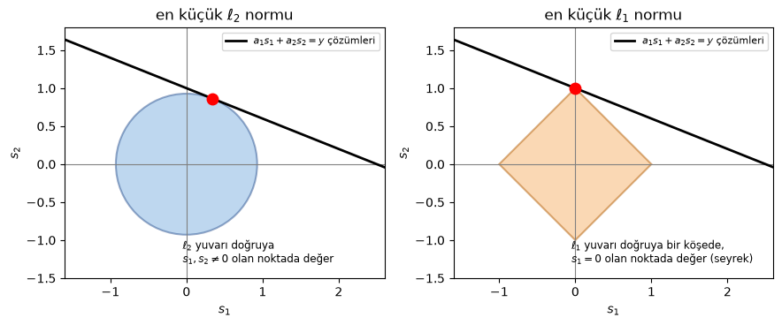
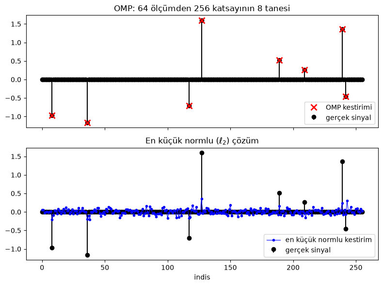
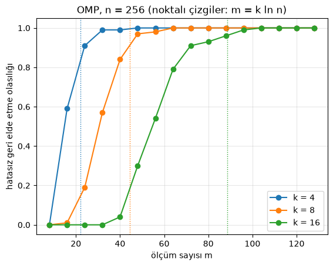
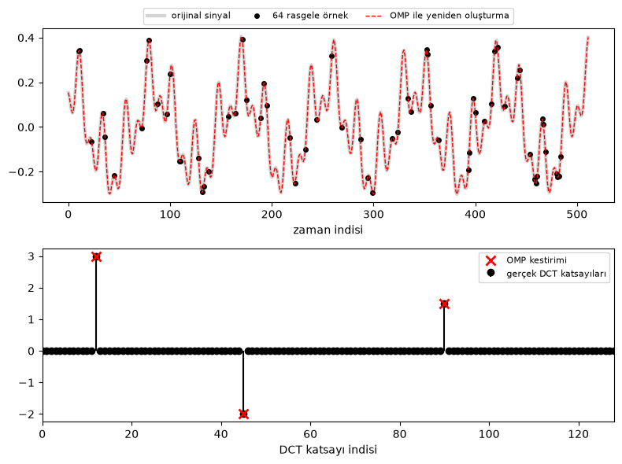

Emre: MR çekimlerinin, örnekleme teoreminin gerektirdiğinden çok daha az ölçüm alınarak birkaç kat hızlandırılabildiğini okudum. Bu Nyquist'le çelişmiyor mu?

Kaan: Çok güzel soru. Çelişmiyor; Nyquist'in varsaymadığı bir şeyden yararlanıyor. Gel bakalım o şey neymiş.

## Problem - Daha Az Ölçmek

Nyquist–Shannon örnekleme teoremini biliyorsun: Bir sinyal $$B$$ Hz'in üzerinde frekans içermiyorsa, saniyede $$2B$$'den fazla örnek alarak onu hatasız olarak geri elde edebiliriz. Bu teorem dünyadaki neredeyse tüm analog-sayısal dönüştürücülerin temelidir.

Ama teoremin sinyal hakkında neyi varsaydığına dikkat et: sadece bant genişliğinin sınırlı olduğunu. Başka hiçbir şeyi değil. Bant sınırlı her sinyali eşit olasılıklı kabul ediyor, bu yüzden en kötü duruma hazırlıklı olmak zorunda.

Şimdi gerçekte ölçtüğümüz sinyalleri düşün. Bir fotoğraf milyonlarca pikselden oluşur ama JPEG algoritması dönüşüm katsayılarının %90'ından fazlasını atabilir ve sen farkı zor fark edersin. Birkaç notadan oluşan bir ses kaydı çoğunlukla bir avuç güçlü frekanstan ibarettir. Bir odadaki kablosuz kanal çoğunlukla birkaç güçlü yansımadan oluşur. Bu sinyaller devasa uzaylarda yaşarlar ama çok az bilgi taşırlar. Başka bir deyişle **seyrektirler** (sparse): doğru tabanda katsayılarının çoğu sıfırdır (ya da sıfıra çok yakındır).

Bu da akla şu soruyu getiriyor: Madem sinyali ölçtükten hemen sonra sıkıştırıp katsayılarının çoğunu atacağız, neden en başta hepsini ölçüyoruz? Sadece "sıkıştırılmış" bilgiyi doğrudan ölçemez miyiz?

Emre: Kulağa harika geliyor ama hangi katsayıların önemli olacağını önceden bilmiyoruz ki.

Kaan: Aynen öyle. Bütün mesele bu ve Sıkıştırmalı Algılama (Compressive Sensing) tam olarak bunu çözüyor. 2006'da Emmanuel Candès, Justin Romberg ve Terence Tao tarafından, onlardan bağımsız olarak da David Donoho tarafından ortaya atıldı ve ölçme hakkında düşünme şeklimizi değiştirdi. Örneğin MR'da ölçümler frekans uzayında tek tek alınır ve her biri zaman alır. Daha az ölçüm almak daha kısa bir çekim demektir; senin okuduğun da tam olarak bu.

## Ölçüm Modeli

Problemi yazalım. Bilmek istediğimiz bir $$\mathbf{x} \in \mathbb{R}^n$$ sinyalimiz var. Onun $$n$$ örneğini ölçmek yerine $$m$$ tane doğrusal ölçüm alıyoruz:

<div>
$$
\mathbf{y} = \mathbf{\Phi} \mathbf{x}
$$
</div>

Burada $$\mathbf{y} \in \mathbb{R}^m$$ ölçüm vektörümüz, $$\mathbf{\Phi}$$ ise $$m \times n$$ boyutundaki **ölçüm matrisi**. $$\mathbf{\Phi}$$'nin her satırı bir ölçümü tanımlar: $$\mathbf{x}$$'in örneklerinin ağırlıklı bir toplamını. İlginç olan durum $$m \ll n$$ durumu: bilinmeyenlerden çok daha az ölçüm.

Emre: Ama bu eksik-belirtilmiş (under-determined) bir sistem! <a href="https://tayyarg.github.io/uyarlanir-filtre-gurultu-yoketme/">Uyarlanır filtreler</a> yazısında en küçük kareler kısmında konuşmuştuk. Sonsuz sayıda çözümü var.

Kaan: Doğru. Eğer $$\mathbf{x}$$ bir çözümse, $$\mathbf{\Phi}$$'nin boş uzayındaki her $$\mathbf{z}$$ için (yani $$\mathbf{\Phi}\mathbf{z} = 0$$ olan her $$\mathbf{z}$$ için) $$\mathbf{x} + \mathbf{z}$$ de bir çözümdür ve bu boş uzay en az $$n - m$$ boyutludur. Ek bir bilgi olmadan doğru olanı seçmenin hiçbir yolu yok.

Klasik cevap, en küçük enerjili çözümü, yani sözde-tersten (pseudo-inverse) elde ettiğimiz en küçük $$\ell_2$$-normlu çözümü seçmektir:

<div>
$$
\hat{\mathbf{x}}_{\ell_2} = \mathbf{\Phi}^T (\mathbf{\Phi}\mathbf{\Phi}^T)^{-1} \mathbf{y}
$$
</div>

Birazdan göreceğiz ki bu cevap seyrek sinyaller için neredeyse her zaman yanlıştır. Enerjiyi birkaç katsayıda toplamak yerine $$n$$ katsayının hepsine yayar.

## Seyreklik

İşte ek bilgi burada devreye giriyor. Sinyalimizin bir $$\mathbf{\Psi}$$ tabanında (örneğin Fourier, DCT ya da dalgacık tabanında) seyrek olduğunu varsayalım:

<div>
$$
\mathbf{x} = \mathbf{\Psi} \mathbf{s}, \qquad \lVert \mathbf{s} \rVert_0 \leq k
$$
</div>

Burada $$\lVert \mathbf{s} \rVert_0$$, $$\mathbf{s}$$'nin sıfır olmayan eleman sayısıdır (aslında gerçek bir norm değildir ama herkes ona $$\ell_0$$-normu der). $$\mathbf{s}$$'ye **$$k$$-seyrek** diyoruz. O zaman ölçümlerimiz şöyle olur:

<div>
$$
\mathbf{y} = \mathbf{\Phi}\mathbf{\Psi}\mathbf{s} = \mathbf{A}\mathbf{s}, \qquad \mathbf{A} = \mathbf{\Phi}\mathbf{\Psi}
$$
</div>

Sinyal zaten kendi uzayında seyrekse $$\mathbf{\Psi} = \mathbf{I}$$ ve $$\mathbf{A} = \mathbf{\Phi}$$ olur.

Artık soru şu hale geliyor: $$\mathbf{y} = \mathbf{A}\mathbf{s}$$'nin tüm çözümleri arasından en seyrek olanı bul:

<div>
$$
\hat{\mathbf{s}} = \arg\min_{\mathbf{s}} \lVert \mathbf{s} \rVert_0 \quad \text{öyle ki} \quad \mathbf{A}\mathbf{s} = \mathbf{y}
$$
</div>

Emre: Bunun tek bir cevabı olması için kaç ölçüme ihtiyacımız var?

Kaan: Bir düşünelim. Diyelim ki iki farklı $$k$$-seyrek vektör, $$\mathbf{s}_1$$ ve $$\mathbf{s}_2$$, aynı ölçümleri verdi. O zaman $$\mathbf{A}(\mathbf{s}_1 - \mathbf{s}_2) = 0$$ olur ve $$\mathbf{s}_1 - \mathbf{s}_2$$ en fazla $$2k$$ sıfır olmayan eleman içerir. Yani $$\mathbf{A}$$'nın herhangi $$2k$$ sütunu doğrusal bağımsızsa bu olamaz ve en seyrek çözüm tektir. Bunun için de en az $$m \geq 2k$$ ölçüm gerekir. Yani prensipte $$k$$ sıfır olmayan elemanı olan bir sinyal, $$n$$ ne kadar büyük olursa olsun, $$2k$$ kadar az ölçümden belirlenebilir!

Emre: O zaman iş bitti mi?

Kaan: Maalesef hayır. $$\ell_0$$ problemi kombinatoryal bir problemdir. Sıfır olmayan elemanların nerede olduğunu bilmiyoruz, bu yüzden olası her desteği (support) denememiz gerekir. $$n = 256$$ ve $$k = 8$$ için $$\binom{256}{8} \approx 4 \times 10^{14}$$ olası destek var. Saniyede bir milyonunu deneyebilsen bile on yıldan fazla sürer. Genel olarak bu problem NP-zordur.

## İki Çıkış Yolu: Dışbükey Gevşetme ve Açgözlü Takip

Pratik çözümlerin iki büyük ailesi var.

### Taban Takibi ($$\ell_1$$ Minimizasyonu)

İlk fikir $$\ell_0$$-"normunu" mutlak değerlerin toplamı olan $$\ell_1$$-normuyla değiştirmek:

<div>
$$
\hat{\mathbf{s}} = \arg\min_{\mathbf{s}} \lVert \mathbf{s} \rVert_1 \quad \text{öyle ki} \quad \mathbf{A}\mathbf{s} = \mathbf{y}
$$
</div>

Buna **Taban Takibi** (Basis Pursuit) denir. Dışbükey (convex) bir problemdir (hatta doğrusal programlama problemi olarak yazılabilir), bu yüzden verimli bir şekilde çözülebilir. Sürpriz olan şu ki, doğru koşullar altında çözümü tam olarak en seyrek çözümdür.

Emre: Neden $$\ell_1$$ de hep minimize ettiğimiz $$\ell_2$$ değil?

Kaan: Bunu görmenin en iyi yolu geometrik. Mümkün olan en küçük örneği alalım: iki bilinmeyen $$(s_1, s_2)$$ ve tek bir ölçüm. Tek bir doğrusal denklemin çözümleri bir doğru oluşturur. Şimdi orijinden bir "yuvar" (ball) şişirelim, ta ki doğruya ilk kez değene kadar; değdiği nokta en küçük normlu çözümdür.

<p align="center">

</p>

$$\ell_2$$ yuvarı yuvarlaktır, bu yüzden doğruya her iki koordinatın da sıfırdan farklı olduğu sıradan bir noktada değer: çözüm seyrek değildir. $$\ell_1$$ yuvarı ise köşeleri eksenlerin üzerinde olan sivri bir karodur (elmas) ve doğru neredeyse her zaman önce köşelerden birine çarpar. Köşe, koordinatlardan birinin sıfır olduğu bir noktadır: seyrek bir çözüm! Yüksek boyutlarda $$\ell_1$$ yuvarı daha da "sivrileşir" ve bu etki daha da güçlenir.

### Açgözlü Takip

İkinci fikir desteği adım adım, açgözlü (greedy) bir şekilde oluşturmak. **Ortogonal Eşleştirme Takibi (Orthogonal Matching Pursuit - OMP)** bunu yapar ve kodlayacağımız algoritma da bu. Teorik olarak Taban Takibi kadar güçlü değildir ama basittir, hızlıdır ve pratikte çok iyi çalışır. Birazdan detaylı olarak ona döneceğim.

## Ne Zaman Çalışır? Uyumsuzluk ve RIP

Tabii ki herhangi bir ölçüm matrisini kullanamayız. Uç bir durumu düşün: $$\mathbf{\Psi} = \mathbf{I}$$ (sinyal zamanda seyrek) ve her ölçüm tek bir örneği okuyor, yani $$\mathbf{\Phi}$$ birim matrisin $$m$$ satırından ibaret. O zaman az sayıdaki sıfır olmayan örneğin çoğunu neredeyse kesin olarak kaçırırız. Her ölçümün her katsayıdan biraz "görmesi" gerekir. Başka bir deyişle $$\mathbf{\Phi}$$'nin satırları $$\mathbf{\Psi}$$'nin sütunlarıyla **uyumsuz** (incoherent) olmalı: hiçbiri diğerine benzememeli.

Bu fikrin formal hali **Kısıtlı Eşmetri Özelliği**dir (Restricted Isometry Property - RIP). Bir $$\mathbf{A}$$ matrisi, tüm $$k$$-seyrek $$\mathbf{s}$$ vektörleri için

<div>
$$
(1 - \delta_k) \lVert \mathbf{s} \rVert_2^2 \leq \lVert \mathbf{A}\mathbf{s} \rVert_2^2 \leq (1 + \delta_k) \lVert \mathbf{s} \rVert_2^2
$$
</div>

koşulunu küçük bir $$\delta_k \in (0, 1)$$ ile sağlıyorsa $$k$$ dereceden RIP'yi sağlar. Kelimelerle: $$\mathbf{A}$$ her seyrek vektörün uzunluğunu yaklaşık olarak korur, bu yüzden iki farklı seyrek vektörü birbirine yakın noktalara götüremez. $$\mathbf{A}$$, yeterince küçük bir $$\delta_{2k}$$ ile $$2k$$ dereceden RIP'yi sağlıyorsa, Taban Takibi her $$k$$-seyrek vektörü hatasız olarak geri elde eder.

Emre: Böyle bir matrisi nasıl tasarlarız?

Kaan: İşin en güzel (ve en şaşırtıcı) kısmı da bu: tasarlamıyoruz, rasgele seçiyoruz! Elemanları bağımsız $$\mathcal{N}(0, 1/m)$$ Gauss dağılımından gelen bir matris, bir $$C$$ sabiti için

<div>
$$
m \geq C \, k \log(n / k)
$$
</div>

olduğu sürece çok yüksek olasılıkla RIP'yi sağlar. Üstelik rasgele bir Gauss matrisi sabit herhangi bir ortonormal $$\mathbf{\Psi}$$ tabanıyla uyumsuzdur, yani ölçümleri tasarlarken seyreklik tabanını bilmemize bile gerek yok. Bu sayının ne kadar küçük olduğuna dikkat et: ölçüm sayısı bilgi içeriği $$k$$ ile doğrusal, sinyal uzunluğu $$n$$ ile ise sadece logaritmik olarak artıyor.

## Ortogonal Eşleştirme Takibi (OMP)

Şimdi OMP'ye bakalım. Fikir çok sezgisel. Her ölçüm vektörü $$\mathbf{y}$$, $$\mathbf{A}$$'nın birkaç sütununun doğrusal bir birleşimidir:

<div>
$$
\mathbf{y} = \mathbf{A}\mathbf{s} = \sum_{j \in S} s_j \mathbf{a}_j
$$
</div>

Burada $$S$$ (bilinmeyen) destek, $$\mathbf{a}_j$$ ise $$\mathbf{A}$$'nın $$j$$. sütunudur. Sütunları bir sözlükteki "atomlar" olarak düşünebilirsin. OMP, $$\mathbf{y}$$'yi oluşturmak için hangi atomların kullanıldığını tek tek bulmaya çalışır:

1. Boş bir destek ve $$\mathbf{r} = \mathbf{y}$$ artığı (residual) ile başla.
2. Artıkla en çok ilintili sütunu, yani henüz açıklanamayan kısmın en büyük parçasını açıklayan atomu bul ve desteğe ekle.
3. Seçilen tüm sütunlar için en iyi katsayıları en küçük kareler ile birlikte bul ve artığı güncelle.
4. $$k$$ sütun seçene ya da artık yeterince küçülene kadar tekrarla.

Emre: Neden "ortogonal" deniyor?

Kaan: 3. adım yüzünden. Daha basit atası olan Eşleştirme Takibi (Matching Pursuit - MP) sadece yeni seçilen atomun katsayısını günceller. OMP ise her adımda tüm destek üzerinde en küçük kareler problemini yeniden çözer. En küçük karelerden bildiğimiz gibi, en küçük kareler çözümünün artığı kullanılan sütunlara diktir. Yani yeni artık daha önce seçtiğimiz tüm atomlara diktir ve OMP aynı atomu asla iki kez seçmez. Bu aynı zamanda her şey yolunda giderse OMP'nin tam olarak $$k$$ iterasyonda bitmesi demektir.

Algoritmayı biraz daha formal yazalım. Burada $$\mathbf{A}_S$$, $$\mathbf{A}$$'nın $$S$$ kümesindeki sütunlarından oluşan matrisi gösteriyor:

{% include pseudocode.html id="1" code="
\begin{algorithm}
\caption{Ortogonal Eşleştirme Takibi}
\begin{algorithmic}
    \STATE Artığı $\mathbf{r}_0 = \mathbf{y}$ ve desteği $S_0 = \emptyset$ olarak ilklendir
    \FOR{$t = 1$ to $k$}
        \STATE En çok ilintili sütunu seç: $j_t = \arg\max_j \lvert \mathbf{a}_j^T \mathbf{r}_{t-1} \rvert / \lVert \mathbf{a}_j \rVert_2$
        \STATE Desteği güncelle: $S_t = S_{t-1} \cup \{ j_t \}$
        \STATE Destek üzerinde en küçük kareleri çöz: $\mathbf{s}_{S_t} = \arg\min_{\mathbf{z}} \lVert \mathbf{y} - \mathbf{A}_{S_t} \mathbf{z} \rVert_2$
        \STATE Artığı güncelle: $\mathbf{r}_t = \mathbf{y} - \mathbf{A}_{S_t} \mathbf{s}_{S_t}$
        \STATE $\lVert \mathbf{r}_t \rVert_2$ yeterince küçükse erken dur
    \ENDFOR
    \RETURN $S_t$ desteği üzerinde $\mathbf{s}_{S_t}$, diğer yerlerde sıfır olan $\hat{\mathbf{s}}$
\end{algorithmic}
\end{algorithm}
" %}

Tropp ve Gilbert 2007'de rasgele Gauss ölçüm matrisiyle, ölçüm sayısı $$k \ln n$$ mertebesinde olduğunda OMP'nin $$k$$-seyrek bir sinyali yüksek olasılıkla geri elde ettiğini gösterdiler. Bu sayıyı aklında tut; simülasyonumuzda kontrol edeceğiz.

## Algoritmayı Kodlama

$$n = 256$$ uzunluğunda ve sadece $$k = 8$$ sıfır olmayan elemanı olan seyrek bir vektörle başlayalım, $$m = 64$$ rasgele Gauss ölçümü alalım ($$n$$'nin dörtte biri) ve hem OMP ile hem de klasik en küçük normlu çözümle geri elde etmeye çalışalım.

```python
import numpy as np
import matplotlib.pyplot as plt

rng = np.random.default_rng(1) # sonuclar tekrarlanabilir olsun diye rasgele sayi uretecini sabitleyelim

def omp(A, y, k, tol=1e-6):
    """Ortogonal Eslestirme Takibi: A @ s ~= y olacak k-seyrek bir s bul."""
    m, n = A.shape
    norms = np.linalg.norm(A, axis=0)  # ilintileri adil karsilastirmak icin sutun normlari
    residual = y.copy()
    support = []
    for _ in range(k):
        # 1. artikla en cok ilintili sutunu sec
        j = int(np.argmax(np.abs(A.T @ residual) / norms))
        support.append(j)
        # 2. secilen tum sutunlar uzerinde en kucuk kareler ("ortogonal" adim)
        coef, *_ = np.linalg.lstsq(A[:, support], y, rcond=None)
        # 3. artigi guncelle (artik secilen sutunlara diktir)
        residual = y - A[:, support] @ coef
        if np.linalg.norm(residual) <= tol * np.linalg.norm(y):
            break
    s_hat = np.zeros(n)
    s_hat[support] = coef
    return s_hat, support

# sinyal uzunlugu, olcum sayisi ve sifir olmayan katsayi sayisi
n, m, k = 256, 64, 8

# rasgele konum ve genliklerle k-seyrek bir sinyal olusturalim
s = np.zeros(n)
true_support = rng.choice(n, k, replace=False)
s[true_support] = rng.normal(0, 1, k) + np.sign(rng.normal(0, 1, k))

# rasgele Gauss olcum matrisi ve olcumler
Phi = rng.normal(0, 1/np.sqrt(m), (m, n))
y = Phi @ s

# OMP ile ve en kucuk normlu (sozde-ters) cozumle geri elde edelim
s_omp, support = omp(Phi, y, k)
s_l2 = np.linalg.pinv(Phi) @ y

print("OMP bagil hatasi:              %.2e" % (np.linalg.norm(s_omp - s) / np.linalg.norm(s)))
print("En kucuk normlu bagil hata:    %.3f" % (np.linalg.norm(s_l2 - s) / np.linalg.norm(s)))
print("Destek dogru bulundu:         ", set(support) == set(true_support))

fig, (ax1, ax2) = plt.subplots(2, 1, figsize=(8, 6), sharex=True)
ax1.stem(s, linefmt='k-', markerfmt='ko', basefmt=' ', label='gerçek sinyal')
nz = np.flatnonzero(s_omp)  # sadece OMP'nin sectigi katsayilari cizdirelim
ax1.plot(nz, s_omp[nz], 'rx', ms=9, mew=2, label='OMP kestirimi')
ax1.set_title('OMP: %i ölçümden %i katsayının %i tanesi' % (m, n, k))
ax1.legend(loc='lower right')
ax2.stem(s, linefmt='k-', markerfmt='ko', basefmt=' ', label='gerçek sinyal')
ax2.plot(s_l2, 'b.-', lw=0.8, label='en küçük normlu kestirim')
ax2.set_title('En küçük normlu ($\\ell_2$) çözüm')
ax2.set_xlabel('indis')
ax2.legend(loc='lower right')
plt.tight_layout()
plt.show()
```

Çıktı şöyle:

```
OMP bagil hatasi:              5.17e-16
En kucuk normlu bagil hata:    0.895
Destek dogru bulundu:          True
```

<p align="center">

</p>

OMP sinyali, ölçümlerin sadece dörtte birinden, bilgisayarın hassasiyeti ölçüsünde hatasız olarak geri elde etti. Sıfır olmayan sekiz konumu sekiz iterasyonda buldu. En küçük normlu çözüm ise yaklaşık %90 hatalı: yukarıdaki figürde yuvarlak $$\ell_2$$ yuvarının öngördüğü gibi, küçük sıfır olmayan değerleri 256 katsayının hepsine yayıyor.

### Kaç Ölçüme İhtiyacımız Var?

Tek bir deneme pek bir şey kanıtlamaz. Her $$m$$ ölçüm sayısı için deneyi her seferinde yeni bir rasgele sinyal ve yeni bir rasgele matrisle 100 kez tekrarlayalım ve OMP'nin sinyali kaç kez hatasız geri elde ettiğini sayalım. Bunu $$k = 4, 8$$ ve $$16$$ için yapalım.

```python
ms = np.arange(8, 129, 8)  # denenecek olcum sayilari
trials = 100

for k in (4, 8, 16):
    success_rate = []
    for m in ms:
        successes = 0
        for _ in range(trials):
            s = np.zeros(n)
            s[rng.choice(n, k, replace=False)] = rng.normal(0, 1, k)
            Phi = rng.normal(0, 1/np.sqrt(m), (m, n))
            s_hat, _ = omp(Phi, Phi @ s, k)
            successes += np.linalg.norm(s_hat - s) <= 1e-4 * np.linalg.norm(s)
        success_rate.append(successes / trials)
    plt.plot(ms, success_rate, 'o-', label='k = %i' % k)
    plt.axvline(k * np.log(n), color=plt.gca().lines[-1].get_color(), ls=':', lw=1)

plt.xlabel('ölçüm sayısı m')
plt.ylabel('hatasız geri elde etme olasılığı')
plt.title('OMP, n = %i (noktalı çizgiler: m = k ln n)' % n)
plt.legend(loc='lower right')
plt.grid(alpha=0.3)
plt.show()
```

<p align="center">

</p>

Bu figür sıkıştırmalı algılamanın kalbidir. Her seyreklik seviyesi için oldukça keskin bir geçiş var: belirli bir ölçüm sayısının altında OMP neredeyse her zaman başarısız oluyor, üstünde ise neredeyse her zaman başarılı. Noktalı çizgiler $$m = k \ln n$$'yi gösteriyor: $$k = 4, 8$$ ve $$16$$ için bu yaklaşık $$22, 44$$ ve $$89$$ ölçüm demek ve her durumda başarı oranı orada zaten %80 ile %95 arasında, tıpkı Tropp ve Gilbert'in sonucunun öngördüğü gibi. 16 sıfır olmayan elemanı olan 256 uzunluğundaki bir sinyal, 256 örneği hiç ölçülmeden, 100 civarı ölçümden güvenilir şekilde geri elde edilebiliyor.

Teorik sınır olan $$m = 2k$$'ya hiç ulaşamadığımıza da dikkat et. O sınır kombinatoryal $$\ell_0$$ problemini çözebildiğimizi varsayıyor. Hızlı bir algoritmanın bedeli birkaç fazla ölçüm.

### Tonların Toplamının Rasgele Örnekleri

Şimdiye kadar sinyalimiz kendi uzayında seyrekti. Şimdi daha gerçekçi bir durumu deneyelim: üç tonun toplamından oluşan, yani zamanda değil frekans uzayında seyrek olan bir sinyal. Frekans tabanı olarak JPEG'in de yaptığı gibi Ayrık Kosinüs Dönüşümünü (DCT) kullanalım. Rasgele bir Gauss matrisi yerine ölçümlerimiz gerçek bir analog-sayısal dönüştürücüyle yapabileceğimiz bir şey olacak: sinyali 512 zaman anından rasgele seçilmiş 64 tanesinde okuyacağız.

```python
from scipy.fft import idct

N, m, k = 512, 64, 3

# DCT tabani: x = Psi @ c, Psi'nin sutunlari kosinuslerdir
Psi = idct(np.eye(N), norm='ortho', axis=0)

# uc tondan olusan bir sinyal (sifir olmayan uc DCT katsayisi)
c = np.zeros(N)
c[[12, 45, 90]] = [3.0, -2.0, 1.5]
x = Psi @ c

# sinyali m rasgele zaman aninda okuyalim: Phi birim matrisin m rasgele satiri
t_samples = np.sort(rng.choice(N, m, replace=False))
y = x[t_samples]
A = Psi[t_samples, :]  # A = Phi @ Psi

c_hat, support = omp(A, y, k)
x_hat = Psi @ c_hat
print("Bulunan tonlar:", sorted(support))
print("Bagil hata:     %.1e" % (np.linalg.norm(x_hat - x) / np.linalg.norm(x)))

fig, (ax1, ax2) = plt.subplots(2, 1, figsize=(8, 6))
ax1.plot(x, color='lightgray', lw=3, label='orijinal sinyal')
ax1.plot(t_samples, y, 'ko', ms=4, label='%i rasgele örnek' % m)
ax1.plot(x_hat, 'r--', lw=1, label='OMP ile yeniden oluşturma')
ax1.set_xlabel('zaman indisi')
ax1.legend(loc='lower center', bbox_to_anchor=(0.5, 1.0), ncol=3, fontsize=8)
ax2.stem(c, linefmt='k-', markerfmt='ko', basefmt=' ', label='gerçek DCT katsayıları')
nz = np.flatnonzero(c_hat)
ax2.plot(nz, c_hat[nz], 'rx', ms=9, mew=2, label='OMP kestirimi')
ax2.set_xlim(0, 128)
ax2.set_xlabel('DCT katsayı indisi')
ax2.legend(loc='upper right', fontsize=8)
plt.tight_layout()
plt.show()
```

```
Bulunan tonlar: [12, 45, 90]
Bagil hata:     4.7e-16
```

<p align="center">

</p>

Rasgele anlarda alınmış örneklerin sadece sekizde birinden OMP üç tonu buldu ve sinyalin tamamını hatasız olarak yeniden oluşturdu. Aynı 64 örneği düzenli aralıklarla, yani sekizde bir hızla alsaydık, yeni Nyquist frekansının üzerindeki tonlar örtüşecek (aliasing) ve onları birbirinden ayıramayacaktık. Burada örtüşmeyi kıran şey rasgelelik: rasgele örneklerde bir tonun "hayaletleri" başka bir tona benzeyecek şekilde üst üste binmez, düşük seviyeli bir gürültü gibi dağılır ve OMP güçlü bileşenleri yine de seçebilir.

## Gerçek Hayat

Simülasyonlarımızda her şey ideal idi. Gerçek hayatta aklında tutman gereken birkaç şey var.

Birincisi, gerçek sinyaller nadiren tam olarak seyrektir; onlar **sıkıştırılabilir**dir (compressible): sıralanmış katsayıları hızla azalır ama hiçbir zaman tam olarak sıfır olmaz. İkincisi, ölçümler her zaman gürültülüdür: $$\mathbf{y} = \mathbf{A}\mathbf{s} + \mathbf{e}$$. İyi haber şu ki sıkıştırmalı algılama ikisine karşı da gürbüzdür. Taban Takibinin (gürültüyü hesaba katan versiyonu olan Taban Takibi Gürültü Giderme ya da LASSO'nun) geri elde etme hatası, gürültü seviyesi artı sinyalin en iyi $$k$$-seyrek yaklaşımının hatası ile sınırlıdır. OMP'de ise tam $$k$$ iterasyondan sonra durmak yerine genellikle artığın enerjisi beklenen gürültü enerjisine düştüğünde dururuz, çünkü geri kalanı açıklamaya çalışmak gürültüyü modellemek olur.

Üçüncüsü, OMP büyük bir ailenin sadece bir üyesi. CoSaMP ve Altuzay Takibi (Subspace Pursuit) her iterasyonda birkaç atom ekleyip çıkarır ve Taban Takibi gibi RIP tabanlı garantilere sahiptir. Yinelemeli Sert Eşikleme (Iterative Hard Thresholding) ise daha da basittir. Katsayılar üzerinde bir öncül dağılımımız olduğunda da Seyrek Bayesçi Öğrenme (Sparse Bayesian Learning) gibi Bayesçi yaklaşımlar devreye girer. <a href="https://tayyarg.github.io/dogrusal_regresyon_probleminin_bayesci_cikarimla_cozulmesi/">Bayesçi doğrusal regresyon</a> yazısını okuduysan, $$\ell_1$$ cezasının katsayılar üzerine konmuş bir Laplace öncülünden başka bir şey olmadığını ve LASSO çözümünün de onun MAP kestirimi olduğunu fark edeceksin.

Son olarak, ölçüm matrisinin donanımda gerçeklenebilir olması gerekir. MR'da ölçümler iki boyutlu Fourier dönüşümünün rasgele örnekleridir ve bu fikir klinik çekim sürelerini önemli ölçüde kısalttı. Rice Üniversitesi'nde geliştirilen meşhur tek pikselli kamerada her ölçüm, rasgele bir mikroayna deseninden yansıyan toplam ışıktır. Kablosuz haberleşmede iki anten arasındaki kanal genellikle birkaç güçlü yoldan oluşur, bu yüzden kanal kestirimi bir seyrek geri elde etme problemine dönüşür ve OMP benzeri algoritmalar orada çok yaygın kullanılır. Kablosuz konulara geldiğimizde buna geri döneceğiz.

## İşlem Karmaşıklığı

OMP her iterasyonda $$O(mn)$$ işlem gerektiren $$\mathbf{A}^T\mathbf{r}$$ ilintilerini hesaplar ve destek üzerinde bir en küçük kareler problemi çözer. Artımlı (incremental) bir QR ayrıştırmasıyla en küçük kareler adımının her seferinde baştan çözülmesi gerekmez ve $$k$$ iterasyonun toplam maliyeti yaklaşık $$O(kmn)$$ olur. Küçük $$k$$ değerleri için bu, Taban Takibini doğrusal programlama ile çözmekten çok daha hızlıdır; OMP'nin gömülü ve gerçek zamanlı sistemlerde bu kadar popüler olmasının sebebi de bu. $$\mathbf{A}$$'nın arkasında hızlı bir dönüşüm (FFT ya da DCT gibi) olduğunda ilintiler matrisi hiç oluşturmadan hesaplanabilir, bu da algoritmayı daha da hızlandırır.

## Referanslar

1. E. J. Candès, J. Romberg, T. Tao, <a href="https://doi.org/10.1109/TIT.2005.862083">Robust uncertainty principles: exact signal reconstruction from highly incomplete frequency information</a>, IEEE Transactions on Information Theory, 2006
2. D. L. Donoho, <a href="https://doi.org/10.1109/TIT.2006.871582">Compressed sensing</a>, IEEE Transactions on Information Theory, 2006
3. E. J. Candès, M. B. Wakin, <a href="https://doi.org/10.1109/MSP.2007.914731">An introduction to compressive sampling</a>, IEEE Signal Processing Magazine, 2008
4. J. A. Tropp, A. C. Gilbert, <a href="https://doi.org/10.1109/TIT.2007.909108">Signal recovery from random measurements via orthogonal matching pursuit</a>, IEEE Transactions on Information Theory, 2007
5. S. Foucart, H. Rauhut, <a href="https://doi.org/10.1007/978-0-8176-4948-7">A Mathematical Introduction to Compressive Sensing</a>, Birkhäuser, 2013
6. M. Lustig, D. Donoho, J. M. Pauly, <a href="https://doi.org/10.1002/mrm.21391">Sparse MRI: The application of compressed sensing for rapid MR imaging</a>, Magnetic Resonance in Medicine, 2007

<a href="https://www.freecounterstat.com" title="visitor counters"></a>
